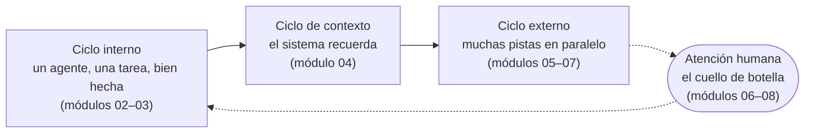

# Agentic Engineering 101

**De un agente a muchos.** Una guía práctica para construir software con
agentes de programación en paralelo sin renunciar a la calidad.

[Read in English](README.md) ·
[Empieza aquí](content/es/00-start-here/README.md) ·
[Contenido](content/es/README.md) ·
[Workshops](workshops/es/README.md) ·
[Contribuye](CONTRIBUTING.es.md)

---

Los agentes de programación han cambiado en muy poco tiempo la forma de
construir software. Algunos ingenieros ya tienen varias sesiones de agentes a la
vez: unas escriben código, otras revisan los pull requests de las demás y otra
mantiene al día la base de conocimiento (knowledge base) del producto. Su trabajo
pasa a ser decidir qué construir, cómo dividirlo, qué significa "terminado" y qué
se mergea. Muchos otros todavía no han tenido la oportunidad de trabajar así con
agentes en su día a día, y en todo el sector la brecha no deja de crecer.

Si es tu caso, la buena noticia es que no es una cuestión de talento ni de años
de práctica. Se reduce a un puñado de prácticas que cualquiera puede aprender en
unas pocas semanas, incluso en su tiempo libre. Esta guía las enseña.

En [The Agile Monkeys](https://www.theagilemonkeys.com) llevamos años apostando
por la IA, y escribimos esta guía para seguir aprendiendo unos de otros, dar la
bienvenida a quienes se incorporan al equipo e impartir workshops. La publicamos
porque esta práctica se está descubriendo ahora mismo y preferimos construirla
en abierto con todo el que esté en el mismo camino.

> [!NOTE]
> **Estado: borrador inicial, septiembre de 2026.** La práctica evoluciona
> rápido y esta guía también lo hará. Si algo está mal, se ha quedado
> desactualizado o falta, [cuéntanoslo](CONTRIBUTING.es.md).

## Para quién es

- **Ingenieros que empiezan con agentes** y quieren un método sólido desde el
  primer día.
- **Quien ya usa un agente a diario** y quiere tener muchas sesiones en paralelo
  sin dejar de fiarse del resultado.
- **Tech leads y facilitadores** que quieren que su equipo, o una sala de
  workshop, dé ese salto a la vez.

Necesitas manejarte con git, una terminal y algún lenguaje de programación.
Todos los laboratorios se pueden hacer con el pequeño
[proyecto de prácticas](practice/shelf/) de este repositorio o con tu propio
código.

## El mapa

La guía se organiza en torno a tres ciclos y un cuello de botella:



| # | Módulo | Qué te llevas |
|---|---|---|
| 00 | [Empieza aquí](content/es/00-start-here/README.md) | El juego completo en 45 minutos: planificar, construir, paralelizar y revisar un cambio real |
| 01 | [Del chatbot al sistema](content/es/01-from-chatbot-to-system/README.md) | Qué es el agentic engineering, qué dice la evidencia y tu punto de partida personal |
| 02 | [Un agente, bien usado](content/es/02-one-agent-done-well/README.md) | Conversar → planificar → construir → verificar con un solo agente |
| 03 | [Cierra el ciclo](content/es/03-close-the-loop/README.md) | Agentes que comprueban su propio trabajo; barreras de seguridad deterministas |
| 04 | [El contexto es infraestructura](content/es/04-context-is-infrastructure/README.md) | Una base de conocimiento que da contexto completo a cada sesión nueva |
| 05 | [Divide el trabajo en pistas](content/es/05-decompose-into-tracks/README.md) | Issues como prompts, radio de impacto, prompts de arranque y traspasos |
| 06 | [Sesiones en paralelo](content/es/06-run-sessions-in-parallel/README.md) | Worktrees, gestión de sesiones y cómo pasar de 2 a más de 20 |
| 07 | [Agentes que revisan a agentes](content/es/07-agents-review-agents/README.md) | Revisión con contexto limpio y entre proveedores, triaje y cierre de bucles |
| 08 | [Economía de tokens](content/es/08-token-economics/README.md) | Coste por PR mergeado, elección de modelo y medir lo que importa |
| 09 | [Equipos y organizaciones](content/es/09-teams-and-organizations/README.md) | Práctica compartida, seguridad, puntos de control y preguntas abiertas |
| 10 | [Tu plan de 30 días](content/es/10-your-30-day-plan/README.md) | Cuatro semanas con tu propio código, medidas frente a tu punto de partida |

Además: [referencia](content/es/reference/) (glosario, herramientas, patrones de
prompts, fuentes) y un [apéndice](content/es/appendix/where-we-are-heading.md)
sobre hacia dónde llevamos esta práctica.

## Tres formas de usarla

1. **A tu ritmo.** Empieza por el [módulo 00](content/es/00-start-here/README.md)
   y haz cada laboratorio. La mayoría de los módulos llevan entre una hora y dos
   horas y media, con su laboratorio.
2. **En un workshop.** En [`workshops/`](workshops/es/README.md) hay agendas
   para una sesión introductoria de 90 minutos, un intensivo de 2 días y un
   seguimiento de 4 semanas, además de una guía para facilitadores.
3. **Como referencia.** Consulta un
   [patrón de prompt](content/es/reference/prompt-patterns.md), un
   [término](content/es/reference/glossary.md) o una
   [herramienta](content/es/reference/tools.md).

## Cómo está organizada y por qué

Nos inspiramos en proyectos educativos que admiramos:

- **Primero el juego completo** ([fast.ai](https://course.fast.ai/)): en el
  laboratorio 0 sacas adelante un cambio real con varios agentes antes de
  cualquier teoría.
- **Distintos tipos de contenido para distintas necesidades**
  ([Diátaxis](https://diataxis.fr/)): las lecciones explican, los laboratorios
  guían la práctica y la referencia resuelve consultas.
- **Módulos numerados con una estructura fija y preguntas de comprobación**
  ([Generative AI for Beginners](https://github.com/microsoft/generative-ai-for-beginners)).
- **Secciones de "ojo con" y ejercicios en cada módulo**
  ([The Missing Semester](https://missing.csail.mit.edu/)).
- **Tiempos, ideas clave y una guía para facilitadores**
  ([The Carpentries](https://carpentries.github.io/sandpaper-docs/)).
- **Primero los principios, después las prácticas y al final los equipos**
  ([el libro de SRE de Google](https://sre.google/sre-book/table-of-contents/)).

Cada lección se apoya en voces públicas citadas con nombre, entre ellas
[Peter Steinberger en The Pragmatic Engineer](https://newsletter.pragmaticengineer.com/p/the-creator-of-clawd-i-ship-code),
[DHH en el podcast de Lex Fridman](https://lexfridman.com/dhh-2/),
[los Agentic Engineering Patterns de Simon Willison](https://simonwillison.net/guides/agentic-engineering-patterns/)
y [las buenas prácticas de Claude Code de Anthropic](https://code.claude.com/docs/en/best-practices).
Y añade lo que hemos aprendido aplicando esta práctica cada día. Cuando los
expertos no se ponen de acuerdo, mostramos ambas posturas y decimos cuál
elegimos y por qué. En [`sources`](content/es/reference/sources.md) están todas
las fuentes que citamos.

## Dos idiomas, una guía

Todo está escrito en inglés y en español. El inglés es la fuente de verdad. Las
rutas son idénticas en [`content/en/`](content/en/) y
[`content/es/`](content/es/), y cada cambio actualiza los dos idiomas
([cómo funciona la traducción](docs/authoring.es.md#traducción)).

## Contribuir

Queremos tu experiencia: qué te ha funcionado, qué ha fallado, qué haces de otra
manera. Aceptamos contribuciones de personas y de agentes que trabajan para
personas. Lee [CONTRIBUTING.es.md](CONTRIBUTING.es.md) y nuestra
[política de IA](AI_POLICY.es.md). Si eres un agente, empieza por
[AGENTS.md](AGENTS.md).

Antes de abrir un pull request, ejecuta:

```bash
python3 scripts/check_content.py
```

## Licencia

- Contenido de la guía (texto, diagramas): [CC BY 4.0](LICENSE). Puedes
  adaptarla, traducirla e impartir tus propios workshops con ella, también de
  pago. Solo tienes que citar *Agentic Engineering 101 de The Agile Monkeys y
  sus colaboradores*.
- Código (el proyecto de prácticas, scripts, fragmentos): [MIT](LICENSE-CODE).

Quien participa acepta nuestro [Código de Conducta](CODE_OF_CONDUCT.es.md).
