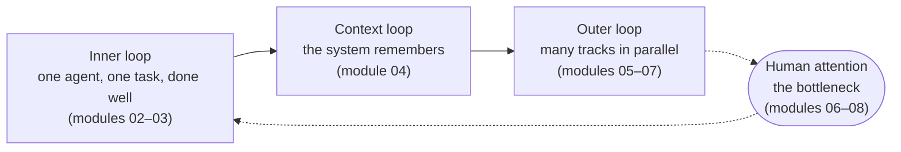

# Agentic Engineering 101

**From one agent to many.** A practical guide to building software with AI
coding agents in parallel, without giving up quality.

[Leer en español](README.es.md) ·
[Start here](content/en/00-start-here/README.md) ·
[Contents](content/en/README.md) ·
[Workshops](workshops/en/README.md) ·
[Contribute](CONTRIBUTING.md)

---

Most engineers who adopt a coding agent get stuck in the same place: one
window, one prompt, one task, then waiting. A few go further. They run several
agent sessions at once, some writing code, some reviewing each other's pull
requests, one keeping the product's knowledge base current. Their job becomes
deciding: what to build, how to split it, what "done" means and what gets merged.

In our experience the gap between those two groups keeps growing, and it isn't
about talent. It comes down to a handful of practices that can be learned. This
guide teaches them.

At [The Agile Monkeys](https://www.theagilemonkeys.com) we wrote it to train our
own engineers and to run workshops. We are publishing it because the practice is
still being discovered, and we would rather work it out in the open with
everyone who is doing the same.

> [!NOTE]
> **Status: early draft, September 2026.** The practice moves fast and so will
> this guide. If something is wrong, out of date or missing,
> [tell us](CONTRIBUTING.md).

## Who it's for

- **Engineers new to coding agents** who want a solid method from day one.
- **Daily users of a single agent** who want to run many sessions in parallel
  and still trust the result.
- **Tech leads and facilitators** who want their teams, or a workshop room, to
  make that jump together.

You need to be comfortable with git, a terminal and one programming language.
Every lab can be done with the small [practice project](practice/shelf/) in this
repository or with your own code.

## The map

The guide is built around three loops and one bottleneck:



| # | Module | What you get out of it |
|---|---|---|
| 00 | [Start here](content/en/00-start-here/README.md) | The whole game in 45 minutes: plan, build, parallelize and review a real change |
| 01 | [From chatbot to system](content/en/01-from-chatbot-to-system/README.md) | What agentic engineering is, what the evidence says, and your personal baseline |
| 02 | [One agent, done well](content/en/02-one-agent-done-well/README.md) | Discuss → plan → build → verify with a single agent |
| 03 | [Close the loop](content/en/03-close-the-loop/README.md) | Agents that check their own work; deterministic guardrails |
| 04 | [Context is infrastructure](content/en/04-context-is-infrastructure/README.md) | A knowledge base that gives every new session full context |
| 05 | [Decompose into tracks](content/en/05-decompose-into-tracks/README.md) | Issues as prompts, blast radius, kickoff prompts and handoffs |
| 06 | [Run sessions in parallel](content/en/06-run-sessions-in-parallel/README.md) | Worktrees, session management and scaling from 2 to 20+ |
| 07 | [Agents review agents](content/en/07-agents-review-agents/README.md) | Fresh-context and cross-vendor review, triage, closing loops |
| 08 | [Token economics](content/en/08-token-economics/README.md) | Cost per merged PR, model choice and measuring what matters |
| 09 | [Teams and organizations](content/en/09-teams-and-organizations/README.md) | Shared practice, security, gates and open questions |
| 10 | [Your 30-day plan](content/en/10-your-30-day-plan/README.md) | Four weeks on your own code, measured against your baseline |

Also: [reference](content/en/reference/) (glossary, tools, prompt patterns,
sources) and an [appendix](content/en/appendix/where-we-are-heading.md) on where
we are taking this practice next.

## Three ways to use it

1. **Self-paced.** Start with [module 00](content/en/00-start-here/README.md)
   and do each lab. Most modules take one to two and a half hours, including the
   lab.
2. **In a workshop.** [`workshops/`](workshops/en/README.md) has agendas for a
   90-minute taster, a 2-day intensive and a 4-week follow-up, plus a
   facilitator guide.
3. **As a reference.** Look up a [prompt pattern](content/en/reference/prompt-patterns.md),
   a [term](content/en/reference/glossary.md) or a [tool](content/en/reference/tools.md).

## How this guide is organized, and why

We borrowed from educational projects we admire:

- **Whole game first** ([fast.ai](https://course.fast.ai/)): lab 0 ships a real
  change with several agents before any theory.
- **Different kinds of content for different needs**
  ([Diátaxis](https://diataxis.fr/)): lessons explain, labs guide practice,
  reference answers lookups.
- **Numbered modules with a fixed skeleton and knowledge checks**
  ([Generative AI for Beginners](https://github.com/microsoft/generative-ai-for-beginners)).
- **"Watch out" sections and exercises in every module**
  ([The Missing Semester](https://missing.csail.mit.edu/)).
- **Timings, key points and a facilitator guide**
  ([The Carpentries](https://carpentries.github.io/sandpaper-docs/)).
- **Principles before practices, then teams**
  ([Google's SRE book](https://sre.google/sre-book/table-of-contents/)).

Each lesson stands on public voices, cited by name: among others,
[Peter Steinberger on The Pragmatic Engineer](https://newsletter.pragmaticengineer.com/p/the-creator-of-clawd-i-ship-code),
[DHH on the Lex Fridman Podcast](https://lexfridman.com/dhh-2/),
[Simon Willison's Agentic Engineering Patterns](https://simonwillison.net/guides/agentic-engineering-patterns/)
and [Anthropic's Claude Code best practices](https://code.claude.com/docs/en/best-practices).
It adds what we have learned running this practice every day. When
practitioners disagree, we show both sides and say which one we pick and why.
[`sources`](content/en/reference/sources.md) lists everything we cite.

## Two languages, one guide

Everything is written in English and Spanish. English is the source of truth.
Paths are identical under [`content/en/`](content/en/) and
[`content/es/`](content/es/), and every change updates both
([how translation works](docs/authoring.md#translation)).

## Contributing

We want your experience: what worked, what failed, what you do differently.
Contributions from humans and from agents working for humans are welcome. Read
[CONTRIBUTING.md](CONTRIBUTING.md) and our [AI policy](AI_POLICY.md). If you are
an agent, start with [AGENTS.md](AGENTS.md).

Before opening a pull request, run:

```bash
python3 scripts/check_content.py
```

## License

- Guide content (text, diagrams): [CC BY 4.0](LICENSE). Adapt it, translate it
  and run your own workshops with it, commercial ones included. Just credit
  *Agentic Engineering 101 by The Agile Monkeys and contributors*.
- Code (the practice project, scripts, snippets): [MIT](LICENSE-CODE).

Everyone who takes part agrees to our [Code of Conduct](CODE_OF_CONDUCT.md).
