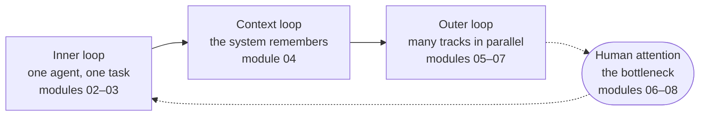

# 0. Start here

> **In one sentence:** Running many agents well is a system you build (context, decomposition, verification, review and decisions), and this guide teaches that system one loop at a time, starting with a lab where you play the whole game once.

## What you'll be able to do

- Explain the three loops and the one bottleneck that organize this guide, and why they come in that order.
- Pick the learning path that matches how you use coding agents today.
- Check that your machine and accounts meet the prerequisites, with one command each.
- Read the guide's conventions: lessons, labs, callouts, prompt pairs and notes about our own practice.
- Run a real change end to end with three agent sessions (lab 0), and name the module that explains each step.

## Why this matters

Picture a Tuesday morning. You open your coding agent, type "add CSV export to the reports page", and wait. Four minutes later you read a diff. A test fails. You paste the error back. You wait again. By lunch you have one pull request and a vague feeling that the agent is "sometimes great, sometimes useless".

On the same morning, another engineer on your team has five sessions open. Two are implementing issues, each in its own git worktree. One is reviewing yesterday's pull request with no memory of how it was written. One is updating the project's knowledge base from a meeting transcript. The fifth is waiting for a yes or no on a plan.

That engineer isn't typing faster and doesn't have a secret model. They spend the morning making decisions, while the agents write and check code.

The difference between those two mornings is not talent. It is a handful of practices that can be learned, and they build on each other in a specific order. That order is the shape of this guide.

## Why this guide exists

Coding agents became capable enough for professional work very recently. Adoption is wide but shallow. Most engineers who use an agent every day still use it like a chatbot: one window, one prompt, one task, then wait. A small group runs many sessions in parallel on real work and keeps the quality bar.

In our experience, the distance between the two groups keeps growing. The second group's setup improves with every correction: a mistake becomes a rule, a rule becomes a check, a repeated task becomes a skill. The first group starts from zero in every session.

> [!NOTE]
> **At The Agile Monkeys** we saw exactly this inside our own company. A handful of our engineers work with many agents at once; most still use the agent as a chatbot. We wrote this guide to close that gap in our own teams first. We publish it because the same gap exists almost everywhere.

Three things we want to say upfront:

- **It teaches practice, not products.** Concepts are tool-agnostic. Examples use [Claude Code](https://code.claude.com/docs/en/overview) and [Codex](https://learn.chatgpt.com/guides/best-practices) because we use both every day, but every principle should make sense with any capable coding agent. Lessons show concrete commands where they teach a principle, each checked against the vendor's documentation and linked. Tool detail that changes often lives in the [tools reference](../reference/tools.md), which carries its own review date.
- **It is honest about evidence.** Where research disagrees with the enthusiasm, we say so. [Module 01](../01-from-chatbot-to-system/README.md) looks at the studies. When we share numbers from our own work, we label them as indicative, not benchmarks.
- **It is a living document.** The practice is still being discovered. Object-oriented languages were in use for well over a decade before the classic catalog of [design patterns](https://en.wikipedia.org/wiki/Design_Patterns) was published in 1994; with coding agents we are only a few years in. Some of what we write here will turn out to be wrong. If your experience says otherwise, we want to hear it: read [how to contribute](../../../CONTRIBUTING.md).

## The map: three loops and one bottleneck



1. **Inner loop: one agent, one task, done well** (modules 02–03). You talk the task through, agree on a plan, let the agent build, and make sure it can check its own work.
2. **Context loop: the system remembers** (module 04). Every session starts with amnesia. Instruction files and a knowledge base turn "a new session" into "a new session with full context", so a short message is enough and nobody re-explains the project.
3. **Outer loop: many tracks in parallel** (modules 05–07). You split work into independent tracks, isolate each one, run them at the same time, have agents review agents, and merge in a planned order.
4. **The bottleneck: human attention** (modules 06–08). Starting an agent is cheap. Your reviews, your decisions and your context switches are not. Everything in the outer loop exists to spend your attention only on decisions. Tokens are the other scarce resource, and module 08 treats them with the same care.

After the loops, [module 09](../09-teams-and-organizations/README.md) takes the practice from one person to a team, and [module 10](../10-your-30-day-plan/README.md) turns it into a four-week plan on your own code.

The loops are adapted from [Gene Kim and Steve Yegge's three developer loops](https://itrevolution.com/articles/the-three-developer-loops-a-new-framework-for-ai-assisted-coding/). We call the middle one the "context loop" because that is where we see teams lose the most time.

### Why this order

Each loop leans on the one before it:

- **Verification before parallelism.** If you have to personally check every result, five agents give you five times the checking. Ten agents that can't verify their own output don't make you faster; they bury you.
- **Context before parallelism.** Five parallel sessions that each rediscover the project from scratch waste tokens and produce five slightly different understandings of it.
- **A review plan before scale.** Parallel work without a way to review it just moves the queue from "waiting for the agent" to "waiting for you".

| Module | Loop | In one line |
|---|---|---|
| [00 Start here](README.md) | — | The whole game, once |
| [01 From chatbot to system](../01-from-chatbot-to-system/README.md) | — | What changes, and what the evidence says |
| [02 One agent, done well](../02-one-agent-done-well/README.md) | Inner | Discuss, plan, build, verify |
| [03 Close the loop](../03-close-the-loop/README.md) | Inner | Agents that check their own work |
| [04 Context is infrastructure](../04-context-is-infrastructure/README.md) | Context | A knowledge base every session can load |
| [05 Decompose into tracks](../05-decompose-into-tracks/README.md) | Outer | Issues as prompts, sized by blast radius |
| [06 Run sessions in parallel](../06-run-sessions-in-parallel/README.md) | Outer, bottleneck | Worktrees, session management, scaling |
| [07 Agents review agents](../07-agents-review-agents/README.md) | Outer, bottleneck | Fresh-context and cross-vendor review |
| [08 Token economics](../08-token-economics/README.md) | Bottleneck | Cost per merged PR, model choice |
| [09 Teams and organizations](../09-teams-and-organizations/README.md) | Team | Shared practice, security, gates |
| [10 Your 30-day plan](../10-your-30-day-plan/README.md) | All | Four weeks on your own code |

## Four kinds of material

We follow the idea behind [Diátaxis](https://diataxis.fr/): different needs call for different kinds of content, and mixing them makes each one worse.

- **Lessons** (the `README.md` in each module) explain one idea. They all share one skeleton: what you'll be able to do, why it matters, concepts, other ways to see it, watch out, check your understanding, key points, go further. If you can answer a lesson's "Check your understanding" questions, skim it and go straight to the lab.
- **Labs** (`lab.md`) are hands-on. Numbered steps, a checkpoint for each step, the literal prompts to type, and a "Done when" checklist you can verify, usually with a command. Every lab runs on the practice project or on your own repository.
- **Reference** (`reference/`) is for lookups: a [glossary](../reference/glossary.md) with English and Spanish terms, [tools](../reference/tools.md), [prompt patterns](../reference/prompt-patterns.md) and every [source](../reference/sources.md) we cite.
- **Workshops** ([`workshops/`](../../../workshops/en/README.md)) contain agendas and a facilitator guide: a 90-minute taster, a two-day intensive (day 1, "The system, not the prompt", covers modules 00–05; day 2, "Orchestration", covers 06–08 plus a parallel sprint) and a four-week follow-up where participants apply modules 09–10 to their own code and measure before and after.

The labs share one **practice project**, [`shelf`](../../../practice/shelf/): a tiny command-line reading-list manager in Python, standard library only, with `unittest` tests that run in seconds. Its [issue list](../../../practice/issues/en.md) is designed for this guide: six independent issues (S1–S6) you can run in parallel, two issues that deliberately conflict (C1 and C2 both change the storage model), and one deliberately vague request (S7) for practicing discussion before building.

[Lab 0](lab.md) follows the "whole game" approach from [fast.ai](https://course.fast.ai/): you play a simplified version of the full game first, and study the parts afterwards.

## Choose your path

| If you… | Path | Don't skip |
|---|---|---|
| are new to coding agents | Modules 00 to 10 in order, every lab | Labs 2 and 3. Don't run sessions in parallel until your agent can verify its own work. |
| use one agent every day | Lab 0 at speed, lab 1 (your baseline), then modules 03, 04 and 05–08 | Module 04. Daily users skip it most often and need it most. |
| lead a team or run workshops | Modules 00, 01, 04, 07, 08, 09, then the workshops folder | Lab 1 for yourself, before you ask anyone else to measure. |

Most modules take one to two and a half hours, including the lab. Lab 1 asks you to log a normal week of work, so start it early and keep going with module 02 while the week runs.

## Prerequisites

| You need | Why | Check it |
|---|---|---|
| git, a recent version | Modules 05–07 isolate tracks with worktrees | `git --version`, then `git worktree list` inside any repository |
| A GitHub account and the [GitHub CLI](https://cli.github.com/), signed in | Labs create issues and pull requests | `gh auth status` |
| One coding agent on a paid plan | Free tiers run out in the middle of parallel labs | `claude --version` or `codex --version` (or your agent's equivalent) |
| Python 3.10 or newer | The practice project | `python --version` (or `python3 --version`) |
| A terminal you are comfortable in | Agents, git and tests all run there | — |

You don't need to know Python well; you need to be comfortable with branches, pull requests and reading code. A second agent from a different vendor is optional but useful from module 07, where one vendor's model reviews another's work. Module 08 covers what heavy use costs.

> [!NOTE]
> **At The Agile Monkeys** we use Claude Code and Codex side by side, and we pick by role rather than loyalty. In our experience Claude is more conversational and helps us think a problem through, while Codex tends to take a well-defined task and run with it, so we use it a lot for code review. Model behavior changes from release to release; treat this as a snapshot, not a ranking.

One safety rule before you start:

> [!WARNING]
> Some agents offer a mode that runs every command without asking. None of the labs need it. Leave it off until [module 03](../03-close-the-loop/README.md) explains when it is safe: inside an isolated environment with no credentials worth stealing.

## Conventions

**Callouts.** Four kinds appear in every module. Notes about our own practice:

> [!NOTE]
> **At The Agile Monkeys** notes describe how our teams work today. They are one company's practice, not the only valid way, and they change as we learn.

Practical shortcuts:

> [!TIP]
> Tips save you time.

Risks:

> [!WARNING]
> Warnings flag lost work, security exposure or runaway cost.

Rules:

> [!IMPORTANT]
> Important callouts are rules we don't bend, and we explain why.

**Prompt pairs.** When the difference between a weak and a strong prompt is the lesson, we show both:

❌ **Weak prompt**

```text
explain this code
```

✅ **Better prompt**

```text
Read README.md, the tests and the shelf/ package before answering.
Then explain, in under 200 words: what this tool does, how a command
travels from the command line to the JSON file, and how to run the tests.
Don't change any files.
```

The second prompt points the agent at sources, bounds the answer, defines what "explained" means and rules out side effects. It is not longer for the sake of it; every sentence removes a way to fail.

**Other conventions:**

- Prompts to type appear in `text` blocks. Type them, paste them or speak them, and adapt names to your repository. You can talk to your agent in any language ([module 02](../02-one-agent-done-well/README.md) explains how we handle that).
- Labs always offer a variant starting with **"On your own repo:"**.
- Numbers from our own practice are marked as *indicative, not benchmarks*.
- Quotes from public people are verbatim, short and linked to the source.
- We don't name specific model versions. We say "the strongest model you have access to", because model names age in weeks.

## Other ways to see it

**Whole game first, or foundations first?** We start with lab 0 because seeing the full cycle once makes every later module easier to place. Some people learn better by mastering one agent before they see three sessions at once. That works too: do steps 1–3 of lab 0, skip the parallel and review steps, and come back to them after module 03.

**How far should you go?** Not everyone wants twenty sessions. [Mitchell Hashimoto](https://mitchellh.com/writing/my-ai-adoption-journey) describes getting real value from a single background agent with notifications off, and writes: "I'm not [yet?] running multiple agents, and currently don't really want to." [Simon Willison](https://simonwillison.net/2025/Oct/5/parallel-coding-agents/) notes that he can only review and land one significant change at a time. These are serious engineers, and parallelism is not a virtue in itself.

What we do: we run many sessions, but only once verification and context are in place, and we treat your attention as the real constraint. If you finish module 06 and find that three sessions is your sweet spot, that is a valid result. Measure it against your [lab 1 baseline](../01-from-chatbot-to-system/lab.md) and decide with data.

**Do you need to keep up with every tool release?** No. [DHH](https://lexfridman.com/dhh-2/) puts it this way: "If you missed the past year, you can catch up to the frontier in two weeks." The practices in this guide change more slowly than the tools.

## Watch out

- ❌ **Jumping straight to parallel sessions.** ✅ Do labs 2 and 3 first. Parallelism multiplies whatever your inner loop produces, including its mistakes.
- ❌ **Reading without doing the labs.** ✅ This is a skill, not a body of facts. [Peter Steinberger](https://lexfridman.com/peter-steinberger-transcript/) calls it a skill you have to learn like any other, like playing an instrument: if you play a piano once, it sounds bad and you decide the piano is bad, the problem isn't the piano.
- ❌ **Treating the guide as a tool manual.** ✅ Learn the principle; look up the current flag in the [tools reference](../reference/tools.md) or the vendor's docs.
- ❌ **Building your own orchestration system before shipping anything.** ✅ Start with a plain setup. Steinberger calls the urge to over-build "the agentic trap", and DHH expects vendors to absorb most of it: "We're not all gonna have to build our own coordination harnesses."
- ❌ **Doing the labs against production code with real credentials.** ✅ Use the practice project, or a throwaway copy of your own repository.
- ❌ **Comparing yourself with the most extreme public claims.** ✅ Some people describe running hundreds of agents, often with effectively unlimited tokens and years of custom tooling. Compare yourself with your own baseline.

## Check your understanding

1. Why does the guide teach verification (module 03) before parallel sessions (module 06)?

   <details><summary>Answer</summary>

   Parallel sessions multiply the output of your inner loop. If the agent can't check its own work, every extra session adds a result you have to verify personally, so the bottleneck (your attention) fills faster than the throughput grows.

   </details>

2. What is the bottleneck in the outer loop, and what does it imply about what you should spend your time on?

   <details><summary>Answer</summary>

   Human attention: reviews, decisions and context switches. The outer loop is designed so your attention goes to decisions (what to build, how to split it, what to merge) and not to re-running tests or re-explaining the project.

   </details>

3. You use an agent every day, always one session at a time, and you often paste the same project background into new sessions. Which path fits you, and which module should you not skip?

   <details><summary>Answer</summary>

   The daily-user path: lab 0 at speed, lab 1, then modules 03, 04 and 05–08. Don't skip module 04. Pasting the same background is the symptom of a missing context loop.

   </details>

4. You see "five stories per person per day" in a note from our practice. How should you read it?

   <details><summary>Answer</summary>

   As indicative: a reference point from one company's context, with different story sizes and quality bars, no control group and no standard definition. It is not a benchmark to compare yourself against. Your own before-and-after numbers are what count.

   </details>

5. Where do you look up a tool's current flags and commands, and why does the guide keep that detail there?

   <details><summary>Answer</summary>

   In `reference/tools.md`, which carries a `last_reviewed` date, and in the vendor docs it links to. Lessons still show concrete commands where they teach a principle, each linked to the official docs, but tools change monthly. Keeping the detail that changes often in one dated place stops lessons from going stale and keeps the concepts tool-agnostic.

   </details>

## Key points

- The guide is organized as three loops (inner, context, outer) and one bottleneck: human attention.
- The order matters: verification and context come before parallelism, or parallelism multiplies mistakes.
- Lessons explain, labs make you practice, reference answers lookups, workshops package it all for a room.
- Choose a path by how you use agents today; skip a lesson only if you can answer its questions.
- Prerequisites: git, the GitHub CLI, one coding agent on a paid plan, Python 3.10+, a terminal.
- Our numbers are indicative, not benchmarks; the practice is young, and your contributions make the guide better.

## Go further

- [Lab 0 — The whole game](lab.md): do it before moving on.
- [fast.ai Practical Deep Learning](https://course.fast.ai/): a course built on "whole game" teaching, where you build something real before you study the parts.
- [Diátaxis](https://diataxis.fr/): why tutorials, explanation and reference should be kept apart.
- [The three developer loops](https://itrevolution.com/articles/the-three-developer-loops-a-new-framework-for-ai-assisted-coding/) by Gene Kim and Steve Yegge: the framework our spine adapts.
- [My AI Adoption Journey](https://mitchellh.com/writing/my-ai-adoption-journey) by Mitchell Hashimoto: a careful, step-by-step adoption path from a skeptic.
- [Claude Code best practices](https://code.claude.com/docs/en/best-practices) and [Codex best practices](https://learn.chatgpt.com/guides/best-practices): the vendors' own guidance, worth reading in full.
- [How to contribute](../../../CONTRIBUTING.md): share what works for you, what failed and what you do differently.

Next: [1. From chatbot to system](../01-from-chatbot-to-system/README.md)
