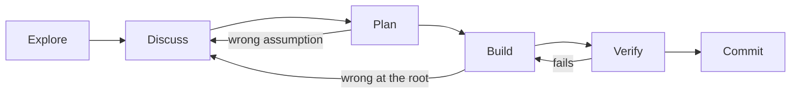

# 2. One agent, done well

> **In one sentence:** Before you run many agents, learn to run one well: talk to it like a coworker who shares your context, keep discussing separate from building, review intent before lines, and throw work away when it is wrong at the root.

## What you'll be able to do

- Run an explore → discuss → plan → build → verify → commit cycle, and control when the agent switches from talking to building.
- Decide when to under-prompt on purpose to get ideas, and when to be precise.
- Review a plan or a generated architecture document instead of a diff, and correct it in one sentence.
- Recognize when to restart with a clearer direction instead of patching.
- Use follow-up prompts that surface side effects and better designs.
- Get answers in the form you read fastest: diagrams, tables, a small HTML page, or your own "explain it my way" skill.

## Why this matters

You ask the agent to "add a stats command to shelf". It writes 150 lines, including a `--json` flag you didn't ask for. You open the diff and start reading.

Twenty lines in, you find the real problem. "Books finished this year" counts every book whose status is `done` and whose date falls in the current year. But what about a book you added yesterday as already read, finished years ago? And "this year" in which time zone? The timestamps are stored in UTC, and you live in Madrid or in Bogotá. You correct it. The agent patches it. A test in another file breaks. You correct again. Forty minutes later, the session is a pile of partial fixes, and you're no longer sure which ones are still needed.

None of that was a model failure. The two questions that mattered could have been asked in a two-minute conversation *before* any code existed. Instead you found them inside a diff, which is the most expensive place to find anything.

The inner loop is about moving corrections earlier: from the diff to the plan, and from the plan to the conversation.

## Talk to it like a coworker, not a search box

A search box gets one long, self-contained query, because the other side knows nothing about you. A coworker gets short messages, because you share context: the codebase, the decisions you made last week, what you're trying to do.

A coding agent can be either, and you decide which. In a session opened in your repository, with instruction files and a few turns of conversation, short messages work: "what about books added as done?", "no, keep the output plain text". If you keep writing long "perfect prompts" that re-explain the project, treat that as a smell: you're typing the context the session lacks. Fix the context ([module 04](../04-context-is-infrastructure/README.md)), not the prompt.

Tell the agent the problem you have, not the steps to take. [DHH](https://lexfridman.com/dhh-2/) describes where he has arrived:

> "I'm not telling it where we're going. I'm telling it the problem I have." — DHH on [Lex Fridman Podcast #501](https://lexfridman.com/dhh-2/)

Short is not vague about what matters. When you hand a task to a session with no history, structure helps: the [Codex best practices](https://learn.chatgpt.com/guides/best-practices) suggest goal, context, constraints and "done when". Those handoff prompts are the subject of [module 05](../05-decompose-into-tracks/README.md); inside a live conversation you rarely need them.

> [!NOTE]
> **At The Agile Monkeys**, the engineers who run many agents say they don't "write prompts" anymore. Planning happens as a conversation inside a session opened in a repository that already holds the project's context and past decisions: "I want to do X, how would you do it?", "do it like this", "no, I prefer this other way". When the plan is ready: "put this plan into GitHub issues; if it's big, split it into an epic". After a few weeks the repository has learned the conventions, and "create an issue" is enough.

## The cycle: explore, discuss, plan, build, verify, commit



**Explore.** The agent reads before it writes. Ask questions whose answers are in the code, and when the agent asks *you* things the code could answer, send it back. [Peter Steinberger](https://lexfridman.com/peter-steinberger-transcript/) uses one sentence for that: "Read more code to answer your own questions."

```text
Read the model, the store and the list command. How is a book's status
changed, and what gets recorded when that happens? Don't change anything.
```

**Discuss.** Ask for options and trade-offs, then choose. Agents are eager to build, so be explicit about when they shouldn't. Steinberger describes trigger phrases that work for him:

> "as soon as I say, let's discuss or give me options, they will not build things until I say build." — Peter Steinberger on [The Pragmatic Engineer](https://newsletter.pragmaticengineer.com/p/the-creator-of-clawd-i-ship-code)

Options suit how people judge. DHH calls it "Differential evaluation. You give me three options, I pick one of them." Picking among three concrete designs beats describing the right one from scratch.

**Plan.** Before it executes, ask the agent to explain what it will do. A plan you can review in a minute has: the files it will change, any change to data or storage, behavior at the edges, the tests that will prove it (and that would fail without the change), and what it will *not* do.

**Build.** Say "build" explicitly. From here on, the agent works and you don't watch.

**Verify.** Tests written in the same context, run by the agent, with the output shown to you. The [Claude Code best practices](https://code.claude.com/docs/en/best-practices) put it as: "Have Claude show evidence rather than asserting success". [Module 03](../03-close-the-loop/README.md) is entirely about this step.

**Commit.** Small, with a message that records the decisions, not just the change. [Kent Beck](https://newsletter.kentbeck.com/p/augmented-coding-beyond-the-vibes) keeps structural and behavioral changes in separate commits, and that habit makes agent work much easier to review.

**When to skip steps.** Not every change needs a plan. Anthropic's rule of thumb: "If you could describe the diff in one sentence, skip the plan." Renaming a flag, fixing a typo in an error message or adding a log line can go straight to build and verify.

> [!NOTE]
> **At The Agile Monkeys** we run this cycle on our laptops with [claude-dev-kit](https://github.com/theam/claude-dev-kit), an open-source plugin we maintain. It runs in Claude Code and in Codex. In Claude Code, `/work-story <issue>` reads the issue, proposes a plan and writes no code until someone approves it. Then it builds, checks the project's own tests and coverage bar, runs a security review and a self-review, and opens the pull request with the verification evidence. It doesn't replace the judgment in this module: you still discuss, correct the plan in a sentence and throw work away when it's wrong at the root. What it changes is that the steps happen by default instead of depending on a habit you have to remember. You don't need it, or any plugin, to follow this guide or to become an agentic engineer: [Build your own skills](../appendix/build-your-own-skills.md) shows how to write this same cycle as your own skill.

## Under-prompt to discover, be precise to deliver

There are two opposite pieces of advice about how much to say, and both are right, at different moments.

**Say less when you don't know what you want yet.** Steinberger does it deliberately:

> "often I purposefully under-prompt the agent so it would do something that would give me new ideas." — Peter Steinberger on [The Pragmatic Engineer](https://newsletter.pragmaticengineer.com/p/the-creator-of-clawd-i-ship-code)

Most of what comes back isn't useful, he admits, but a couple of ideas usually are. DHH makes the same point from the agile tradition: nobody knows what software should do until they use it.

> "Be as vague as you can to manifest something, then interact with the something." — DHH on [Lex Fridman Podcast #501](https://lexfridman.com/dhh-2/)

Experts can hurt results by over-prescribing. DHH relays, secondhand and unverified, that a coding-agent vendor cut its system prompt sharply because the agent "was actually being damaged by overly prescriptive humans". The pattern is familiar: dictate each step, and the agent follows your steps even where its own reading of the code would have found a better path.

**Say more when the knowledge isn't in the code.** Be precise about decisions already made, invariants, data rules, security constraints, interfaces other people depend on, and what is out of scope. The agent can't read those in the repository, so it will guess.

| Situation | How much to say | Example |
|---|---|---|
| Discovery: you don't know what you want | Little. Ask for options. | "Shelf should be more useful for book clubs. Give me three directions, very different from each other." |
| Delivery: you know what, not how | Precise on outcome and constraints, silent on steps | "Stats print one line per status plus 'finished this year', calendar year in UTC like the stored timestamps. Plain text, no flags." |
| Repair: it went wrong at the root | Explicit direction, fresh session | "Start over. Keep storage unchanged; compute stats from existing fields only." |

## Review intent, not lines

A plan takes a minute to read. A 400-line diff takes twenty, and you can still miss the wrong assumption buried in it. The team behind [HumanLayer's context-engineering guide](https://github.com/humanlayer/advanced-context-engineering-for-coding-agents/blob/main/ace-fca.md) puts the economics plainly: "a bad line of a plan could lead to hundreds of bad lines of code." So for any non-trivial change, the first artifact you review should not be a diff.

There are two ways to get a reviewable plan.

**Plan mode.** Several agents have a read-only mode that explores and proposes a plan without editing files: one of the [permission modes](https://code.claude.com/docs/en/permission-modes) in Claude Code, and a plan mode in Codex. Anthropic recommends planning in it before implementing, and the [Codex best practices](https://learn.chatgpt.com/guides/best-practices) call it the easiest option for difficult or ambiguous work.

**Conversation.** Steinberger stopped using plan mode. In late 2025 he wrote that "Plan mode feels like a hack that was necessary for older generations of models" ([Shipping at Inference-Speed](https://steipete.me/posts/2025/shipping-at-inference-speed)), a reversal of [his advice a few months earlier](https://steipete.me/posts/2025/optimal-ai-development-workflow) ("Using plan mode and iterating is key"). He gets the same effect by talking and using trigger words.

Both are right, and his change of mind is the real lesson: the best mechanism depends on this season's models. The goal doesn't change.

> [!NOTE]
> **At The Agile Monkeys** we use whichever mechanism keeps us reviewing intent rather than lines. With an agent that tends to start editing too early, or on multi-file changes in unfamiliar code, plan mode. In a session that already has rich context, a conversation that ends with "explain what you're going to do", then "ok". The rule we don't bend: for non-trivial work, the first thing we review is never a diff.

A plan review prompt that works:

```text
Before building, write the plan in under 25 lines: files you'll change,
any change to stored data and how existing files still load, the exact
output (show an example), the tests you'll add and why each would fail
without the change, and what you will not do. Then wait.
```

Answer with one-sentence corrections: "Don't add `--json`, that's another issue." "Use the calendar year in UTC, like the stored timestamps." "The tests must not depend on today's date; write the shelf file with fixed timestamps."

## Let the agent draw the system, then correct the drawing

Some problems are hard to see in plans or diffs because they live in how pieces interact. For those, ask the agent to generate a visual description of the system from the code, read it, and correct it in a sentence or two.

> [!NOTE]
> **At The Agile Monkeys**, one of our engineers spent a long stretch iterating on an event-sourced ingestion system and concluded the whole approach was wrong. Before redoing it, they asked the agent to generate a visual architecture document from the code. Reading it revealed the problem immediately: each incoming webhook created an event that triggered a command, which fanned out to four more commands, and if any of them failed, nothing recorded it. The correction took one sentence: "each command must record its success or failure, and the fan-out belongs to the event system, not to the command." The agent read the document, proposed a plan, got an "ok", fixed the code and updated the document.

Three rules make this work:

1. **Don't edit the document yourself.** It is a thinking tool, not the deliverable. Editing it by hand costs your time and teaches the agent nothing. Tell the agent what's wrong, and let it fix the code and the document together.
2. **Ask for pictures, not paragraphs.** Flowcharts, sequence diagrams and tables are faster to check than prose. Many people lose the thread of a textual description within a few words, but can spot a wrong arrow at a glance.
3. **Ground it in the code.** A generated diagram can show the design the agent *expects* rather than the one that exists. Ask it to cite files and lines for every arrow.

```text
Read the code under shelf/ and write docs/architecture.md with: a Mermaid
flowchart of how a command travels from the command line to the JSON file,
a sequence diagram for "shelf finish 3", and a table of every place that
reads or writes the file. Cite file and line for each element. Mark
anything you inferred rather than read.
```

Simon Willison describes related techniques, such as [linear walkthroughs](https://simonwillison.net/guides/agentic-engineering-patterns/linear-walkthroughs/) of a codebase, in his patterns guide.

## Make what comes back easy to read

Your bandwidth limits you in both directions. Information goes in when you talk to the agent ([voice](#voice-speak-your-language-write-in-one), below), give it whole goals, and point it at the sources instead of retelling them ([module 04](../04-context-is-infrastructure/README.md#connect-the-sources-then-point-dont-retell)). Information comes out as plans, explanations, reports and reviews. The second direction is easy to neglect, and a wall of Markdown takes as long to read when an agent wrote it.

So apply the drawing rule to everything you read, not only to architecture:

- **Explanations come with a picture.** A flowchart of what a pull request changes, a table of the cases an issue covers, a sequence diagram of a bug. If a paragraph needs a diagram to make sense, ask for the diagram.
- **Reports as a small HTML page.** For a status report, a comparison or a dashboard, ask for one self-contained HTML file with tables and charts. It shows what Markdown can't, and when something is wrong you say so and the agent fixes a line. A generated image with three wrong words has to be generated again.
- **Write down once how you understand best**, as a personal skill, and reuse it on any issue, pull request or question.

```markdown
---
name: explain-my-way
description: Explain an issue, a pull request, a diff or a question the way I
  understand best. Use when I ask you to explain something.
---

Explain it for me:
- Start with one sentence: what changes for the user, or what the question
  is really about.
- Then one Mermaid diagram of the flow involved, citing files and lines.
- Prefer tables to paragraphs. No paragraph longer than three sentences.
- End with what you're unsure about and where I should look first.
```

In Claude Code, save it as `~/.claude/skills/explain-my-way/SKILL.md` and run `/explain-my-way` followed by the link or the question. [Build your own skills](../appendix/build-your-own-skills.md) shows where skills live in each tool and how to test one.

> [!NOTE]
> **At The Agile Monkeys** many of us stopped reading long Markdown reports. We ask for a diagram or a small HTML page, review it in a fraction of the time, and answer with questions about the picture. When several tracks run at once, the extra seconds the agent spends drawing cost us nothing: we're busy with another track.

## Follow-up prompts that pay for themselves

A few short prompts find problems that neither you nor the agent was looking for.

| Prompt | Why it works |
|---|---|
| "Read more code to answer your own questions." | Sends the agent back to the source when it asks you things the repository answers. |
| "Do we have any side effects?" | Makes the agent look beyond the lines it changed. Steinberger found a hidden database-trigger bug only when he asked "do we have any side effects for this and this?" |
| "Now that you built it, what would you have done differently?" | After building, the agent knows the code better than when it planned. The answer often contains the refactor worth doing. |
| "Make it simpler." | Agents add layers and defensive code. DHH describes telling an agent a finished, reviewed change "looks a little too complicated", and watching it cut the code in half. |
| "What did you assume that you didn't check?" | Turns hidden guesses into a list you can review. |
| "What did you not run, and why?" | Separates "tests pass" from "the tests that exist and could run pass". |

Treat hindsight answers as proposals, not orders. If the refactor is small and inside the scope of the change, do it now. Otherwise, write it down as a follow-up and keep the change focused.

## Throwing work away is cheap

When code was expensive, patching a wrong implementation made sense. Now it often doesn't ([Writing code is cheap now](https://simonwillison.net/guides/agentic-engineering-patterns/code-is-cheap/), as Willison titles that chapter). Steinberger changed a core architectural assumption of his project, from one agent to many, in about three hours with an agent; he estimates two weeks by hand.

The [Claude Code best practices](https://code.claude.com/docs/en/best-practices) give a concrete threshold: after two failed corrections on the same problem, stop, clear the session and start over with a better prompt, because "A clean session with a better prompt almost always outperforms a long session with accumulated corrections."

**Restart instead of patching when:**

- the implementation is wrong at the root: wrong data model, wrong layer, wrong abstraction;
- you have corrected the same problem twice and it's still wrong;
- the agent is fixing its own fixes;
- the session is full of failed approaches that keep leaking back in.

**How to restart well:**

1. In the failing session, ask for the lessons: "List in at most 10 bullets what we learned: constraints discovered, approaches that failed and why."
2. Discard the branch. Nothing in it is precious.
3. Open a fresh session. Paste the bullets and give explicit direction.

❌ **Weak prompt**

```text
still wrong, the yearly count is off again. fix it
```

✅ **Better prompt**

```text
We're starting over on shelf stats. Lessons from the first attempt:
- finish timestamps are stored in UTC; "this year" means the calendar year in UTC
- the year-boundary tests failed depending on the day they ran; use fixed timestamps
- the first attempt changed storage and broke loading; storage stays unchanged
Plan first: compute stats only from existing fields, show me the plan and an
example of the output, and wait for my ok.
```

## Voice: speak your language, write in one

Planning by conversation suits voice. Speaking is faster than typing when you're thinking aloud, and agents make surprising sense of unpolished spoken thoughts.

Think out loud with the agent rather than dictating to it. You don't need finished sentences: ramble, change your mind halfway ("no, forget that, try the other way"), and let the agent turn it into a structure you can correct. It recovers your intent even from a bad transcription: a tired "did that commit go straight to main?" can come out as "exit on commit direct to main", and the agent still asks back whether the commit went straight to `main`. People who haven't tried this tend to assume it needs clean, structured sentences. Try it for a week before you decide.

Dictation is one mode. Some tools also offer a real-time voice conversation, which some of us prefer for talking through a task or a piece of code instead of reading transcripts. In Claude Code, `/voice` turns on [voice dictation](https://code.claude.com/docs/en/voice-dictation): hold the space bar and speak.

> [!NOTE]
> **At The Agile Monkeys** many of us talk to agents in Spanish, often by voice, and we keep a standing rule in our repositories that every persisted artifact (code, comments, commits, pull requests, issues, documentation) is written in English. We haven't seen problems from mixing the two.

Put the rule in your instruction file so every session follows it without being told:

```text
Talk to the user in the language they use. Write every persisted artifact
(code, comments, commit messages, pull request and issue text, documentation)
in English.
```

Watch out for dictation around identifiers, numbers and file names. When they matter, paste them instead of saying them, and read the transcription before you send it.

## Use the strongest model by default

Use the strongest model you have access to for planning, architecture, debugging and review. Downgrade a role only when you have evidence: an evaluation on your own tasks, or cost data showing parity.

The reason is the bottleneck: a weaker model's mistakes cost your attention, the scarcest resource in this guide. DHH describes a long port that several cheaper models completed at a fraction of the cost, while one tried to cheat by wrapping an existing implementation and never finished. Cheaper can work for well-specified volume; you find out by measuring. [Module 08](../08-token-economics/README.md) goes deeper.

## Other ways to see it

**Specs first, or talk first?** One school writes detailed specifications before code: [GitHub Spec Kit](https://github.com/github/spec-kit) goes through specify, plan and tasks with a human check at each phase, and [Harper Reed's workflow](https://harper.blog/2025/02/16/my-llm-codegen-workflow-atm/) builds a spec one question at a time. The other school keeps specs light. Steinberger calls big up-front specs "the waterfall model of software building", and [Birgitta Böckeler](https://martinfowler.com/articles/exploring-gen-ai/sdd-3-tools.html) questions whether heavy spec workflows give a false sense of control, and would rather review code than all those markdown files. Anthropic sits in between: for larger features, let the agent interview you, write a spec and implement it in a fresh session.

What we do: conversation for discovery; a short written plan, kept in the issue, for anything another session or person will execute; no multi-document specs for small changes.

**How much should you read?** Some practitioners review plans and rarely read code; others read every diff. We tier reading by risk, and [module 07](../07-agents-review-agents/README.md) explains how. In the inner loop, the rule is simpler: never let the diff be the first place you discover what the agent decided.

## Watch out

- ❌ **The kitchen-sink session**: one task, then an unrelated question, then back to the task, until the context is full of noise. ✅ One task per session; clear or start fresh between unrelated tasks.
- ❌ **Letting an eager agent build during a discussion.** ✅ Say "don't write code until I say build", and check `git status` if you're unsure.
- ❌ **Correcting the same thing over and over.** ✅ After two failed corrections on the same problem, collect the lessons and start a fresh session with a better prompt.
- ❌ **Accepting "done" without evidence.** ✅ Ask for the command it ran and its output.
- ❌ **Editing the generated architecture document yourself.** ✅ Correct it in a sentence and let the agent update code and document.
- ❌ **Asking "is this correct?"** Agents tend to agree with the person asking. ✅ Ask "what is the strongest argument that this is wrong?" or "what did you not check?"
- ❌ **Prescribing every step because you're the expert.** ✅ Prescribe the outcome and the constraints the code can't tell it.

❌ **Weak prompt**

```text
add a stats command
```

✅ **Better prompt**

```text
Let's discuss issue #3 (shelf stats) before building. Read the issue, the
model and the store first. Then tell me which cases the issue doesn't settle,
give me options for each with their trade-offs, and recommend one.
Don't write code until I say build.
```

## Check your understanding

1. Why is a long, carefully crafted prompt often a smell rather than a skill?

   <details><summary>Answer</summary>

   Because it usually means the session lacks context, and you're re-typing it every time. Short messages work when the session has the repository, instruction files and conversation history. The fix is to build context that persists (module 04), not to write longer prompts.

   </details>

2. When would you deliberately under-prompt, and when would you be precise?

   <details><summary>Answer</summary>

   Under-prompt during discovery, when you don't know what you want yet and want the agent's ideas. Be precise when delivering, about the outcome and the constraints the agent can't read in the code: decisions already made, invariants, security, interfaces and scope. Be explicit when repairing work that went wrong at the root.

   </details>

3. According to Anthropic's rule of thumb, when can you skip the plan? Give an example from shelf.

   <details><summary>Answer</summary>

   When you could describe the diff in one sentence, for example "change the empty-shelf message to mention `shelf add --status`" or "rename the help text of `finish`". A stats command with a date decision in it can't be described in one sentence, so it needs a plan.

   </details>

4. The architecture document the agent generated shows an arrow you know is wrong. What do you do?

   <details><summary>Answer</summary>

   Don't edit the document. Tell the agent in one or two sentences what is wrong and what should be true, ask it to check the code (with file and line), propose a plan, and then fix both the code and the document.

   </details>

5. You've corrected the agent twice on the same problem and it's still wrong. What now, concretely?

   <details><summary>Answer</summary>

   Stop patching. Ask the session for the lessons in at most 10 bullets, discard the branch, open a fresh session, paste the lessons, give explicit direction and ask for a plan before building.

   </details>

## Key points

- Talk to the agent like a coworker who shares your context. Long "perfect prompts" signal missing context.
- Explore, discuss, plan, build, verify, commit. Say when to build; skip the plan only for one-sentence diffs.
- Under-prompt to discover; be precise about outcomes and constraints to deliver.
- Review intent before lines: plans and generated diagrams first, corrected in one sentence.
- Your bandwidth runs both ways. Talk, give goals and point at sources to put context in; ask for diagrams, tables or HTML to take results out.
- Follow-up prompts like "do we have any side effects?" and "what would you have done differently?" are cheap and find real problems.
- Throw work away when it's wrong at the root: collect the lessons, restart fresh, give explicit direction.
- Speak whatever language you like; persist artifacts in one team language. Default to the strongest model.

## Go further

- [Lab 2 — One agent, done well](lab.md): implement S3 with the full cycle and a correction log.
- [Claude Code best practices](https://code.claude.com/docs/en/best-practices): explore, plan, implement, commit; managing context; common failure patterns.
- [Codex best practices](https://learn.chatgpt.com/guides/best-practices): prompt structure, planning and keeping one chat per unit of work.
- [Just Talk To It](https://steipete.me/posts/just-talk-to-it) by Peter Steinberger: conversational prompting, short messages and why he stopped over-engineering his setup.
- [Advanced Context Engineering for Coding Agents](https://github.com/humanlayer/advanced-context-engineering-for-coding-agents/blob/main/ace-fca.md) by HumanLayer: research, plan and implement, with humans reviewing the first two hardest.
- [Writing code is cheap now](https://simonwillison.net/guides/agentic-engineering-patterns/code-is-cheap/) by Simon Willison: what changes when code costs almost nothing to produce.
- [Understanding Spec-Driven Development](https://martinfowler.com/articles/exploring-gen-ai/sdd-3-tools.html) by Birgitta Böckeler: a careful look at the spec-first tools and their limits.

Next: [3. Close the loop](../03-close-the-loop/README.md)
