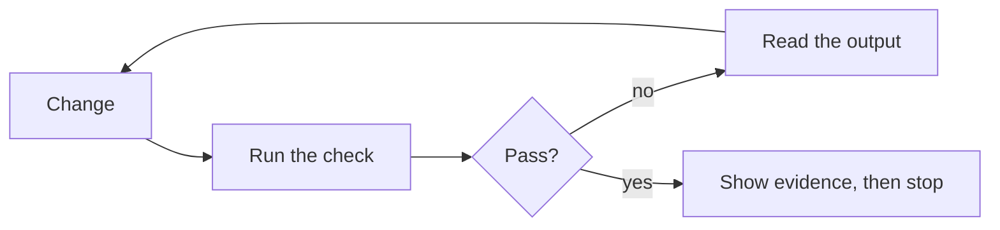

# 3. Close the loop

> **In one sentence:** An agent is only as reliable as the checks it can run on its own work, so design every task and codebase so that a program can confirm "done", and put the rules that must never bend into code instead of prose.

## What you'll be able to do

- Design a task and a codebase so the agent can verify its own work without you in the loop.
- Use red/green TDD with an agent, and prove that a new test fails when the change is reverted.
- Turn a rule the agent keeps missing into a deterministic guard (a hook, a validator or a CI check) whose error message tells the agent how to fix the problem.
- Set permission tiers and choose where autonomy is safe: a sandbox, a container, or nowhere.
- Let the agent check its work in a realistic environment, and diagnose production through read-only access when your policies allow it.
- Spot verification traps: uniform fixtures, tools that fail silently, and models re-typing structured data.

## Why this matters

You ask an agent to add a CSV export. Ten minutes later it answers: "Done. The export works and all tests pass." You open the pull request. The export breaks as soon as a title contains a comma. The agent never ran the command. It ran two test files out of forty, the two it had edited.

The agent wasn't lying. It stopped because the work *looked* done, and that was the only signal it had:

> "Without a check it can run, 'looks done' is the only signal available, and you become the verification loop" — [Claude Code best practices](https://code.claude.com/docs/en/best-practices)

You can be the verification loop for one session, not for five or twenty. Every later module assumes that each agent checks its own work before it asks for your attention. [Peter Steinberger](https://steipete.me/) calls this the core of the practice:

> "you have to close the loop. It needs to be able to debug and test itself. That's the big secret." — Peter Steinberger on [The Pragmatic Engineer](https://newsletter.pragmaticengineer.com/p/the-creator-of-clawd-i-ship-code)

[Andrej Karpathy](https://karpathy.bearblog.dev/sequoia-ascent-2026/) says the same from the other side: LLMs automate what you can verify. Better checks, more work you can hand over.

## The loop: change, check, read, fix



A **check** is anything that returns a signal the agent can read: tests, a build's exit code, a linter, a type checker, a script that diffs output against a fixture, a screenshot compared with a design. A good check is:

1. **Runnable by the agent alone:** no button to click, no credential or VPN it doesn't have.
2. **Fast:** seconds, not a 40-minute CI run. Slow checks get skipped.
3. **Quiet on success, specific on failure:** one line when everything passes; when something fails, the failing test, the file and line, expected against actual, and the command to reproduce it. Twenty lines like that beat 3,000 lines of logs. The more precise the reason, the faster the agent fixes it and tries again.
4. **Deterministic:** a flaky test teaches the agent that red means nothing.
5. **Able to fail:** a test that passes with or without the change checks nothing.

Then ask for **evidence, not claims**. A pasted test summary is faster to review than re-running everything, and it works for sessions you weren't watching.

❌ **Weak prompt**

```text
Add CSV export and make sure it works.
```

✅ **Better prompt**

```text
Add `shelf export --format csv` (issue S4). Done means:
1. a test for a title that contains a comma and a quote, written first and seen failing,
2. python3 -m unittest passes, and you paste the last three lines,
3. you ran the real command against a temporary SHELF_PATH and pasted the output.
If you can't do one of these, tell me which one and why.
```

## Design the codebase for verifiability

The loop is not only a prompting habit. It shapes the code.

> "The model always needs to be able to verify the work itself, which automatically steers me to better architecture." — Peter Steinberger on [The Pragmatic Engineer](https://newsletter.pragmaticengineer.com/p/the-creator-of-clawd-i-ship-code)

What that looks like in practice:

- **CLI first.** A command line is the easiest surface for an agent to exercise: run, read stdout and the exit code, compare. Steinberger starts new projects as CLIs for this reason. On the same podcast he describes a Mac app bug that was slow to reproduce by hand: he had the agent build a debug-only CLI that called the same code paths, and after about an hour of iterating it found a race condition.
- **Debug entry points use the real code paths.** A script that re-implements the logic "for testing" only verifies itself.
- **Logs the agent can read**, in a file or on stdout, not only in a dashboard ([Armin Ronacher](https://lucumr.pocoo.org/2025/6/12/agentic-coding/) makes the same case).
- **One local "full gate" command** that runs lint, type checks, build and tests, named in your instruction file: `make check`, `pnpm gate`. The gate is the loop; CI is the backstop.
- **Wrap noisy tools.** Some builds print thousands of lines when all that matters is pass or fail and why: a Maven build, a bundler, an end-to-end runner. Ask the agent to write a small script that runs the tool, prints one line on success, and on failure prints only the errors with their full detail. It saves context on every run, and it helps the humans who run it too.
- **Tiered speed.** The fast suite runs on every change; browsers, real databases and external APIs run before the pull request and in CI.

> [!NOTE]
> **At The Agile Monkeys** every pull request also runs CI and automated review, and one round of both costs us about 40 minutes (indicative, not a benchmark). Every failure the local gate catches first saves a full round.

## Tests in the same context, red first

Write tests right after the change, in the same session, while the context still holds the intent and the edge cases you discussed.

> "Ask the model to write tests after each feature/fix is done. Use the same context." — Peter Steinberger, [Just Talk To It](https://steipete.me/posts/just-talk-to-it)

Even better, write the test first. [Simon Willison's red/green TDD pattern](https://simonwillison.net/guides/agentic-engineering-patterns/red-green-tdd/) fits in one short sentence of a prompt: "Use red/green TDD." The agent writes the test, runs it and watches it fail (red), then implements until it passes (green). The red step is not a ritual:

> "If you skip that step you risk building a test that passes already, hence failing to exercise and confirm your new implementation." — Simon Willison, [Red/green TDD](https://simonwillison.net/guides/agentic-engineering-patterns/red-green-tdd/)

Our rule for every behavior change is stronger than "has a test": **the suite must be able to fail when this change is reverted.** Check it mechanically: put the production code back the way it was, keep the new tests, and run them.

**Before you commit**, stash the production code, new files included ([git stash](https://git-scm.com/docs/git-stash)):

```bash
git stash list                                    # note what is already there
git stash push --include-untracked -m revert-check -- shelf/
git stash list                                    # the top entry must say revert-check
python3 -m unittest                               # expected: the new tests fail
git stash pop                                     # only if the top entry is revert-check
```

`--include-untracked` matters. Many changes only add files, such as a new command module, and a plain `git stash` leaves untracked files where they are. In a project that discovers commands automatically, like the practice project, the tests then keep passing against code you thought you had removed. And if git answers "No local changes to save", nothing was stashed: don't pop, or you'll bring back an older, unrelated stash.

**After you commit**, on a branch, put `shelf/` back to where the branch started, then return to your commit ([git restore](https://git-scm.com/docs/git-restore)):

```bash
git status --short                                # expected: no output
base=$(git merge-base origin/main HEAD)
git restore --source="$base" --staged --worktree -- shelf/   # also removes files the branch added
python3 -m unittest                               # expected: the new tests fail
git restore --source=HEAD --staged --worktree -- shelf/      # back to your commit
git status --short                                # expected: no output again
```

If the suite still passes without the implementation, the tests don't test the change.

Watch the tests as closely as the code. [Kent Beck](https://newsletter.kentbeck.com/p/augmented-coding-beyond-the-vibes) lists the signs that an agent is going off track, and one of them is:

> "Any indication that the genie was cheating, for example by disabling or deleting tests." — Kent Beck, [Augmented Coding: Beyond the Vibes](https://newsletter.kentbeck.com/p/augmented-coding-beyond-the-vibes)

A rewritten assertion deserves more scrutiny than a new one.

## The verification ratchet

A ratchet turns one way. We apply the same idea to checks: **verification only gets tighter.** When the change and the check disagree, fix the change, not the check.

Loosening takes many forms, and an agent under pressure will find all of them: a skip marker, an `assertEqual` that becomes `assertIn`, a lower coverage threshold, a wider lint ignore, retries on a flaky test, a snapshot regenerated without reading the diff, `--no-verify`, a swallowed exception. Sometimes a check really is wrong. Then a human decides, in a separate change, with a written reason. Every allowlist entry in our CI guards carries one.

The second half of the ratchet is **honest reporting**: if a check can't run, the agent says exactly what it didn't run and why. "Tests pass" when half the suite needed a database the agent couldn't start is worse than no report. We ask for this shape:

```text
Verification
- Ran: python3 -m unittest -> Ran 41 tests, OK
- Ran: shelf export --format csv with SHELF_PATH=/tmp/s.json -> output below
- Not run: export on Windows line endings. No Windows machine here.
```

Put the ratchet in your instruction file, in words the agent can't misread:

```markdown
## Verification
- Verification only gets tighter. When a check fails, fix the change, not the check.
- Never skip, delete or weaken a test, a lint rule or a threshold to get green.
  If you believe a check is wrong, stop and explain why.
- Before you say "done", run `make check` and paste its last lines.
- If a check can't run, list what you didn't run and why.
```

## Deterministic guardrails beat reminder text

That block is prose, and prose is advisory. An agent deep into a long session can still miss line 143 of an instruction file. The Claude Code documentation is direct about it:

> "Unlike CLAUDE.md instructions which are advisory, hooks are deterministic and guarantee the action happens." — [Claude Code best practices](https://code.claude.com/docs/en/best-practices)

So we climb a ladder. Each rung costs more to build and guarantees more:

| Where the rule lives | What it guarantees | Use it for |
|---|---|---|
| A prompt | This turn, maybe | One-off constraints |
| Instruction file (`AGENTS.md`) | Every session reads it, and usually follows it | Conventions, context, how to verify |
| A hook in the agent tool | The tool runs your script at a fixed moment, every time | "Tests pass before you stop", "don't touch applied migrations" |
| A validator in CI | Nothing merges without passing | Invariants other people and systems rely on |
| Server-side protection | Holds even if everything above is bypassed | Protected branches, required checks, secrets outside the repo |

Our rule: **if a rule is repeatedly missed, add a deterministic check instead of adding more prose.** [Mitchell Hashimoto](https://mitchellh.com/writing/my-ai-adoption-journey) calls the habit "harness engineering":

> "anytime you find an agent makes a mistake, you take the time to engineer a solution such that the agent never makes that mistake again." — Mitchell Hashimoto, [My AI Adoption Journey](https://mitchellh.com/writing/my-ai-adoption-journey)

**A guard's error message is a prompt.** The agent reads it and acts on it. Say which rule broke, why it exists and how to fix it:

```text
❌ Validation failed.

✅ kb/ACTIVE.md has 134 lines; the budget is 100. Remove tracks that shipped
   and move detail into the linked issue. Don't merge rows to save lines.
```

> [!NOTE]
> **At The Agile Monkeys** our hooks block `rm -rf` on home or root, force-pushes and, in product repositories, direct pushes to `main`; refuse edits to applied database migrations; protect `.env` files; and lint each file right after an edit. Our knowledge base repository is the deliberate exception where sessions commit straight to `main` ([module 4](../04-context-is-infrastructure/README.md) explains why); there, a Stop hook won't let a session end while validation fails, and its message says: "do not work around a block, fix the file."

**Know where to stop.** Guard mechanical invariants: structure, formats, IDs, links, forbidden operations, secrets. Don't build tooling to police whether prose is still accurate; it costs more than it saves and breaks on every rewording. When something must be exact because other systems consume it, generate it from the code and gate that. This guide's own [validator](../../../scripts/check_content.py) checks headings, links and that both languages exist, not whether the prose is true.

### A Stop hook that runs the tests

A Stop hook runs when the agent finishes its turn. If your script exits with code 2, the agent can't stop: it gets your stderr as the reason and keeps working. A complete Claude Code example, in `.claude/settings.json`, committed for the whole team ([hooks reference](https://code.claude.com/docs/en/hooks)):

```json
{
  "hooks": {
    "Stop": [
      {
        "hooks": [
          {
            "type": "command",
            "command": "\"${CLAUDE_PROJECT_DIR}\"/.claude/hooks/tests-must-pass.sh",
            "timeout": 300
          }
        ]
      }
    ]
  }
}
```

```bash
#!/usr/bin/env bash
# .claude/hooks/tests-must-pass.sh
# Stop hook: the agent can't end its turn while the fast test suite fails.
input=$(cat)                                    # the hook event, JSON on stdin
cwd=$(jq -r '.cwd' <<<"$input")                 # follows the agent into worktrees
root=$(git -C "$cwd" rev-parse --show-toplevel 2>/dev/null) || exit 0
cd "$root" || exit 0

if ! output=$(npm test 2>&1); then              # your fast test command
  {
    echo "The test suite fails, so you can't finish yet."
    echo "Fix the code, not the tests: don't skip, delete or weaken a test."
    echo "Last 40 lines of output:"
    tail -n 40 <<<"$output"
  } >&2
  exit 2                                        # 2 blocks; exit 1 would not
fi
exit 0
```

Six details decide whether this works, and each one has bitten someone:

1. **Exit code 2, not 1.** In Claude Code, exit code 1 is a *non-blocking* error: the agent stops anyway and you see a notice.
2. **The agent reads stderr.** Send the tail of the output, not the whole log. Every line costs tokens on every retry.
3. **Test where the agent works.** `${CLAUDE_PROJECT_DIR}` stays where the session started, even after the agent enters a worktree. The `cwd` field in the hook's input follows the agent.
4. **A broken hook fails open.** A wrong path or a script that isn't executable produces a non-blocking error, and the agent stops. Test the hook by piping JSON into it yourself (the [lab](lab.md) shows how).
5. **Plan the way out.** The input's `stop_hook_active` is true when the agent is already continuing because of a Stop hook, and Claude Code ends the turn after 8 consecutive blocks. The gate also keeps the agent from pausing to ask you a question while the suite is red.
6. **Keep it fast.** It runs at the end of *every* turn, even one where the agent only answered a question.

**Codex** supports the same pattern in `.codex/hooks.json`, with the same structure. Its documentation recommends resolving script paths from the git root, for example `"$(git rev-parse --show-toplevel)/.claude/hooks/tests-must-pass.sh"`. Exit code 2 makes Codex continue, with your stderr as the next instruction. Two differences: you must review and trust each new or changed hook with `/hooks`, and the documentation describes no limit on consecutive blocks, so your script needs its own ([Codex hooks](https://learn.chatgpt.com/docs/hooks)). The lab's version works in both tools.

## Permission tiers

A hook decides *when* a check runs. Permissions decide *what* the agent may do at all. We sort actions into three tiers:

| Tier | Examples | Why |
|---|---|---|
| **Allow** | run tests and lint, read-only git (`status`, `diff`, `log`), `gh pr view` | Safe, frequent. Prompts here only train you to click "yes". |
| **Ask** | `git push`, `gh pr create`, `gh pr merge`, `gh issue create`, database migrations | Visible to other people, or hard to undo |
| **Deny** | reading `.env` and secret files, force-push | No task in this repository needs them |

In Claude Code, that looks like this in `.claude/settings.json` ([permissions](https://code.claude.com/docs/en/permissions)):

```json
{
  "permissions": {
    "allow": ["Bash(npm test *)", "Bash(npm run lint *)", "Bash(git status *)", "Bash(git diff *)", "Bash(git log *)", "Bash(gh pr view *)"],
    "ask": ["Bash(git push *)", "Bash(gh pr create *)", "Bash(gh pr merge *)", "Bash(gh issue create *)"],
    "deny": ["Read(./.env)", "Read(./.env.*)", "Read(./secrets/**)", "Bash(git push --force *)", "Bash(git push -f *)"]
  }
}
```

Deny rules win over ask, and ask wins over allow. Codex has the same idea with different parts: a sandbox mode, an approval policy, and rule files that allow, prompt for or forbid command prefixes ([Codex approvals and security](https://learn.chatgpt.com/docs/agent-approvals-security)).

> [!WARNING]
> Command rules match the text of a command, not what it does. The Claude Code documentation shows that a deny rule for `git push` doesn't stop `git -C . push`, and `Read(./.env)` doesn't stop a Python script that opens the file. Permission rules steer a cooperative agent; they are not a security boundary. For that you need the operating system (a sandbox) and the server (branch protection, secrets that never reach the machine).

## Sandboxes, bypass modes and the lethal trifecta

Permission prompts have a human failure mode. Anthropic reports:

> "Claude Code users approve 93% of permission prompts." — Anthropic, [Claude Code auto mode](https://www.anthropic.com/engineering/claude-code-auto-mode)

After the tenth prompt you're clicking, not reviewing. There are four ways out, from safest to riskiest:

1. **Pre-approve the safe tier** with allow rules, so the prompts that remain mean something.
2. **An operating-system sandbox** that limits which files and hosts commands can reach. Anthropic reports it cut permission prompts by 84% internally, and that you need both halves: "Without network isolation, a compromised agent could exfiltrate sensitive files like SSH keys" ([Anthropic on sandboxing](https://www.anthropic.com/engineering/claude-code-sandboxing)). Codex sandboxes local commands by default, with the network off and writes limited to the workspace.
3. **A classifier that approves for you**, such as Claude Code's auto mode ([permission modes](https://code.claude.com/docs/en/permission-modes)). Anthropic reports a 17% false-negative rate on real overeager actions: "[Auto mode] is not a drop-in replacement for careful human review on high-stakes infrastructure."
4. **Skip permissions entirely**, only in a container or virtual machine that holds no credentials you care about.

In 2025 Steinberger wrote that he ran Claude Code with `--dangerously-skip-permissions` on his own machine, protected by hourly backups:

> "Yes, a rogue prompt could theoretically nuke my system." — Peter Steinberger, [Claude Code is my computer](https://steipete.me/posts/2025/claude-code-is-my-computer)

Backups solve deletion, not theft. In August 2025 the [s1ngularity attack](https://nx.dev/blog/s1ngularity-postmortem) published malicious versions of the popular `nx` npm packages. A post-install script ran the AI command-line tools it found with flags that skip permission prompts, used them to hunt for secrets, and uploaded the results to public GitHub repositories ([Wiz analysis](https://www.wiz.io/blog/s1ngularity-supply-chain-attack)). Nobody typed a bad prompt; a dependency install did it. No backup takes a leaked token back.

[Simon Willison](https://simonwillison.net/2025/Jun/16/the-lethal-trifecta/) names the underlying risk the **lethal trifecta**: an agent that has access to private data, is exposed to untrusted content, and can communicate externally.

> "The only way to stay safe there is to avoid that lethal trifecta combination entirely." — Simon Willison, [The lethal trifecta](https://simonwillison.net/2025/Jun/16/the-lethal-trifecta/)

A coding session often has all three: tokens and `.env` files on disk; issues, web pages and dependency code it reads; network access and `gh`. Remove at least one leg: no secrets where agents run unattended, restricted network egress, or no untrusted input in sessions that hold credentials.

> [!IMPORTANT]
> We don't bend these: no permission-bypass aliases on a machine that holds credentials. Unattended or bypass-mode agents run only in an isolated environment without production secrets. A human runs production-privileged commands that an agent prepared. Agents never merge.

## Realistic test data

A check is only as good as the data it runs on.

**Previews and staging use synthetic data.** Every pull request should get an environment, seeded with realistic fake data, where the agent and you can run the change end to end. We build sensitive flows against staging with fake data first and connect real credentials last. Don't add "if preview" branches to the data path: a preview that behaves differently verifies nothing.

**Fixtures must vary where production varies.** A real example, simplified: a report had to exclude archived projects. The implementation forgot the filter. The tests passed, because every project in the fixtures was active. The mock agreed with the bug.

❌ **Weak prompt**

```text
Write tests for the projects report.
```

✅ **Better prompt**

```text
Write tests for the projects report. First list every value `status` takes in
production (active, paused, archived). Include at least one fixture per value
that changes the result, and assert that archived projects are excluded.
Use red/green: show the exclusion test failing before you add the filter.
```

## Check it where it will run

A solid local environment comes first: the app and its dependencies in containers you can start per worktree, fast and isolated ([module 6](../06-run-sessions-in-parallel/README.md)). It catches most problems. It doesn't catch the ones that only exist in a real environment: infrastructure configuration, networking, authentication, a third-party integration, data at real volume.

So let the agent check its work in a realistic environment too:

- **Deploy to a development or staging environment** through a script or skill that the team owns, with the approval step your [permission tiers](#permission-tiers) require.
- **Use the app like a user.** A browser-automation tool lets the agent open the deployed app, click through the flow, and read the console and the network errors. In Claude Code that is the [Chrome integration](https://code.claude.com/docs/en/chrome) (`claude --chrome`).
- **Read the environment's logs** when something fails, instead of guessing from the code.

❌ **Weak prompt**

```text
Deploy it and check that it works.
```

✅ **Better prompt**

```text
The tests pass locally. Deploy this branch to the dev environment with
scripts/deploy-dev.sh and wait until it reports healthy. Then open the app in
the browser, sign in with the test account, export a list with a title that
contains a comma, and open the file. Paste the result and any console or
server errors you saw. Don't touch any other environment.
```

**Read-only access to production.** Diagnosing a production problem goes much faster when the agent can read the logs, metrics and traces itself. It is useful for at least the lead engineers on a team to have a way to give their agent **read-only** access for diagnostics: its own identity, scoped to reading, never able to change anything. Production-privileged changes stay with a human ([module 9](../09-teams-and-organizations/README.md#humans-run-production-privileged-commands)).

> [!WARNING]
> Production logs hold personal and confidential data, and they are untrusted text: anyone who can send your app a request can put words in them. Follow your company's security policies and the sensitivity of the data you handle. If those don't allow it, don't do it. Where they do, keep that session without a way to send data out (the [lethal trifecta](../09-teams-and-organizations/README.md#untrusted-input-and-the-lethal-trifecta)).

## Let code handle structured data

Models are good at turning messy text into structure, and unreliable at copying 400 numbers: you can't tell which three they got wrong. Our rule: **use the model for unstructured extraction only, and handle structured data with code.** When a task says "the AI does X", split it into **extraction** (the model turns an email, a PDF or notes into JSON validated against a schema), a **deterministic core** (tested code does the joins, sums and writes) and a **human gate** (a person approves anything that leaves the system). In a coding session the rule reads: ask the agent to write the program, not to be the program.

❌ **Weak prompt**

```text
Here are hours.csv and projects.csv. Give me the total hours per project for August.
```

✅ **Better prompt**

```text
Write a script that joins hours.csv and projects.csv and prints total hours
per project for a given month. Add tests with a project that has no hours and a
project whose name differs only in capitalization. Run it for August and paste
the output. Don't compute any totals yourself.
```

## Trust, then re-fetch

Tools fail silently. We have seen a CLI command that edits a pull request description exit successfully without changing anything. When an agent writes through an API or a CLI, the check is to read the result back:

```text
After you update the PR description, fetch it again with gh pr view <number> --json body
and confirm the "Verification" section is there. If it isn't, try another way and tell me.
```

## Other ways to see it

- **Local gate or CI?** Steinberger stopped waiting for remote CI: "If the tests pass locally, we merge. And then, yes, sometimes main slips a little bit" ([The Pragmatic Engineer](https://newsletter.pragmaticengineer.com/p/the-creator-of-clawd-i-ship-code)). He works mostly alone. With a team depending on `main`, we keep CI as a required check and use the local gate to pass it on the first try.
- **Tests first or after?** Willison and Beck push red/green; Steinberger asks for tests right after each change. We use red/green for bug fixes and clearly specified behavior, tests-after for exploratory UI work, and the revert check either way.
- **How much autonomy?** From approving everything by hand, to sandboxes and classifiers, to bypass mode. [Willison](https://simonwillison.net/2025/Oct/5/parallel-coding-agents/) runs local agents with no approvals for tasks where he's confident malicious instructions can't reach the context, sends riskier tasks to a cloud agent, and says he needs to start running local agents in Docker. [Ronacher](https://lucumr.pocoo.org/2025/6/12/agentic-coding/) skips permissions too, and suggests moving the dev environment into Docker to manage the risk. We allow the safe tier, sandbox where we can, and keep bypass mode for disposable environments.
- **Scripts or models as judges?** A hook decides only what a script can decide. "Does this do what the issue asks?" needs a model: a [`/goal`](https://code.claude.com/docs/en/goal) condition checked by a separate evaluator, a verification subagent, or a fresh reviewer ([module 7](../07-agents-review-agents/README.md)). We use scripts for invariants and models for intent.

## Watch out

- **"All tests pass" without output.** No evidence, no "done".
- **The agent fixes the check.** A diff that touches both the code and the assertions that were failing needs a careful read.
- **A guard you never saw fail.** Exit code 1, a wrong path or a missing `chmod +x` disables it silently. Break something on purpose once.
- **A slow Stop hook.** A ten-minute suite at the end of every turn makes every session crawl.
- **Flaky tests.** They teach the agent, and you, to ignore red. Fix them or quarantine them visibly.
- **Guards with vague messages.** The agent thrashes. Each message must say how to fix the problem.
- **Bypass mode on your laptop.** Convenient until a dependency turns malicious.
- **Production access "just to look".** Read-only, its own identity, within your company's policies, or not at all.

❌ **Weak prompt**

```text
The tests are failing, fix them.
```

✅ **Better prompt**

```text
test_export_quotes_commas fails. Read the failure, decide whether the code or
the test is wrong, and tell me which and why before changing anything. If it's
the code, fix the code. Don't edit the test without my OK.
```

## Check your understanding

1. Your Stop hook script exits with code 1 when the tests fail. What happens when the agent tries to stop?

   <details><summary>Answer</summary>

   The agent stops anyway. In Claude Code, exit code 1 is a non-blocking error: you see a notice and the turn ends. Only exit code 2 (or a JSON `"decision": "block"`) prevents the stop.

   </details>

2. A test for "hide archived projects" passes, but production shows archived projects. The fixtures contain five active projects. What went wrong, and what rule prevents it?

   <details><summary>Answer</summary>

   The fixtures don't vary where production varies, so the missing filter changes nothing in the test. The mock agreed with the bug. Fixtures need at least one record per value that changes the outcome, including the records the filter must exclude.

   </details>

3. You never want an agent to push to `main`. You've written it in `AGENTS.md` and added a deny rule for `git push origin main`. Are you done?

   <details><summary>Answer</summary>

   No. The instruction is advisory, and command rules match text: `git push origin HEAD:main` or `git -C . push` are different strings. Keep the rule and the deny, but protect `main` on the server, where no local bypass can reach it.

   </details>

4. Why is running an agent with permissions skipped inside a disposable container different from doing it on your laptop, even with good backups?

   <details><summary>Answer</summary>

   Backups undo deletion, not exfiltration. Your laptop holds credentials, reads untrusted content and has network access: the lethal trifecta. A container without secrets removes the private-data leg.

   </details>

## Key points

- If the agent can't run a check, you are the check. Ask for evidence, not claims.
- Write tests in the same context, red first where you can, and prove they fail when the change is reverted.
- Verification only gets tighter: fix the change, not the check, and report what wasn't run.
- Prose is advisory. A rule missed twice moves down the ladder: hook, validator, CI, server. Every guard's message says how to fix the problem.
- Permission rules steer; sandboxes and servers enforce. Skip permissions only where there is nothing to steal.
- Fixtures vary where production varies, and structured data belongs to code.
- Checks are quiet on success and specific on failure. Local containers first, then a realistic environment the agent can deploy to and use like a user.

## Go further

- [Claude Code best practices: give Claude a way to verify its work](https://code.claude.com/docs/en/best-practices) — four levels of gating, from a prompt to a verification subagent.
- [Claude Code hooks reference](https://code.claude.com/docs/en/hooks) and [Codex hooks](https://learn.chatgpt.com/docs/hooks) — every event, exit code and input field.
- [Claude Code permissions](https://code.claude.com/docs/en/permissions) and [Codex approvals and security](https://learn.chatgpt.com/docs/agent-approvals-security) — rule syntax, sandboxes, and what rules don't cover.
- [Kent Beck: Augmented Coding: Beyond the Vibes](https://newsletter.kentbeck.com/p/augmented-coding-beyond-the-vibes) — TDD with an agent, and the signs that it is cheating.
- [Simon Willison: The lethal trifecta](https://simonwillison.net/2025/Jun/16/the-lethal-trifecta/) — the three capabilities you must not combine.
- [Nx: s1ngularity postmortem](https://nx.dev/blog/s1ngularity-postmortem) — a supply-chain attack that used AI command-line tools on developer machines.
- [Lab 3: give the agent a way to check itself](lab.md) — add a Stop hook to the practice project and watch it catch a mistake.

Next: [4. Context is infrastructure](../04-context-is-infrastructure/README.md)
