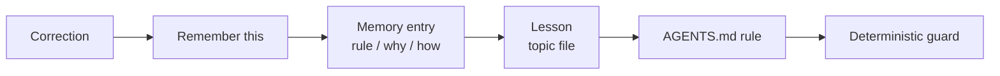

# 4. Context is infrastructure

> **In one sentence:** Every session starts with amnesia, so build context like infrastructure: a small always-loaded contract, a knowledge base that agents write and you correct, and live systems that win over any snapshot, all committed so that a new session with full context costs seconds.

## What you'll be able to do

- Split project knowledge into four layers (instruction files, knowledge base, backlog, live systems) and put each fact in the right one.
- Write a lean `AGENTS.md` that works across tools, and a `CLAUDE.md` that imports it.
- Keep an `ACTIVE.md` index that answers "what are we doing on X?" in ten seconds.
- Record decisions so they can be superseded without being lost, and promote repeated corrections from memory to rules to guards.
- Run the loop that turns a meeting transcript into knowledge base updates and a re-planned backlog.

## Why this matters

Monday morning. Three tracks are in flight. You open a new session and type "continue with the export work". The agent reads the code, finds a half-finished branch and proposes the design you rejected on Thursday. The rejection lived in a chat window you closed. You spend twenty minutes explaining it again.

Now multiply that by every session, every day, and every teammate who joins. With one agent the cost is annoying. With ten sessions in parallel ([module 6](../06-run-sessions-in-parallel/README.md)) it is the ceiling on how far you can go.

Every session starts knowing nothing about your project. You can't fix that with longer prompts. Longer prompts are a smell of missing context ([module 2](../02-one-agent-done-well/README.md)). You fix it the way you fix any repeated manual work: you build infrastructure. Versioned, shared, validated and maintained.

The goal isn't "give the agent everything". Context has a cost in tokens and in attention. Anthropic's guidance on context engineering describes the target as:

> "the smallest possible set of high-signal tokens that maximize the likelihood of some desired outcome" — Anthropic, [Effective context engineering for AI agents](https://www.anthropic.com/engineering/effective-context-engineering-for-ai-agents)

The job of this lesson is to make "a new session with full context" cheap in both.

## Four layers, four questions

| Layer | Answers | Lives in | Loaded | Written by |
|---|---|---|---|---|
| **Instruction files** | How do we work here? | `AGENTS.md`, `CLAUDE.md` | Every session | Agent drafts, human curates |
| **Knowledge base** | Why is it like this? What did we decide and learn? | `kb/` in git | Index always, the rest on demand | Agents, corrected by humans |
| **Backlog** | What, when, who? | Issue tracker | On demand, through the CLI | Agents, steered by humans ([module 5](../05-decompose-into-tracks/README.md)) |
| **Live systems** | What is true right now? | Code, CI, issue states, production | Queried when needed | Nobody: they are the truth |

Three rules keep the layers honest:

1. **Split why from what.** The knowledge base holds rationale, decisions and evidence. The tracker holds tasks, owners and dates. Don't copy the backlog into the knowledge base, or you will maintain two truths that drift. Link both ways instead.
2. **Live systems win over snapshots.** Any table in the knowledge base is a snapshot with a date. When it disagrees with the output of a command, the command wins.
3. **Check claims against the code.** In our own words: issue bodies are dated the day they were written; code is dated today. An agent that implements an issue from three weeks ago without reading the current code will build on things that no longer exist.

## Instruction files: one contract, thin adapters

[AGENTS.md](https://agents.md/) is an open standard that Codex and many other agents read. Claude Code reads `CLAUDE.md` instead, and its [memory documentation](https://code.claude.com/docs/en/memory) recommends a `CLAUDE.md` that imports the shared file. So the contract lives in one place and each tool gets a thin adapter. [DHH](https://lexfridman.com/dhh-2/) does the same in every project: his `CLAUDE.md` only points to `AGENTS.md`.

A good `AGENTS.md` holds what the agent can't work out from the code, and points to everything else. Here is a realistic one for a small reading-list web service:

```markdown
# AGENTS.md

Reading-list service: a REST API (`api/`) and a web client (`web/`) sharing
types in `packages/types/`. Node 22, pnpm workspaces, PostgreSQL 16.

## Start here
- Work in flight, decisions pending and blockers: `kb/ACTIVE.md`. Read it first.
- Why things are the way they are: `kb/decisions/`. Superseded records name their replacement.

## Map
api/src/routes/     HTTP handlers, kept thin: validate, call a service, map errors
api/src/services/   business rules; the only code that touches the database
api/migrations/     SQL migrations; applied ones never change
web/src/            React client; calls the API only through packages/client
packages/types/     generated from api/openapi.yaml with `pnpm gen`; don't edit by hand

## Commands
pnpm install              # once per worktree
pnpm gate                 # lint + typecheck + unit tests; run before you say "done"
pnpm test:api <pattern>   # one API test file, fast
pnpm db:reset             # local database for this worktree only

## Rules that fail the build
- CI rejects hand edits under packages/types/src/generated/.
- A new migration never edits an applied one. Add a new file.

## Working agreements
- One issue, one branch, one pull request, end to end.
- Verification only gets tighter: fix the change, not the check. If a check
  can't run, say what you didn't run and why.
- Tests for a filter or permission need fixtures the rule must exclude.
- Never read `.env*` files or print secrets. Ask for the variable name.
- Write code, commits, pull requests and docs in English.
- No new runtime dependency without a decision record in `kb/decisions/`.

## Done means
- `pnpm gate` passes and you pasted its last lines.
- A behavior change has a test that fails when the change is reverted.
- The track's row in `kb/ACTIVE.md` shows the new state and next gate.
```

And the Claude Code adapter:

```markdown
@AGENTS.md

## Claude Code only
- Hooks in `.claude/settings.json` run the gate when you stop and validate edits
  under `kb/`. If one blocks, fix what it names. Don't edit the hook.
```

What stays **out**: file-by-file descriptions, style rules a linter already enforces, anything that changes weekly (that goes in `ACTIVE.md`), and long rationale (that goes in a decision record). For each line, the [Claude Code best practices](https://code.claude.com/docs/en/best-practices) suggest one test: "Would removing this cause Claude to make mistakes?" If not, cut it.

Two tool details that change how you write these files:

- In Claude Code, an `@` import loads the imported file into context at launch. Imports organize your instructions; they don't make them cheaper. The documentation suggests keeping each `CLAUDE.md` under about 200 lines.
- Codex joins the `AGENTS.md` files from the repository root down to the current directory, closer files last, and stops adding them once the total reaches a size limit, 32 KiB by default ([Codex AGENTS.md docs](https://learn.chatgpt.com/docs/agent-configuration/agents-md)). A bloated file doesn't only cost tokens. Past the limit, the rest isn't loaded at all.

## Our practice: a mission repository

> [!NOTE]
> **At The Agile Monkeys** a lead engineer runs many Claude Code and Codex sessions from a single *mission repository*. Its purpose is a mission, not a product. It holds the knowledge base, and the product repositories are linked into it. We think and plan inside sessions opened there, because they start with the mission, every past decision and the current state of every track. Code gets written somewhere else: in worktrees of the product repositories ([module 6](../06-run-sessions-in-parallel/README.md)).

We seeded ours from [Limina](https://github.com/theam/limina), our open-source research harness. Limina gives an agent one mission and a protocol (Mission → Hypothesis → Experiment → Finding → Decision) that forces it to write down what it learns. Both matter. One mission keeps the scope tight. A protocol that makes saving knowledge part of the work, not an afterthought, is what makes remembering actually happen. You don't need Limina to apply this lesson: any mission-style harness works, and so does a plain folder with the structure below.

A mission repository looks roughly like this:

```text
product-mission/
├── AGENTS.md                 # the shared contract, a map (~100 lines)
├── CLAUDE.md                 # @AGENTS.md
├── kb/
│   ├── mission/CHALLENGE.md  # the mission, and how we'll know we're done
│   ├── ACTIVE.md             # always loaded, at most 100 lines
│   ├── decisions/            # decision records, superseded but never deleted
│   ├── lessons/              # small topic files, read on demand
│   ├── research/             # analyses and evidence
│   ├── announcements/        # team updates, as they were sent
│   └── memory/               # typed entries plus a one-line-per-entry index
├── repos/                    # product repositories, as git submodules
│   ├── api/
│   └── web/
├── scripts/validate_kb.py    # shape, line budgets, links, supersede chains
└── .claude/  .codex/         # hooks: load ACTIVE.md, validate kb/ edits
```

**Bring the existing world in.** Our mission started from about ten scattered automation initiatives, each in its own repository. The first task was to link all of them and ask the agent what was valid, what was duplicated and what didn't work. Every repository we add later gets the same treatment:

```text
I added repos/importer as a submodule. Read it and compare it with the mission
in kb/mission/CHALLENGE.md and with the other repos. Tell me what is valid and
reusable, what duplicates something we already have, and what is broken or
abandoned, with file paths as evidence. Save the analysis in kb/research/.
Propose the decisions you think we need, but don't record them yet.
```

## The ACTIVE index

`ACTIVE.md` is the one knowledge base file that every session loads. It is an **index, not a log**: one row per track in flight, with its state and the next gate, and links to everything else. It has a hard budget of 100 lines.

```markdown
# ACTIVE

Index of work in flight. Rewrite rows, don't append. Budget: 100 lines.
Details live in the linked issues, pull requests and records.

## Current objective
Shared reading lists in beta by 2026-10-15.

## Next step
Human review of the schema migration in #230, then unblock #218.

## Active tracks
| Track | Issue | PR | State | Next gate |
|---|---|---|---|---|
| Shared lists schema | #212 | #230 | In review | Human review of the migration |
| List invitations | #218 | — | Planning | Plan accepted; waits on #230 merge |
| CSV export | #205 | #227 | Fixing review findings | Re-review after push |
| Search relevance | #199 | — | Research | Decide Postgres full-text vs external index |

## Blockers
- #218: invite expiry needs a product decision (asked 2026-09-15). Degraded path: 7 days.

## Recent decisive evidence
- Full-text search prototype: p95 38 ms on 50k books (kb/research/2026-09-14-fts-benchmark.md).

## Working set
- kb/decisions/D-0012-shared-lists.md
```

With this file loaded, "what were we doing on search?" is a ten-second question, and the next message can be a decision: "go with Postgres full-text, record it".

The discipline is in how rows change:

```text
❌ | CSV export | #205 | #227 | Mon: started. Tue: CI red (3 failures), fixed 2.
     Wed: reviewer found 14 threads, 9 fixed, commit 4f2a9c1... | ... |

✅ | CSV export | #205 | #227 | Fixing review findings | Re-review after push |
```

Rewrite the row; never append a diary. Delete the row when the track ships. CI counts, commit hashes and review-thread status belong in the pull request, never here.

Load it deterministically. In Claude Code you can import it from `CLAUDE.md` with `@kb/ACTIVE.md`. A `SessionStart` hook works in both Claude Code and Codex, because both add a SessionStart hook's plain output to the session's context ([Claude Code hooks](https://code.claude.com/docs/en/hooks), [Codex hooks](https://learn.chatgpt.com/docs/hooks)). The `compact` matcher reloads it after the context is compacted. The same entry goes in `.claude/settings.json` and in Codex's `.codex/hooks.json`, where you trust it once with `/hooks`:

```json
{
  "hooks": {
    "SessionStart": [
      {
        "matcher": "startup|resume|clear|compact",
        "hooks": [{ "type": "command", "command": "cat \"$(git rev-parse --show-toplevel)/kb/ACTIVE.md\"" }]
      }
    ]
  }
}
```

The command finds the file from the git root, as the Codex documentation recommends, instead of `${CLAUDE_PROJECT_DIR}`: only Claude Code sets that variable, and both tools run hook commands in the session's working directory.

A validator run by hooks enforces the shape and the budget, with a message that tells the agent how to fix it ([module 3](../03-close-the-loop/README.md)).

> [!WARNING]
> A line budget doesn't cap how long a row gets. Even with a validator, our own rows slowly collected CI counts and review details, because a rule written in prose decays under pressure. Reread `ACTIVE.md` every week or two and ask the agent to rewrite rows that turned into logs.

When a session starts cold, or after a machine restart, we use a short recovery protocol: read the mission, then `ACTIVE.md`, then only the artifacts linked from the relevant row. Reconstruct the objective, the next step, the blocker and the open decision. Cross-check numbers and dates against live output; if they disagree, that is a blocker to resolve first. Search the knowledge base before creating anything new.

## A knowledge base written by AI, for AI

> [!NOTE]
> **At The Agile Monkeys** we don't write the knowledge base by hand, and we don't read most of it. The agents write it while they work: decisions, lessons, research, handoffs. It contains errors. When we see one we say "this is wrong, fix it", and many others remain. We accept that, because the value of a session that starts with months of context is far higher than the cost of the errors.

This works because of the layers above: live systems win over the knowledge base, and agents are told to check claims against the code. The knowledge base gives a session direction and rationale. It isn't treated as ground truth. In a line [Andrej Karpathy](https://karpathy.bearblog.dev/sequoia-ascent-2026/) says he keeps returning to: "You can outsource your thinking, but you can't outsource your understanding." The knowledge base remembers for you. It doesn't understand for you.

Keep files small and topical, so sessions load them on demand instead of reading everything. Anthropic calls this "just in time" retrieval: the agent keeps lightweight references such as file paths and loads what it needs when it needs it.

A shared knowledge base also changes how a team works. When teammates joined, they cloned the mission repository, and now they ask it questions: "why did we choose this schema?", "design this feature and file the issues".

### Supersede, don't delete

Decisions change. When one does, don't edit or delete the old record. Mark it superseded, link the replacement, and keep it:

```markdown
---
id: D-0009
title: One reading list per user
status: superseded
decided_on: 2026-06-02
superseded_on: 2026-09-12
superseded_by: D-0012
---

# D-0009 One reading list per user

> **Superseded on 2026-09-12 by [D-0012](D-0012-shared-lists.md).** Kept because it
> explains why old exports have no `list_id` and why `books.user_id` exists.

## Context
Beta users asked for one simple list. Sharing was out of scope.

## Decision
Each user has exactly one list, and books belong to the user.

## Consequences
- Permissions are trivial: only the owner reads or writes.
- Sharing will need a schema change.
```

The new record carries `supersedes: D-0009`. A validator checks the chain: any record with status `superseded` must name what replaced it.

Why keep dead decisions? Because the old code, old data and old exports still reflect them, and because a deleted decision gets proposed again six months later by an agent that sees only the current code. Captured decisions are the asset. When you hand a task to an agent, list the decisions that are already made and tell it not to re-open them.

### Commit the knowledge base

An uncommitted knowledge base change did not happen. The next session in another worktree can't see it, a teammate can't pull it, and a disk failure erases it.

> [!NOTE]
> **At The Agile Monkeys** we learned this the hard way. Weeks into the mission, one repository had thousands of uncommitted knowledge base changes. Now every session ends with commit and push, and several sessions write to `main` in parallel with simple hygiene: one writer per file, and analysis sessions write new files instead of editing shared ones ([module 6](../06-run-sessions-in-parallel/README.md)).

Committing straight to `main` is a deliberate exception to the rule that agents don't push to protected branches like `main` ([module 3](../03-close-the-loop/README.md), [module 9](../09-teams-and-organizations/README.md)), and it applies only to the mission repository. That repository holds documents, not product code; sessions make many small, independent writes that a pull request per change would bury in reviews; and validators run by hooks protect its shape instead of pull request review. Product code always goes through a branch and a pull request.

The same applies to what you tell people. We draft team announcements in the knowledge base and archive them as sent. Two days later, a session writing the next update can say "the message on Monday said exports are CSV only; this release changes that" and include the correction.

## Memory and the promotion path

Corrections are the most valuable context you produce, and the easiest to lose. When an agent gets something wrong and you correct it, or when something fails often, say it explicitly: "remember this". Our harness tells agents to persist what they learn, and "remember this" makes it unmissable.

Each memory entry has three parts: the **rule**, **why** it exists, and **how to apply** it. Without the why, a future session can't tell when the rule doesn't apply.

```markdown
---
type: feedback
created: 2026-09-10
---

# Fixtures must vary where production varies

**Rule:** A test for a filter, permission or visibility rule needs fixtures the
rule must exclude, at least one per value that changes the outcome.

**Why:** On 2026-09-09 the projects report showed archived projects in
production. Its test passed because every fixture project was active: the mock
agreed with the bug. Fixed in #231.

**How to apply:** Before writing assertions, list the values the field takes in
production. Add a fixture for each value that changes the result, and assert on
the excluded ones. In review, reject filter tests with uniform fixtures.
```

An index file lists one line per entry, so a session can scan all memory cheaply and open only what applies:

```markdown
- [Fixtures must vary where production varies](feedback-fixtures-vary.md) — filter tests need excluded records; a uniform mock hid a bug.
```

Entries don't stay memories forever. They move along a promotion path as they prove themselves:



- **Memory entry → lesson** when it applies across several tasks.
- **Lesson → `AGENTS.md` rule** when every session in the repository needs it. The fixtures entry above became a line in the example `AGENTS.md`.
- **Rule → guard** when it is mechanically checkable and still gets missed ([module 3](../03-close-the-loop/README.md)). Not every rule can become a guard. "Fixtures must vary" needs judgment, so it stays a rule and a review question.

The path runs backwards too. When stale advice turns up, mark the entry superseded inside itself, with a date. When the agent already does something right without being told, delete the line. The Claude Code best practices say: "If Claude already does something correctly without the instruction, delete it or convert it to a hook."

Tools ship their own memory features, such as Claude Code's [auto memory](https://code.claude.com/docs/en/memory). Use them if they fit. The shape of the entries matters more than where they are stored.

## Meetings feed the knowledge base, then the backlog

Plans change in meetings, and the backlog doesn't hear about it. Our loop takes a transcript, updates the knowledge base, and then re-plans the backlog against it:

```text
Here is the transcript of today's planning meeting: meetings/2026-09-16.txt.
Update the knowledge base:
- record each decision as a new record, superseding any record it replaces,
- add open questions to the relevant rows in kb/ACTIVE.md,
- refer to people by role, and leave out anything personal.
Don't touch the backlog yet. List the knowledge base changes you made.
```

```text
Now re-plan the backlog against the updated knowledge base. Give me three lists:
issues to close because they are no longer needed, issues to update and what
changes, and issues to create. One line of why for each, with a link to the
decision behind it. Don't change anything on GitHub until I say go.
```

Then you read three lists instead of five hundred issues, and say go. With a backlog of several hundred open issues, this loop is what keeps it honest after a strategy change.

> [!WARNING]
> Transcripts are sensitive. Get consent to record. Don't commit raw transcripts to a shared repository: keep the decisions and rationale, not side comments about people. Keep the human approval before any bulk change to the backlog.

## Other ways to see it

**Lean or long instruction files?** Practitioners disagree, and the reasons are instructive.

- **Lean.** DHH relays a claim from Claude Code's team that a recent system prompt shrank by about 80%, because the agent "was actually being damaged by overly prescriptive humans" ([Lex Fridman Podcast #501](https://lexfridman.com/dhh-2/)). It is secondhand, but it matches the vendors' own advice. The [Codex best practices](https://learn.chatgpt.com/guides/best-practices) say: "A short, accurate AGENTS.md is more useful than a long file full of vague rules."
- **Long.** [Peter Steinberger](https://steipete.me/posts/just-talk-to-it) keeps a large file that the agent wrote as it learned: "My Agent file is currently ~800 lines long and feels like a collection of organizational scar tissue. I didn't write it, codex did".
- **A map.** OpenAI's [harness engineering](https://openai.com/index/harness-engineering/) write-up describes keeping `AGENTS.md` to about 100 lines that work as a table of contents into a structured `docs/` directory, after a single large instruction file went stale and crowded out the context. It is a vendor's greenfield experiment, but the pattern travels well.

**What we do:** keep the always-loaded context small (an `AGENTS.md` that is a map, plus `ACTIVE.md`, each around 100 lines) and let everything else load on demand: decisions, lessons, skills. Steinberger's scar tissue is real knowledge; we just keep most of it one link away instead of in every session's context.

**Skills early or late?** A skill packages a workflow the agent loads when needed. [Boris Cherny](https://x.com/bcherny/status/2017742741636321619), who created Claude Code, suggests turning anything you do more than once a day into a skill. We are more conservative, because skills aren't free:

> "Every skill in the skill listing adds to your context on every turn, whether or not Claude ever uses it." — [Claude Code skills documentation](https://code.claude.com/docs/en/skills)

We create a skill when something already hurts. The clearest example: one of our engineers was spending hours a day typing "continue" into code review loops. That became a review-loop skill ([module 7](../07-agents-review-agents/README.md)). Steinberger warns about the other extreme, which he calls the agentic trap: building tooling and workflows instead of shipping.

**Should humans review the knowledge base?** [Birgitta Böckeler](https://martinfowler.com/articles/exploring-gen-ai/sdd-3-tools.html) warns that spec-driven tools produce piles of Markdown that give a false sense of control, and that she would rather review code. We agree about reviewing: we don't review the knowledge base like code. We query it, correct it when an answer is wrong, and rely on live systems and tests for truth.

## Watch out

- **`ACTIVE.md` as a diary.** Appended narrative turns the index into a log that nobody, human or agent, can scan. Rewrite rows.
- **Two sources of truth.** A backlog copied into the knowledge base drifts from the tracker within days. Link, don't mirror.
- **Trusting the snapshot.** An agent that believes a three-week-old issue body over today's code builds on ghosts. Tell it to check.
- **Uncommitted knowledge.** If it isn't pushed, the next session doesn't have it.
- **Deleting decisions.** They come back as new proposals. Supersede instead.
- **Instruction bloat.** Every rule "just in case" dilutes the ones that matter, and `@` imports don't make it cheaper.
- **Skills for everything.** Each one adds to every turn. Wait for the pain.
- **Secrets and personal data in the knowledge base.** It gets cloned by every teammate and read by every session. Treat it like a public document inside the company.

❌ **Weak prompt**

```text
continue with the export work
```

✅ **Better prompt**

```text
Read kb/ACTIVE.md and everything linked from the CSV export row. In five lines,
tell me the objective, the next step, the blocker and the open decision. Flag
anything where the knowledge base and the current code disagree. Then wait.
```

## Check your understanding

1. A decision recorded in March no longer holds. A teammate wants to delete the record to "keep the knowledge base clean". What do you do, and why?

   <details><summary>Answer</summary>

   Mark it superseded, with the date and a link to the decision that replaces it, and add a banner under the title. The old decision still explains old code and data, and a deleted decision tends to be proposed again by an agent that only sees the current code.

   </details>

2. `ACTIVE.md` says the CSV export is merged. `gh pr view 227` says the pull request is still open. Which one does the agent believe, and what should happen next?

   <details><summary>Answer</summary>

   The live system wins: the pull request is open. A disagreement between the knowledge base and live output is a blocker to resolve first, so the agent should flag it and fix the row, not carry on as if the export shipped.

   </details>

3. Your `CLAUDE.md` is 600 lines, so you split it into five files and import them with `@`. Did you reduce the context each session loads?

   <details><summary>Answer</summary>

   No. Imported files load into context at launch, so the cost is the same. To reduce it, delete lines the agent doesn't need, move occasional knowledge into files or skills that load on demand, and keep the always-loaded part a map.

   </details>

4. You corrected the same mistake in three different sessions. What are the next steps on the promotion path?

   <details><summary>Answer</summary>

   Say "remember this" and make sure it becomes a memory entry with rule, why and how to apply. If it keeps applying across tasks, promote it to a lesson, then to an `AGENTS.md` rule. If it is mechanically checkable and still gets missed, turn it into a guard.

   </details>

5. After a strategy meeting, why ask for the three backlog lists (close, update, create) instead of letting the agent edit issues directly?

   <details><summary>Answer</summary>

   A bulk change to a shared backlog is a decision with a large blast radius. Three short lists with a reason and a linked decision each let you review intent in minutes, catch misreadings of the transcript, and keep a human at the gate.

   </details>

## Key points

- Every session starts with amnesia. Make "a new session with full context" cheap in tokens and in your minutes.
- Keep four layers apart: instruction files (how), knowledge base (why), backlog (what, when, who) and live systems (what is true now, and the winner in any disagreement).
- One `AGENTS.md` contract, thin tool adapters (`CLAUDE.md` with `@AGENTS.md`), and an always-loaded part that stays a map.
- `ACTIVE.md` is an index of tracks under 100 lines: rewrite rows, never append.
- Let agents write the knowledge base and correct it when you see errors; supersede decisions instead of deleting them; commit at the end of every session.
- Promote corrections: memory entry (rule, why, how to apply) → lesson → `AGENTS.md` rule → guard. Create skills only when something hurts.

## Go further

- [Anthropic: Effective context engineering for AI agents](https://www.anthropic.com/engineering/effective-context-engineering-for-ai-agents) — high-signal context, just-in-time retrieval and structured notes.
- [Limina](https://github.com/theam/limina) — the open-source research harness we started our mission repository from.
- [AGENTS.md](https://agents.md/) — the open standard for agent instruction files.
- [Claude Code memory](https://code.claude.com/docs/en/memory) — `CLAUDE.md`, imports, `AGENTS.md` and auto memory.
- [Codex: custom instructions with AGENTS.md](https://learn.chatgpt.com/docs/agent-configuration/agents-md) — how Codex discovers and merges instruction files.
- [OpenAI: Harness engineering](https://openai.com/index/harness-engineering/) — a short `AGENTS.md` as a map into a structured docs directory.
- [Peter Steinberger: Just Talk To It](https://steipete.me/posts/just-talk-to-it) — the case for a long, agent-written instruction file.
- [Mitchell Hashimoto: My AI Adoption Journey](https://mitchellh.com/writing/my-ai-adoption-journey) — turning every agent mistake into harness.
- [Lab 4: give the project a memory](lab.md) — build `AGENTS.md`, `ACTIVE.md` and a decision record for the practice project, and compare a fresh session with and without them.

Next: [5. Decompose into tracks](../05-decompose-into-tracks/README.md)
