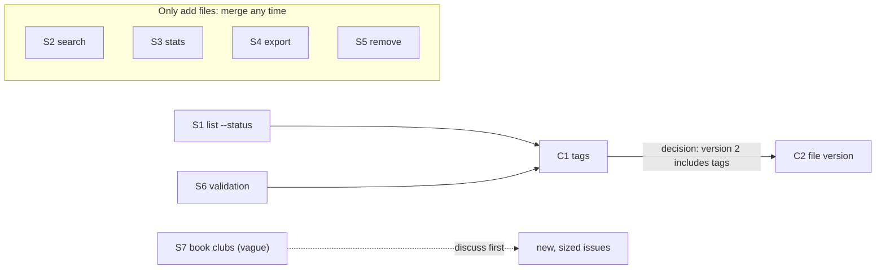

# 5. Decompose into tracks

> **In one sentence:** Parallel agents are only as good as the split you give them: turn the plan into stand-alone issues, group them by blast radius into tracks that don't touch each other, and sequence the merges, not the work.

## What you'll be able to do

- Turn a planning conversation into stand-alone issues that a fresh session can execute without you.
- Size work by blast radius and group it into independent tracks, spotting textual and semantic conflicts before they happen.
- Plan a merge order that is separate from the work order.
- Write a kickoff prompt that stops an agent from re-deriving facts, re-opening decisions and making design choices silently.
- Write a handoff pack that lets a fresh session (or you, after a week away) pick up a track.

## Why this matters

Picture a Tuesday morning. You have nine issues and a new habit: one session per issue. You open five terminals, type "implement #12" into each one, and go make coffee.

Forty minutes later, two sessions have changed the storage format in two incompatible ways. One has re-opened a decision you made last week ("I think tags should live in a separate file"). One stopped to ask a question the code already answers. The fifth did exactly what its issue said, but the issue was written after a conversation that session never saw, so it built the wrong thing.

None of that is the agents' fault. Parallelism doesn't fix a bad split. It multiplies it. With one agent on one task, you catch a misunderstanding while it happens. With five, you catch five of them at review time, all at once.

When agents write the code, the scarce resources are your review attention and the coherence of the system. Decomposition decides how both get spent. [Addy Osmani](https://addyosmani.com/blog/code-agent-orchestra/) lists work decomposition, next to clear specs and output verification, as the skills that replace writing the code yourself. This module is about that skill. [Module 06](../06-run-sessions-in-parallel/README.md) covers the mechanics of running the sessions.

## The backlog belongs to the agent; you steer it

At The Agile Monkeys we rarely write issues by hand anymore. We plan in conversation, inside a session that already has the project's context ([module 04](../04-context-is-infrastructure/README.md)). "I want to do X, how would you approach it?" "No, I prefer this other way." "What happens to files in the old format?" When the plan is settled, we ask the agent to write it down in the tracker.

❌ **Weak prompt**

```text
Create issues for this.
```

✅ **Better prompt**

```text
Put the plan we just agreed into GitHub issues. One issue per change that can
merge on its own. Every body must stand alone: problem, evidence with
file:line, fix sketch, acceptance criteria, out of scope, and which other
issues it conflicts with or must merge after. If the plan needs more than five
issues, also create an epic that links them. Don't create anything yet: first
show me the titles, a size for each, and the conflicts you see.
```

The last sentence matters. Creating issues is cheap for the agent and expensive for your attention later. Review the *shape* (titles, sizes, conflicts) before anything lands in the tracker. After a few rounds the conventions end up in AGENTS.md or a skill, and "create an issue for this" is enough.

Two habits keep this honest:

- **Don't read every issue. Ask for the plan before execution.** Before a session starts a task, ask it: "Explain what you're going to do and what you'll leave out." Its answer takes a minute to read. A detailed issue body takes ten.
- **Issues age; code doesn't.** An issue body is dated the day it was written. The code is dated today. Tell sessions to check an issue's claims against the code before building on them.

> [!NOTE]
> **At The Agile Monkeys** the backlog of our internal operations platform has held around 500 open issues at a time, created and maintained almost entirely by agents. Some of what's in it is wrong. It's still the best-kept backlog we have had: every issue is detailed enough to hand to a fresh session, and the agent re-plans it when strategy changes. After an important meeting, we update the knowledge base, then ask the agent to close issues that are no longer needed, update the ones that no longer match and create the missing ones.

## An issue is a prompt

A fresh session knows nothing except the repository and what you give it. Often the issue is all you give it. So write issues as prompts, not as reminders for someone who was in the meeting.

A stand-alone issue body has six parts:

| Part | Why it's there |
|---|---|
| **Problem** | The outcome, in user terms. Lets the agent make the small calls you didn't anticipate. |
| **Evidence** | `file:line` references, commands and their output. The session doesn't re-derive what you know, and stale claims are easy to check. |
| **Fix sketch** | The intended approach, briefly. Not a full design; just enough that the agent doesn't pick a different architecture. |
| **Acceptance criteria** | Observable and testable. They become the "Done when" of the kickoff prompt. |
| **Out of scope** | What *not* to do. Agents are eager, and this is where scope creep stops. |
| **Coordination** | Which issues touch the same files or contracts, and the merge order. |

The [practice issue catalog](../../../practice/issues/en.md) writes issues for people starting out: problem, acceptance criteria, likely files, out of scope. Here is its C1 after a planning session turned it into a stand-alone prompt for the [practice project](../../../practice/shelf/), with evidence, a fix sketch and coordination added:

```markdown
# C1: Tag books

## Problem
A status says where a book is in your reading, not what it is about. People
want to group books by topic (sci-fi, work, book-club) and list one group.

## Evidence
- shelf/models.py:16-23: `Book` has id, title, author, status, added_at and
  finished_at. No tags.
- shelf/models.py:34-35: `from_dict` passes every stored key to the
  constructor, so files written before this change load only if `tags` has a
  default.
- shelf/models.py:37-38: `__str__` is the book line that `list` prints.
- shelf/commands/add.py:10-15 and shelf/commands/list_books.py:10-12: neither
  command accepts `--tag`.
- tests/test_store.py:29-37: pins the exact set of keys stored for a book.
  This test has to change.

## Fix sketch
- `Book.tags: list[str]`, defaulting to an empty list.
- `shelf add` gets a repeatable `--tag`; tags are stored lowercase, trimmed,
  without duplicates, in the order first given.
- `shelf list --tag X` filters, ignoring case. The book line shows tags in
  parentheses after the author; books without tags print as today.

## Acceptance criteria
- [ ] `--tag Sci-Fi --tag " sci-fi "` stores `["sci-fi"]`.
- [ ] `shelf list` prints `#1 [to-read] Dune by Frank Herbert (sci-fi, classics)`.
- [ ] `shelf list --tag sci-fi` shows only books with that tag.
- [ ] A shelf file without tags still loads, and its books have no tags.
- [ ] The stored-fields test in tests/test_store.py includes `tags`.
- [ ] Each criterion has a test that fails if the change is reverted, and
      `python -m unittest` passes.

## Out of scope
- Tagging existing books, renaming or removing tags.
- Tags in `shelf export` (S4) and `shelf search` (S2).

## Coordination
- Semantic conflict with C2 (file versioning): both change what a stored book
  looks like. Decision (2026-09-17): C1 merges first, and C2's version 2
  includes `tags`. One version, less code. C2 adapts; this issue doesn't.
- Textual overlaps: S1 edits list_books.py and S6 edits add.py. If they are
  still open, both merge before this issue; when told, merge origin/main and
  keep their changes.
```

Notice two things. It records a decision, with its date and its reason, so no session re-opens it. And the **Coordination** section carries the merge order *inside the issue*, where every session that picks it up will see it.

> [!TIP]
> Put a closing keyword in every PR description ("Closes #14"). A bare "#14" only mentions the issue; it doesn't close it on merge ([GitHub docs on linking PRs to issues](https://docs.github.com/en/issues/tracking-your-work-with-issues/using-issues/linking-a-pull-request-to-an-issue)). With dozens of PRs a week, issues that stay open after their work merged are how a backlog starts lying.

## Size by blast radius

[Peter Steinberger](https://steipete.me/posts/just-talk-to-it) thinks about the "blast radius" of every change: before starting, he estimates how long it will take and how many files it will touch. Many small bombs can go off in parallel. A few big ones can't: they overlap, their commits can't be isolated, and when one goes wrong it is hard to untangle.

Blast radius has two dimensions, and people usually check only the first:

1. **Textual overlap.** Two tracks edit the same lines. Git tells you at merge time. Annoying, visible, usually cheap.
2. **Semantic overlap.** Two tracks edit *different* lines, or different files, that share an assumption: a data format, a function's contract, an error convention, output that another program parses. Git merges cleanly and the result is wrong. Only tests, or a reviewer who knows both changes, will catch it.

The practice project has a clean example. C1 (tags) and C2 (file versioning) both change what a stored book looks like. When we implemented both on separate branches and merged them, git merged `models.py` and `store.py` without complaint and stopped only on `tests/test_store.py`. Whichever side of that test you keep, a stored-format test fails, until someone decides whether version 2 of the file contains tags. Git reported a conflict in one test file. The real conflict is a design decision.

S4 (export) is the quieter case. It shares no lines with C1, but once tags exist, an export written before them leaves them out, and nothing fails. That's not a reason to couple the two tracks. It's a reason for a one-line follow-up issue ("export includes tags") that waits for both.

Watch out for **hotspot files**: places nearly every change touches. In a web app that's usually the router, the dependency container, the migrations index, the lockfile or the changelog. Hotspots produce small, frequent textual conflicts. You have two options:

- **Accept them.** Tell each track where to add its entry, and expect a trivial merge.
- **Remove them first.** Make one short, sequential change that turns the hotspot into separate files, before you start the parallel tracks. [Kent Beck](https://newsletter.kentbeck.com/p/augmented-coding-beyond-the-vibes) keeps structural changes separate from behavioral ones for the same reason.

The practice project was built the second way. Its commands are discovered automatically from `shelf/commands/`, one module per command, so adding `search`, `stats` or `export` means adding a file, not editing a shared list. S2, S3 and S4 only add files, so they can't collide with anything. What's left are smaller overlaps: S1 and C1 both change `shelf/commands/list_books.py`, and S6 and C1 both change `shelf/commands/add.py`. Those are textual overlaps with no shared contract, fixed in a minute at merge time.

For every pair of issues, we make this decision:

| | Small blast radius | Large blast radius |
|---|---|---|
| **No overlap** | Parallel. Merge in any order. | Parallel, but stagger the reviews: each large PR needs your full attention. |
| **Overlap** (same files or same contract) | Parallel, with a planned merge order. The later track merges `main` and adapts. | Sequence them, or make them one track with one owner. |

Ask the agent for the first pass. It reads code faster than you do:

```text
For each open issue, estimate: the files it will likely touch, the shared
contracts it changes (data formats, public functions, command output), and
its size (S/M/L). Then list every pair of issues that overlap textually or
semantically, and the files that more than two issues touch.
Don't propose tracks yet.
```

> [!IMPORTANT]
> **"Independent" means disjoint files and no shared contract.** If you can't say which files a track owns, it isn't a track yet.

## One PR, end to end

When a piece of work is big, the old reflex is to phase it: PR1 adds the model, PR2 the storage, PR3 the command. With agents, that reflex usually costs more than it saves.

With agents doing the implementation, writing the code is no longer the expensive step. Human review and validation are. Every extra PR adds one more review, one more CI run, one more context reload for you, and one more intermediate state that has to be valid on its own. Phasing also creates coordination debt: the PRs must merge in order, each description has to explain the missing pieces, and someone has to track all of them.

Phasing instructions are also fragile. Scope instructions don't survive. At The Agile Monkeys we once told an agent to implement phase 1 of a four-phase issue, and it shipped all four. One line saying "stop early" competes with everything else in the context that describes the whole feature.

So our default is **one issue, one PR, end to end**: model, storage, command, tests and docs in the same change. When the result is too big to review as one PR, the fix is a smaller *issue*, a thinner slice of behavior that still works from end to end. It's not a stack of horizontal layers of the same issue.

We make two exceptions:

- **An irreversible step.** For example, a data migration that must run and be checked in production before the code that depends on it ships.
- **A half that must be deployed first.** For example, a backwards-compatible API that has to be live before its clients switch to it.

## Merge order is not work order

Once you've decided that C1 merges before C2, the tempting conclusion is "C2 waits for C1". It doesn't have to.

> [!IMPORTANT]
> **Merge order is not the work order.** Start every track at once. Only the merges are sequenced.

C2's session can build file versioning today, against the current format. When C1 merges, C2 merges `origin/main` into its branch and adapts: its version 2 now includes `tags`, and its migration from the old format gives old books an empty tag list. The conflict is known in advance, written in both issues and both kickoff prompts, and small. Waiting would turn two 40-minute tracks into an 80-minute queue to save a ten-minute adaptation.

How do you pick the order? Two rules of thumb, and one case where no rule helps:

- **The change that is harder to adapt merges first.** A small change usually goes before a large one: S1 and S6 merge before C1, because re-applying a few lines inside C1's branch is easy, and the reverse is not.
- **A provider merges before its consumers.** A track that changes a contract (an API, a file format, a shared function) goes first; the tracks that use it adapt.
- **When two tracks change the same contract, the order is a design decision.** C1 and C2 both change the stored book. C1 first means version 2 includes tags: one version, less code. C2 first means C1 has to bump the file to version 3 and add a migration: more code, but it's what a real project does once version 2 has shipped. Neither is wrong. Decide before either session starts, and write the decision into both issues.

There's one more exception. If the first track's design is still uncertain, the second track's "small adaptation" can turn into a rewrite. If C1's tag model might change completely, start C2 once C1's *plan* is approved, not after it merges.

Here is the practice backlog as tracks. Every issue starts now; an arrow means "merges before":



(S5 adds a method to `store.py`, but in a part of the file C1 and C2 don't touch, so git merges it cleanly.)

S7 ("make shelf more useful for book clubs") is not a track. It's a conversation that hasn't happened yet. When it happens, you may find that part of it is already C1 (tags) or S4 (export), and that most book-club ideas change the file format too. Decompose after you decide, not before.

## Prioritize by value, not by capacity

When one engineer can run five or ten tracks, "we have too many stories" stops being the problem. The problem is having the wrong stories at the top. A session will happily work on whatever you give it. It won't tell you that the most valuable issue is number 40 on the list.

So order tracks by value, and push back on bad prioritization rather than on load. When we want a number, we use a variant of [Weighted Shortest Job First (WSJF)](https://framework.scaledagile.com/wsjf):

```text
priority = (business value + time criticality + risk reduction) / effort
```

Ask the agent to propose the scores and justify each one in a sentence. You correct the two or three that are wrong. That's a two-minute decision instead of a meeting.

## Advance before discussing

Vague requests like S7 invite ping-pong: "What do you mean by book clubs?", "Which features?", "Can you write the requirements?" Each round costs a day on the calendar and produces a longer document, not a better product.

What we do instead: one focused discussion with the agent (it proposes two or three options and you pick one), then we **record the decision** in the knowledge base and **build the next slice**. Feedback on something that works is worth more than another round of requirements. [DHH](https://lexfridman.com/dhh-2/) makes a similar point: people are much better at picking between options they can see than at specifying what they want in advance.

This is not an excuse to skip thinking. Irreversible or expensive decisions still deserve the discussion: a public API, a production data model, anything involving money or personal data. The point is to stop discussing questions that a small slice would answer faster.

> [!NOTE]
> **At The Agile Monkeys** we treat a second round of requirements questions as a warning sign. When we notice one, we write down the decision we would make today and why, build the smallest slice that tests it, and ask for feedback on the slice.

## The kickoff prompt

The issue says *what*. The kickoff prompt tells one session *how to work on it now*: in which checkout, with which facts already established, which decisions are closed, and when to stop. It's the difference between a session that finishes and one that stops to ask you three things you already knew.

These are the sections we use, and the failure each one prevents:

| Section | Prevents |
|---|---|
| **What I already checked: start from here** | Twenty minutes and a pile of tokens spent re-deriving facts you already have. |
| **Do this first: prove the premise** | A complete implementation built on a false assumption. |
| **Decisions already made: don't re-open them** | Sessions that "improve" last week's decision. |
| **Scope, and "report, don't fix"** | Scope creep. Out-of-scope findings go into the report, not into the PR. |
| **Repo rules that will fail the build** | A PR that fails CI on a rule the agent couldn't guess. |
| **Environment notes that will cost you an hour** | Known traps: ports, data files, slow tests, variables that must be set. |
| **Coordination** | Surprises from other tracks: who merges first, which files belong to someone else. |
| **If you find yourself making design decisions, stop and report** | Silent architecture. |
| **Done when** | "Done" meaning "I wrote some code". |
| **Report back** | A report you can't act on. You want the PR URL and the decisions it made. |

The complete template:

```text
You're working on issue #<number>: <title> (<link>).
Work only in the worktree at <path>, on branch <branch>, created from a
freshly fetched origin/main. Don't edit any other checkout.

GOAL
<One or two sentences: the outcome, not the steps.>

WHAT I ALREADY CHECKED. START FROM HERE, DON'T RE-DERIVE IT
- <fact, with file:line, a command or its output>
- <fact>

DO THIS FIRST, BEFORE ANY IMPLEMENTATION: PROVE THE PREMISE
<The cheapest check the plan depends on, e.g. "write a failing test that
loads a file in the old format".> If the premise turns out to be false,
stop and tell me what you found. Don't build around it.

DECISIONS ALREADY MADE. IMPLEMENT THEM, DON'T RE-OPEN THEM
- <decision>: <one-line reason>
- <decision>: <one-line reason>

SCOPE
In scope: <...>
Out of scope: <...>
Report, don't fix: if you find bugs or improvements outside this scope,
list them in your final report. Don't change them in this PR.

REPO RULES THAT WILL FAIL THE BUILD
- <e.g. every behavior change needs a test that fails if it is reverted>
- <e.g. standard library only, no new dependencies>
- <e.g. never edit a migration that has already been applied>

ENVIRONMENT NOTES THAT WILL COST YOU AN HOUR
- <e.g. SHELF_PATH points to a scratch file for this track; never unset it>
- <e.g. port 4467 is yours; don't stop processes you didn't start>
- <e.g. variables you need, by name only: API_TOKEN>

COORDINATION WITH OTHER TRACKS
- <e.g. C1 changes the stored book and merges before you. When I tell you
  it has merged, merge origin/main and adapt.>
- <e.g. files other tracks own: ... If you need to change one, stop and ask.>

IF YOU FIND YOURSELF MAKING DESIGN DECISIONS, STOP AND REPORT
A design decision is anything this prompt and the issue don't settle that
another engineer could reasonably decide differently: data formats, public
names, error behavior, new dependencies.

DONE WHEN
- [ ] Every acceptance criterion in the issue is covered by a test that
      fails if the change is reverted.
- [ ] The full local check passes: <command>.
- [ ] One PR against main, with "Closes #<number>" in its description.
- [ ] The PR description says what you ran and what you didn't run.

REPORT BACK
The PR URL. The commands you ran and their results. What you didn't run, and
why. Anything you had to decide that the issue didn't settle. Out-of-scope
findings.
```

Not every task needs every section. A one-line fix needs a goal and a "done when". But a section you skip should be empty because there is nothing to say, not because you didn't think about it.

"Fails if the change is reverted" is a check you can run, not a promise to take on trust. [Module 03](../03-close-the-loop/README.md) has the commands for work before and after it's committed, including changes that only add files.

> [!TIP]
> Durable rules don't belong in kickoff prompts. If you paste "every change needs a test" into every prompt, move it to AGENTS.md or, better, to a hook ([module 03](../03-close-the-loop/README.md)). The kickoff prompt carries what is specific to *this* task, *this* week. The [Codex best practices](https://learn.chatgpt.com/guides/best-practices) give the same advice, and use a similar skeleton for prompts: Goal, Context, Constraints, Done when.

## Handoff packs

Tracks outlive sessions. A context window fills up, you go on holiday, a track moves to a teammate, a session stops because a decision is pending. The worst handoff is "we were close, the tests were mostly passing". A week later, nobody knows what "close" or "mostly" meant.

A handoff pack is a short file that lets a fresh session (or you) continue without the original conversation. Its core rule: **a number survives a week away; an adjective does not.** "16 tests, 2 failing: test_load_old_format and test_list_two_tags" is a handoff. "Almost done" is not.

The structure that works for us separates what is known from what is hoped:

- **Verified:** true, and how you know (command, output, commit). Safe to build on.
- **Believed:** probably true, but not checked. The next session verifies before relying on it.
- **Open:** undecided or unfinished, with a recommendation when you have one.
- **Traps:** what cost time and will cost time again. Usually the most valuable section.
- **Continue here:** numbered steps. The first one must be something you can do today, with its command.
- **Bootstrap prompt:** a self-contained prompt to paste into a new session.

```markdown
# Handoff: <track> (<issue link>), <date>

State in one line: <e.g. "PR #41 open; 3 of 4 acceptance criteria covered;
waiting for a decision on whether version 2 includes tags">

## Verified
- <fact> (how: <command and result, commit, date>)

## Believed (not verified: check before relying on it)
- <belief> (why we believe it: <reason>)

## Open
- <question or unfinished item> (recommendation: <...>; who decides: <...>)

## Traps
- <what went wrong, what it looked like, how to avoid it>

## Continue here
1. <first step, doable today, with the exact command>
2. <next step>

## Environment
- Worktree: <path>, branch <branch>
- Variables needed (names only, never values): <NAMES>
- Links: <issue>, <PR>, <decision record>

## Bootstrap prompt
Read this handoff pack, then the issue and the PR diff. Check every item under
"Believed" against the code before relying on it. Start with step 1 of
"Continue here". Don't re-open the decisions recorded in the issue. Stop and
ask me before deciding anything listed under "Open".
```

Ask the agent to write the pack: it has the context. Then read two sections yourself. **Open**: is there anything you can decide right now, in one sentence? **Traps**: is the thing that wasted your afternoon in there?

## Other ways to see it

**Heavy specs or conversation?** Tools like [GitHub Spec Kit](https://github.com/github/spec-kit) make the phases explicit: specify, plan, break into tasks, implement, with a human check between phases. Steinberger rejects big up-front specs: "This is the waterfall model of software building. We learned long ago that this doesn't work." ([The Pragmatic Engineer](https://newsletter.pragmaticengineer.com/p/the-creator-of-clawd-i-ship-code)). [Birgitta Böckeler](https://martinfowler.com/articles/exploring-gen-ai/sdd-3-tools.html) warns that reviewing piles of spec files can give a false sense of control. We sit in between. Our issues *are* specs, but short ones, generated from a conversation, and we review the plan the agent explains rather than every issue body.

**Small batches, or one PR end to end?** [DORA's research](https://dora.dev/dora-report-2025/) keeps finding that working in small batches matters, and "one PR, end to end" can sound like the opposite. It isn't, as long as the *issue* is small. Batch size is about how much behavior changes at once, not how many PRs one behavior is spread across. Where teams really disagree is the threshold. Some cap PRs by line count. We cap them by what one reviewer can hold in their head, and split the issue when it's too much.

**Let the agent decompose on its own?** Claude Code's `/batch` fans one large change out to subagents, each in its own worktree and each opening a PR ([best practices](https://code.claude.com/docs/en/best-practices)). [Agent teams](https://code.claude.com/docs/en/agent-teams) let a lead session split and assign the work. They work well for mechanical, uniform changes, like a rename across 200 files. For product work we still decompose in conversation, because the split encodes decisions about what matters. The tools follow this lesson's rule too: the agent teams docs tell you to partition the work so that teammates don't edit the same files.

## Watch out

- **Splitting by layer.** "PR1: model. PR2: storage. PR3: command." Three reviews and three intermediate states for one behavior. Split by behavior instead.
- **"As discussed" issues.** An issue that depends on a conversation the implementing session never saw. If the body wouldn't make sense to a new colleague, it won't make sense to a new session.
- **Hidden shared contracts.** Two tracks that share no file but share a format. Before starting, ask: "What does each track assume that another track might change?"
- **More tracks than review capacity.** Work that nobody reviews is a queue, not throughput. In Osmani's words: "Don't run more agents than you can meaningfully review."
- **Adjectives in handoffs.** "Almost working", "mostly done", "should be fine". Replace each one with a number or a command, or move it to **Believed**.
- **Kickoff prompts that settle nothing:**

❌ **Weak prompt**

```text
Implement #14 (tags). Be careful, the storage stuff is tricky.
```

✅ **Better prompt**

```text
Implement #14 (C1: Tag books) in the worktree at ../shelf-c1, branch c1-tags.
Already checked: Book has no tags field, and from_dict passes every stored key
to the constructor, so the new field needs a default. Decisions made, don't
re-open them: tags are lowercase, trimmed and deduplicated; list shows them in
parentheses; C1 merges before C2, and C2 adapts, not you. First, write a
failing test that loads a shelf file without tags. If S1 and S6 are still
open, they merge before you: when I tell you, merge origin/main and keep their
changes. If you need to
decide something the issue doesn't settle, stop and ask. Done when every
acceptance criterion has a test and python -m unittest passes. Report the PR
URL and any decision you made.
```

## Check your understanding

1. Two issues edit different files, and git will merge them without a conflict. Can you run them as independent tracks without further thought?

   <details><summary>Answer</summary>

   Not yet. No textual overlap doesn't mean no semantic overlap. Check whether they share a contract: a data format, a function's behavior, an error convention, output that tests or other programs parse. If they do, plan a merge order and write it in both issues.

   </details>

2. You decided that C1 merges before C2. When should C2's session start?

   <details><summary>Answer</summary>

   Now, in parallel with C1, with the merge order and the decision ("version 2 includes tags") written in its kickoff prompt. Only the merges are sequenced. The exception: if C1's design is still uncertain, start C2 once C1's plan is approved, so C2 doesn't adapt to a moving target.

   </details>

3. A large feature won't fit in one reviewable PR. A colleague proposes PR1 for the database, PR2 for the API and PR3 for the UI. What do you propose instead, and when would you accept their split?

   <details><summary>Answer</summary>

   Split the *issue* into thinner slices, each one a behavior that works end to end in one PR. Accept a sequential split when a step is irreversible (a production data migration that must be checked first) or when one half must be deployed before the other can work (a backwards-compatible API before its clients).

   </details>

4. Why does a handoff pack separate "Verified" from "Believed"?

   <details><summary>Answer</summary>

   Because the next session treats everything it reads as true. The split tells it which facts it can build on and which ones to check first. Without it, last week's guess becomes the premise of this week's work.

   </details>

5. A session spent 20 minutes re-reading storage code you had already analyzed. Which kickoff prompt section would have prevented it?

   <details><summary>Answer</summary>

   "What I already checked: start from here, don't re-derive it." Give the facts with `file:line` references, so the session can confirm them in seconds instead of rediscovering them.

   </details>

## Key points

- Parallel sessions multiply the quality of your decomposition, good or bad.
- Let the agent write and maintain the backlog. Review the plan it explains, not every issue.
- Write issues as prompts: problem, evidence with `file:line`, fix sketch, acceptance criteria, out of scope, coordination.
- Size by blast radius and check both textual and semantic overlap. Independent means disjoint files and no shared contract.
- One issue, one PR, end to end. Make issues smaller instead of phasing PRs.
- Start every track at once and sequence only the merges. When two tracks change the same contract, the merge order is a design decision: make it before they start.
- Kickoff prompts close decisions and define "done". Handoff packs separate Verified, Believed and Open, with numbers instead of adjectives.

## Go further

- [Just Talk To It](https://steipete.me/posts/just-talk-to-it) by Peter Steinberger: blast radius, many agents in one folder, short prompts.
- [The Code Agent Orchestra](https://addyosmani.com/blog/code-agent-orchestra/) by Addy Osmani: decomposition, file ownership, and verification as the real bottleneck.
- [Claude Code best practices](https://code.claude.com/docs/en/best-practices): writing a spec with the agent, implementing it in a fresh session, and `/batch`.
- [Codex best practices](https://learn.chatgpt.com/guides/best-practices): the Goal / Context / Constraints / Done when prompt structure.
- [Weighted Shortest Job First](https://framework.scaledagile.com/wsjf): the prioritization formula behind our value-over-effort ordering.
- [Lab 5](lab.md): turn the practice backlog into issues, tracks and kickoff prompts.

Next: [6. Run sessions in parallel](../06-run-sessions-in-parallel/README.md)
