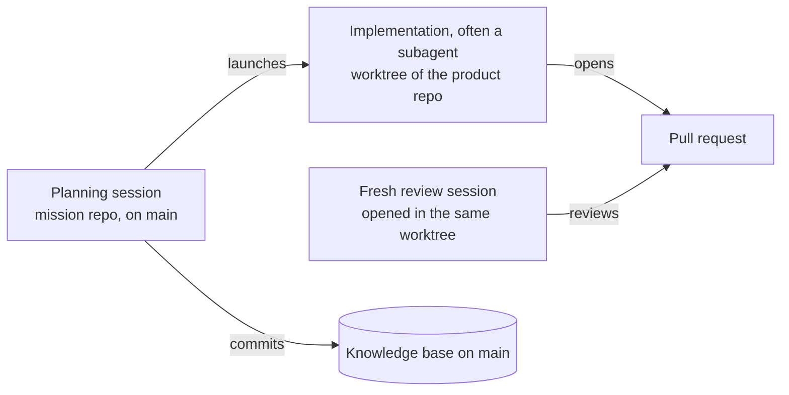

# 6. Run sessions in parallel

> **In one sentence:** Running many agents is an attention problem before it is a tooling problem: isolate every track so sessions can't break each other, arrange sessions so decisions reach you in priority order, and add sessions only as fast as your review capacity grows.

## What you'll be able to do

- Choose between worktrees, one shared folder and cloud agents for a project, and explain the trade-offs.
- Create, use and clean up git worktrees from a freshly fetched `origin/main` without the usual traps.
- Isolate runtime resources (ports, databases, data files, memory) so parallel tracks don't break each other's tests.
- Organize sessions by track and priority, and handle their notifications without losing the thread.
- Run an orchestrator session that holds a plan and fans out focused sessions you can steer one by one.
- Recognize when you're ready for more sessions, and when to step back.

## Why this matters

You give an agent a well-specified issue. It starts reading code. Two minutes later you check: still reading. You open your email. Eight minutes later it asks a question, you answer, and it runs the tests for four minutes. By the time the PR is ready, you've spent 40 minutes half-watching one session, and you feel less productive than when you wrote the code yourself.

[DHH describes exactly this on the Lex Fridman Podcast](https://lexfridman.com/dhh-2/): agents "are at once both too fast and too slow". Too slow to keep you in flow while you wait for them; too fast to write the code alongside them. Waiting on one, he says, "feels actually like you're a little bit useless."

The way out isn't a faster agent. It's having another decision ready when one session goes quiet. With several sessions running, "you can feel like you're in a flow state because you're constantly doing programming work in the sense that you're making decisions" (same interview).

But as soon as you run two sessions in one checkout, new problems show up. One session reformats a file the other is halfway through editing. Tests fail because another session's dev server holds the port. One agent "cleans up" a database the other one was using. This lesson is about getting the benefit of parallel sessions without paying for it in broken work.

## Why parallel works, and where it stops

Parallel sessions don't make you review faster. [Simon Willison](https://simonwillison.net/2025/Oct/5/parallel-coding-agents/) is precise about it: "I can only focus on reviewing and landing one significant change at a time". What he runs in parallel are tasks that don't compete for that focus: research and proofs of concept, explanations of existing code, low-stakes maintenance, and carefully specified work.

[Peter Steinberger](https://newsletter.pragmaticengineer.com/p/the-creator-of-clawd-i-ship-code) describes a similar shape: one main project that has his focus, plus satellite projects where he spends five minutes and the agent then works for half an hour.

That suggests a practical way to mix sessions:

- **One focus track.** The change you'll review carefully today. It gets your attention first.
- **Satellite tracks.** Well specified, verifiable, small blast radius ([module 05](../05-decompose-into-tracks/README.md)). Each needs a few minutes of decisions.
- **Background work.** Research, explaining parts of the codebase, knowledge-base upkeep, reviews of other PRs ([module 07](../07-agents-review-agents/README.md)). No merge at the end, so it doesn't feed your review queue.

It also sets the ceiling. How many sessions you can run depends on how many decisions per hour you can make well, not on your machine or your subscription. Beyond that number, extra sessions only build a queue of PRs waiting for you. That's not throughput.

## Three ways to isolate tracks

Every parallel setup has to answer one question: what stops session A from breaking session B? There are three common answers.

**1. One git worktree per track.** A [worktree](https://git-scm.com/docs/git-worktree) is an extra working directory attached to the same repository, with its own branch and its own files. Each session gets one. Edits can't collide, and conflicts appear only when branches merge. This is what the [Claude Code docs](https://code.claude.com/docs/en/worktrees) recommend for parallel sessions, and the [Codex app creates worktrees](https://learn.chatgpt.com/docs/environments/git-worktrees) for the same reason.

**2. One folder, atomic commits.** All sessions share one checkout. Each agent commits only the files it changed, as soon as a unit of work is done. [Steinberger works this way](https://steipete.me/posts/just-talk-to-it), with most of his agents "in the same folder". His reasons: one dev server where he can try several changes at once, no juggling of several servers, and an OAuth provider that accepts only a few callback domains. He adds his own caveat: "I usually work alone, if you work in a bigger team that workflow obv won't fly" ([Shipping at Inference-Speed](https://steipete.me/posts/2025/shipping-at-inference-speed)).

**3. Cloud or background agents.** Each task runs in its own remote environment, a VM or container that clones the repository and ends with a diff or a PR. [Claude Code cloud sessions](https://code.claude.com/docs/en/claude-code-on-the-web) and [Codex cloud](https://learn.chatgpt.com/docs/cloud) both work this way. Isolation is complete, and nothing runs on your laptop.

The trade-offs, honestly:

| | Worktree per track | One folder, atomic commits | Cloud or background agents |
|---|---|---|---|
| File isolation | Full: separate files per track | None: agents see each other's half-finished edits | Full: a separate machine per task |
| When conflicts show up | At merge time, as git conflicts | All the time, as surprises in the working tree | At merge time, as git conflicts |
| Dev servers and ports | One per worktree; you need a port scheme | One server for everyone (simple) | Inside each environment, if you configure it |
| Databases and local state | Must be separated per branch | Shared: convenient until two tracks need different migrations | One per environment; needs a setup script |
| OAuth callbacks and webhooks | Hard: every port or host must be registered | Easy: one registered URL | Hard: usually no inbound callbacks |
| Trying several changes together | Merge or switch branches first | Natural: everything is in one tree | Only after merging |
| Setup cost per track | Seconds, plus installing dependencies | None | Configure the environment once, then minutes per task |
| Disk and memory | Multiplied: dependencies, build caches and running stacks per worktree | One copy | Not on your machine |
| Steering mid-task | Easy: one terminal per session | Easy | Possible, but less immediate |
| Team fit | Good: one branch and one PR per track | Poor beyond one person, by its author's own account | Good |
| Best for | Code you'll review and merge | Solo work, tightly related changes, documents | Well-specified tasks with a reproducible environment |

> [!NOTE]
> **At The Agile Monkeys** we use all three, for different kinds of work: worktrees for code, one shared folder for knowledge-base work (see [where each kind of work runs](#where-each-kind-of-work-runs)), and cloud agents for tasks that are fully specified and don't need our local stack.

## A worktree recipe that doesn't bite

The basic commands are simple. The traps are in the details, so here is the recipe with the details included.

**1. Start from a fresh `main`.** A worktree created from a stale local `main` starts the track with old code and guarantees conflicts later.

```bash
git fetch origin
```

**2. Create the worktree on a new branch, from `origin/main`.**

```bash
git worktree add --no-track -b c1-tags ../shelf-c1 origin/main
```

- `-b c1-tags` creates the branch, `../shelf-c1` is the new directory, and `origin/main` is the starting point.
- `--no-track` matters. Without it, a branch created from `origin/main` is set up to track `origin/main`. `git status` then compares your branch with `origin/main` ("Your branch is up to date with 'origin/main'"), which confuses people and agents, and a plain `git push` refuses because the names don't match. With `--no-track`, the first push sets the real upstream: `git push -u origin HEAD`. If you already have a tracking branch, `git branch --unset-upstream` fixes it.
- A sibling directory like `../shelf-c1` keeps worktrees out of your main checkout. If you put them inside the repository instead (`claude --worktree` uses `.claude/worktrees/`), add that path to `.gitignore`, or your main checkout lists it as untracked.
- Git refuses to check out a branch that is already checked out in another worktree, `main` included. That's a feature: it's what stops two sessions from silently sharing a branch.

**3. Prepare the worktree.** A new worktree has the tracked files only. Untracked and ignored files are missing: `.env`, `node_modules`, virtual environments, build caches. Install dependencies in each worktree, and copy local configuration on purpose. Claude Code can copy selected ignored files for you with a [`.worktreeinclude` file](https://code.claude.com/docs/en/worktrees).

**4. Check what exists.**

```bash
git worktree list
```

Run it at the start and at the end of every working session. It's the fastest way to spot forgotten tracks.

**5. Clean up after the PR merges.**

```bash
gh pr view 42 --json state --jq .state   # expect MERGED
git worktree remove ../shelf-c1
git branch -D c1-tags
git worktree prune
```

- `git worktree remove` refuses if the worktree has modified or untracked files. Don't reach for `--force` by reflex. Look first: that refusal may be protecting the only copy of some work.
- `git branch -d` (lowercase) usually refuses after a squash merge, because the squash created a new commit and the branch's own commits aren't in `main`. Once `gh pr view` confirms the PR is merged, `-D` is safe.
- `git worktree prune` removes the records of worktrees whose directories were deleted by hand. `git worktree list` marks those as `prunable`.

> [!WARNING]
> **Our own cleanup drifts.** At The Agile Monkeys we have found dozens of stale worktrees in a single repository, left behind by sessions that ended before their PRs merged. They waste disk, keep old branches alive and confuse the next session that runs `git worktree list`. Put cleanup in your end-of-session checklist, and sweep once a week.

Tools can run the recipe for you. `claude --worktree <name>` creates a worktree (branched from your default branch on the remote) and starts a session inside it, and several session managers create a worktree per task. Learn the manual recipe anyway. It's what you'll need when something goes wrong.

## Where each kind of work runs

Putting the pieces together, this is the layout we use:



- **The knowledge base lives on `main`, in the mission repository** ([module 04](../04-context-is-infrastructure/README.md)). Planning sessions read and write it. Their tasks are independent enough not to collide, so they share one checkout, each commits only its own files, and they push straight to `main`. That's a deliberate exception, for a repository of documents protected by validators and hooks instead of pull request review; module 04 explains it. Product code never works this way.
- **Code goes in worktrees of the product repository.** From the planning session we ask for a worktree from a fresh `origin/main` and run the implementation there, often as a subagent, so the planning session's context stays small.
- **Review happens in a fresh session opened in the worktree.** The reviewer must not carry the implementation session's reasoning, or it will tend to agree with it. [Module 07](../07-agents-review-agents/README.md) covers what that session does.

## Isolate resources, not just files

Worktrees isolate files. Your tracks still share one machine: ports, databases, containers, caches, memory. Most "flaky" failures in parallel work are two tracks fighting over one of those.

**Ports.** Two dev servers can't both listen on port 3000. Give each worktree a port derived from its branch name, so the same track always gets the same port:

```bash
BRANCH=$(git branch --show-current)
PORT=$((4000 + $(printf '%s' "$BRANCH" | cksum | cut -d' ' -f1) % 1000))
echo "$BRANCH -> $PORT"
```

With 1,000 possible ports, two branches can still collide. Print the port and let the server fail loudly if it's taken.

**Databases and data files.** Two branches with different migrations can't share a database. Use one local database, or a whole local stack, per branch, named after the branch, and let tests create their own. Shared test databases pollute across worktrees: one track's leftover rows make another track's test fail. In the practice project, the "database" is a JSON file, and `SHELF_PATH` lets each worktree use its own.

**Callbacks.** OAuth providers and webhooks need registered URLs, and most providers won't let you register a new port per branch. Your options: one shared dev server for the flows that need callbacks, a preview environment per PR, or a tunnel with a stable name per track.

**Memory.** Each full local stack (database, app server, workers, build watcher) costs memory, and machines hit the ceiling sooner than you'd expect.

> [!NOTE]
> **At The Agile Monkeys** we moved to per-branch local stacks after parallel worktrees kept clobbering each other's databases. On our laptops, memory runs out at around five or six full stacks (*indicative, and very dependent on the stack*). Beyond that, tracks either share a stack on purpose or move to preview environments.

One rule holds whatever your stack looks like:

> [!IMPORTANT]
> **Never let a session stop resources it didn't start.** An agent that "cleans up" containers, or kills whatever holds a port, can take down another track's database in the middle of its test run. Tell every session: stop only what you started. And when a load-sensitive test fails while five stacks are running, rerun it on its own before calling it a failure.

## Managing many sessions

Tools change every few months. These principles have held:

1. **One session, one track; one code track, one worktree.** Never two tracks in one session, and never two sessions writing code in one worktree. Planning sessions in the knowledge base are the exception described [above](#where-each-kind-of-work-runs): they share one checkout because they write separate documents.
2. **Name every session after its track.** "c1-tags", not "claude (3)". Most tools support names; in Claude Code it's `claude -n <name>` or `/rename` ([session docs](https://code.claude.com/docs/en/sessions)).
3. **Group sessions by track and order them by priority.** Put the focus track at the top. Groups organize your head as much as your screen.
4. **Handle notifications round-robin, top of the list first.** When a session finishes or needs a decision, it tells you. Finish the decision you're making, then go to the highest-priority session that's waiting, not to whichever one pinged last.
5. **Keep a plain shell next to each agent.** You'll use it to run the tests yourself, check `git status` and look at a diff. It also keeps you from typing into the wrong window: Steinberger once prompted the wrong project, and the agent spent about 20 minutes confused, trying to work out what he meant ([Lex Fridman Podcast #491](https://lexfridman.com/peter-steinberger-transcript/)).
6. **Keep session IDs.** Claude Code and Codex both save sessions locally and can resume them (`/resume`; see the [Codex commands](https://learn.chatgpt.com/docs/developer-commands)). Write each ID next to its track. After a restart, IDs are how you recover which session was doing what, and they let one session read others' transcripts, for example to write a status update across tracks.

**Notifications on or off?** Practitioners disagree. DHH moved from plain tmux to [Herdr](https://herdr.dev/), "essentially tmux plus agent notifications", with a bell when an agent is ready for a decision. [Mitchell Hashimoto](https://mitchellh.com/writing/my-ai-adoption-journey) advises the opposite: "turn off agent desktop notifications. Context switching is very expensive." (He also isn't running several agents, and currently doesn't want to.) With one or two agents, notifications mostly interrupt deep work. With five or more and no notifications, you end up polling every window, which is worse. What we do: notifications on, treated as a *queue*, not an interrupt. When we need deep focus, such as reading a data model line by line, we silence them and let the queue wait.

Tools, as examples only (the [tools reference](../reference/tools.md) keeps the list current): terminal multiplexers like [tmux](https://github.com/tmux/tmux/wiki) and the agent-aware [Herdr](https://herdr.dev/); agent-aware terminals and apps like [Warp](https://www.warp.dev/), [Superset](https://github.com/superset-sh/superset) and [Conductor](https://www.conductor.build/) (the last two create a worktree per task); [claude-squad](https://github.com/smtg-ai/claude-squad), which combines tmux and worktrees; and what's built into the agents, like Claude Code's [agent view](https://code.claude.com/docs/en/agent-view) (`claude agents`), which shows every background session and which ones need input.

> [!NOTE]
> **At The Agile Monkeys** the engineers who run the most sessions keep them in an agent-aware terminal, grouped by track, ordered by importance and handled round-robin. We've switched tools more than once: one showed each session's PR right next to it, but it sometimes crashed when we used it. Pick tools you can walk away from without losing your practice.

## Subagents or separate windows?

Some parallel work doesn't need a window of its own. A **subagent** is a worker the current session starts for a side task. It works in its own context window and returns a summary ([Claude Code subagents](https://code.claude.com/docs/en/sub-agents), [Codex subagents](https://learn.chatgpt.com/docs/agent-configuration/subagents)).

| | Subagent | Separate session in its own window |
|---|---|---|
| Your main context | Stays small: only the summary comes back | Untouched, but you hold the connections between sessions in your head |
| Visibility while it runs | Low: you see the result | Full: you see every step |
| Steering mid-task | Hard | Easy |
| Notifications and queueing | Handled by the parent session | Yours to manage |
| Good for | Bounded, verifiable work: implementing an approved plan, searching, a specialist review | Work you may need to steer, and reviews you want to watch |

Steinberger prefers windows: "What others do with subagents, I usually do with separate windows" ([Just Talk To It](https://steipete.me/posts/just-talk-to-it)). The [Claude Code docs](https://code.claude.com/docs/en/agents) recommend subagents for side tasks that would otherwise flood your conversation. We use both on purpose: the planning session launches the implementation as a subagent in a worktree, and the review happens in a separate, fresh window, because that's the one we want to watch.

## An orchestrator session for each plan

When a plan has many threads, give the plan its own session. Call it an orchestrator, a director or a planner: its job is the plan, not the code. It holds the plan's context (the goal, the decisions, the state of every thread) and fans out focused sessions, each with a kickoff prompt ([module 05](../05-decompose-into-tracks/README.md)) that carries only what that thread needs. You talk mostly to the orchestrator, and open a thread when you want to steer it. If you work on several epics or separate projects, run one orchestrator for each.

Don't confuse this with the modes where the tool runs a swarm of agents for you. In Claude Code, [agent teams](https://code.claude.com/docs/en/agent-teams) put a lead agent in charge of peer sessions, and [dynamic workflows](https://code.claude.com/docs/en/workflows) (the `ultracode` keyword or setting) run dozens of subagents from a script Claude writes. Those are a good fit for bulk work with a clear check, such as an audit or a migration across hundreds of files. Use an orchestrator session when you want to control each thread yourself: you build the broad plan once, then share the details with each thread on its own.

Conventions that make it work:

- **Name each session after its task, role and version**, for example `landing-builder-v2`. The orchestrator can then tell you which thread is where, and so can you after a restart.
- **Roll over instead of overflowing.** When a thread's context fills up, the orchestrator writes a handoff pack ([module 05](../05-decompose-into-tracks/README.md)), starts `-v3` from it and retires `-v2`.
- **Threads coordinate through files, not through you.** Plans, decisions and states go into the knowledge base, so each thread can read what the others did.
- **Choose the model and the effort when a session starts.** The orchestrator can propose them per role ([module 08](../08-token-economics/README.md)). Avoid switching models mid-session: the next request rereads the whole conversation uncached, because "Each model has its own cache" ([Claude Code prompt caching](https://code.claude.com/docs/en/prompt-caching)).
- **End every thread with a retro** that proposes improvements to the skills and instructions it used ([module 04](../04-context-is-infrastructure/README.md#memory-and-the-promotion-path)).

> [!NOTE]
> **At The Agile Monkeys** we use the same pattern for work that isn't code. To produce course material (videos, a landing page and the exercises for each chapter) we talk only to the orchestrator, which proposes each session with its name, role, model and effort. The builder threads work in parallel on independent parts, sometimes overnight, without stepping on each other, because everything they do is written down for the others to read. You don't need to be an engineer to work this way.

Some of us keep one more session above the orchestrators, one that decides what to work on at all, fed by email, chat and meetings. The appendix [Your own operating loop](../appendix/your-own-operating-loop.md) describes it.

## A realistic scaling path

Don't jump from one agent to twenty. The skills build on each other: each stage depends on the previous one having become routine.

| Stage | What it looks like | Ready for the next stage when… | Step back when… |
|---|---|---|---|
| **2 sessions** | One focus track plus one satellite (research or a small fix) in a worktree. | You're rarely idle waiting; the satellite finishes without being rescued; its tests are its feedback loop ([module 03](../03-close-the-loop/README.md)). | You keep watching one session's output instead of switching. |
| **5 sessions** | Tracks from a planned decomposition. Kickoff prompts that work cold. Worktrees, ports and data isolation are scripted. | Conflicts are rare and predicted; the review queue doesn't grow from one day to the next; `ACTIVE.md` tells you what every session is doing in ten seconds. | PRs wait more than a day for you; you type into the wrong window. |
| **10 sessions** | Agents review agents ([module 07](../07-agents-review-agents/README.md)). Notifications handled round-robin. Per-branch stacks. Cleanup is a habit. | Your minutes per merged PR go down while rework stays flat; you hit memory or plan limits before attention limits. | You approve plans without reading them; rework goes up. |
| **20+ sessions** | Many sessions don't write code: reviews, triage, knowledge-base upkeep, research. Cloud agents take specified work. Usage limits become a budget question ([module 08](../08-token-economics/README.md)). | There's no next stage. Most engineers don't need this one. | Any of the above, or your sleep suffers. |

For calibration: DHH says he can run "about 16 threads", and that "the faster the agents run, of course, the fewer threads I can run". Steinberger has described anything from three to ten agents at different times. [Boris Cherny](https://x.com/bcherny/status/2007179832300581177), who created Claude Code, described five local sessions, each in its own checkout, plus more running on the web. The numbers differ because the ceiling isn't the tool. It's attention, and how much of it each track needs.

## Session hygiene

With several sessions working on one repository, hygiene is a matter of correctness, not tidiness. A stale line in the knowledge base is read as current truth by the next session. A dirty shared checkout makes the next session's diff lie.

**Start of a session:**

```text
[ ] git fetch origin && git status       clean? on the branch you expect?
[ ] git worktree list                    anything stale to deal with first?
[ ] read ACTIVE.md (or your track list)  which track is this session for?
[ ] code work? create or enter that track's worktree; never code in a shared checkout
[ ] name the session after the track and note its ID next to the track
```

**End of a session:**

```text
[ ] tests and the local check pass, or the handoff says exactly what doesn't
[ ] commit and push, knowledge-base changes included
[ ] PR opened with "Closes #n", or a handoff pack written
[ ] ACTIVE.md row updated: state and next gate, rewritten, not appended
[ ] stop the servers and containers this session started, and only those
[ ] PR merged? remove the worktree and delete the branch you created
[ ] git status is clean
```

Ask the agent to run the end-of-session checklist: it knows what it started. Better still, make the important checks deterministic: a hook that won't let a session end with uncommitted knowledge-base changes beats a reminder ([module 03](../03-close-the-loop/README.md)).

## Sustainability

Running many agents is more tiring than writing code, not less. Steinberger: "I don't have one employee that I manage. I have like five or 10 that all work on things." Willison finds running several agents "surprisingly effective, if mentally exhausting" ([Vibe engineering](https://simonwillison.net/2025/Oct/7/vibe-engineering/)). Asked whether he could keep up his current pace, DHH answered: "This is not sustainable at all."

There's also a pull that has nothing to do with fatigue. Every prompt is a small bet with a fast, unpredictable payoff, and there's always one more session you could start. Steinberger wrote openly about his "slot machine addiction" and about being up until the early hours in [Just One More Prompt](https://steipete.me/posts/just-one-more-prompt). The dynamic is built into the work, so plan for it.

What helps:

- **A stop time, and silence after it.** Decide when the day ends before it starts. Queue tomorrow's work as issues and kickoff prompts instead of starting sessions at midnight, and turn off phone notifications from agents and review bots outside working hours.
- **Don't launch long runs just to "use the night".** An overnight run you then review exhausted is a bad trade. Unattended work should be work that won't need you when it finishes: research, reviews, specified low-risk tasks.
- **Protect your sleep.** Your judgment is the scarce resource in this whole system, and tired review is how bad code gets merged.
- **Watch your hours, not only your PRs.** If your sessions and your hours grow together, you haven't scaled. You've just worked more.

> [!NOTE]
> **At The Agile Monkeys** we treat a sustainable pace as part of the practice. When a parallel setup only works with late nights, we fix the setup: too many tracks, reviews that should be automated, or decisions that should have been made once and written down.

## Other ways to see it

**Worktrees or one folder?** In [tips shared from the Claude Code team](https://x.com/bcherny/status/2017742741636321619), running three to five worktrees at once is described as their single biggest productivity unlock. Steinberger finds that, for his large refactors, worktrees "would just cause lots of merge conflicts and suboptimal refactors". Each describes their own context: a team that reviews PRs, and a solo developer who tries many changes in one running app. We work in teams and review every PR, so code goes in worktrees.

**How many agents at all?** Hashimoto deliberately runs one. Willison runs several but lands one significant change at a time. Others run dozens. Parallelism multiplies your decomposition, verification and review; if those are weak, one agent is the right number.

**Build your own orchestration?** Steinberger doesn't see the need for multi-agent orchestration systems: "so far I don't see much need for this - usually I'm the bottleneck". DHH expects the vendors to absorb it: "We're not all gonna have to build our own coordination harnesses." We agree for now. Use what your tools provide, script the boring parts (worktrees, ports, cleanup), and spend your effort on decomposition and review.

## Watch out

- **Coding in the shared checkout "just this once".** The next session inherits your mess. Code goes in a worktree, every time.
- **Calling a load failure a regression.** A timeout while six stacks run isn't evidence. Rerun the test alone before anyone "fixes" it by raising the timeout.
- **More sessions than reviews.** If PRs wait longer for you every day, you have more sessions than attention. Remove sessions before adding tools.
- **Losing track after a restart.** No session names, no IDs, no `ACTIVE.md` row: you'll spend the morning reconstructing what ran where.
- **An agent cleaning up resources that aren't its own:**

❌ **Weak prompt**

```text
The tests fail because port 5432 is busy. Fix it.
```

✅ **Better prompt**

```text
The tests fail because port 5432 is busy. Don't stop or kill anything: other
tracks run their own databases on this machine. Find out which process holds
the port and whether this worktree started it. If it didn't, configure this
worktree's stack to use its own port and database name, then rerun the tests.
```

## Check your understanding

1. Your web app has an OAuth login with a single registered callback URL, and you want three parallel tracks. Which isolation option makes the login flow easiest, and what does it cost you?

   <details><summary>Answer</summary>

   One folder with one shared dev server makes the callback trivial, but you lose file isolation and get surprises in the working tree all day. In a team that reviews PRs, that rarely pays off. The usual compromise: worktrees for the tracks, plus one shared dev server (or preview environments with registered URLs) for testing the login flow itself.

   </details>

2. You ran `git worktree add -b s4-export ../shelf-s4 origin/main`, and `git status` in the new worktree says "Your branch is up to date with 'origin/main'". What happened, and how do you avoid it?

   <details><summary>Answer</summary>

   Because the starting point was a remote-tracking branch, git set the new branch to track `origin/main`. Create worktrees with `--no-track` and set the upstream on the first push with `git push -u origin HEAD`. To fix an existing branch, run `git branch --unset-upstream`.

   </details>

3. A test times out in one track while five other stacks are running. The agent proposes raising the timeout. What do you do first?

   <details><summary>Answer</summary>

   Rerun the test alone. If it passes alone, the failure came from resource contention: not a regression, and not a reason to weaken the check. If it fails alone, it's a real failure; investigate it.

   </details>

4. When would you use a subagent instead of a separate window?

   <details><summary>Answer</summary>

   When the work is bounded and verifiable and you don't expect to steer it, like implementing an approved plan, a search, or a specialist review. It keeps the parent session's context small. Use a separate window when you may need to steer, or when you want to watch the work, like a fresh-context review.

   </details>

5. You went from three to eight sessions last week. Name two signs that you went too far.

   <details><summary>Answer</summary>

   Any two of these: PRs wait longer for your review each day; you approve plans without reading them; rework or reverts go up; you type prompts into the wrong window; your working hours grew along with the session count.

   </details>

## Key points

- The limit on parallel sessions is your attention and review capacity, not your machine or your tools.
- Isolate every track: worktrees for code, one shared folder only where tasks truly don't collide, cloud agents for well-specified work.
- Create worktrees from a freshly fetched `origin/main` with `--no-track`, prepare them explicitly, and remove them when the PR merges.
- Files aren't the only shared resource. Give each track its own ports and database or data file, and never stop what you didn't start.
- Name sessions, group them by track, order them by priority, keep their IDs, and treat notifications as a queue.
- Give a big plan its own orchestrator session that fans out threads you can steer. Leave autonomous swarms for bulk work with a clear check.
- Scale in steps (2, then 5, then 10) and move up only when the signals say so.
- Protect your sleep. Tired review is how bad code gets merged.

## Go further

- [Run parallel sessions with worktrees](https://code.claude.com/docs/en/worktrees) (Claude Code docs): `--worktree`, `.worktreeinclude`, subagent isolation and cleanup.
- [git-worktree](https://git-scm.com/docs/git-worktree) (git reference): every option, including `lock`, `move` and `prune`.
- [Run agents in parallel](https://code.claude.com/docs/en/agents) (Claude Code docs): subagents, agent view, agent teams and workflows compared.
- [Embracing the parallel coding agent lifestyle](https://simonwillison.net/2025/Oct/5/parallel-coding-agents/) by Simon Willison: which tasks parallelize well.
- [My AI Adoption Journey](https://mitchellh.com/writing/my-ai-adoption-journey) by Mitchell Hashimoto: a strong counterweight, from someone who deliberately runs one agent.
- [DHH on the Lex Fridman Podcast #501](https://lexfridman.com/dhh-2/): programming with parallel agents, around 1:32 in the transcript.
- [Just One More Prompt](https://steipete.me/posts/just-one-more-prompt) by Peter Steinberger: an honest account of the slot-machine side of this work.
- [Lab 6](lab.md): run three tracks at once and merge them in order.

Next: [7. Agents review agents](../07-agents-review-agents/README.md)
