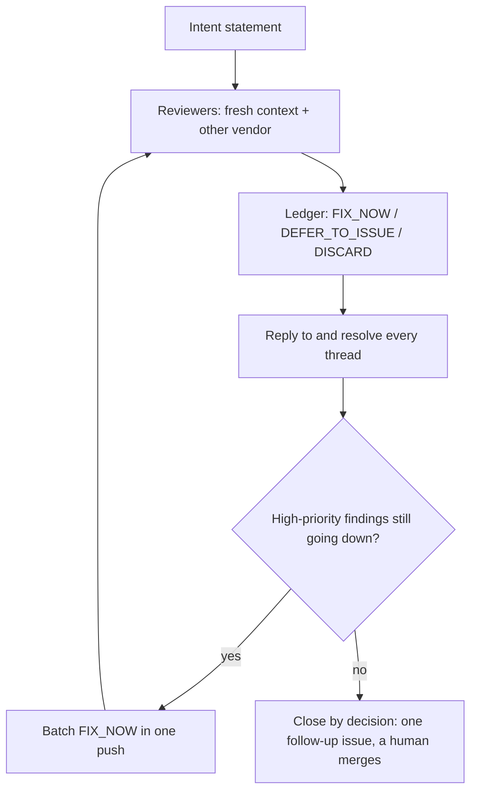

# 7. Agents review agents

> **In one sentence:** Let fresh agents, ideally from another vendor, find the problems; judge every finding against the PR's stated intent; and close the loop by decision, not by exhaustion.

## What you'll be able to do

- Set up reviewers that don't share the writer's blind spots: a fresh context and a second vendor.
- Write a PR intent statement and use it to rule on every finding.
- Triage findings with a ledger (FIX_NOW / DEFER_TO_ISSUE / DISCARD), then reply to and resolve every thread.
- Spot when review rounds stop converging, and close the loop with a recorded decision.
- Feed your verdicts back into the reviewer's instructions so it stops repeating false positives.
- Decide how much of a PR a human must read, based on risk.

## Why this matters

After [module 6](../06-run-sessions-in-parallel/README.md) you have five sessions running and, by the afternoon, five pull requests. Each agent says it's done. You can't read thousands of lines line by line, and you shouldn't merge them unread.

Automated review helps, but it fails in two opposite ways:

1. **Nobody independent looks.** The agent that wrote the code also grades it, so it doesn't question its own choices.
2. **Review never ends.** A reviewer asked to find problems always finds some. An agent told to "address the comments" accepts them all. Each fix adds code, the new code gets reviewed, and the PR grows every round.

We hit the second failure hard: one of our PRs went from about 5,000 changed lines to somewhere between 20,000 and 40,000. This lesson is the system we built to avoid both failures: independent reviewers, a ruler for scope, a ledger for decisions, and a clear point where a human stops the loop.

## Why the writer shouldn't be the only reviewer

A reviewer can be independent of the writer in two ways. They catch different problems, so use both.

**Fresh context.** Open a new session with no memory of the implementation. It sees only the diff, the code around it and your criteria. In the words of the [Claude Code best practices](https://code.claude.com/docs/en/best-practices): "A fresh context improves code review since Claude won't be biased toward code it just wrote."

**A different model, ideally from another vendor.** Models trained differently have different blind spots. [DHH](https://lexfridman.com/dhh-2/) has one vendor's model do the work, a second vendor's model review it, and a bot review the PR on GitHub:

> "Copilot keeps finding stuff that's legitimately broken" — DHH on [Lex Fridman Podcast #501](https://lexfridman.com/dhh-2/)

His reasoning is the one behind human code review:

> "if you finish a job and you ask your also very good peer to review it, you're gonna end up with better code." — DHH on [Lex Fridman Podcast #501](https://lexfridman.com/dhh-2/)

[Addy Osmani](https://addyosmani.com/blog/agentic-code-review/) says the same: two reviewers that work differently catch different kinds of bugs, and that variety matters more than picking the "best" one.

| Reviewer | What it adds | Limits |
| --- | --- | --- |
| Writer's own session | Typos, obvious gaps | Shares every assumption that produced the bug |
| New session, same model | Mistakes that came from the writer's reasoning | Some blind spots shared through training |
| New session, other vendor | Different kinds of bugs | A second subscription or API key |
| Review bot on every push | Catches regressions as the PR changes | Tokens per push; noisy without rules |
| Specialist subagents | Depth in one risky area | More findings to triage |
| Human | Intent, product fit, complexity, accountability | Scarcest resource: spend it on decisions |

> [!NOTE]
> **At The Agile Monkeys** we open the reviewer as a *new session inside the PR's worktree*, so it doesn't inherit the implementation session's context. Most automated review on our repositories comes from a different vendor's model than the one that wrote the code. With the current models, one tends to talk more and helps us think; the other takes a task and just does it, which suits review.

Reviewers can also check *direction*. When we asked another vendor's model to challenge a PR's product choices, it concluded the work was "technically careful but solves the wrong interaction problem". No test suite would have said that. For direction reviews we force exactly one verdict (CONTINUE / CONTINUE_WITH_FIXES / PIVOT / STOP / ESCALATE) plus a confidence level.

## Start with a PR intent statement

Every finding raises a scope question: does this belong in *this* PR? If nothing written answers it, the most confident reviewer wins, and agents are built to agree.

The **intent statement** is the ruler for every scope call. Write it before the first review, put it at the top of the PR body, and give it to every reviewer:

```markdown
## Intent
**Goal:** <one sentence: the behavior this PR delivers>
**Issue:** <link>
**In scope:** <what this PR changes>
**Out of scope (on purpose):** <what it doesn't, and where that lives>
**Context that sets the bar:** <internal or internet-facing? who uses it? what data? how reversible?>
**Decisions already made (don't re-open):** <choices a reviewer might question>
**Verified with:** <commands run and results>
**Look hardest at:** <risky files or functions>
```

Filled in for issue S5 of the [practice project](../../../practice/shelf/), "Remove a book, with confirmation":

```markdown
## Intent
**Goal:** `shelf remove ID --yes` removes exactly one book; without `--yes` nothing is removed.
**Issue:** S5
**In scope:** new `shelf/commands/remove.py`, a `Store.remove` method, messages and exit codes, tests.
**Out of scope (on purpose):** interactive prompts, undo, removing several books, id reuse
after removing the newest book (fixing it needs a stored counter, which changes the file format).
**Context that sets the bar:** local single-user CLI; the data file belongs to the person running it; no network.
**Decisions already made (don't re-open):** no `Are you sure?` prompt; without `--yes` it prints
what it would remove and exits with code 1.
**Verified with:** `python -m unittest` (all pass); manual run against a temporary SHELF_PATH.
**Look hardest at:** `Store.remove` in `shelf/store.py` and the unknown-id path.
```

People skip the "Context that sets the bar" line. For us, it was the line that stopped scope creep.

## Triage: one verdict per finding

This is our review loop. We turned it into a skill after noticing we spent hours a day typing "continue" into review sessions (see [module 4](../04-context-is-infrastructure/README.md)).

1. **Collect** every unresolved thread each round, from bots and humans, across all pages.
2. **Read** each thread in full before deciding.
3. **Record one verdict per finding:**
   - **FIX_NOW**: it breaks the stated goal or belongs to an always-fix category.
   - **DEFER_TO_ISSUE**: real, but outside this PR's intent. It goes into a follow-up issue that makes sense on its own.
   - **DISCARD**: a nitpick, a preference, or wrong. Don't turn nitpicks into issues nobody will pick up.
4. **Batch** FIX_NOW changes into one push per round.
5. **Reply to and resolve every thread**, including discarded ones, with the verdict and the reason.
6. **Watch** for the re-review (we check after 1, 2, 4, 7, 15 and 30 minutes). A push alone doesn't make a PR done.

When the agent can't tell which verdict applies, it marks the finding **ASK** and waits. ASK isn't a fourth verdict. It means a human decides.



The ledger for the S5 PR after round 1:

| ID | Source | Finding | Verdict | Reason (against the intent) | Thread |
| --- | --- | --- | --- | --- | --- |
| F1 | Other-vendor reviewer | `remove 42 --yes` with an unknown id exits 0 and prints nothing | FIX_NOW | Breaks the goal: the user thinks a book was removed | Fixed, test added, resolved |
| F2 | Fresh-context reviewer | No test fails if the `--yes` check is deleted | FIX_NOW | Always-fix: missing behavioral coverage | Test added, resolved |
| F3 | PR bot | `Store.remove` copies the find-by-id loop instead of using `find` | FIX_NOW | Always-fix: this PR introduces the duplication | Uses `find`, resolved |
| F4 | Other-vendor reviewer | After removing the newest book, the next `shelf add` reuses its id | DEFER_TO_ISSUE | Real, but the issue puts it out of scope: the fix changes the file format | Issue linked, resolved |
| F5 | Fresh-context reviewer | A title with terminal escape sequences could spoof `list` output | DEFER_TO_ISSUE (after ASK) | Security is never discarded; on a local single-user tool the attacker already controls the file | Human decided, same issue, resolved |
| F6 | PR bot | Rename `--yes` to `--force` | DISCARD | Decision already made in the issue | Replied, resolved |

Six threads, six replies, one follow-up issue, and every verdict ties back to the intent.

**Always-fix categories.** These get fixed in the PR however the intent is worded, because they cost little now and a lot later:

- **Security or data exposure.** Never discarded: fix it, defer it with a written reason, or escalate it.
- **Serious performance regressions.**
- **Duplication introduced by this PR.** Agents copy code readily, and every copy is a future inconsistency.
- **Missing behavioral coverage.** The test suite must be able to fail if this PR's behavior is reverted.
- **Deviations from documented architecture**, such as rules in `AGENTS.md` or architecture docs.

Also read rewritten tests closely. Osmani warns that agents sometimes change assertions to match newly broken behavior.

## Our failure: reviewers without a ruler

The first version of our review-triage agent was an optimist. For each comment from a review bot it chose between applying it, filing it or discarding it, and in practice it applied almost everything. It worked all night, and phones buzzed with GitHub notifications until morning.

A PR of about 5,000 changed lines grew to between 20,000 and 40,000. The reviewer kept raising things like "if a user types some unusual character, it could be SQL injection". That had nothing to do with the PR's goal, and the product was an internal tool reachable only from inside the company. Each fix added code, the new code drew new hypothetical threats, and the loop fed itself. Every comment looked plausible on its own. What was missing was a ruler.

The fix had two parts:

1. **Reviewers and the triage agent always get the PR's goal and the project context**: internal or internet-facing, who uses it, what data it touches.
2. **When unsure whether to implement something, the agent asks a human** instead of defaulting to "yes".

Context lowers the bar for some threats, not all. Internal tools still leak data and still have authorization bugs. "Internal" is part of the context, not an exemption.

> [!IMPORTANT]
> Treat findings as claims to rule on, not instructions. "A reviewer prompted to find gaps will usually report some, even when the work is sound, because that is what it was asked to do." ([Claude Code best practices](https://code.claude.com/docs/en/best-practices))

## A reviewer prompt that keeps the goal in mind

❌ **Weak prompt**

```text
Review this PR and fix everything you find.
```

It has no goal, no context and no bar, and it lets the reviewer edit code. This is how a 5,000-line PR becomes a 30,000-line one.

✅ **Better prompt**

```text
You are reviewing PR #<n> in a fresh session. You did not write this code.

1. Read the intent statement at the top of the PR body (gh pr view <n>). It is the
   ruler: judge every finding against its goal, scope and context.
2. Read the diff (gh pr diff <n>) and the code around it. Read more code to answer
   your own questions before reporting.
3. Project context: <internal tool used only inside the company | internet-facing
   product | library other teams depend on>. Data: <none | personal | money>.
   Calibrate threats to this context.

Report only: correctness bugs and gaps against the goal; security or data exposure;
serious performance regressions; duplication this PR introduces; behavior no test
would catch if reverted; deviations from documented architecture (AGENTS.md, docs/).
Do not report formatting, anything CI enforces, renames or preferences.
Label problems that predate this PR as PRE-EXISTING.

For each finding: priority (P0 blocks merge, P1 fix in this PR, P2 follow-up),
file:line, a concrete failing scenario, a one-line fix idea.
If you are unsure whether a finding is real or in scope, don't decide: list it under
"Questions for the human". At most five P2 findings. Do not edit files.
If nothing reaches P0 or P1, say so. An empty review is a valid result.
```

You can store these rules in the repository so they apply to every PR. Codex's GitHub reviewer flags only P0 and P1 issues by default and reads a `## Code Review Rules` section in `AGENTS.md` ([docs](https://learn.chatgpt.com/docs/third-party/github)). Claude Code's managed review reads a `REVIEW.md` where you set severity, nitpick caps and re-review rules ([docs](https://code.claude.com/docs/en/code-review)). See the [tools reference](../reference/tools.md).

## Close loops by decision

Review rounds should converge. Watch one number: **high-priority findings per round**. When it stops going down, more rounds won't help.

> [!NOTE]
> **At The Agile Monkeys** we learned this the expensive way. One large PR went through about 20 automated review rounds and more than 200 threads: about 155 fixed, a few mitigated, about 44 deferred. These numbers are indicative, not a benchmark.

High-priority findings per round on that PR:

| Round | 1 | 2 | 3 | 4 | 5 | 6 |
| --- | --- | --- | --- | --- | --- | --- |
| High-priority findings | 8 | 5 | 3 | 0 | 3 | 4 |

After round 4 the loop was generating its own findings. Each CI-plus-review cycle took about 40 minutes, so twenty rounds cost more than a working day of wall-clock time, plus our attention every time a round ended.

**What derivative findings look like.** When most findings in a round are one of these, stop pushing fixes:

- **Consequences of last round's fixes.** "The helper you extracted should also handle X." If your fix broke something, fix it. If the reviewer wants to extend new code, that's scope growth.
- **Parked items raised again in new words.** "Ids get reused after removal" comes back as "ids aren't stable across remove and add". Reply with the existing issue link.
- **Product questions dressed up as bugs.** "Should `remove` support undo?" is a product decision.
- **Hypotheticals beyond the stated context.** If they're security-flavored, defer them with a reason. Never drop them silently.
- **Reviewers contradicting each other.** One round asks for exceptions, the next for return codes. Decide once and add the choice to "Decisions already made".

**How to close:** stop the fix loop; ask for a demanding go/no-go assessment rather than another ledger; classify every open thread in one final ledger; reply with the decision and resolve; put all deferrals into **one** follow-up issue; confirm no security finding was discarded. A human decides on the merge.

```text
Stop the fix loop. High-priority findings per round went 3 → 1 → 2, and the latest
ones are consequences of our own fixes or items we already deferred.
Give me a demanding go/no-go assessment of PR #<n> against its intent statement:
what would break for a user if we merged now? Then classify every open thread in one
final ledger, draft a reply with the reason for each, list what goes into ONE
follow-up issue, and confirm no security finding was discarded.
Don't push code. I decide on the merge.
```

A rule of thumb to start with: if high-priority findings didn't fall over the last two rounds, stop and decide. Adjust the threshold to your risk.

## How much should a human read?

Practitioners disagree, so here are the positions:

- **[Peter Steinberger](https://newsletter.pragmaticengineer.com/p/the-creator-of-clawd-i-ship-code)**: "Did I read all the code? No. Because a lot of code really is just boring plumbing." But he reads database code and outside contributions, his trust comes from verification loops, and he mostly works alone.
- **DHH** reviews the *shape* of everything and reads critical model-layer code line by line. His best review move is pushing back on complexity. He describes agents that say they're done and pass another agent's review, then cut the code in half when he calls it too complicated: "you actually do have to tell them, 'Make it simpler.'" ([Lex Fridman Podcast #501](https://lexfridman.com/dhh-2/))
- **Anthropic** logs every automated approval and has humans review "a risk-weighted sample". New AI reviewers run in shadow mode first ([How Anthropic secures its AI-native SDLC](https://claude.com/blog/how-anthropic-secures-its-ai-native-software-development-lifecycle)).
- **Osmani** tiers review by risk, not by who wrote the code: "A model cannot be paged and cannot be held responsible for what it shipped, so whoever clicks merge owns it." ([Agentic Code Review](https://addyosmani.com/blog/agentic-code-review/))

What we do is tiered reading:

| Tier | What | How a human reads it |
| --- | --- | --- |
| Every PR | Intent statement, ledger, PR shape (files, size, new dependencies, deleted or rewritten tests) | Always; a few minutes |
| Critical | Data model and migrations, auth and permissions, money, deletion and other irreversible operations, outside contributions | Line by line |
| Ordinary logic | Business rules with behavioral tests | The tests and the risky functions; sample the rest |
| Plumbing | Parsing, mapping, wiring, generated code | May go unread, but only because tests, types, CI guards and previews exist ([module 3](../03-close-the-loop/README.md)) |

Reading the shape includes asking whether the change is proportional to the problem:

```text
This looks too complicated for what it does. Make it simpler: same behavior, the
same tests pass, fewer moving parts. Show me what you removed and why it was safe.
```

## Specialist reviewers as subagents

A general reviewer spreads its attention thin. Where mistakes are expensive, add narrow specialists. In one of our setups a lead feature-quality reviewer delegates to security (row-level data access rules), telemetry privacy, UI consistency, and search exposure (what gets indexed, and who can find it). Anthropic describes review agents "scoped to a specific, narrow focus" too ([source](https://claude.com/blog/how-anthropic-secures-its-ai-native-software-development-lifecycle)).

A specialist works when it has **one question** ("can any user read or change data they shouldn't?"), **a trigger** (run it only when the diff touches its area), **the ledger's output format**, and **its own context**. As a subagent it reads what it needs without filling the orchestrator's context window ([Claude Code subagents](https://code.claude.com/docs/en/sub-agents)).

## Teach the reviewer from your verdicts

Every DISCARD in the ledger carries a reason, and without a feedback loop the same false positive comes back on the next PR, and the one after. That costs tokens, review rounds and attention. The fix is the [promotion path](../04-context-is-infrastructure/README.md#memory-and-the-promotion-path) applied to the reviewer: turn repeated verdicts into review instructions.

Automated reviewers can read such instructions from the repository. [Claude Code Code Review](https://code.claude.com/docs/en/code-review-customize) reads a `REVIEW.md` at the repository root, with sections such as what to always check and what not to report. [Codex reviews on GitHub](https://learn.chatgpt.com/docs/third-party/github) follow a `## Code Review Rules` section in `AGENTS.md`. A reviewer you built yourself can read any file you point it to.

> [!NOTE]
> **At The Agile Monkeys** some of our repositories use a custom agent as the pull request reviewer. We reply to each of its comments: "this doesn't apply here", "applied", "stop reviewing these dependencies". Once a week a job collects those replies from every pull request into a file in the repository, and the reviewer reads that file before each review.

```text
Read the review threads of the pull requests merged since <date>, with our
replies and verdicts. Group the findings we discarded for the same reason, and
the categories we keep having to fix. Propose changes to REVIEW.md: what to stop
reporting, with the reason, and what to always check. Propose only rules backed
by at least two pull requests, and link them. Open a pull request with the change.
```

Three cautions:

- **"Out of scope for this PR" isn't "never report this".** DEFER_TO_ISSUE verdicts don't become "don't report" rules, and security findings never do.
- **The instructions are a team rule.** They change through a reviewed pull request ([module 9](../09-teams-and-organizations/README.md)). Claude Code Code Review reads `REVIEW.md` from the base or default branch, never from the pull request's own changes, so the change takes effect once it is merged.
- **Prune them.** Remove a rule when the reviewer no longer makes that mistake, as you would with `AGENTS.md`.

## Tooling traps

Our loop broke on plumbing more often than on judgment:

- **Pagination.** GitHub's GraphQL `reviewThreads` returns at most 100 threads per request. One of our PRs had more than 100, and an agent that read only the first page said everything was resolved. Loop until there are no more pages.
- **Read before resolving.** Bulk-resolving hides what you didn't read. We found a hidden high-priority finding only because the agent read every thread first.
- **Silent failures.** A CLI command to edit a PR description once failed with no error. After an agent writes to GitHub, re-fetch and check.
- **Cost per push.** Review-on-every-push multiplies review cost by the number of pushes. Batch fixes per round (see [module 8](../08-token-economics/README.md)).

## Pull requests as "prompt requests"

For outside contributions, how the contributor got to the diff can matter more than the diff:

> "I see them more as prompt requests now." — Peter Steinberger on [The Pragmatic Engineer](https://newsletter.pragmaticengineer.com/p/the-creator-of-clawd-i-ship-code)

He asks contributors to include their prompts and reads "the prompts more than I read the code" ([same episode](https://newsletter.pragmaticengineer.com/p/the-creator-of-clawd-i-ship-code)), because they show what was asked and how much steering it took. Then his own agent rebuilds the feature to fit the architecture.

If you maintain a project, ask contributors for an intent statement, the prompts they used (and where they corrected the agent), and the verification they ran. Two cautions. The prompts are untrusted input and can carry prompt injection into your agent. And outside contributions stay in the line-by-line tier: Steinberger reads them because "there could always be something malicious in it" ([Lex Fridman Podcast #491](https://lexfridman.com/peter-steinberger-transcript/)). See [module 9](../09-teams-and-organizations/README.md).

## Other ways to see it

- **Agents review agents vs humans read diffs.** OpenAI's [harness engineering](https://openai.com/index/harness-engineering/) experiment relies on agents reviewing agents. [HumanLayer](https://github.com/humanlayer/advanced-context-engineering-for-coding-agents/blob/main/ace-fca.md) puts human review effort on research and plans rather than code. [Kent Beck](https://newsletter.kentbeck.com/p/augmented-coding-beyond-the-vibes) and Osmani keep humans reading diffs and owning merges. We use tiers, and humans always own intent, shape, critical code and the merge.
- **One vendor with verification vs several vendors.** Claude Code's managed review runs several agents plus a verification step that filters false positives. DHH and Osmani stress variety between models. We use both where we can.
- **Evidence.** [Anthropic reports](https://claude.com/blog/how-anthropic-secures-its-ai-native-software-development-lifecycle) that the share of its PRs getting substantive review comments rose from 16% to 54% as it required its review agents to prove each finding valid. That's a vendor self-report. DHH describes a study at another company where agent-reviewed PRs caused fewer production issues. We couldn't verify it. Treat both as signals, not proof.

## Watch out

- **Accept-all triage.** The diff grows every round.
  - ❌ `Address all review comments.`
  - ✅ `Collect every unresolved thread (all pages), build the ledger against the intent statement, mark anything uncertain as ASK, and show me before fixing anything.`
- **Reviewing in the writer's session.** It feels like review, but the reviewer shares the bug's assumptions.
- **Resolving without replying.** Months later nobody knows why a finding was dropped.
- **Discarding security findings** because "it's internal". Defer them with a reason instead.
- **Opening PRs faster than you can review them.** [Faros AI](https://www.faros.ai/blog/ai-software-engineering) found that teams with heavy AI use merged 98% more PRs, while PR review time rose 91%. Beyond your review capacity, parallel work becomes a queue.

## Check your understanding

1. Your fresh-context reviewer and your second-vendor reviewer report completely different findings on the same PR. Is something wrong?

   <details><summary>Answer</summary>

   Not necessarily. That's why you run both. Put both sets into one ledger and rule on each finding against the intent statement.

   </details>

2. On an internal admin tool, a reviewer flags "a crafted Unicode username could bypass the uniqueness check". The PR only changes the export format. What verdict?

   <details><summary>Answer</summary>

   It's out of scope but security-flavored, so it is never DISCARD. Mark it ASK. If a human agrees it's unrelated, record DEFER_TO_ISSUE with the reason. If this PR actually introduces the exposure, it's FIX_NOW.

   </details>

3. High-priority findings per round go 6 → 4 → 4 → 5, and the latest ones are about a helper added in round 2. What do you do?

   <details><summary>Answer</summary>

   Close by decision. The count stopped falling, and the findings are derivative because they concern code the loop itself added. Fix any real regression your own fix caused. Then get a go/no-go assessment, reply to and resolve every thread, file one follow-up issue, and decide on the merge yourself.

   </details>

4. Which parts of a 1,500-line PR with a database migration and a new report page must a human read line by line?

   <details><summary>Answer</summary>

   The migration, anything that changes permissions or data access, and any rewritten tests. Read the intent, ledger and shape as always. Rendering and mapping code can be sampled if tests and previews cover it.

   </details>

5. Why tell a reviewer that "an empty review is a valid result"?

   <details><summary>Answer</summary>

   A reviewer asked to find problems will find some even in sound work. Allowing "nothing at P0 or P1" removes the pressure to invent findings, which is where scope creep and over-engineering start.

   </details>

## Key points

- The writer shouldn't be its only reviewer: use a fresh context and, where possible, another vendor's model.
- Write the intent statement first. Its context line sets the bar for threats.
- One verdict per finding, batch fixes per round, reply to and resolve every thread, and never discard security findings.
- Watch high-priority findings per round. When they stop falling and turn derivative, close by decision.
- Turn repeated verdicts into review instructions, through a reviewed pull request, so the same false positive doesn't come back.
- Read by risk: always the shape, line by line for critical code, and unread plumbing only where verification exists.
- Agents find problems. Humans decide what matters, push back on complexity and own the merge.

## Go further

- [Claude Code best practices](https://code.claude.com/docs/en/best-practices): the Writer/Reviewer pattern and the warning about chasing every finding.
- [Agentic Code Review](https://addyosmani.com/blog/agentic-code-review/) by Addy Osmani: risk tiers, evidence before review, rewritten tests.
- [How Anthropic secures its AI-native SDLC](https://claude.com/blog/how-anthropic-secures-its-ai-native-software-development-lifecycle): narrow review agents, risk-weighted human sampling, shadow mode.
- [Claude Code Code Review](https://code.claude.com/docs/en/code-review) and [Codex code review on GitHub](https://learn.chatgpt.com/docs/third-party/github): encoding severity and review rules in the repository.
- [The creator of Clawd: "I ship code I don't read"](https://newsletter.pragmaticengineer.com/p/the-creator-of-clawd-i-ship-code): prompt requests and what Steinberger does read.
- [Prompt patterns](../reference/prompt-patterns.md): reviewer, triage and close-by-decision prompts, with notes.

Next: [8. Token economics](../08-token-economics/README.md)
