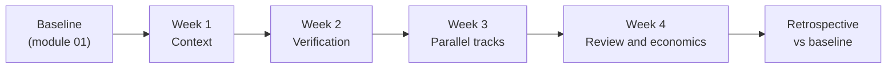

# 10. Your 30-day plan

> **In one sentence:** The practice only sticks when you apply it to your own code for four weeks, one layer at a time, and measure the result against the baseline you took in module 01.

## What you'll be able to do

- Turn this guide into a four-week plan on your own codebase, one layer per week.
- Set weekly goals with deliverables that someone else, or an agent, can verify.
- Compare your practice against your module 01 baseline using the same metrics and the same method.
- Run a 15-minute weekly check-in and a final retrospective that decide what to keep, change or drop.
- Share one practice back so others can learn from it.

## Why this matters

A workshop ends on a high. On day two you ran four sessions in parallel on a small practice project with fast tests, clean issues and nothing at stake. On Monday you open your real repository. The test suite takes 25 minutes and two tests are flaky. There is no `AGENTS.md`. The backlog is a mix of tickets written for humans who already knew the context. By Wednesday you are back to one window and one prompt.

This isn't a motivation problem. The practice has layers, and a missing layer undoes the ones built on top of it:

- **Parallel sessions without verification** give you parallel slop, and you review all of it.
- **Verification without context** means every session re-learns the project, and you re-explain it every time.
- **Review loops without a way to measure cost** can run twenty rounds on one PR before anyone asks what it costs (module 07).

So the plan builds the layers in order, on your real code, and measures the effect. Measuring matters because your feelings are unreliable here. In [METR's 2025 study](https://metr.org/blog/2025-07-10-early-2025-ai-experienced-os-dev-study/), experienced open-source developers were 19% slower with AI on their own repositories, and afterwards still believed they had been about 20% faster. You need numbers, taken the same way before and after.

## The shape of the four weeks



| Week | Layer | Modules | Goal | Target |
| --- | --- | --- | --- | --- |
| 1 | Context | 04 | A fresh session knows what you're doing and why | New sessions start useful work without re-explaining |
| 2 | Verification | 02, 03 | The agent can't call work done while checks fail | One gate command plus one deterministic guard |
| 3 | Parallel tracks | 05, 06 | Several real tracks at once, in worktrees | 5+ sessions in parallel on at least two days, if module 06's signals hold at 2–3 |
| 4 | Review and economics | 07, 08 | Agents review agents; you know what a merged PR costs | Cost per merged PR computed and one sink removed |

Module 00 teaches the inner loop, verification included, before the context loop. On your own code the plan starts with context anyway, because the two meet in one file: `AGENTS.md` is where you write down how the agent verifies its work, with the commands that build, lint and test the project. Week 1 makes verification discoverable, so every session knows how to check itself. Week 2 makes it enforced, with a gate and a guard the agent can't skip.

Module 09 isn't a week of its own. Apply its security baseline before week 3, when your agents start running with more autonomy.

## Before day 1: prepare the ground

1. **Find your baseline.** Open the notes from [Lab 1](../01-from-chatbot-to-system/lab.md): sessions in parallel, PRs merged, cycle time, human minutes per PR, cost per merged PR, rework, time waiting on the agent and plan usage. If you skipped it, spend the first three to five working days taking it now. Without a baseline, week 4 is an opinion.
2. **Pick one repository** you'll work in every day for the month. For the first weeks, choose one where a bad PR is an inconvenience, not an incident. If other people work in it, tell them what you're doing: you'll be adding files they'll see.
3. **Protect time.** About 30 minutes a day of deliberate practice on top of normal work, plus 15 minutes for a weekly check-in. If you can, find a buddy doing the same plan and hold the check-ins together.
4. **Create a plan file** where your agent can read it, for example `kb/30-day-plan.md` in a personal knowledge base or in the repository. [Lab 10](lab.md) gives you the template.

> [!NOTE]
> **At The Agile Monkeys** we built the four-week follow-up of our workshop on this same plan: participants apply it to their real code and compare before/after numbers. Those numbers are indicative, not benchmarks. Their value is showing each person what changed for them.

## Week 1 — Context

**Goal:** a fresh session answers "what are we working on, and why?" correctly, without you explaining.

**Do:**

- Ask the agent to draft `AGENTS.md` from the code and the README (and a `CLAUDE.md` that imports it, if you use Claude Code). Make sure it names the commands that build, lint and test the project. Correct it in short sentences. Keep it short: a map, not a manual.
- Create `kb/` with an `ACTIVE.md` index of your current tracks (under 100 lines) and one decision record per real decision you make this week.
- End every session with "update the knowledge base and commit it". An uncommitted knowledge base change didn't happen.
- Each time you correct the agent twice for the same thing, say "remember this" and check where it was written.

**Deliverables:** `AGENTS.md`, `kb/ACTIVE.md`, at least three decision records, and a note comparing a fresh session's answer before and after.

**Measure:** how many times per day you re-explain context to an agent (a tally is enough).

**Watch for:** a 500-line `AGENTS.md` written in one sitting. Always-loaded context costs tokens in every session. Move detail into files the agent reads on demand.

> [!NOTE]
> **At The Agile Monkeys** "commit and push the knowledge base" is how every session ends. We learned it the hard way: weeks into our own practice, we found thousands of uncommitted knowledge base changes that no other session or teammate could see.

## Week 2 — Verification and guards

**Goal:** the agent checks its own work on your real code, and it can't finish while checks fail.

**Do:**

- Agree with the agent on **one gate command** that runs lint, type checks and the relevant tests, and write it in `AGENTS.md`.
- If the suite is slow or flaky, fix the loop before anything else: a fast subset for inner-loop work, and flaky tests rerun alone before anyone calls them failures.
- Add **one deterministic guard**, such as a [hook](https://code.claude.com/docs/en/hooks) that blocks the session from ending while the gate fails. Watch it catch a real mistake.
- Set permission tiers: allow tests and read-only commands, ask for push and PR creation, deny reading secrets and force-push (module 03).
- Every time a rule gets missed twice, turn it into a check.

**Deliverables:** the gate command, one guard you have seen block, a permissions configuration, and one test fixture that varies the way production data varies.

**Measure:** the share of agent PRs that pass CI on the first run, and corrections per task (keep a correction log like the one in lab 2).

**Watch for:** the agent weakening a test to get green. The rule is "fix the change, not the check".

## Week 3 — Parallel tracks

**Goal:** run several real tracks at once without losing track or quality. Target: 5+ sessions in parallel on at least two days, if the signals from module 06 hold at 2–3 sessions.

**Do:**

- Ramp up: two sessions on days 1–2, three or four on day 3, five or more on days 4–5. Move up only while the signals from [module 06](../06-run-sessions-in-parallel/README.md) hold: satellites finish without rescue, your review queue doesn't grow from one day to the next, and `ACTIVE.md` tells you what every session is doing. If they don't, stay at the level you reached, fix what the signals show, and record that level as a finding.
- Decompose first (module 05). Use issues written as prompts, grouped into tracks that touch disjoint files, with one kickoff prompt per track.
- Isolate each code track in a worktree created from a freshly fetched `origin/main`, and give each branch its own ports and database if your stack needs them (module 06).
- Keep one row per track in `ACTIVE.md`, and handle notifications round-robin, most important group first.
- End each day clean: commit, push, and remove finished worktrees (`git worktree list` should show only live tracks).

**Deliverables:** a worktree recipe in `AGENTS.md`, a kickoff prompt template, session IDs from your two busiest days, and a clean `git worktree list`.

**Measure:** peak parallel sessions, PRs merged this week, and time spent waiting on an agent.

**Watch for:** launching more than you can review. If PRs waiting for your review outnumber running sessions, stop launching and review.

## Week 4 — Agents review agents, and the bill

**Goal:** every PR gets independent agent review that you close by decision, and you know what a merged PR costs you.

**Do:**

- Start every PR with a short intent statement. It's the ruler for every scope decision.
- Review each PR in a **fresh session**, and with a **second model or vendor** when you have access to one.
- Triage every finding into `FIX_NOW`, `DEFER_TO_ISSUE` or `DISCARD`, reply to every thread and resolve it. When findings become derivative, stop pushing and close by decision (module 07).
- Compute **cost per merged PR** for the week (module 08) and find your top three token sinks.

**Deliverables:** triage ledgers on at least three PRs, your cost per merged PR, and one change made for each of your top three sinks.

**Measure:** cost per merged PR, review rounds per PR, and human minutes per PR.

**Watch for:** a reviewer that turns a small PR into a large one by chasing unlikely threats. Give reviewers the PR's goal and the project context.

## Measure against your baseline

At the end of week 4, take the same measurements as your baseline: **same metrics, same method, same length of window** (one working week). As in the baseline, check rework again a week later, when every PR has had its 7 days. Fill in a table like this:

| Metric | Baseline | Week 4 | Change | Source | Confounders |
| --- | --- | --- | --- | --- | --- |
| Peak sessions in parallel | | | | | |
| PRs merged in the week | | | | | |
| Cycle time, PR opened → merged (median) | | | | | |
| Time waiting on an agent (per day) | | | | | |
| Plan usage or tokens | | | | | |
| Cost per merged PR | | | | | |
| Human minutes per PR | | | | | |
| Rework (merged PRs that needed a follow-up fix or revert within 7 days) | | | | | |

Rules for reading your own numbers honestly:

- **They're indicative, not benchmarks.** Your week-4 work isn't your baseline work. Holidays, on-call duty and task mix all move the numbers. Write the confounders down.
- **Watch for task substitution.** [METR found](https://metr.org/blog/2026-05-08-task-substitution-and-uplift/) that people drift toward tasks AI made cheap, so speedups per task overstate value. Ask whether the PRs you merged were the ones that mattered.
- **PR counts aren't value.** Next to the table, write one sentence per important PR about what it changed for users or for the team.
- **A worse number is a finding, not a failure.** Cost per PR often goes up before it goes down, while you learn where the tokens go.

## The weekly check-in

Fifteen minutes, same day each week, alone or with your buddy. Copy this into `kb/checkins/week-N.md`:

```markdown
# Week N check-in — YYYY-MM-DD

**Goal this week:**

**Deliverables** (link each one to a file, commit or PR):
- [ ]
- [ ]

**Numbers** (same method as the baseline):
- Peak sessions in parallel:
- PRs merged:
- Time waiting on agents (rough, per day):
- Plan usage / tokens:
- Week-specific metric:

**Worked — keep doing:**

**Hurt — one sentence each:**

**Promoted this week** (correction → memory, rule, skill or guard):

**One change for next week:**

**Blocked on** (what I need, why now, what I'll do meanwhile):
```

Let the agent pre-fill the numbers from sources it can reach, such as `gh pr list --state merged --author "@me"` for merged PRs. Write the "worked", "hurt" and "change" lines yourself. That's the part that builds judgment.

## When the plan slips

It will. Some slips are the plan working:

- **The repository has no usable tests.** Week 2 becomes weeks 2 and 3. Don't skip to parallel work: parallel sessions on unverifiable code multiply rework.
- **Tools or policies block you at work.** Write down what's blocked and run that week on the practice project so the skill still grows.
- **You're exhausted.** Running many agents is more tiring than writing code, and it can feel like a slot machine. Steinberger wrote about it in ["Just One More Prompt"](https://steipete.me/posts/just-one-more-prompt), and DHH says of his own pace: "This is not sustainable at all." ([Lex Fridman Podcast #501](https://lexfridman.com/dhh-2-transcript)). Pick a time after which you don't launch new sessions, and protect your sleep.

## Share one practice back

At the end of the month, share one thing you learned: a prompt, a hook, a skill, a failure, a before/after number. Use the "Share your practice" issue form described in [CONTRIBUTING](../../../CONTRIBUTING.md). A good share includes:

- **Context:** kind of repository, team size, which agents.
- **What you did:** the prompt, rule or guard, verbatim and sanitized.
- **Evidence:** before/after numbers, marked as indicative.
- **What didn't work,** or where it stops applying.

Remove client names, secrets, internal URLs and anything your employer wouldn't publish.

## Other ways to see it

- **Not everyone should aim for 5+ sessions.** [Mitchell Hashimoto's adoption journey](https://mitchellh.com/writing/my-ai-adoption-journey) builds deep habits with one agent, and he writes that he doesn't run multiple agents and doesn't want to yet. [Simon Willison](https://simonwillison.net/2025/Oct/5/parallel-coding-agents/) notes a hard limit: "I can only focus on reviewing and landing one significant change at a time." The week-3 target is practice, not a quota. If your review capacity tops out at three sessions, three well-reviewed tracks beat six unreviewed ones. Record it as a finding.
- **Why not all at once?** Some people learn best by jumping straight to parallel work, as in our 2-day workshop. That's fine for a practice project. On real code, we build the layers in order because a skipped layer tends to come back as rework: parallel slop, context you re-explain every day, review loops nobody measures.
- **Four weeks is arbitrary.** It's long enough to hit real problems and short enough to finish. Repeat the measurement a month later: the [Microsoft rollout study](https://arxiv.org/abs/2607.01418) tracked whether gains held over four months, and so should you.

## Watch out

- ❌ Skipping week 2 to get to parallel sessions. ✅ Verification first; parallel work on unverified code multiplies review.
- ❌ Measuring something different at the end than at the start. ✅ Same metrics, same method, same window.
- ❌ Treating "5+ sessions" as a score. ✅ It's a practice target; outcomes are what you report.
- ❌ Running permission-bypass modes on your work laptop "to go faster" in week 3. ✅ Apply module 09's security baseline first.
- ❌ Doing the plan alone and quietly. ✅ Check in with a buddy and share one practice back.

Asking the agent for your retrospective, two ways:

❌ **Weak prompt**

```text
How did my month go?
```

✅ **Better prompt**

```text
Read kb/30-day-plan.md, my baseline notes and the four files in kb/checkins/.
Fill in the before/after table from the plan. Take every number from a source
you can show me (a file, or command output such as
gh pr list --state merged --author "@me"). Leave a cell empty if there's no source.
Do not estimate. Then list the three biggest confounders you can see.
Don't write conclusions: I'll write those.
```

## Check your understanding

1. Why is verification (week 2) scheduled before parallel tracks (week 3)?

   <details><summary>Answer</summary>

   Parallel sessions multiply whatever each session produces. Without a gate and a guard, you multiply unverified output, and your review time becomes the bottleneck immediately. With verification in place, sessions catch most of their own mistakes before they reach you.

   </details>

2. Your merged PRs went from 6 to 14 per week, and your cost per merged PR went up by 50%. Is that good or bad? What else do you need to know?

   <details><summary>Answer</summary>

   You can't tell from those two numbers. Check rework (did merged PRs need a follow-up fix or revert within 7 days?), human minutes per PR, what the PRs changed (task substitution toward cheap, low-value tasks?) and confounders. A higher cost per PR while you learn where tokens go is common and can be fine.

   </details>

3. On day 4 of week 3 you have six sessions running and nine PRs waiting for your review. What do you do?

   <details><summary>Answer</summary>

   Stop launching sessions and review. PRs waiting for review outnumber running sessions, so you are producing queue, not throughput. Use agent reviewers and triage to cut your time per PR, and note your real review capacity as a finding.

   </details>

4. Why must the week-4 measurement use the same method and window as the baseline?

   <details><summary>Answer</summary>

   Otherwise any change might come from the measurement, not the practice. A different window length, a different way of counting waiting time, or a different source for plan usage makes the comparison meaningless. People also misjudge their own speed with AI, so a consistent method is the only protection you have.

   </details>

## Key points

- Build the layers in order on your real code: context, verification, parallel tracks, review and economics.
- Each week has one goal, deliverables someone can verify and one metric.
- Measure against your module 01 baseline with the same metrics, method and window. Numbers are indicative, and a worse number is a finding.
- A 15-minute weekly check-in keeps the plan honest. Write the judgment lines yourself.
- Review capacity, not session count, sets your real ceiling.
- Finish by sharing one practice back.

## Go further

- [Mitchell Hashimoto, "My AI Adoption Journey"](https://mitchellh.com/writing/my-ai-adoption-journey): a step-by-step adoption path that is deliberately different from ours.
- [METR's task substitution analysis](https://metr.org/blog/2026-05-08-task-substitution-and-uplift/): why speedups per task overstate value.
- [METR's 2026 uplift update](https://metr.org/blog/2026-02-24-uplift-update/): why measuring AI productivity is hard, even for researchers.
- [Claude Code best practices](https://code.claude.com/docs/en/best-practices) and [Codex best practices](https://learn.chatgpt.com/guides/best-practices): official guidance to check your habits against.
- [Lab 10](lab.md): the capstone checklist and the retrospective template.

Next: [Appendix — Where we are heading](../appendix/where-we-are-heading.md) (optional: the limits of this laptop-based practice and where we are taking it; you don't need it to apply this guide)
