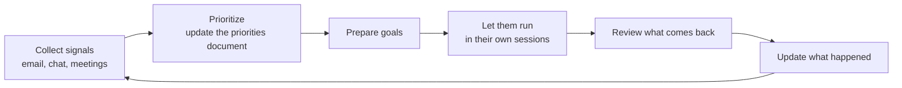

# Your own operating loop

This guide is about engineering work: a repository, tracks, pull requests. Your day holds more than that: email, chat, meetings, requests from people, reviews that aren't code, decisions that wait on you. The same agent that runs your tracks can help you decide which tracks to run.

At The Agile Monkeys, some of the people who run the most agents say this is where their work changed most. Optimizing a project makes the project faster. Optimizing how you choose and hand out work lets you take on more of it. Nothing on this page is required to follow the rest of the guide. It builds on connected sources ([module 4](../04-context-is-infrastructure/README.md#connect-the-sources-then-point-dont-retell)), orchestrator sessions ([module 6](../06-run-sessions-in-parallel/README.md#an-orchestrator-session-for-each-plan)) and the cost of unattended work ([module 8](../08-token-economics/README.md)).

## The loop



## Collect signals

A scheduled task reads your inbox and your chat mentions, and surfaces the few items that need you, each with a line on why. For the first week or two, compare its list with your inbox. When it misses something, tell it why that message mattered and add the reason to its instructions, the same [promotion path](../04-context-is-infrastructure/README.md#memory-and-the-promotion-path) you use for code. Once it stops missing things, you can stop reading everything yourself.

```text
Read the email and the chat mentions I received since the last run. List at
most ten items that need me, most urgent first, each with one line on why and
a link to the source. Flag anything that expires, breaks or blocks someone.
Don't reply to anything and don't mark anything as read.
```

Claude Code can run a prompt like this on a schedule in three ways: in the cloud with [routines](https://code.claude.com/docs/en/routines), on your own machine with [Desktop scheduled tasks](https://code.claude.com/docs/en/desktop-scheduled-tasks), or inside an open session with `/loop` ([Run prompts on a schedule](https://code.claude.com/docs/en/scheduled-tasks) compares them).

> [!NOTE]
> **At The Agile Monkeys** this caught something nobody was looking for. The daily list flagged a notice from a mailing list we had always ignored: a certificate that several of our services depend on would expire in 30 days.

## Keep a priorities document

Keep one document with your priorities, somewhere the agent can read and write: a file in your knowledge base or a page in your documents tool. The agent maintains it by crossing requests, meetings and deadlines from all your sources. In the morning, ask it to prioritize your day: read the new signals, update the document, and propose the focus. You decide.

## From priorities to goals

Keep one long-lived priorities session. It knows the document and your sources, and it hands work to focused sessions: a pull request, a proposal, the preparation for a meeting, a talk. Each one gets a whole goal ("explore, plan, build and verify, and tell me when you need me") and a session of its own, the way an [orchestrator](../06-run-sessions-in-parallel/README.md#an-orchestrator-session-for-each-plan) hands out threads. Not all of it is code, and the same principles apply.

## Update what already happened

At the end of the day, or whenever you come back to the priorities session, ask it to go through the sessions and the sources and update the document: what's done, what's pending, what's waiting on someone else. The document stays true without you maintaining it.

## Organize your sessions so you can come back

Keep the priorities session at the top, the work in flight grouped under it, and your key projects in a group of their own. Without that structure the list grows until a session waiting for your review gets lost, and work stops for a review you never saw. [Module 6](../06-run-sessions-in-parallel/README.md#managing-many-sessions) has the principles, and tools like Claude Code's [agent view](https://code.claude.com/docs/en/agent-view) show every background session and which ones need you.

## Watch out

- **Email is private data and untrusted text.** Anyone can send you a message with instructions in it. A triage agent that can also reply has all three legs of the [lethal trifecta](../09-teams-and-organizations/README.md#untrusted-input-and-the-lethal-trifecta). Keep it read-only, and connect your email and chat only through the accounts and connectors your company approves.
- **Unattended prompts cost tokens.** Keep scheduled prompts small, and don't schedule them on large sessions ([module 8](../08-token-economics/README.md)).
- **A long-lived session resends its history with every request.** Compact it at natural breaks, and keep unrelated concerns in sessions of their own.
- **Don't hand over the decision.** The agent proposes priorities; you set them. If the loop leaves you working more hours rather than better ones, fix the loop ([module 6](../06-run-sessions-in-parallel/README.md#sustainability)).
- **Summaries of your inbox contain other people's information.** Keep them out of shared repositories.
