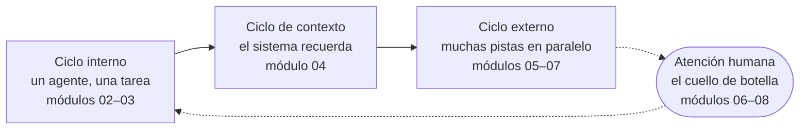

# 0. Empieza aquí

> **En una frase:** trabajar bien con muchos agentes es un sistema que construyes (contexto, descomposición, verificación, revisión y decisiones), y esta guía lo enseña ciclo a ciclo, empezando por un laboratorio en el que juegas el juego completo una vez.

## Lo que serás capaz de hacer

- Explicar los tres ciclos y el cuello de botella que organizan esta guía, y por qué van en ese orden.
- Elegir el itinerario que encaja con cómo usas hoy los agentes de programación.
- Comprobar, con un comando cada uno, que tu equipo y tus cuentas cumplen los requisitos previos.
- Leer las convenciones de la guía: lecciones, laboratorios, avisos, parejas de prompts y notas sobre nuestra propia práctica.
- Llevar un cambio real de principio a fin con tres sesiones de agente (laboratorio 0) y saber qué módulo explica cada paso.

## Por qué importa

Imagina un martes por la mañana. Abres tu agente de programación, escribes "añade exportación a CSV en la página de informes" y esperas. Cuatro minutos después lees un diff. Falla un test. Pegas el error. Vuelves a esperar. A la hora de comer tienes un pull request y la vaga sensación de que el agente "a veces es genial y a veces no sirve".

Esa misma mañana, en otro lugar, otra ingeniera tiene cinco sesiones abiertas. Dos implementan issues, cada una en su propio worktree de git. Una revisa el pull request de ayer sin ningún recuerdo de cómo se escribió. Otra actualiza la base de conocimiento (knowledge base) del proyecto a partir de la transcripción de una reunión. La quinta espera un sí o un no sobre un plan.

Ella no escribe más rápido ni tiene un modelo secreto. Pasa la mañana tomando decisiones, mientras los agentes escriben y comprueban código.

La diferencia entre esas dos mañanas no es el talento. Es un puñado de prácticas que se pueden aprender y que se apoyan unas en otras en un orden concreto. Ese orden es la forma de esta guía.

## Por qué existe esta guía

Los agentes de programación son lo bastante capaces para el trabajo profesional desde hace muy poco, y la práctica a su alrededor cambia mes a mes. En todo el sector, algunos ingenieros ya tienen muchas sesiones en paralelo sobre trabajo real sin bajar el listón de calidad. Muchos otros todavía no han tenido la oportunidad de trabajar así en su día a día: su proyecto, su cliente o su código no les han dado margen, o sencillamente estas prácticas aún no les han llegado.

La brecha no deja de crecer, porque los entornos acumulan mejoras: un error se convierte en una regla, una regla en una comprobación y una tarea repetida en una skill. Si estás en el lado que empieza, la buena noticia es que se cierra rápido. No hay un largo aprendizaje que cumplir, porque las herramientas y las prácticas son tan nuevas que nadie lleva una década de ventaja:

> «Si te perdiste el último año, puedes ponerte al día con la vanguardia en dos semanas.» — DHH en el [Lex Fridman Podcast #501](https://lexfridman.com/dhh-2-transcript) (01:24:08) (traducción propia)

Casi todo lo que enseña esta guía se puede poner en práctica en unas pocas semanas, incluso en tu tiempo libre.

> [!NOTE]
> **En The Agile Monkeys** llevamos años apostando por la IA, y los agentes de programación forman parte del día a día de todo el equipo. Cada persona ha ido descubriendo sus propios trucos, así que los pusimos por escrito en un solo sitio: para aprender unos de otros, dar la bienvenida a quienes se incorporan e impartir workshops. La publicamos porque las mismas preguntas aparecen en todas partes.

Tres cosas que queremos dejar claras desde el principio:

- **Enseña práctica, no productos.** Los conceptos no dependen de ninguna herramienta. Los ejemplos usan [Claude Code](https://code.claude.com/docs/en/overview) y [Codex](https://learn.chatgpt.com/guides/best-practices) porque usamos ambos a diario, pero cada principio debería tener sentido con cualquier agente de programación capaz. Las lecciones muestran comandos concretos cuando enseñan un principio, cada uno comprobado en la documentación del proveedor y enlazado. El detalle de herramientas que cambia a menudo está en la [referencia de herramientas](../reference/tools.md), que lleva su propia fecha de revisión.
- **Es honesta con la evidencia.** Cuando la investigación no coincide con el entusiasmo, lo decimos. El [módulo 01](../01-from-chatbot-to-system/README.md) repasa los estudios. Cuando compartimos cifras de nuestro propio trabajo, las marcamos como orientativas, no como benchmarks.
- **Es un documento vivo.** La práctica se está descubriendo todavía. Los lenguajes orientados a objetos se usaron durante más de una década antes de que se publicara, en 1994, el catálogo clásico de [patrones de diseño](https://es.wikipedia.org/wiki/Patr%C3%B3n_de_dise%C3%B1o); con los agentes de programación llevamos solo unos pocos años. Parte de lo que escribimos aquí resultará ser incorrecto. Si tu experiencia dice otra cosa, queremos oírla: lee [cómo contribuir](../../../CONTRIBUTING.es.md).

## El mapa: tres ciclos y un cuello de botella



1. **Ciclo interno: un agente, una tarea, bien hecha** (módulos 02–03). Hablas la tarea con el agente, acuerdas un plan, le dejas construir y te aseguras de que puede comprobar su propio trabajo.
2. **Ciclo de contexto: el sistema recuerda** (módulo 04). Cada sesión empieza con amnesia. Los archivos de instrucciones y una base de conocimiento convierten "una sesión nueva" en "una sesión nueva con todo el contexto", así que basta un mensaje corto y nadie vuelve a explicar el proyecto.
3. **Ciclo externo: muchas pistas en paralelo** (módulos 05–07). Divides el trabajo en pistas de trabajo (tracks) independientes, aíslas cada una, las ejecutas a la vez, haces que unos agentes revisen a otros y haces merge en un orden planificado.
4. **El cuello de botella: la atención humana** (módulos 06–08). Arrancar un agente es barato. Tus revisiones, tus decisiones y tus cambios de contexto no lo son. Todo el ciclo externo existe para que gastes tu atención solo en decisiones. Los tokens son el otro recurso escaso, y el módulo 08 los trata con el mismo cuidado.

Después de los ciclos, el [módulo 09](../09-teams-and-organizations/README.md) lleva la práctica de una persona a un equipo, y el [módulo 10](../10-your-30-day-plan/README.md) la convierte en un plan de cuatro semanas con tu propio código.

Los ciclos están adaptados de [los tres ciclos del desarrollador de Gene Kim y Steve Yegge](https://itrevolution.com/articles/the-three-developer-loops-a-new-framework-for-ai-assisted-coding/). Al del medio lo llamamos "ciclo de contexto" porque es donde vemos que los equipos pierden más tiempo.

### Por qué en este orden

Cada ciclo se apoya en el anterior:

- **Verificación antes que paralelismo.** Si tienes que comprobar personalmente cada resultado, cinco agentes te dan cinco veces más comprobaciones. Diez agentes que no pueden verificar lo que producen no te hacen más rápido: te entierran.
- **Contexto antes que paralelismo.** Cinco sesiones en paralelo que redescubren el proyecto desde cero malgastan tokens y producen cinco versiones ligeramente distintas de él.
- **Un plan de revisión antes de escalar.** El trabajo en paralelo sin forma de revisarlo solo mueve la cola de "esperando al agente" a "esperándote a ti".

| Módulo | Ciclo | En una línea |
|---|---|---|
| [00 Empieza aquí](README.md) | — | El juego completo, una vez |
| [01 Del chatbot al sistema](../01-from-chatbot-to-system/README.md) | — | Qué cambia y qué dice la evidencia |
| [02 Un agente, bien usado](../02-one-agent-done-well/README.md) | Interno | Conversar, planificar, construir, verificar |
| [03 Cierra el ciclo](../03-close-the-loop/README.md) | Interno | Agentes que comprueban su propio trabajo |
| [04 El contexto es infraestructura](../04-context-is-infrastructure/README.md) | Contexto | Una base de conocimiento que cualquier sesión puede cargar |
| [05 Divide el trabajo en pistas](../05-decompose-into-tracks/README.md) | Externo | Issues como prompts, dimensionados por radio de impacto |
| [06 Sesiones en paralelo](../06-run-sessions-in-parallel/README.md) | Externo, cuello de botella | Worktrees, gestión de sesiones, escalar |
| [07 Agentes que revisan a agentes](../07-agents-review-agents/README.md) | Externo, cuello de botella | Revisión con contexto limpio y entre proveedores |
| [08 Economía de tokens](../08-token-economics/README.md) | Cuello de botella | Coste por PR mergeado, elección de modelo |
| [09 Equipos y organizaciones](../09-teams-and-organizations/README.md) | Equipo | Práctica compartida, seguridad, puntos de control |
| [10 Tu plan de 30 días](../10-your-30-day-plan/README.md) | Todos | Cuatro semanas con tu propio código |

## Cuatro tipos de material

Seguimos la idea de [Diátaxis](https://diataxis.fr/): necesidades distintas piden contenidos distintos, y mezclarlos empeora cada uno de ellos.

- **Lecciones** (el `README.md` de cada módulo): explican una idea. Todas comparten la misma estructura: lo que serás capaz de hacer, por qué importa, conceptos, otras formas de verlo, ojo con, comprueba lo que has aprendido, ideas clave y para profundizar. Si sabes responder las preguntas de "Comprueba lo que has aprendido" de una lección, léela en diagonal y pasa directamente al laboratorio.
- **Laboratorios** (`lab.md`): son prácticos. Pasos numerados, un punto de control por paso, los prompts literales que escribir y una lista de "Cómo saber que has terminado" que puedes verificar, normalmente con un comando. Todos los laboratorios funcionan con el proyecto de prácticas o con tu propio repositorio.
- **Referencia** (`reference/`): para consultas. Un [glosario](../reference/glossary.md) con los términos en inglés y en español, [herramientas](../reference/tools.md), [patrones de prompts](../reference/prompt-patterns.md) y todas las [fuentes](../reference/sources.md) que citamos.
- **Workshops** ([`workshops/`](../../../workshops/es/README.md)): agendas y una guía para facilitadores. Una sesión introductoria de 90 minutos, un intensivo de dos días (el día 1, "El sistema, no el prompt", cubre los módulos 00–05; el día 2, "Orquestación", cubre los 06–08 más un sprint en paralelo) y un seguimiento de cuatro semanas en el que cada participante aplica los módulos 09–10 a su propio código y mide el antes y el después.

Los laboratorios comparten un **proyecto de prácticas**, [`shelf`](../../../practice/shelf/): un pequeño gestor de lista de lecturas para la línea de comandos, escrito en Python solo con la biblioteca estándar, con tests de `unittest` que se ejecutan en segundos. Su [lista de issues](../../../practice/issues/es.md) está diseñada para esta guía: seis issues independientes (S1–S6) que puedes ejecutar en paralelo, dos que chocan a propósito (C1 y C2 cambian ambas el modelo de almacenamiento) y una petición deliberadamente vaga (S7) para practicar la conversación antes de construir.

El [laboratorio 0](lab.md) sigue el enfoque del "juego completo" de [fast.ai](https://course.fast.ai/): primero juegas una versión simplificada del juego entero y después estudias las partes.

## Elige tu itinerario

| Si… | Itinerario | No te saltes |
|---|---|---|
| empiezas con agentes de programación | Módulos 00 a 10 en orden, con todos los laboratorios | Los laboratorios 2 y 3. No abras sesiones en paralelo hasta que tu agente pueda verificar su propio trabajo. |
| usas un agente cada día | Laboratorio 0 a buen ritmo, laboratorio 1 (tu punto de partida) y después los módulos 03, 04 y 05–08 | El módulo 04. Es el que más se saltan quienes usan agentes a diario y el que más necesitan. |
| lideras un equipo o impartes workshops | Módulos 00, 01, 04, 07, 08, 09 y después la carpeta de workshops | El laboratorio 1, para ti, antes de pedir a nadie más que mida. |

La mayoría de los módulos llevan entre una hora y dos horas y media, con su laboratorio. El laboratorio 1 te pide registrar una semana normal de trabajo, así que empiézalo pronto y sigue con el módulo 02 mientras pasa la semana.

## Requisitos previos

| Necesitas | Para qué | Cómo comprobarlo |
|---|---|---|
| git, en una versión reciente | Los módulos 05–07 aíslan pistas con worktrees | `git --version` y después `git worktree list` dentro de cualquier repositorio |
| Una cuenta de GitHub y la [GitHub CLI](https://cli.github.com/) con sesión iniciada | Los laboratorios crean issues y pull requests | `gh auth status` |
| Un agente de programación con plan de pago | Los planes gratuitos se agotan a mitad de los laboratorios en paralelo | `claude --version` o `codex --version` (o el equivalente de tu agente) |
| Python 3.10 o posterior | El proyecto de prácticas | `python --version` (o `python3 --version`) |
| Una terminal en la que te manejes bien | Los agentes, git y los tests se ejecutan ahí | — |

No necesitas saber mucho Python; necesitas manejarte con ramas, pull requests y lectura de código. Un segundo agente de otro proveedor es opcional, pero resulta útil a partir del módulo 07, donde el modelo de un proveedor revisa el trabajo de otro. El módulo 08 trata lo que cuesta un uso intensivo.

> [!NOTE]
> **En The Agile Monkeys** usamos Claude Code y Codex en paralelo, y elegimos según el papel, no por fidelidad a una marca. En nuestra experiencia, Claude es más conversacional y nos ayuda a pensar un problema, mientras que Codex tiende a tomar una tarea bien definida y tirar con ella, así que lo usamos mucho para la revisión de código (code review). El comportamiento de los modelos cambia de una versión a otra; tómalo como una foto del momento, no como una clasificación.

Una regla de seguridad antes de empezar:

> [!WARNING]
> Algunos agentes ofrecen un modo que ejecuta cualquier comando sin preguntar. Ningún laboratorio lo necesita. Déjalo desactivado hasta que el [módulo 03](../03-close-the-loop/README.md) explique cuándo es seguro: dentro de un entorno aislado y sin credenciales que merezca la pena robar.

## Convenciones

**Avisos.** En todos los módulos aparecen cuatro tipos. Notas sobre nuestra propia práctica:

> [!NOTE]
> **En The Agile Monkeys**: estas notas describen cómo trabajan hoy nuestros equipos. Son la práctica de una empresa, no la única forma válida, y cambian a medida que aprendemos.

Atajos prácticos:

> [!TIP]
> Los consejos te ahorran tiempo.

Riesgos:

> [!WARNING]
> Las advertencias señalan trabajo perdido, exposición de seguridad o costes que se disparan.

Reglas:

> [!IMPORTANT]
> Los avisos importantes son reglas que no negociamos, y explicamos por qué.

**Parejas de prompts.** Cuando la lección está en la diferencia entre un prompt débil y uno fuerte, mostramos los dos:

❌ **Prompt débil**

```text
explica este código
```

✅ **Prompt mejor**

```text
Lee README.md, los tests y el paquete shelf/ antes de responder.
Después explica, en menos de 200 palabras: qué hace esta herramienta, cómo
viaja un comando desde la línea de comandos hasta el archivo JSON y cómo se
ejecutan los tests. No cambies ningún archivo.
```

El segundo prompt dirige al agente a las fuentes, acota la respuesta, define qué significa "explicado" y descarta efectos secundarios. No es más largo por serlo: cada frase elimina una forma de fallar.

**Otras convenciones:**

- Los prompts que debes escribir aparecen en bloques `text`. Escríbelos, pégalos o díctalos, y adapta los nombres a tu repositorio. Puedes hablar con tu agente en cualquier idioma (el [módulo 02](../02-one-agent-done-well/README.md) explica cómo lo gestionamos).
- Los laboratorios siempre ofrecen una variante que empieza con **"En tu propio repositorio:"**.
- Las cifras de nuestra propia práctica se marcan como *orientativas, no benchmarks*.
- Las citas de personas públicas son literales, breves y enlazan a la fuente. En español las traducimos y lo indicamos con "(traducción propia)".
- No nombramos versiones concretas de modelos. Decimos "el modelo más potente al que tengas acceso", porque los nombres de los modelos envejecen en semanas.

## Otras formas de verlo

**¿Primero el juego completo o primero los fundamentos?** Empezamos con el laboratorio 0 porque ver el ciclo completo una vez hace que cada módulo posterior sea más fácil de situar. Hay quien aprende mejor dominando primero un solo agente antes de ver tres sesiones a la vez. También funciona: haz los pasos 1–3 del laboratorio 0, sáltate los de paralelismo y revisión, y vuelve a ellos después del módulo 03.

**¿Hasta dónde llegar?** No todo el mundo quiere veinte sesiones. [Mitchell Hashimoto](https://mitchellh.com/writing/my-ai-adoption-journey) cuenta que obtiene un valor real con un único agente en segundo plano y las notificaciones desactivadas, y escribe: «No estoy ejecutando [¿todavía?] varios agentes, y ahora mismo no quiero hacerlo» (traducción propia). [Simon Willison](https://simonwillison.net/2025/Oct/5/parallel-coding-agents/) explica que solo puede centrarse en revisar e integrar un cambio importante a la vez. Son ingenieros serios, y el paralelismo no es una virtud en sí mismo.

Lo que hacemos nosotros: trabajamos con muchas sesiones, pero solo cuando la verificación y el contexto están en su sitio, y tratamos tu atención como la restricción real. Si terminas el módulo 06 y descubres que tu punto óptimo son tres sesiones, es un resultado válido. Mídelo frente a tu [punto de partida del laboratorio 1](../01-from-chatbot-to-system/lab.md) y decide con datos.

**¿Hace falta estar al día de cada nueva herramienta?** No. [DHH](https://lexfridman.com/dhh-2/) lo resume así: «Si te perdiste el último año, puedes ponerte al día con la vanguardia en dos semanas» (traducción propia). Las prácticas de esta guía cambian más despacio que las herramientas.

## Ojo con

- ❌ **Saltar directamente a las sesiones en paralelo.** ✅ Haz primero los laboratorios 2 y 3. El paralelismo multiplica lo que produce tu ciclo interno, incluidos sus errores.
- ❌ **Leer sin hacer los laboratorios.** ✅ Esto es una habilidad, no un conjunto de datos. [Peter Steinberger](https://lexfridman.com/peter-steinberger-transcript/) dice que es una habilidad que hay que aprender como cualquier otra, igual que tocar un instrumento: si tocas un piano una vez, suena mal y decides que el piano es malo, el problema no es el piano.
- ❌ **Tratar la guía como un manual de herramientas.** ✅ Aprende el principio y consulta el flag actual en la [referencia de herramientas](../reference/tools.md) o en la documentación del proveedor.
- ❌ **Construir tu propio sistema de orquestación antes de haber entregado nada.** ✅ Empieza con un entorno sencillo. Steinberger llama "la trampa agéntica" a esas ganas de construir de más, y DHH espera que los proveedores absorban casi todo: «No vamos a tener que construirnos cada uno nuestro propio sistema de coordinación» (traducción propia).
- ❌ **Hacer los laboratorios sobre código de producción con credenciales reales.** ✅ Usa el proyecto de prácticas o una copia desechable de tu propio repositorio.
- ❌ **Compararte con las afirmaciones públicas más extremas.** ✅ Hay quien cuenta que trabaja con cientos de agentes, a menudo con tokens prácticamente ilimitados y años de herramientas a medida. Compárate con tu propio punto de partida.

## Comprueba lo que has aprendido

1. ¿Por qué la guía enseña la verificación (módulo 03) antes que las sesiones en paralelo (módulo 06)?

   <details><summary>Respuesta</summary>

   Las sesiones en paralelo multiplican lo que produce tu ciclo interno. Si el agente no puede comprobar su propio trabajo, cada sesión adicional añade un resultado que tienes que verificar en persona, así que el cuello de botella (tu atención) se llena más rápido de lo que crece el rendimiento.

   </details>

2. ¿Cuál es el cuello de botella del ciclo externo y qué implica sobre en qué deberías gastar tu tiempo?

   <details><summary>Respuesta</summary>

   La atención humana: revisiones, decisiones y cambios de contexto. El ciclo externo está diseñado para que tu atención vaya a las decisiones (qué construir, cómo dividirlo, qué integrar) y no a volver a ejecutar tests o a explicar otra vez el proyecto.

   </details>

3. Usas un agente cada día, siempre una sesión a la vez, y a menudo pegas el mismo contexto del proyecto en cada sesión nueva. ¿Qué itinerario te encaja y qué módulo no deberías saltarte?

   <details><summary>Respuesta</summary>

   El itinerario de uso diario: laboratorio 0 a buen ritmo, laboratorio 1 y después los módulos 03, 04 y 05–08. No te saltes el módulo 04. Pegar el mismo contexto una y otra vez es el síntoma de que te falta el ciclo de contexto.

   </details>

4. Lees "cinco historias por persona al día" en una nota sobre nuestra práctica. ¿Cómo deberías interpretarlo?

   <details><summary>Respuesta</summary>

   Como una cifra orientativa: un punto de referencia del contexto de una empresa, con tamaños de historia y listones de calidad distintos, sin grupo de control y sin una definición estándar. No es un benchmark con el que compararte. Lo que cuenta son tus propias cifras de antes y después.

   </details>

5. ¿Dónde consultas los flags y comandos actuales de una herramienta, y por qué la guía guarda ese detalle ahí?

   <details><summary>Respuesta</summary>

   En `reference/tools.md`, que lleva una fecha `last_reviewed`, y en la documentación del proveedor a la que enlaza. Las lecciones siguen mostrando comandos concretos cuando enseñan un principio, cada uno enlazado a la documentación oficial, pero las herramientas cambian cada mes. Tener el detalle que cambia a menudo en un único lugar fechado evita que las lecciones se queden obsoletas y mantiene los conceptos independientes de la herramienta.

   </details>

## Ideas clave

- La guía se organiza en tres ciclos (interno, de contexto y externo) y un cuello de botella: la atención humana.
- El orden importa: la verificación y el contexto van antes que el paralelismo, o el paralelismo multiplica los errores.
- Las lecciones explican, los laboratorios te hacen practicar, la referencia resuelve consultas y los workshops lo empaquetan todo para una sala.
- Elige itinerario según cómo usas hoy los agentes; sáltate una lección solo si sabes responder sus preguntas.
- Requisitos previos: git, la GitHub CLI, un agente de programación con plan de pago, Python 3.10+ y una terminal.
- Nuestras cifras son orientativas, no benchmarks; la práctica es joven y tus contribuciones mejoran la guía.

## Para profundizar

- [Laboratorio 0 — El juego completo](lab.md): hazlo antes de seguir.
- [Practical Deep Learning de fast.ai](https://course.fast.ai/): un curso construido sobre la enseñanza del "juego completo", en el que construyes algo real antes de estudiar las partes.
- [Diátaxis](https://diataxis.fr/): por qué conviene separar tutoriales, explicaciones y referencia.
- [Los tres ciclos del desarrollador](https://itrevolution.com/articles/the-three-developer-loops-a-new-framework-for-ai-assisted-coding/), de Gene Kim y Steve Yegge: el marco que adapta la columna vertebral de esta guía.
- [My AI Adoption Journey](https://mitchellh.com/writing/my-ai-adoption-journey), de Mitchell Hashimoto: un camino de adopción cuidadoso, paso a paso, contado por alguien escéptico.
- [Las buenas prácticas de Claude Code](https://code.claude.com/docs/en/best-practices) y [las buenas prácticas de Codex](https://learn.chatgpt.com/guides/best-practices): la guía de los propios proveedores, que merece la pena leer entera.
- [Cómo contribuir](../../../CONTRIBUTING.es.md): comparte lo que te funciona, lo que ha fallado y lo que haces de otra manera.

Siguiente: [1. Del chatbot al sistema](../01-from-chatbot-to-system/README.md)
