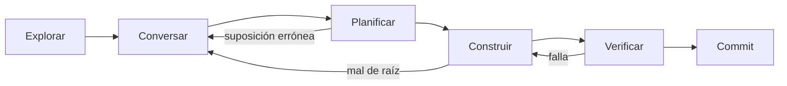

# 2. Un agente, bien usado

> **En una frase:** antes de trabajar con muchos agentes, aprende a llevar bien uno: háblale como a un compañero que comparte tu contexto, separa la conversación de la construcción, revisa la intención antes que las líneas y tira el trabajo cuando esté mal de raíz.

## Lo que serás capaz de hacer

- Seguir un ciclo de explorar → conversar → planificar → construir → verificar → hacer commit, y controlar cuándo pasa el agente de hablar a construir.
- Decidir cuándo dar menos indicaciones a propósito para obtener ideas y cuándo ser preciso.
- Revisar un plan o un documento de arquitectura generado en lugar de un diff, y corregirlo en una frase.
- Reconocer cuándo empezar de nuevo con una dirección más clara en lugar de parchear.
- Usar preguntas de seguimiento que sacan a la luz efectos secundarios y diseños mejores.

## Por qué importa

Le pides al agente que "añada un comando de estadísticas a shelf". Escribe 150 líneas, incluido un flag `--json` que no has pedido. Abres el diff y empiezas a leer.

A las veinte líneas encuentras el problema de verdad. "Libros terminados este año" cuenta cada libro con estado `done` cuya fecha cae en el año en curso. Pero ¿qué pasa con un libro que añadiste ayer como ya leído y que terminaste hace años? ¿Y "este año" en qué zona horaria? Las marcas de tiempo se guardan en UTC, y tú vives en Madrid o en Bogotá. Lo corriges. El agente lo parchea. Se rompe un test en otro archivo. Vuelves a corregir. Cuarenta minutos después, la sesión es un montón de arreglos a medias y ya no sabes cuáles siguen haciendo falta.

Nada de eso fue un fallo del modelo. Las dos preguntas que importaban se podían haber hecho en una conversación de dos minutos *antes* de que existiera código. En cambio, las encontraste dentro de un diff, que es el sitio más caro para encontrar cualquier cosa.

El ciclo interno consiste en adelantar las correcciones: del diff al plan, y del plan a la conversación.

## Háblale como a un compañero, no como a un buscador

A un buscador le das una consulta larga y autocontenida, porque al otro lado no saben nada de ti. A un compañero le mandas mensajes cortos, porque compartes contexto con él: el código, las decisiones de la semana pasada, lo que intentas conseguir.

Un agente de programación puede ser cualquiera de los dos, y tú decides cuál. En una sesión abierta en tu repositorio, con archivos de instrucciones y unas cuantas vueltas de conversación, los mensajes cortos funcionan: "¿y los libros añadidos como done?", "no, deja la salida en texto plano". Si sigues escribiendo largos "prompts perfectos" que vuelven a explicar el proyecto, tómalo como una señal de alarma: estás tecleando el contexto que le falta a la sesión. Arregla el contexto ([módulo 04](../04-context-is-infrastructure/README.md)), no el prompt.

Cuéntale al agente el problema que tienes, no los pasos que hay que dar. [DHH](https://lexfridman.com/dhh-2/) describe adónde ha llegado:

> «No le digo adónde vamos. Le digo el problema que tengo.» — DHH en [Lex Fridman Podcast #501](https://lexfridman.com/dhh-2/) (traducción propia)

Corto no es impreciso en lo que importa. Cuando pasas una tarea a una sesión sin historia contigo, la estructura ayuda: [las buenas prácticas de Codex](https://learn.chatgpt.com/guides/best-practices) proponen objetivo, contexto, restricciones y "cuándo está terminado". Esos prompts de traspaso son el tema del [módulo 05](../05-decompose-into-tracks/README.md); dentro de una conversación en marcha rara vez los necesitas.

> [!NOTE]
> **En The Agile Monkeys**, quienes trabajan con muchos agentes dicen que ya no "escriben prompts". La planificación es una conversación dentro de una sesión abierta en un repositorio que ya contiene el contexto del proyecto y las decisiones pasadas: "quiero hacer X, ¿cómo lo harías?", "hazlo así", "no, prefiero esta otra forma". Cuando el plan está listo: "convierte este plan en issues de GitHub; si es grande, divídelo en una épica". Al cabo de unas semanas el repositorio ha aprendido las convenciones, y basta con "crea una issue".

## El ciclo: explorar, conversar, planificar, construir, verificar, hacer commit



**Explorar.** El agente lee antes de escribir. Hazle preguntas cuya respuesta está en el código, y cuando el agente *te* pregunte cosas que el código podría responder, devuélvelo a la fuente. [Peter Steinberger](https://lexfridman.com/peter-steinberger-transcript/) usa una sola frase para eso: «Lee más código para responder tus propias preguntas» (traducción propia).

```text
Lee el modelo, el store y el comando list. ¿Cómo cambia el estado de un libro
y qué se guarda cuando eso ocurre? No cambies nada.
```

**Conversar.** Pide opciones con sus pros y contras, y elige. Los agentes tienen ganas de construir, así que deja claro cuándo no deben hacerlo. Steinberger describe unas frases disparadoras que le funcionan:

> «en cuanto digo "hablemos" o "dame opciones", no construyen nada hasta que digo "construye"» — Peter Steinberger en [The Pragmatic Engineer](https://newsletter.pragmaticengineer.com/p/the-creator-of-clawd-i-ship-code) (traducción propia)

Las opciones encajan con cómo juzgamos las personas. DHH lo llama «Evaluación diferencial. Me das tres opciones y elijo una» (traducción propia). Elegir entre tres diseños concretos funciona mejor que describir el correcto desde cero.

**Planificar.** Antes de que ejecute, pide al agente que explique qué va a hacer. Un plan que puedes revisar en un minuto incluye: los archivos que va a cambiar, cualquier cambio en los datos o en el almacenamiento, el comportamiento en los casos límite, los tests que lo demostrarán (y que fallarían sin el cambio) y lo que *no* va a hacer.

**Construir.** Di "construye" de forma explícita. A partir de aquí, el agente trabaja y tú no miras.

**Verificar.** Tests escritos en el mismo contexto, ejecutados por el agente, con la salida a la vista. [Las buenas prácticas de Claude Code](https://code.claude.com/docs/en/best-practices) lo formulan así: «Haz que Claude muestre pruebas en lugar de afirmar que ha terminado bien» (traducción propia). El [módulo 03](../03-close-the-loop/README.md) trata entero sobre este paso.

**Hacer commit.** Pequeño, con un mensaje que recoja las decisiones y no solo el cambio. [Kent Beck](https://newsletter.kentbeck.com/p/augmented-coding-beyond-the-vibes) separa en commits distintos los cambios estructurales y los de comportamiento, y ese hábito hace mucho más fácil revisar el trabajo de un agente.

**Cuándo saltarse pasos.** No todo cambio necesita un plan. La regla práctica de Anthropic: «Si pudieras describir el diff en una frase, sáltate el plan» (traducción propia). Renombrar un flag, corregir una errata en un mensaje de error o añadir una línea de log pueden ir directamente a construir y verificar.

## Menos indicaciones para descubrir, precisión para entregar

Hay dos consejos opuestos sobre cuánto decir, y los dos tienen razón en momentos distintos.

**Di menos cuando todavía no sabes lo que quieres.** Steinberger lo hace a propósito:

> «a menudo le doy al agente menos indicaciones a propósito, para que haga algo que me dé ideas nuevas» — Peter Steinberger en [The Pragmatic Engineer](https://newsletter.pragmaticengineer.com/p/the-creator-of-clawd-i-ship-code) (traducción propia)

Reconoce que casi todo lo que vuelve no sirve, pero un par de ideas suelen merecer la pena. DHH defiende lo mismo desde la tradición ágil: nadie sabe qué debe hacer un software hasta que lo usa.

> «Sé todo lo vago que puedas para que se materialice algo, y después interactúa con ese algo.» — DHH en [Lex Fridman Podcast #501](https://lexfridman.com/dhh-2/) (traducción propia)

Los expertos pueden empeorar los resultados si lo prescriben todo. DHH cuenta, de segunda mano y sin que podamos verificarlo, que un proveedor de agentes recortó mucho su prompt de sistema porque al agente «lo estaban perjudicando humanos demasiado prescriptivos» (traducción propia). El patrón es conocido: si dictas cada paso, el agente sigue tus pasos incluso donde su propia lectura del código habría encontrado un camino mejor.

**Di más cuando el conocimiento no está en el código.** Sé preciso con las decisiones ya tomadas, los invariantes, las reglas sobre los datos, las restricciones de seguridad, las interfaces de las que dependen otras personas y lo que queda fuera de alcance. El agente no puede leer eso en el repositorio, así que lo adivinará.

| Situación | Cuánto decir | Ejemplo |
|---|---|---|
| Descubrimiento: no sabes lo que quieres | Poco. Pide opciones. | "Shelf debería ser más útil para clubes de lectura. Dame tres direcciones muy distintas entre sí." |
| Entrega: sabes qué, no cómo | Preciso en el resultado y las restricciones, callado sobre los pasos | "Stats muestra una línea por estado más 'finished this year': año natural en UTC, como las marcas de tiempo guardadas. Texto plano, sin flags." |
| Reparación: salió mal de raíz | Dirección explícita, sesión nueva | "Empieza de nuevo. No toques el almacenamiento; calcula las estadísticas solo con los campos que ya existen." |

## Revisa la intención, no las líneas

Un plan se lee en un minuto. Un diff de 400 líneas lleva veinte, y aun así se te puede escapar la suposición equivocada que esconde. El equipo detrás de [la guía de ingeniería de contexto de HumanLayer](https://github.com/humanlayer/advanced-context-engineering-for-coding-agents/blob/main/ace-fca.md) lo resume sin rodeos: «una mala línea de un plan puede acabar en cientos de líneas de código malas» (traducción propia). Así que, para cualquier cambio que no sea trivial, lo primero que revises no debería ser un diff.

Hay dos formas de conseguir un plan revisable.

**Modo plan.** Varios agentes tienen un modo de solo lectura que explora y propone un plan sin editar archivos: uno de los [modos de permisos](https://code.claude.com/docs/en/permission-modes) en Claude Code, y un modo plan en Codex. Anthropic recomienda planificar en él antes de implementar, y [las buenas prácticas de Codex](https://learn.chatgpt.com/guides/best-practices) lo presentan como la opción más sencilla para el trabajo difícil o ambiguo.

**Conversación.** Steinberger dejó de usar el modo plan. A finales de 2025 escribió que «El modo plan parece un apaño que hacía falta con generaciones anteriores de modelos» ([Shipping at Inference-Speed](https://steipete.me/posts/2025/shipping-at-inference-speed), traducción propia), lo contrario de [lo que aconsejaba unos meses antes](https://steipete.me/posts/2025/optimal-ai-development-workflow) («Usar el modo plan e iterar es clave», traducción propia). Consigue el mismo efecto hablando y usando frases disparadoras.

Las dos posturas tienen razón, y su cambio de opinión es la lección de verdad: el mejor mecanismo depende de los modelos de esta temporada. El objetivo no cambia.

> [!NOTE]
> **En The Agile Monkeys** usamos el mecanismo que nos mantenga revisando la intención y no las líneas. Con un agente que tiende a ponerse a editar demasiado pronto, o en cambios de varios archivos sobre código que no conocemos, modo plan. En una sesión que ya tiene mucho contexto, una conversación que termina con "explica qué vas a hacer" y después "ok". La regla que no negociamos: en trabajo no trivial, lo primero que revisamos nunca es un diff.

Un prompt de revisión de plan que funciona:

```text
Antes de construir, escribe el plan en menos de 25 líneas: archivos que vas a
cambiar, cualquier cambio en los datos guardados y cómo se siguen cargando los
archivos existentes, la salida exacta (con un ejemplo), los tests que vas a
añadir y por qué fallaría cada uno sin el cambio, y lo que no vas a hacer.
Después espera.
```

Responde con correcciones de una frase: "No añadas `--json`, eso es otra issue." "Usa el año natural en UTC, como las marcas de tiempo guardadas." "Los tests no pueden depender de la fecha de hoy; escribe el archivo de la estantería con marcas de tiempo fijas."

## Deja que el agente dibuje el sistema y corrige el dibujo

Algunos problemas son difíciles de ver en planes o diffs porque viven en cómo interactúan las piezas. Para esos, pide al agente que genere a partir del código una descripción visual del sistema, léela y corrígela en una o dos frases.

> [!NOTE]
> **En The Agile Monkeys**, uno de nuestros ingenieros pasó una larga temporada iterando sobre un sistema de ingesta basado en eventos (event sourcing) y llegó a la conclusión de que todo el enfoque estaba mal. Antes de rehacerlo, pidió al agente que generara un documento visual de arquitectura a partir del código. Al leerlo, el problema saltó a la vista: cada webhook entrante creaba un evento que disparaba un comando, que a su vez lanzaba otros cuatro comandos, y si alguno fallaba, nada lo registraba. La corrección cupo en una frase: "cada comando debe registrar si ha tenido éxito o ha fallado, y el reparto a otros comandos le corresponde al sistema de eventos, no al comando". El agente leyó el documento, propuso un plan, recibió un "ok", arregló el código y actualizó el documento.

Tres reglas hacen que funcione:

1. **No edites tú el documento.** Es una herramienta para pensar, no el entregable. Editarlo a mano te cuesta tiempo y no le enseña nada al agente. Dile al agente qué está mal y deja que arregle el código y el documento a la vez.
2. **Pide dibujos, no párrafos.** Los diagramas de flujo, los de secuencia y las tablas se comprueban más rápido que la prosa. Mucha gente pierde el hilo de una descripción textual a las pocas palabras, pero ve una flecha equivocada de un vistazo.
3. **Ánclalo al código.** Un diagrama generado puede mostrar el diseño que el agente *espera* en lugar del que existe. Pídele que cite archivos y líneas para cada flecha.

```text
Lee el código de shelf/ y escribe docs/architecture.md con: un diagrama de
flujo en Mermaid de cómo viaja un comando desde la línea de comandos hasta el
archivo JSON, un diagrama de secuencia de "shelf finish 3" y una tabla con
cada punto que lee o escribe el archivo. Cita archivo y línea para cada
elemento. Marca todo lo que hayas deducido en lugar de leído.
```

Simon Willison describe técnicas relacionadas, como los [recorridos lineales (linear walkthroughs)](https://simonwillison.net/guides/agentic-engineering-patterns/linear-walkthroughs/) de un código, en su guía de patrones.

## Preguntas de seguimiento que se pagan solas

Unos pocos prompts cortos encuentran problemas que no buscabas ni tú ni el agente.

| Prompt | Por qué funciona |
|---|---|
| "Lee más código para responder tus propias preguntas." | Devuelve al agente a la fuente cuando te pregunta cosas que el repositorio responde. |
| "¿Tenemos algún efecto secundario?" | Hace que el agente mire más allá de las líneas que ha cambiado. Steinberger encontró un bug oculto en un trigger de base de datos solo cuando preguntó si había efectos secundarios en esa parte. |
| "Ahora que lo has construido, ¿qué habrías hecho de otra manera?" | Después de construir, el agente conoce el código mejor que cuando planificó. La respuesta suele contener la refactorización que merece la pena. |
| "Hazlo más simple." | Los agentes añaden capas y código defensivo. DHH cuenta que le dice a un agente que un cambio terminado y revisado «parece un poco demasiado complicado» (traducción propia), y el agente lo reduce a la mitad. |
| "¿Qué has supuesto sin comprobarlo?" | Convierte las suposiciones ocultas en una lista que puedes revisar. |
| "¿Qué no has ejecutado, y por qué?" | Separa "los tests pasan" de "pasan los tests que existen y que se han podido ejecutar". |

Trata las respuestas en retrospectiva como propuestas, no como órdenes. Si la refactorización es pequeña y cabe en el alcance del cambio, hazla ahora. Si no, apúntala como seguimiento y mantén el cambio centrado.

## Tirar trabajo es barato

Cuando el código era caro, parchear una implementación equivocada tenía sentido. Ahora muchas veces no lo tiene ([Writing code is cheap now](https://simonwillison.net/guides/agentic-engineering-patterns/code-is-cheap/), "escribir código ahora es barato", titula Willison ese capítulo). Steinberger cambió una suposición central de la arquitectura de su proyecto, de un agente a muchos, en unas tres horas con un agente; calcula que a mano habrían sido dos semanas.

[Las buenas prácticas de Claude Code](https://code.claude.com/docs/en/best-practices) dan un umbral concreto: después de dos correcciones fallidas sobre el mismo problema, para, limpia la sesión y empieza de nuevo con un prompt mejor, porque «Una sesión limpia con un prompt mejor casi siempre supera a una sesión larga con correcciones acumuladas» (traducción propia).

**Empieza de nuevo en lugar de parchear cuando:**

- la implementación está mal de raíz: modelo de datos equivocado, capa equivocada, abstracción equivocada;
- has corregido dos veces el mismo problema y sigue mal;
- el agente está arreglando sus propios arreglos;
- la sesión está llena de enfoques fallidos que se vuelven a colar.

**Cómo empezar de nuevo bien:**

1. En la sesión que falla, pide las lecciones: "Resume en 10 puntos como máximo lo que hemos aprendido: restricciones descubiertas, enfoques que fallaron y por qué."
2. Descarta la rama. No hay nada valioso en ella.
3. Abre una sesión nueva. Pega los puntos y da una dirección explícita.

❌ **Prompt débil**

```text
sigue mal, la cuenta anual vuelve a fallar. arréglalo
```

✅ **Prompt mejor**

```text
Empezamos de nuevo con shelf stats. Lecciones del primer intento:
- las marcas de tiempo de fin se guardan en UTC; "este año" es el año natural en UTC
- los tests del cambio de año fallaban según el día en que se ejecutaban; usa marcas de tiempo fijas
- el primer intento cambió el almacenamiento y rompió la carga; el almacenamiento no se toca
Primero el plan: calcula las estadísticas solo con los campos existentes,
enséñame el plan y un ejemplo de la salida, y espera a mi ok.
```

## Voz: habla en tu idioma, escribe en uno

Planificar conversando encaja con la voz. Hablar es más rápido que teclear cuando piensas en voz alta, y los agentes le sacan un sentido sorprendente a pensamientos dichos sin pulir.

> [!NOTE]
> **En The Agile Monkeys** muchos hablamos con los agentes en español, a menudo por voz, y tenemos una regla fija en nuestros repositorios: todo artefacto que se guarda (código, comentarios, commits, pull requests, issues, documentación) se escribe en inglés. No hemos visto problemas por mezclar los dos idiomas.

Pon la regla en tu archivo de instrucciones, para que cada sesión la siga sin que se lo digas. La escribimos en inglés, como el resto de artefactos:

```text
Talk to the user in the language they use. Write every persisted artifact
(code, comments, commit messages, pull request and issue text, documentation)
in English.
```

Ten cuidado con el dictado cuando haya identificadores, números o nombres de archivo. Cuando importen, pégalos en lugar de decirlos, y lee la transcripción antes de enviarla.

## Usa el modelo más potente por defecto

Usa el modelo más potente al que tengas acceso para planificar, diseñar la arquitectura, depurar y revisar. Baja de modelo en un rol solo cuando tengas pruebas: una evaluación con tus propias tareas, o datos de coste que muestren que rinde igual.

El motivo es el cuello de botella: los errores de un modelo más flojo cuestan tu atención, el recurso más escaso de esta guía. DHH describe una migración larga de código que varios modelos más baratos completaron por una fracción del coste, mientras que uno intentó hacer trampa envolviendo una implementación existente y nunca terminó. Lo barato puede funcionar para volumen bien especificado; lo descubres midiendo. El [módulo 08](../08-token-economics/README.md) profundiza en esto.

## Otras formas de verlo

**¿Primero la especificación o primero la conversación?** Una escuela escribe especificaciones detalladas antes del código: [GitHub Spec Kit](https://github.com/github/spec-kit) pasa por especificar, planificar y dividir en tareas con una comprobación humana en cada fase, y el [flujo de Harper Reed](https://harper.blog/2025/02/16/my-llm-codegen-workflow-atm/) construye una especificación pregunta a pregunta. La otra escuela mantiene las especificaciones ligeras. Steinberger llama a las grandes especificaciones iniciales «el modelo en cascada de construir software» (traducción propia), y [Birgitta Böckeler](https://martinfowler.com/articles/exploring-gen-ai/sdd-3-tools.html) se pregunta si los flujos con mucha especificación dan una falsa sensación de control, y prefiere revisar código antes que todos esos archivos Markdown. Anthropic se sitúa en medio: para funcionalidades grandes, deja que el agente te entreviste, escriba una especificación y la implemente en una sesión nueva.

Lo que hacemos nosotros: conversación para descubrir; un plan escrito y breve, guardado en la issue, para todo lo que vaya a ejecutar otra sesión u otra persona; nada de especificaciones de varios documentos para cambios pequeños.

**¿Cuánto hay que leer?** Hay quien revisa planes y rara vez lee código, y quien lee cada diff. Nosotros escalonamos la lectura según el riesgo, y el [módulo 07](../07-agents-review-agents/README.md) explica cómo. En el ciclo interno la regla es más simple: que el diff no sea nunca el primer sitio donde descubres lo que ha decidido el agente.

## Ojo con

- ❌ **La sesión cajón de sastre**: una tarea, luego una pregunta sin relación, luego vuelta a la tarea, hasta que el contexto se llena de ruido. ✅ Una tarea por sesión; limpia o empieza de nuevo entre tareas que no tienen que ver.
- ❌ **Dejar que un agente con prisa construya durante una conversación.** ✅ Di "no escribas código hasta que te diga que construyas", y mira `git status` si tienes dudas.
- ❌ **Corregir lo mismo una y otra vez.** ✅ Tras dos correcciones fallidas sobre el mismo problema, recoge las lecciones y empieza una sesión nueva con un prompt mejor.
- ❌ **Aceptar "terminado" sin pruebas.** ✅ Pide el comando que ejecutó y su salida.
- ❌ **Editar tú el documento de arquitectura generado.** ✅ Corrígelo en una frase y deja que el agente actualice código y documento.
- ❌ **Preguntar "¿esto está bien?"** Los agentes tienden a dar la razón a quien pregunta. ✅ Pregunta "¿cuál es el mejor argumento de que esto está mal?" o "¿qué no has comprobado?"
- ❌ **Prescribir cada paso porque eres quien sabe.** ✅ Prescribe el resultado y las restricciones que el código no le puede contar.

❌ **Prompt débil**

```text
añade un comando de estadísticas
```

✅ **Prompt mejor**

```text
Hablemos de la issue #3 (shelf stats) antes de construir. Lee primero la
issue, el modelo y el store. Después dime qué casos no resuelve la issue,
dame opciones para cada uno con sus pros y contras, y recomienda una.
No escribas código hasta que te diga que construyas.
```

## Comprueba lo que has aprendido

1. ¿Por qué un prompt largo y cuidadosamente elaborado suele ser una señal de alarma más que una habilidad?

   <details><summary>Respuesta</summary>

   Porque normalmente significa que a la sesión le falta contexto y lo estás tecleando cada vez. Los mensajes cortos funcionan cuando la sesión tiene el repositorio, los archivos de instrucciones y el historial de la conversación. La solución es construir un contexto que persista (módulo 04), no escribir prompts más largos.

   </details>

2. ¿Cuándo darías menos indicaciones a propósito y cuándo serías preciso?

   <details><summary>Respuesta</summary>

   Menos indicaciones durante el descubrimiento, cuando aún no sabes lo que quieres y buscas ideas del agente. Precisión al entregar, sobre el resultado y las restricciones que el agente no puede leer en el código: decisiones ya tomadas, invariantes, seguridad, interfaces y alcance. Dirección explícita al reparar un trabajo que salió mal de raíz.

   </details>

3. Según la regla práctica de Anthropic, ¿cuándo puedes saltarte el plan? Pon un ejemplo con shelf.

   <details><summary>Respuesta</summary>

   Cuando podrías describir el diff en una frase, por ejemplo "cambiar el mensaje de estantería vacía para que mencione `shelf add --status`" o "cambiar el texto de ayuda de `finish`". Un comando de estadísticas con una decisión sobre fechas dentro no se describe en una frase, así que necesita un plan.

   </details>

4. El documento de arquitectura que ha generado el agente muestra una flecha que sabes que está mal. ¿Qué haces?

   <details><summary>Respuesta</summary>

   No edites el documento. Dile al agente en una o dos frases qué está mal y qué debería ser cierto, pídele que lo compruebe en el código (con archivo y línea), que proponga un plan y que después arregle tanto el código como el documento.

   </details>

5. Has corregido al agente dos veces sobre el mismo problema y sigue mal. ¿Qué haces ahora, en concreto?

   <details><summary>Respuesta</summary>

   Deja de parchear. Pide a la sesión las lecciones en 10 puntos como máximo, descarta la rama, abre una sesión nueva, pega las lecciones, da una dirección explícita y pide un plan antes de construir.

   </details>

## Ideas clave

- Háblale al agente como a un compañero que comparte tu contexto. Los largos "prompts perfectos" delatan falta de contexto.
- Explorar, conversar, planificar, construir, verificar, hacer commit. Di cuándo construir; sáltate el plan solo en diffs de una frase.
- Da menos indicaciones para descubrir; sé preciso sobre resultados y restricciones para entregar.
- Revisa la intención antes que las líneas: primero planes y diagramas generados, corregidos en una frase.
- Preguntas de seguimiento como "¿tenemos algún efecto secundario?" o "¿qué habrías hecho de otra manera?" son baratas y encuentran problemas reales.
- Tira el trabajo cuando esté mal de raíz: recoge las lecciones, empieza limpio y da una dirección explícita.
- Habla en el idioma que quieras; guarda los artefactos en un único idioma de equipo. Usa por defecto el modelo más potente.

## Para profundizar

- [Laboratorio 2 — Un agente, bien usado](lab.md): implementa S3 con el ciclo completo y un registro de correcciones.
- [Las buenas prácticas de Claude Code](https://code.claude.com/docs/en/best-practices): explorar, planificar, implementar y hacer commit; gestionar el contexto; patrones de fallo habituales.
- [Las buenas prácticas de Codex](https://learn.chatgpt.com/guides/best-practices): estructura de los prompts, planificación y un chat por unidad de trabajo.
- [Just Talk To It](https://steipete.me/posts/just-talk-to-it), de Peter Steinberger: prompts conversacionales, mensajes cortos y por qué dejó de sobrediseñar su entorno.
- [Advanced Context Engineering for Coding Agents](https://github.com/humanlayer/advanced-context-engineering-for-coding-agents/blob/main/ace-fca.md), de HumanLayer: investigar, planificar e implementar, con las personas revisando con más dureza las dos primeras fases.
- [Writing code is cheap now](https://simonwillison.net/guides/agentic-engineering-patterns/code-is-cheap/), de Simon Willison: qué cambia cuando producir código no cuesta casi nada.
- [Understanding Spec-Driven Development](https://martinfowler.com/articles/exploring-gen-ai/sdd-3-tools.html), de Birgitta Böckeler: una mirada cuidadosa a las herramientas que ponen la especificación primero y a sus límites.

Siguiente: [3. Cierra el ciclo](../03-close-the-loop/README.md)
