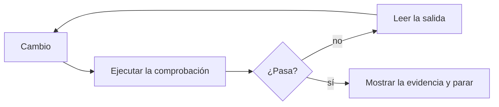

# 3. Cierra el ciclo

> **En una frase:** un agente es tan fiable como las comprobaciones que puede ejecutar sobre su propio trabajo, así que diseña cada tarea y cada código para que un programa pueda confirmar que algo está "hecho", y lleva las reglas que nunca deben romperse al código en lugar de dejarlas en prosa.

## Lo que serás capaz de hacer

- Diseñar una tarea y un código para que el agente verifique su propio trabajo sin que tú estés en medio.
- Usar red/green TDD con un agente y demostrar que un test nuevo falla cuando se revierte el cambio.
- Convertir una regla que el agente se salta una y otra vez en una barrera de seguridad (guardrail) determinista (un hook, un validador o una comprobación en CI) cuyo mensaje de error le diga al agente cómo arreglar el problema.
- Definir niveles de permisos y decidir dónde es segura la autonomía: en un sandbox, en un contenedor o en ningún sitio.
- Dejar que el agente compruebe su trabajo en un entorno realista, y diagnosticar producción con acceso de solo lectura cuando tus políticas lo permitan.
- Detectar trampas de verificación: fixtures uniformes, herramientas que fallan en silencio y modelos que vuelven a teclear datos estructurados.

## Por qué importa

Le pides a un agente que añada una exportación a CSV. Diez minutos después responde: "Hecho. La exportación funciona y todos los tests pasan". Abres el pull request. La exportación se rompe en cuanto un título lleva una coma. El agente nunca ejecutó el comando. Ejecutó dos archivos de tests de cuarenta: los dos que había editado.

El agente no mentía. Se detuvo porque el trabajo *parecía* terminado, y esa era la única señal que tenía:

> «Sin una comprobación que pueda ejecutar, "parece terminado" es la única señal disponible, y tú te conviertes en el ciclo de verificación» — [Buenas prácticas de Claude Code](https://code.claude.com/docs/en/best-practices) (traducción propia)

Puedes ser el ciclo de verificación de una sesión, pero no de cinco ni de veinte. Todos los módulos siguientes dan por hecho que cada agente comprueba su propio trabajo antes de pedirte atención. [Peter Steinberger](https://steipete.me/) lo considera el núcleo de esta práctica:

> «Tienes que cerrar el ciclo. Tiene que poder depurarse y probarse a sí mismo. Ese es el gran secreto.» — Peter Steinberger en [The Pragmatic Engineer](https://newsletter.pragmaticengineer.com/p/the-creator-of-clawd-i-ship-code) (traducción propia)

[Andrej Karpathy](https://karpathy.bearblog.dev/sequoia-ascent-2026/) dice lo mismo desde el otro lado: los LLM automatizan lo que puedes verificar. Mejores comprobaciones, más trabajo que puedes delegar.

## El ciclo: cambiar, comprobar, leer, corregir



Una **comprobación** es cualquier cosa que devuelva una señal que el agente pueda leer: tests, el código de salida de un build, un linter, un comprobador de tipos, un script que compara la salida con un fixture, una captura de pantalla comparada con un diseño. Una buena comprobación es:

1. **Ejecutable por el agente sin ayuda:** sin botones que pulsar ni credenciales o VPN que no tenga.
2. **Rápida:** segundos, no una ejecución de CI de 40 minutos. Las comprobaciones lentas se acaban saltando.
3. **Silenciosa cuando pasa, concreta cuando falla:** una línea si todo va bien; si algo falla, el test que falla, el archivo y la línea, lo esperado frente a lo obtenido y el comando para reproducirlo. Veinte líneas así valen más que 3.000 líneas de logs. Cuanto más preciso sea el motivo, antes lo arregla el agente y vuelve a intentarlo.
4. **Determinista:** un test inestable le enseña al agente que el rojo no significa nada.
5. **Capaz de fallar:** un test que pasa con el cambio y sin él no comprueba nada.

Después, pide **evidencias, no afirmaciones**. Un resumen pegado de la ejecución de los tests se revisa más rápido que volver a ejecutarlo todo, y sirve también para las sesiones que no estabas mirando.

❌ **Prompt débil**

```text
Añade exportación a CSV y asegúrate de que funciona.
```

✅ **Prompt mejor**

```text
Añade `shelf export --format csv` (issue S4). "Hecho" significa:
1. un test con un título que contiene una coma y unas comillas, escrito primero y visto fallar,
2. python3 -m unittest pasa, y pegas las tres últimas líneas,
3. ejecutaste el comando real contra un SHELF_PATH temporal y pegaste la salida.
Si no puedes cumplir alguno de estos puntos, dime cuál y por qué.
```

## Diseña el código para que se pueda verificar

El ciclo no es solo una costumbre al escribir prompts. También da forma al código.

> «El modelo siempre tiene que poder verificar el trabajo por sí mismo, y eso me empuja automáticamente hacia una arquitectura mejor.» — Peter Steinberger en [The Pragmatic Engineer](https://newsletter.pragmaticengineer.com/p/the-creator-of-clawd-i-ship-code) (traducción propia)

En la práctica:

- **Primero, una CLI.** La línea de comandos es la superficie más fácil de ejercitar para un agente: ejecuta, lee la salida estándar y el código de salida, compara. Steinberger empieza sus proyectos nuevos como CLI por eso. En el mismo podcast describe un bug de una app de Mac que costaba reproducir a mano: pidió al agente una CLI solo para depuración que llamaba a los mismos caminos de código, y tras una hora iterando encontró una condición de carrera.
- **Los puntos de entrada de depuración usan el código real.** Un script que reimplementa la lógica "para probar" solo se verifica a sí mismo.
- **Logs que el agente pueda leer**, en un archivo o en la salida estándar, no solo en un panel ([Armin Ronacher](https://lucumr.pocoo.org/2025/6/12/agentic-coding/) defiende lo mismo).
- **Un único comando de validación local completa (full gate)** que ejecute linter, tipos, build y tests, y que aparezca en tu archivo de instrucciones: `make check`, `pnpm gate`. Esa validación es el ciclo; la CI es la red de seguridad.
- **Envuelve las herramientas ruidosas.** Algunos builds imprimen miles de líneas cuando lo único que importa es si pasa o falla y por qué: un build de Maven, un bundler, un ejecutor de tests de extremo a extremo. Pide al agente un pequeño script que ejecute la herramienta, imprima una línea si todo va bien y, si falla, imprima solo los errores con todo su detalle. Ahorra contexto en cada ejecución, y también ayuda a las personas que lo ejecutan.
- **Velocidad por niveles.** La batería rápida se ejecuta con cada cambio; navegadores, bases de datos reales y APIs externas, antes del pull request y en CI.

> [!NOTE]
> **En The Agile Monkeys** cada pull request pasa además por CI y por revisión automática, y una ronda de ambas nos cuesta unos 40 minutos (orientativo, no es un benchmark). Cada fallo que la validación local detecta antes nos ahorra una ronda entera.

## Tests en el mismo contexto, primero en rojo

Escribe los tests justo después del cambio, en la misma sesión, mientras el contexto todavía guarda la intención y los casos límite que ya se han hablado.

> «Pídele al modelo que escriba tests cuando termine cada funcionalidad o corrección. Usa el mismo contexto.» — Peter Steinberger, [Just Talk To It](https://steipete.me/posts/just-talk-to-it) (traducción propia)

Todavía mejor: escribe el test primero. El [patrón red/green TDD de Simon Willison](https://simonwillison.net/guides/agentic-engineering-patterns/red-green-tdd/) cabe en una frase corta de un prompt: "Use red/green TDD". El agente escribe el test, lo ejecuta y lo ve fallar (rojo), y después implementa hasta que pasa (verde). El paso en rojo no es un ritual:

> «Si te saltas ese paso, te arriesgas a construir un test que ya pasa y que, por tanto, no ejercita ni confirma tu nueva implementación.» — Simon Willison, [Red/green TDD](https://simonwillison.net/guides/agentic-engineering-patterns/red-green-tdd/) (traducción propia)

Nuestra regla para todo cambio de comportamiento va más allá de "tiene un test": **la batería de tests tiene que poder fallar si se revierte este cambio.** Compruébalo de forma mecánica: deja el código de producción como estaba, conserva los tests nuevos y ejecútalos.

**Antes de hacer commit**, guarda en el stash el código de producción, archivos nuevos incluidos ([git stash](https://git-scm.com/docs/git-stash)):

```bash
git stash list                                    # apunta lo que ya hay
git stash push --include-untracked -m revert-check -- shelf/
git stash list                                    # la entrada de arriba tiene que decir revert-check
python3 -m unittest                               # lo esperado: los tests nuevos fallan
git stash pop                                     # solo si la entrada de arriba es revert-check
```

`--include-untracked` importa. Muchos cambios solo añaden archivos, como un módulo de comando nuevo, y un `git stash` normal deja los archivos sin seguimiento donde están. En un proyecto que descubre los comandos automáticamente, como el proyecto de prácticas, los tests siguen pasando contra un código que creías haber quitado. Y si git responde "No local changes to save", no se ha guardado nada: no hagas pop, o recuperarás un stash anterior que no tiene nada que ver.

**Después de hacer commit**, en una rama, devuelve `shelf/` al punto donde empezó la rama y luego vuelve a tu commit ([git restore](https://git-scm.com/docs/git-restore)):

```bash
git status --short                                # lo esperado: ninguna salida
base=$(git merge-base origin/main HEAD)
git restore --source="$base" --staged --worktree -- shelf/   # también quita los archivos que añadió la rama
python3 -m unittest                               # lo esperado: los tests nuevos fallan
git restore --source=HEAD --staged --worktree -- shelf/      # vuelta a tu commit
git status --short                                # lo esperado: otra vez ninguna salida
```

Si los tests siguen pasando sin la implementación, no prueban el cambio.

Vigila los tests tanto como el código. [Kent Beck](https://newsletter.kentbeck.com/p/augmented-coding-beyond-the-vibes) enumera las señales de que un agente se está desviando, y una de ellas es:

> «Cualquier indicio de que el genio estaba haciendo trampas, por ejemplo desactivando o borrando tests.» — Kent Beck, [Augmented Coding: Beyond the Vibes](https://newsletter.kentbeck.com/p/augmented-coding-beyond-the-vibes) (traducción propia)

Una aserción reescrita merece más escrutinio que una nueva.

## El trinquete de la verificación

Un trinquete solo gira en un sentido. Aplicamos la misma idea a las comprobaciones: **la verificación solo se endurece.** Cuando el cambio y la comprobación no están de acuerdo, se arregla el cambio, no la comprobación.

Relajar una comprobación tiene muchas formas, y un agente bajo presión las encontrará todas: una marca para saltar un test, un `assertEqual` que se convierte en `assertIn`, un umbral de cobertura más bajo, una exclusión del linter más amplia, reintentos en un test inestable, un snapshot regenerado sin leer el diff, `--no-verify`, una excepción que se traga. A veces una comprobación está mal de verdad. Entonces lo decide una persona, en un cambio aparte y con una razón escrita. Cada entrada de las listas de excepciones de nuestras guardas de CI lleva la suya.

La otra mitad del trinquete es **informar con honestidad**: si una comprobación no se puede ejecutar, el agente dice exactamente qué no ejecutó y por qué. "Los tests pasan", cuando la mitad necesitaba una base de datos que el agente no pudo arrancar, es peor que no informar. Pedimos este formato:

```text
Verification
- Ran: python3 -m unittest -> Ran 41 tests, OK
- Ran: shelf export --format csv with SHELF_PATH=/tmp/s.json -> output below
- Not run: export on Windows line endings. No Windows machine here.
```

Escribe el trinquete en tu archivo de instrucciones, con palabras que el agente no pueda malinterpretar:

```markdown
## Verification
- Verification only gets tighter. When a check fails, fix the change, not the check.
- Never skip, delete or weaken a test, a lint rule or a threshold to get green.
  If you believe a check is wrong, stop and explain why.
- Before you say "done", run `make check` and paste its last lines.
- If a check can't run, list what you didn't run and why.
```

## Las barreras deterministas ganan a los recordatorios

Ese bloque es prosa, y la prosa es orientativa. Un agente que lleva mucho rato en una sesión larga todavía puede saltarse la línea 143 de un archivo de instrucciones. La documentación de Claude Code lo dice sin rodeos:

> «A diferencia de las instrucciones de CLAUDE.md, que son orientativas, los hooks son deterministas y garantizan que la acción ocurre.» — [Buenas prácticas de Claude Code](https://code.claude.com/docs/en/best-practices) (traducción propia)

Así que subimos por una escalera. Cada peldaño cuesta más de construir y garantiza más:

| Dónde vive la regla | Qué garantiza | Para qué usarla |
|---|---|---|
| Un prompt | Este turno, quizá | Restricciones puntuales |
| Archivo de instrucciones (`AGENTS.md`) | Todas las sesiones lo leen y normalmente lo siguen | Convenciones, contexto, cómo verificar |
| Un hook en la herramienta del agente | La herramienta ejecuta tu script en un momento fijo, siempre | "Los tests pasan antes de parar", "no toques migraciones aplicadas" |
| Un validador en CI | No se hace merge de nada que no lo pase | Invariantes de las que dependen otras personas y sistemas |
| Protección en el servidor | Aguanta aunque todo lo anterior se esquive | Ramas protegidas, comprobaciones obligatorias, secretos fuera del repositorio |

Nuestra regla: **si una regla se incumple una y otra vez, añade una comprobación determinista en lugar de más prosa.** [Mitchell Hashimoto](https://mitchellh.com/writing/my-ai-adoption-journey) llama a este hábito "harness engineering":

> «Cada vez que ves que un agente comete un error, te tomas el tiempo de diseñar una solución para que el agente no vuelva a cometerlo nunca.» — Mitchell Hashimoto, [My AI Adoption Journey](https://mitchellh.com/writing/my-ai-adoption-journey) (traducción propia)

**El mensaje de error de una guarda es un prompt.** El agente lo lee y actúa en consecuencia. Di qué regla se ha roto, por qué existe y cómo arreglarlo:

```text
❌ Validation failed.

✅ kb/ACTIVE.md has 134 lines; the budget is 100. Remove tracks that shipped
   and move detail into the linked issue. Don't merge rows to save lines.
```

> [!NOTE]
> **En The Agile Monkeys** nuestros hooks bloquean `rm -rf` sobre el directorio personal o la raíz, los force-push y, en los repositorios de producto, los push directos a `main`; rechazan ediciones de migraciones de base de datos ya aplicadas; protegen los archivos `.env`; y pasan el linter por cada archivo justo después de editarlo. El repositorio de nuestra base de conocimiento (knowledge base) es la excepción deliberada en la que las sesiones hacen commit directamente en `main` (el [módulo 4](../04-context-is-infrastructure/README.md) explica por qué); allí, un hook de Stop no deja terminar una sesión mientras la validación falle, y su mensaje dice: "no esquives un bloqueo, arregla el archivo".

**Hasta dónde llegar.** Protege invariantes mecánicas: estructura, formatos, identificadores, enlaces, operaciones prohibidas, secretos. No construyas herramientas para vigilar si una prosa sigue siendo exacta: cuestan más de lo que ahorran y se rompen con cada cambio de redacción. Cuando algo tiene que ser exacto porque otros sistemas lo consumen, genéralo desde el código y pon la guarda ahí. El propio [validador](../../../scripts/check_content.py) de esta guía comprueba encabezados, enlaces y que existan los dos idiomas, no si la prosa es verdad.

### Un hook de Stop que ejecuta los tests

Un hook de Stop se ejecuta cuando el agente termina su turno. Si tu script sale con código 2, el agente no puede parar: recibe tu stderr como motivo y sigue trabajando. Un ejemplo completo para Claude Code, en `.claude/settings.json`, con commit para todo el equipo ([referencia de hooks](https://code.claude.com/docs/en/hooks)):

```json
{
  "hooks": {
    "Stop": [
      {
        "hooks": [
          {
            "type": "command",
            "command": "\"${CLAUDE_PROJECT_DIR}\"/.claude/hooks/tests-must-pass.sh",
            "timeout": 300
          }
        ]
      }
    ]
  }
}
```

```bash
#!/usr/bin/env bash
# .claude/hooks/tests-must-pass.sh
# Stop hook: the agent can't end its turn while the fast test suite fails.
input=$(cat)                                    # the hook event, JSON on stdin
cwd=$(jq -r '.cwd' <<<"$input")                 # follows the agent into worktrees
root=$(git -C "$cwd" rev-parse --show-toplevel 2>/dev/null) || exit 0
cd "$root" || exit 0

if ! output=$(npm test 2>&1); then              # your fast test command
  {
    echo "The test suite fails, so you can't finish yet."
    echo "Fix the code, not the tests: don't skip, delete or weaken a test."
    echo "Last 40 lines of output:"
    tail -n 40 <<<"$output"
  } >&2
  exit 2                                        # 2 blocks; exit 1 would not
fi
exit 0
```

Seis detalles deciden si esto funciona, y cada uno le ha dado un disgusto a alguien:

1. **Código de salida 2, no 1.** En Claude Code, el código 1 es un error *no bloqueante*: el agente para igualmente y tú ves un aviso.
2. **El agente lee stderr.** Envía el final de la salida, no el log entero. Cada línea cuesta tokens en cada reintento.
3. **Prueba donde trabaja el agente.** `${CLAUDE_PROJECT_DIR}` se queda donde empezó la sesión, aunque el agente entre en un worktree. El campo `cwd` de la entrada del hook sigue al agente.
4. **Un hook roto falla en abierto.** Una ruta equivocada o un script sin permiso de ejecución producen un error no bloqueante, y el agente para. Prueba el hook pasándole JSON tú mismo (el [laboratorio](lab.md) enseña cómo).
5. **Prevé la salida.** El campo `stop_hook_active` de la entrada vale true cuando el agente ya está continuando por culpa de un hook de Stop, y Claude Code termina el turno tras 8 bloqueos seguidos. La puerta también impide que el agente se detenga para hacerte una pregunta mientras los tests están en rojo.
6. **Que sea rápido.** Se ejecuta al final de *cada* turno, incluso cuando el agente solo ha respondido una pregunta.

**Codex** admite el mismo patrón en `.codex/hooks.json`, con la misma estructura. Su documentación recomienda resolver las rutas de los scripts desde la raíz de git, por ejemplo `"$(git rev-parse --show-toplevel)/.claude/hooks/tests-must-pass.sh"`. El código de salida 2 hace que Codex continúe, con tu stderr como siguiente instrucción. Dos diferencias: tienes que revisar y aprobar cada hook nuevo o modificado con `/hooks`, y la documentación no describe ningún límite de bloqueos consecutivos, así que tu script necesita el suyo ([hooks de Codex](https://learn.chatgpt.com/docs/hooks)). La versión del laboratorio funciona en las dos herramientas.

## Niveles de permisos

Un hook decide *cuándo* se ejecuta una comprobación. Los permisos deciden *qué* puede hacer el agente. Clasificamos las acciones en tres niveles:

| Nivel | Ejemplos | Por qué |
|---|---|---|
| **Permitir** | ejecutar tests y linter, git de solo lectura (`status`, `diff`, `log`), `gh pr view` | Seguro y frecuente. Aquí las preguntas solo te entrenan para pulsar "sí". |
| **Preguntar** | `git push`, `gh pr create`, `gh pr merge`, `gh issue create`, migraciones de base de datos | Lo ven otras personas o es difícil de deshacer |
| **Denegar** | leer `.env` y archivos de secretos, force-push | Ninguna tarea de este repositorio los necesita |

En Claude Code queda así en `.claude/settings.json` ([permisos](https://code.claude.com/docs/en/permissions)):

```json
{
  "permissions": {
    "allow": ["Bash(npm test *)", "Bash(npm run lint *)", "Bash(git status *)", "Bash(git diff *)", "Bash(git log *)", "Bash(gh pr view *)"],
    "ask": ["Bash(git push *)", "Bash(gh pr create *)", "Bash(gh pr merge *)", "Bash(gh issue create *)"],
    "deny": ["Read(./.env)", "Read(./.env.*)", "Read(./secrets/**)", "Bash(git push --force *)", "Bash(git push -f *)"]
  }
}
```

Las reglas de denegar ganan a las de preguntar, y las de preguntar a las de permitir. Codex tiene la misma idea con otras piezas: un modo de sandbox, una política de aprobación y archivos de reglas que permiten, preguntan o prohíben prefijos de comandos ([aprobaciones y seguridad en Codex](https://learn.chatgpt.com/docs/agent-approvals-security)).

> [!WARNING]
> Las reglas de comandos comparan el texto del comando, no lo que hace. La documentación de Claude Code muestra que una regla que deniega `git push` no detiene `git -C . push`, y que `Read(./.env)` no detiene un script de Python que abre el archivo. Las reglas de permisos guían a un agente que coopera; no son una frontera de seguridad. Para eso necesitas el sistema operativo (un sandbox) y el servidor (ramas protegidas, secretos que nunca llegan a la máquina).

## Sandboxes, modos sin permisos y la trifecta letal

Las preguntas de permisos tienen un modo de fallo humano. Anthropic informa:

> «Los usuarios de Claude Code aprueban el 93 % de las solicitudes de permiso.» — Anthropic, [Claude Code auto mode](https://www.anthropic.com/engineering/claude-code-auto-mode) (traducción propia)

A partir de la décima pregunta ya no revisas, pulsas. Hay cuatro salidas, de la más segura a la más arriesgada:

1. **Preaprobar el nivel seguro** con reglas de permitir, para que las preguntas que quedan signifiquen algo.
2. **Un sandbox del sistema operativo** que limite a qué archivos y hosts pueden llegar los comandos. Anthropic cuenta que internamente redujo las preguntas de permisos un 84 % y que hacen falta las dos mitades: «sin aislamiento de red, un agente comprometido podría exfiltrar archivos sensibles como las claves SSH» ([Anthropic sobre sandboxing](https://www.anthropic.com/engineering/claude-code-sandboxing), traducción propia). Codex ejecuta los comandos locales en un sandbox por defecto, sin red y con escritura limitada al espacio de trabajo.
3. **Un clasificador que aprueba por ti**, como el modo auto de Claude Code ([modos de permisos](https://code.claude.com/docs/en/permission-modes)). Anthropic informa de un 17 % de falsos negativos ante acciones realmente excesivas: «[el modo auto] no sustituye directamente a una revisión humana cuidadosa en infraestructura crítica» (traducción propia).
4. **Saltarse los permisos por completo**, solo dentro de un contenedor o una máquina virtual sin credenciales que te importen.

En 2025 Steinberger contó que ejecutaba Claude Code con `--dangerously-skip-permissions` en su propia máquina, protegido por copias de seguridad cada hora:

> «Sí, un prompt malicioso podría, en teoría, arrasar mi sistema.» — Peter Steinberger, [Claude Code is my computer](https://steipete.me/posts/2025/claude-code-is-my-computer) (traducción propia)

Las copias de seguridad resuelven el borrado, no el robo. En agosto de 2025, el [ataque s1ngularity](https://nx.dev/blog/s1ngularity-postmortem) publicó versiones maliciosas de los populares paquetes npm de `nx`. Un script de post-instalación ejecutaba las herramientas de IA de línea de comandos que encontraba con opciones que se saltan los permisos, las usaba para buscar secretos y subía los resultados a repositorios públicos de GitHub ([análisis de Wiz](https://www.wiz.io/blog/s1ngularity-supply-chain-attack)). Nadie escribió un prompt malo: lo hizo la instalación de una dependencia. Ninguna copia de seguridad recupera un token filtrado.

[Simon Willison](https://simonwillison.net/2025/Jun/16/the-lethal-trifecta/) llama al riesgo de fondo la **trifecta letal**: un agente con acceso a datos privados, expuesto a contenido no confiable y capaz de comunicarse con el exterior.

> «La única forma de estar a salvo es evitar por completo esa combinación de la trifecta letal.» — Simon Willison, [The lethal trifecta](https://simonwillison.net/2025/Jun/16/the-lethal-trifecta/) (traducción propia)

Una sesión de programación suele tener las tres: tokens y archivos `.env` en disco; issues, páginas web y código de dependencias que lee; acceso a red y `gh`. Quita al menos una pata: sin secretos donde los agentes trabajan desatendidos, con la salida a red restringida, o sin contenido no confiable en sesiones que tienen credenciales.

> [!IMPORTANT]
> Esto no lo negociamos: ningún alias para saltarse permisos en una máquina con credenciales. Los agentes desatendidos o sin permisos solo se ejecutan en un entorno aislado sin secretos de producción. Los comandos con privilegios de producción que prepara un agente los ejecuta una persona. Los agentes nunca hacen merge.

## Datos de prueba realistas

Una comprobación vale lo que valen los datos con los que se ejecuta.

**Las previsualizaciones y staging usan datos sintéticos.** Cada pull request debería tener un entorno, con datos falsos realistas, donde puedas ejecutar el cambio de principio a fin, igual que el agente. Construimos los flujos sensibles contra staging con datos falsos primero y conectamos las credenciales reales al final. No añadas ramas "si es previsualización" al camino de los datos: una previsualización que se comporta distinto no verifica nada.

**Los fixtures tienen que variar donde varía producción.** Un ejemplo real, simplificado: un informe tenía que excluir los proyectos archivados. La implementación olvidó el filtro. Los tests pasaban, porque todos los proyectos de los fixtures estaban activos. El mock estaba de acuerdo con el bug.

❌ **Prompt débil**

```text
Escribe tests para el informe de proyectos.
```

✅ **Prompt mejor**

```text
Escribe tests para el informe de proyectos. Primero enumera todos los valores
que toma `status` en producción (active, paused, archived). Incluye al menos un
fixture por cada valor que cambie el resultado, y comprueba que los proyectos
archivados quedan excluidos. Usa red/green: enséñame el test de exclusión
fallando antes de añadir el filtro.
```

## Compruébalo donde va a funcionar

Lo primero es un buen entorno local: la aplicación y sus dependencias en contenedores que puedes arrancar por worktree, rápidos y aislados ([módulo 6](../06-run-sessions-in-parallel/README.md)). Detecta la mayoría de los problemas. No detecta los que solo existen en un entorno real: la configuración de la infraestructura, la red, la autenticación, una integración con terceros, los datos a volumen real.

Así que deja que el agente compruebe su trabajo también en un entorno realista:

- **Despliega en un entorno de desarrollo o de staging** con un script o una skill que mantenga el equipo, con el paso de aprobación que exijan tus [niveles de permisos](#niveles-de-permisos).
- **Usa la aplicación como lo haría alguien de verdad.** Una herramienta de automatización del navegador permite al agente abrir la aplicación desplegada, recorrer el flujo y leer la consola y los errores de red. En Claude Code es la [integración con Chrome](https://code.claude.com/docs/en/chrome) (`claude --chrome`).
- **Lee los logs del entorno** cuando algo falla, en lugar de adivinar a partir del código.

❌ **Prompt débil**

```text
Despliégalo y comprueba que funciona.
```

✅ **Prompt mejor**

```text
Los tests pasan en local. Despliega esta rama en el entorno de desarrollo con
scripts/deploy-dev.sh y espera a que diga que está sano. Después abre la
aplicación en el navegador, entra con la cuenta de pruebas, exporta una lista
con un título que contenga una coma y abre el archivo. Pega el resultado y
cualquier error de consola o de servidor que hayas visto. No toques ningún
otro entorno.
```

**Acceso de solo lectura a producción.** Diagnosticar un problema en producción va mucho más rápido cuando el agente puede leer por sí mismo los logs, las métricas y las trazas. Es útil que al menos las personas que lideran técnicamente un equipo tengan una forma de dar a su agente acceso **de solo lectura** para diagnosticar: con su propia identidad, limitado a leer, sin poder cambiar nada nunca. Los cambios con privilegios de producción siguen en manos de una persona ([módulo 9](../09-teams-and-organizations/README.md#los-humanos-ejecutan-los-comandos-con-privilegios-de-producción)).

> [!WARNING]
> Los logs de producción contienen datos personales y confidenciales, y son texto no confiable: cualquiera que pueda enviar una petición a tu aplicación puede meter palabras en ellos. Sigue las políticas de seguridad de tu empresa y ten en cuenta lo sensibles que son los datos que manejas. Si no lo permiten, no lo hagas. Donde sí lo permitan, deja esa sesión sin ninguna vía para enviar datos fuera (la [trifecta letal](../09-teams-and-organizations/README.md#entradas-no-confiables-y-la-trifecta-letal)).

## Que el código se ocupe de los datos estructurados

Los modelos son buenos convirtiendo texto desordenado en estructura, y poco fiables copiando 400 números: no puedes saber en qué tres se equivocaron. Nuestra regla: **usa el modelo solo para extraer información no estructurada, y trata los datos estructurados con código.** Cuando una tarea diga "la IA hace X", divídela en **extracción** (el modelo convierte un correo, un PDF o unas notas en JSON validado contra un esquema), un **núcleo determinista** (código con tests hace los cruces, las sumas y las escrituras) y una **puerta humana** (una persona aprueba todo lo que sale del sistema). En una sesión de programación, la regla queda así: pide al agente que escriba el programa, no que sea el programa.

❌ **Prompt débil**

```text
Aquí tienes hours.csv y projects.csv. Dame el total de horas por proyecto en agosto.
```

✅ **Prompt mejor**

```text
Escribe un script que cruce hours.csv y projects.csv e imprima el total de horas
por proyecto para un mes dado. Añade tests con un proyecto sin horas y con un
proyecto cuyo nombre solo cambia en mayúsculas y minúsculas. Ejecútalo para
agosto y pega la salida. No calcules tú ningún total.
```

## Confía, y vuelve a leer

Las herramientas fallan en silencio. Hemos visto un comando de CLI que edita la descripción de un pull request terminar con éxito sin cambiar nada. Cuando un agente escribe a través de una API o una CLI, la comprobación es volver a leer el resultado:

```text
Después de actualizar la descripción del PR, vuelve a leerla con gh pr view <número> --json body
y confirma que la sección "Verification" está ahí. Si no está, prueba de otra forma y avísame.
```

## Otras formas de verlo

- **¿Validación local o CI?** Steinberger dejó de esperar a la CI remota: «si los tests pasan en local, hacemos merge. Y sí, a veces main se desvía un poco» ([The Pragmatic Engineer](https://newsletter.pragmaticengineer.com/p/the-creator-of-clawd-i-ship-code), traducción propia). Él trabaja casi siempre solo. Con un equipo que depende de `main`, mantenemos la CI como comprobación obligatoria y usamos la validación local para pasarla a la primera.
- **¿Tests antes o después?** Willison y Beck defienden red/green; Steinberger pide tests justo después de cada cambio. Nosotros usamos red/green para corregir bugs y para comportamientos bien especificados, tests después para trabajo exploratorio de interfaz, y la comprobación de revertir en ambos casos.
- **¿Cuánta autonomía?** Desde aprobarlo todo a mano, pasando por sandboxes y clasificadores, hasta el modo sin permisos. [Willison](https://simonwillison.net/2025/Oct/5/parallel-coding-agents/) ejecuta agentes en local sin aprobaciones en tareas en las que confía en que no se pueden colar instrucciones maliciosas en el contexto, manda las tareas más arriesgadas a un agente en la nube y dice que tiene que empezar a ejecutar sus agentes locales en Docker. [Ronacher](https://lucumr.pocoo.org/2025/6/12/agentic-coding/) también se salta los permisos, y propone mover el entorno de desarrollo a Docker para gestionar el riesgo. Nosotros permitimos el nivel seguro, usamos sandbox donde podemos y dejamos el modo sin permisos para entornos desechables.
- **¿Scripts o modelos como jueces?** Un hook solo decide lo que puede decidir un script. "¿Hace esto lo que pide la issue?" necesita un modelo: una condición de [`/goal`](https://code.claude.com/docs/en/goal) que comprueba un evaluador independiente, un subagente de verificación o un revisor con contexto limpio ([módulo 7](../07-agents-review-agents/README.md)). Usamos scripts para las invariantes y modelos para la intención.

## Ojo con

- **"Todos los tests pasan" sin salida.** Sin evidencia, no hay "hecho".
- **El agente arregla la comprobación.** Un diff que toca a la vez el código y las aserciones que fallaban necesita una lectura atenta.
- **Una guarda que nunca has visto fallar.** Un código de salida 1, una ruta equivocada o un `chmod +x` olvidado la desactivan en silencio. Rompe algo a propósito una vez.
- **Un hook de Stop lento.** Una batería de diez minutos al final de cada turno hace que todas las sesiones vayan a paso de tortuga.
- **Tests inestables.** Enseñan a ignorar el rojo, al agente y a ti. Arréglalos o ponlos en cuarentena de forma visible.
- **Guardas con mensajes vagos.** El agente da vueltas sin rumbo. Cada mensaje tiene que decir cómo arreglar el problema.
- **Modo sin permisos en tu portátil.** Cómodo hasta que una dependencia se vuelve maliciosa.
- **Acceso a producción "solo para mirar".** De solo lectura, con su propia identidad y dentro de las políticas de tu empresa, o nada.

❌ **Prompt débil**

```text
Los tests fallan, arréglalos.
```

✅ **Prompt mejor**

```text
test_export_quotes_commas falla. Lee el fallo, decide si está mal el código o el
test, y dime cuál y por qué antes de cambiar nada. Si es el código, arregla el
código. No edites el test sin mi visto bueno.
```

## Comprueba lo que has aprendido

1. Tu hook de Stop sale con código 1 cuando fallan los tests. ¿Qué pasa cuando el agente intenta parar?

   <details><summary>Respuesta</summary>

   El agente para igualmente. En Claude Code, el código de salida 1 es un error no bloqueante: ves un aviso y el turno termina. Solo el código 2 (o un JSON con `"decision": "block"`) impide que pare.

   </details>

2. Un test de "ocultar proyectos archivados" pasa, pero en producción aparecen proyectos archivados. Los fixtures tienen cinco proyectos activos. ¿Qué ha fallado y qué regla lo evita?

   <details><summary>Respuesta</summary>

   Los fixtures no varían donde varía producción, así que la falta del filtro no cambia nada en el test. El mock estaba de acuerdo con el bug. Los fixtures necesitan al menos un registro por cada valor que cambie el resultado, incluidos los que el filtro debe excluir.

   </details>

3. No quieres que ningún agente haga push a `main`. Lo has escrito en `AGENTS.md` y has añadido una regla que deniega `git push origin main`. ¿Has terminado?

   <details><summary>Respuesta</summary>

   No. La instrucción es orientativa, y las reglas de comandos comparan texto: `git push origin HEAD:main` o `git -C . push` son cadenas distintas. Mantén la regla y la denegación, pero protege `main` en el servidor, donde ningún atajo local llega.

   </details>

4. ¿Por qué no es lo mismo ejecutar un agente sin permisos dentro de un contenedor desechable que en tu portátil, aunque tengas buenas copias de seguridad?

   <details><summary>Respuesta</summary>

   Las copias deshacen un borrado, no una exfiltración. Tu portátil tiene credenciales, lee contenido no confiable y tiene acceso a red: la trifecta letal. Un contenedor sin secretos elimina la pata de los datos privados.

   </details>

## Ideas clave

- Si el agente no puede ejecutar una comprobación, la comprobación eres tú. Pide evidencias, no afirmaciones.
- Escribe los tests en el mismo contexto, en rojo primero cuando puedas, y demuestra que fallan si se revierte el cambio.
- La verificación solo se endurece: arregla el cambio, no la comprobación, e informa de lo que no se ejecutó.
- La prosa es orientativa. Una regla incumplida dos veces baja por la escalera: hook, validador, CI, servidor. El mensaje de cada guarda dice cómo arreglar el problema.
- Las reglas de permisos guían; los sandboxes y los servidores imponen. Sáltate los permisos solo donde no haya nada que robar.
- Los fixtures varían donde varía producción, y los datos estructurados son cosa del código.
- Las comprobaciones son silenciosas cuando pasan y concretas cuando fallan. Primero contenedores en local; después, un entorno realista en el que el agente pueda desplegar y usar la aplicación como alguien de verdad.

## Para profundizar

- [Buenas prácticas de Claude Code: dale a Claude una forma de verificar su trabajo](https://code.claude.com/docs/en/best-practices) — cuatro niveles de control, desde un prompt hasta un subagente de verificación.
- [Referencia de hooks de Claude Code](https://code.claude.com/docs/en/hooks) y [hooks de Codex](https://learn.chatgpt.com/docs/hooks) — todos los eventos, códigos de salida y campos de entrada.
- [Permisos de Claude Code](https://code.claude.com/docs/en/permissions) y [aprobaciones y seguridad en Codex](https://learn.chatgpt.com/docs/agent-approvals-security) — sintaxis de reglas, sandboxes y lo que las reglas no cubren.
- [Kent Beck: Augmented Coding: Beyond the Vibes](https://newsletter.kentbeck.com/p/augmented-coding-beyond-the-vibes) — TDD con un agente y las señales de que está haciendo trampas.
- [Simon Willison: The lethal trifecta](https://simonwillison.net/2025/Jun/16/the-lethal-trifecta/) — las tres capacidades que no debes combinar.
- [Nx: postmortem de s1ngularity](https://nx.dev/blog/s1ngularity-postmortem) — un ataque a la cadena de suministro que usó herramientas de IA de línea de comandos en máquinas de desarrollo.
- [Laboratorio 3: dale al agente una forma de comprobar su trabajo](lab.md) — añade un hook de Stop al proyecto de prácticas y observa cómo detecta un error.

Siguiente: [4. El contexto es infraestructura](../04-context-is-infrastructure/README.md)
