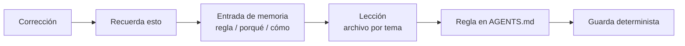

# 4. El contexto es infraestructura

> **En una frase:** cada sesión empieza con amnesia, así que construye el contexto como infraestructura: un contrato pequeño que siempre se carga, una base de conocimiento que escriben los agentes y corriges tú, y sistemas vivos que ganan a cualquier foto fija, todo con commit, para que una sesión nueva con contexto completo cueste segundos.

## Lo que serás capaz de hacer

- Separar el conocimiento del proyecto en cuatro capas (archivos de instrucciones, base de conocimiento, backlog y sistemas vivos) y poner cada dato en la suya.
- Escribir un `AGENTS.md` ligero que funcione con cualquier herramienta, y un `CLAUDE.md` que lo importe.
- Mantener un índice `ACTIVE.md` que responda "¿qué estábamos haciendo con X?" en diez segundos.
- Registrar decisiones de forma que se puedan sustituir sin perderlas, y promover las correcciones repetidas de memoria a reglas y de reglas a guardas.
- Ejecutar el ciclo que convierte la transcripción de una reunión en cambios en la base de conocimiento y un backlog replanificado.
- Conectar el agente a los sitios donde vive tu trabajo, dentro de las reglas de tu organización, y señalárselos en lugar de resumírselos.

## Por qué importa

Lunes por la mañana. Tienes tres pistas de trabajo (tracks) en marcha. Abres una sesión nueva y escribes "sigue con lo de la exportación". El agente lee el código, encuentra una rama a medias y propone el diseño que descartaste el jueves. El descarte vivía en una ventana de chat que cerraste. Te pasas veinte minutos explicándolo otra vez.

Ahora multiplícalo por cada sesión, cada día y cada compañero que se incorpora. Con un agente es una molestia. Con diez sesiones en paralelo ([módulo 6](../06-run-sessions-in-parallel/README.md)) es el techo de hasta dónde puedes llegar.

Cada sesión empieza sin saber nada de tu proyecto. Eso no se arregla con prompts más largos: los prompts largos son un síntoma de contexto que falta ([módulo 2](../02-one-agent-done-well/README.md)). Se arregla como cualquier trabajo manual repetido: construyendo infraestructura. Versionada, compartida, validada y mantenida.

El objetivo no es "darle todo al agente". El contexto cuesta tokens y atención. La guía de Anthropic sobre ingeniería de contexto describe el objetivo así:

> «el conjunto más pequeño posible de tokens de alta señal que maximice la probabilidad de un resultado deseado» — Anthropic, [Effective context engineering for AI agents](https://www.anthropic.com/engineering/effective-context-engineering-for-ai-agents) (traducción propia)

El trabajo de esta lección es que "una sesión nueva con contexto completo" salga barata en ambas cosas.

## Cuatro capas, cuatro preguntas

| Capa | Responde | Dónde vive | Cuándo se carga | Quién la escribe |
|---|---|---|---|---|
| **Archivos de instrucciones** | ¿Cómo trabajamos aquí? | `AGENTS.md`, `CLAUDE.md` | En cada sesión | El agente propone, una persona cura |
| **Base de conocimiento (knowledge base)** | ¿Por qué es así? ¿Qué decidimos y aprendimos? | `kb/` en git | El índice siempre; el resto bajo demanda | Los agentes, con correcciones humanas |
| **Backlog** | ¿Qué, cuándo, quién? | El gestor de issues | Bajo demanda, a través de la CLI | Los agentes, dirigidos por personas ([módulo 5](../05-decompose-into-tracks/README.md)) |
| **Sistemas vivos** | ¿Qué es verdad ahora mismo? | Código, CI, estado de las issues, producción | Se consultan cuando hace falta | Nadie: son la verdad |

Tres reglas mantienen honestas las capas:

1. **Separa el porqué del qué.** La base de conocimiento guarda razones, decisiones y evidencias. El gestor de issues guarda tareas, responsables y fechas. No copies el backlog en la base de conocimiento o mantendrás dos verdades que se separan. Enlaza en las dos direcciones.
2. **Los sistemas vivos ganan a las fotos fijas.** Cualquier tabla de la base de conocimiento es una foto con fecha. Cuando no coincide con la salida de un comando, gana el comando.
3. **Contrasta las afirmaciones con el código.** Como decimos nosotros: el cuerpo de una issue tiene la fecha del día en que se escribió; el código tiene la fecha de hoy. Un agente que implementa una issue de hace tres semanas sin leer el código actual construirá sobre cosas que ya no existen.

## Archivos de instrucciones: un contrato, adaptadores finos

[AGENTS.md](https://agents.md/) es un estándar abierto que leen Codex y muchos otros agentes. Claude Code lee `CLAUDE.md`, y su [documentación sobre memoria](https://code.claude.com/docs/en/memory) recomienda un `CLAUDE.md` que importe el archivo compartido. Así el contrato vive en un solo sitio y cada herramienta tiene un adaptador fino. [DHH](https://lexfridman.com/dhh-2/) hace lo mismo en todos sus proyectos: su `CLAUDE.md` solo apunta a `AGENTS.md`.

Un buen `AGENTS.md` contiene lo que el agente no puede deducir del código y apunta a todo lo demás. Aquí tienes uno realista para un pequeño servicio web de listas de lectura (los ejemplos de archivos están en inglés, como todos nuestros artefactos):

```markdown
# AGENTS.md

Reading-list service: a REST API (`api/`) and a web client (`web/`) sharing
types in `packages/types/`. Node 22, pnpm workspaces, PostgreSQL 16.

## Start here
- Work in flight, decisions pending and blockers: `kb/ACTIVE.md`. Read it first.
- Why things are the way they are: `kb/decisions/`. Superseded records name their replacement.

## Map
api/src/routes/     HTTP handlers, kept thin: validate, call a service, map errors
api/src/services/   business rules; the only code that touches the database
api/migrations/     SQL migrations; applied ones never change
web/src/            React client; calls the API only through packages/client
packages/types/     generated from api/openapi.yaml with `pnpm gen`; don't edit by hand

## Commands
pnpm install              # once per worktree
pnpm gate                 # lint + typecheck + unit tests; run before you say "done"
pnpm test:api <pattern>   # one API test file, fast
pnpm db:reset             # local database for this worktree only

## Rules that fail the build
- CI rejects hand edits under packages/types/src/generated/.
- A new migration never edits an applied one. Add a new file.

## Working agreements
- One issue, one branch, one pull request, end to end.
- Verification only gets tighter: fix the change, not the check. If a check
  can't run, say what you didn't run and why.
- Tests for a filter or permission need fixtures the rule must exclude.
- Never read `.env*` files or print secrets. Ask for the variable name.
- Write code, commits, pull requests and docs in English.
- No new runtime dependency without a decision record in `kb/decisions/`.

## Done means
- `pnpm gate` passes and you pasted its last lines.
- A behavior change has a test that fails when the change is reverted.
- The track's row in `kb/ACTIVE.md` shows the new state and next gate.
```

Y el adaptador para Claude Code:

```markdown
@AGENTS.md

## Claude Code only
- Hooks in `.claude/settings.json` run the gate when you stop and validate edits
  under `kb/`. If one blocks, fix what it names. Don't edit the hook.
```

Lo que se queda **fuera**: descripciones archivo por archivo, reglas de estilo que ya impone un linter, todo lo que cambia cada semana (eso va en `ACTIVE.md`) y las justificaciones largas (eso va en un registro de decisión). Para cada línea, las [buenas prácticas de Claude Code](https://code.claude.com/docs/en/best-practices) proponen una prueba: «¿Quitar esto haría que Claude cometiera errores?» (traducción propia). Si no, bórrala.

Dos detalles de las herramientas cambian cómo se escriben estos archivos:

- En Claude Code, un import con `@` carga el archivo importado en el contexto al arrancar. Los imports ordenan las instrucciones; no las abaratan. La documentación sugiere mantener cada `CLAUDE.md` por debajo de unas 200 líneas.
- Codex une los `AGENTS.md` desde la raíz del repositorio hasta el directorio actual, con los más cercanos al final, y deja de añadirlos cuando el total llega a un límite de tamaño, 32 KiB por defecto ([documentación de AGENTS.md en Codex](https://learn.chatgpt.com/docs/agent-configuration/agents-md)). Un archivo hinchado no solo cuesta tokens: pasado el límite, el resto ni siquiera se carga.

## Nuestra práctica: un repositorio de misión

> [!NOTE]
> **En The Agile Monkeys** un ingeniero líder ejecuta muchas sesiones de Claude Code y Codex desde un único *repositorio de misión*. Su propósito es una misión, no un producto. Contiene la base de conocimiento, y los repositorios de producto están enlazados dentro. Pensamos y planificamos en sesiones abiertas ahí, porque empiezan con la misión, todas las decisiones pasadas y el estado actual de cada pista. El código se escribe en otro sitio: en worktrees de los repositorios de producto ([módulo 6](../06-run-sessions-in-parallel/README.md)).

Sembramos el nuestro a partir de [Limina](https://github.com/theam/limina), nuestro arnés de investigación de código abierto. Limina le da a un agente una sola misión y un protocolo (Misión → Hipótesis → Experimento → Hallazgo → Decisión) que le obliga a dejar por escrito lo que aprende. Las dos cosas importan. Una sola misión mantiene el alcance acotado. Un protocolo en el que guardar conocimiento forma parte del trabajo, y no es un añadido, es lo que hace que recordar ocurra de verdad. No necesitas Limina para aplicar esta lección: sirve cualquier arnés organizado en torno a una misión, y también una carpeta normal con la estructura de abajo.

Un repositorio de misión tiene más o menos este aspecto:

```text
product-mission/
├── AGENTS.md                 # the shared contract, a map (~100 lines)
├── CLAUDE.md                 # @AGENTS.md
├── kb/
│   ├── mission/CHALLENGE.md  # the mission, and how we'll know we're done
│   ├── ACTIVE.md             # always loaded, at most 100 lines
│   ├── decisions/            # decision records, superseded but never deleted
│   ├── lessons/              # small topic files, read on demand
│   ├── research/             # analyses and evidence
│   ├── announcements/        # team updates, as they were sent
│   └── memory/               # typed entries plus a one-line-per-entry index
├── repos/                    # product repositories, as git submodules
│   ├── api/
│   └── web/
├── scripts/validate_kb.py    # shape, line budgets, links, supersede chains
└── .claude/  .codex/         # hooks: load ACTIVE.md, validate kb/ edits
```

**Trae el mundo que ya existe.** Nuestra misión empezó a partir de una decena de iniciativas de automatización dispersas, cada una en su repositorio. La primera tarea fue enlazarlas todas y preguntar al agente qué era válido, qué estaba duplicado y qué no funcionaba. Cada repositorio que añadimos después recibe el mismo tratamiento:

```text
He añadido repos/importer como submódulo. Léelo y compáralo con la misión de
kb/mission/CHALLENGE.md y con los otros repositorios. Dime qué es válido y
reutilizable, qué duplica algo que ya tenemos y qué está roto o abandonado, con
rutas de archivos como evidencia. Guarda el análisis en kb/research/.
Propón las decisiones que creas que necesitamos, pero no las registres todavía.
```

### Dónde vive la base de conocimiento

Un repositorio de misión aparte es nuestra elección para el trabajo que abarca muchos repositorios. No es el único buen sitio. Lo que importa es que la base de conocimiento exista; dónde vive depende de tu situación:

| Situación | Dónde encaja |
|---|---|
| Un único repositorio autocontenido, como una app móvil | Dentro de él, con commit junto al código y a la documentación para personas. Un solo clon le da a la sesión todo lo que necesita. |
| Muchos servicios en muchos repositorios | Un repositorio aparte que sabe cómo se relacionan los servicios y de qué se encarga cada uno. Ningún repositorio de un servicio puede tener esa visión. |
| Tu propio trabajo en varios proyectos | Un espacio de conocimiento personal: un índice en la raíz, un archivo con lo que está en marcha y una carpeta por proyecto. Puede guardar más que Markdown, como hojas de cálculo y documentos exportados. |

Algunos sincronizamos el espacio personal con una unidad en la nube en lugar de git, para que esté siempre al día y se pueda leer desde el móvil. Para notas personales funciona. El conocimiento que comparte un equipo va en git, donde el historial, la revisión y las cadenas de sustitución hacen que sea fiable.

## El índice ACTIVE

`ACTIVE.md` es el único archivo de la base de conocimiento que carga cada sesión. Es un **índice, no un diario**: una fila por cada pista en marcha, con su estado, la siguiente puerta y enlaces a todo lo demás. Tiene un presupuesto estricto de 100 líneas.

```markdown
# ACTIVE

Index of work in flight. Rewrite rows, don't append. Budget: 100 lines.
Details live in the linked issues, pull requests and records.

## Current objective
Shared reading lists in beta by 2026-10-15.

## Next step
Human review of the schema migration in #230, then unblock #218.

## Active tracks
| Track | Issue | PR | State | Next gate |
|---|---|---|---|---|
| Shared lists schema | #212 | #230 | In review | Human review of the migration |
| List invitations | #218 | — | Planning | Plan accepted; waits on #230 merge |
| CSV export | #205 | #227 | Fixing review findings | Re-review after push |
| Search relevance | #199 | — | Research | Decide Postgres full-text vs external index |

## Blockers
- #218: invite expiry needs a product decision (asked 2026-09-15). Degraded path: 7 days.

## Recent decisive evidence
- Full-text search prototype: p95 38 ms on 50k books (kb/research/2026-09-14-fts-benchmark.md).

## Working set
- kb/decisions/D-0012-shared-lists.md
```

Con este archivo cargado, "¿qué estábamos haciendo con la búsqueda?" es una pregunta de diez segundos, y el siguiente mensaje puede ser una decisión: "vamos con full-text de Postgres; regístralo".

La disciplina está en cómo cambian las filas:

```text
❌ | CSV export | #205 | #227 | Mon: started. Tue: CI red (3 failures), fixed 2.
     Wed: reviewer found 14 threads, 9 fixed, commit 4f2a9c1... | ... |

✅ | CSV export | #205 | #227 | Fixing review findings | Re-review after push |
```

Reescribe la fila; nunca añadas un diario. Borra la fila cuando la pista se entregue. Los recuentos de CI, los hashes de commit y el estado de los hilos de revisión van en el pull request, nunca aquí.

Cárgalo de forma determinista. En Claude Code puedes importarlo desde `CLAUDE.md` con `@kb/ACTIVE.md`. Un hook `SessionStart` funciona en Claude Code y en Codex, porque los dos añaden al contexto de la sesión la salida en texto plano de ese hook ([hooks de Claude Code](https://code.claude.com/docs/en/hooks), [hooks de Codex](https://learn.chatgpt.com/docs/hooks)). El matcher `compact` lo vuelve a cargar después de compactar el contexto. La misma entrada va en `.claude/settings.json` y en el `.codex/hooks.json` de Codex, donde la apruebas una vez con `/hooks`:

```json
{
  "hooks": {
    "SessionStart": [
      {
        "matcher": "startup|resume|clear|compact",
        "hooks": [{ "type": "command", "command": "cat \"$(git rev-parse --show-toplevel)/kb/ACTIVE.md\"" }]
      }
    ]
  }
}
```

El comando busca el archivo desde la raíz de git, como recomienda la documentación de Codex, en lugar de usar `${CLAUDE_PROJECT_DIR}`: esa variable solo la define Claude Code, y las dos herramientas ejecutan los comandos de los hooks en el directorio de trabajo de la sesión.

Un validador que ejecutan los hooks impone la forma y el presupuesto, con un mensaje que le dice al agente cómo arreglarlo ([módulo 3](../03-close-the-loop/README.md)).

> [!WARNING]
> Un presupuesto de líneas no limita lo larga que se vuelve una fila. Incluso con un validador, nuestras filas fueron acumulando recuentos de CI y detalles de revisión, porque una regla escrita en prosa se degrada bajo presión. Relee `ACTIVE.md` cada semana o dos y pide al agente que reescriba las filas que se hayan convertido en diarios.

Cuando una sesión empieza en frío, o tras reiniciar la máquina, seguimos un protocolo corto de recuperación: leer la misión, después `ACTIVE.md`, y después solo los artefactos enlazados desde la fila que importa. Reconstruir el objetivo, el siguiente paso, el bloqueo y la decisión pendiente. Contrastar números y fechas con la salida de los sistemas vivos; si no coinciden, eso es un bloqueo que hay que resolver primero. Buscar en la base de conocimiento antes de crear nada nuevo.

## Una base de conocimiento escrita por la IA, para la IA

> [!NOTE]
> **En The Agile Monkeys** no escribimos la base de conocimiento a mano, y la mayor parte no la leemos. La escriben los agentes mientras trabajan: decisiones, lecciones, investigación, traspasos. Tiene errores. Cuando vemos uno decimos "esto está mal, arréglalo", y muchos otros se quedan. Lo aceptamos, porque el valor de una sesión que empieza con meses de contexto es mucho mayor que el coste de los errores.

Esto funciona gracias a las capas de arriba: los sistemas vivos ganan a la base de conocimiento, y a los agentes se les pide que contrasten las afirmaciones con el código. La base de conocimiento da a la sesión dirección y razones; no se trata como la verdad absoluta. Lo resume una frase a la que [Andrej Karpathy](https://karpathy.bearblog.dev/sequoia-ascent-2026/) dice que vuelve una y otra vez: «Puedes externalizar tu pensamiento, pero no puedes externalizar tu comprensión» (traducción propia). La base de conocimiento recuerda por ti. No entiende por ti.

Mantén los archivos pequeños y por temas, para que las sesiones los carguen bajo demanda en lugar de leerlo todo. Anthropic lo llama recuperación "just in time": el agente guarda referencias ligeras, como rutas de archivos, y carga lo que necesita cuando lo necesita.

Una base de conocimiento compartida también cambia cómo trabaja un equipo. Cuando se incorporaron compañeros, clonaron el repositorio de misión, y ahora le hacen preguntas: "¿por qué elegimos este esquema?", "diseña esta funcionalidad y crea las issues".

### Sustituye, no borres

Las decisiones cambian. Cuando una cambia, no edites ni borres el registro antiguo. Márcalo como sustituido, enlaza el que lo reemplaza y consérvalo:

```markdown
---
id: D-0009
title: One reading list per user
status: superseded
decided_on: 2026-06-02
superseded_on: 2026-09-12
superseded_by: D-0012
---

# D-0009 One reading list per user

> **Superseded on 2026-09-12 by [D-0012](D-0012-shared-lists.md).** Kept because it
> explains why old exports have no `list_id` and why `books.user_id` exists.

## Context
Beta users asked for one simple list. Sharing was out of scope.

## Decision
Each user has exactly one list, and books belong to the user.

## Consequences
- Permissions are trivial: only the owner reads or writes.
- Sharing will need a schema change.
```

El registro nuevo lleva `supersedes: D-0009`. Un validador comprueba la cadena: todo registro con estado `superseded` tiene que nombrar al que lo reemplaza.

¿Por qué conservar decisiones muertas? Porque el código, los datos y las exportaciones antiguas todavía las reflejan, y porque una decisión borrada vuelve a proponerse seis meses después por un agente que solo ve el código actual. Las decisiones registradas son el activo. Cuando le pases una tarea a un agente, enumera las decisiones ya tomadas y dile que no las reabra.

### Haz commit de la base de conocimiento

Un cambio en la base de conocimiento sin commit no ha ocurrido. La siguiente sesión en otro worktree no lo ve, un compañero no puede traérselo y un fallo de disco lo borra.

> [!NOTE]
> **En The Agile Monkeys** lo aprendimos por las malas. Tras varias semanas de misión, un repositorio acumulaba miles de cambios sin commit en la base de conocimiento. Ahora cada sesión termina con commit y push, y varias sesiones escriben en `main` en paralelo con una higiene sencilla: un solo autor por archivo, y las sesiones de análisis crean archivos nuevos en lugar de editar los compartidos ([módulo 6](../06-run-sessions-in-parallel/README.md)).

Hacer commit directamente en `main` es una excepción deliberada a la regla de que los agentes no hacen push a ramas protegidas como `main` ([módulo 3](../03-close-the-loop/README.md), [módulo 9](../09-teams-and-organizations/README.md)), y solo se aplica al repositorio de misión. Ese repositorio contiene documentos, no código de producto; las sesiones hacen muchas escrituras pequeñas e independientes que un pull request por cambio enterraría en revisiones; y lo que protege su forma son validadores que ejecutan los hooks, no la revisión de pull requests. El código de producto siempre pasa por una rama y un pull request.

Lo mismo vale para lo que le cuentas al equipo. Redactamos los anuncios en la base de conocimiento y los archivamos tal como se enviaron. Dos días después, una sesión que escribe el siguiente anuncio puede decir "el mensaje del lunes decía que las exportaciones eran solo CSV; esta versión lo cambia" e incluir la corrección.

## La memoria y el camino de promoción

Las correcciones son el contexto más valioso que produces y el más fácil de perder. Cuando un agente se equivoca y lo corriges, o cuando algo falla a menudo, dilo explícitamente: "recuerda esto". Nuestro arnés pide a los agentes que guarden lo que aprenden, y "recuerda esto" hace que sea imposible pasarlo por alto.

Cada entrada de memoria tiene tres partes: la **regla**, **por qué** existe y **cómo aplicarla**. Sin el porqué, una sesión futura no sabe cuándo la regla no aplica.

```markdown
---
type: feedback
created: 2026-09-10
---

# Fixtures must vary where production varies

**Rule:** A test for a filter, permission or visibility rule needs fixtures the
rule must exclude, at least one per value that changes the outcome.

**Why:** On 2026-09-09 the projects report showed archived projects in
production. Its test passed because every fixture project was active: the mock
agreed with the bug. Fixed in #231.

**How to apply:** Before writing assertions, list the values the field takes in
production. Add a fixture for each value that changes the result, and assert on
the excluded ones. In review, reject filter tests with uniform fixtures.
```

Un archivo índice tiene una línea por entrada, para que una sesión pueda recorrer toda la memoria con poco coste y abrir solo lo que aplica:

```markdown
- [Fixtures must vary where production varies](feedback-fixtures-vary.md) — filter tests need excluded records; a uniform mock hid a bug.
```

Las entradas no se quedan como memoria para siempre. Avanzan por un camino de promoción a medida que demuestran su valor:



- **De entrada de memoria a lección** cuando aplica a varias tareas.
- **De lección a regla en `AGENTS.md`** cuando la necesita cada sesión del repositorio. La entrada sobre fixtures de arriba se convirtió en una línea del `AGENTS.md` de ejemplo.
- **De regla a guarda** cuando se puede comprobar mecánicamente y aun así se incumple ([módulo 3](../03-close-the-loop/README.md)). No toda regla puede ser una guarda. "Los fixtures tienen que variar" requiere criterio, así que sigue siendo una regla y una pregunta de revisión.

**No dependas de acordarte de decirlo.** Termina cada sesión con una retrospectiva corta: pide al agente que enumere todas las correcciones que has tenido que hacerle y que proponga dónde va cada una en el camino, como entrada de memoria, como cambio en una skill, como línea de `AGENTS.md` o como comprobación. Tú decides qué se queda. En nuestro equipo hay quien la ejecuta como una skill al final de cada sesión, y nuestro prompt de [fin de sesión](../reference/prompt-patterns.md#26-fin-de-sesión) la incluye.

El camino también va hacia atrás. Cuando aparece un consejo obsoleto, marca la entrada como sustituida dentro de ella misma, con fecha. Cuando el agente ya hace algo bien sin que se lo digan, borra la línea. Las buenas prácticas de Claude Code lo dicen así: «Si Claude ya hace algo correctamente sin la instrucción, bórrala o conviértela en un hook» (traducción propia).

Las herramientas traen sus propias funciones de memoria, como la [memoria automática de Claude Code](https://code.claude.com/docs/en/memory). Úsalas si encajan. La forma de las entradas importa más que dónde se guardan.

## Las reuniones alimentan la base de conocimiento, y esta al backlog

Los planes cambian en las reuniones, y el backlog no se entera. Nuestro ciclo toma una transcripción, actualiza la base de conocimiento y después replanifica el backlog a partir de ella:

```text
Aquí tienes la transcripción de la reunión de planificación de hoy:
meetings/2026-09-16.txt. Actualiza la base de conocimiento:
- registra cada decisión como un registro nuevo, sustituyendo el que reemplace,
- añade las preguntas abiertas a las filas correspondientes de kb/ACTIVE.md,
- refiérete a las personas por su rol y deja fuera cualquier cosa personal.
No toques el backlog todavía. Enumera los cambios que has hecho en la base de conocimiento.
```

```text
Ahora replanifica el backlog a partir de la base de conocimiento actualizada.
Dame tres listas: issues que cerrar porque ya no hacen falta, issues que
actualizar y qué cambia, e issues que crear. Una línea de porqué para cada una,
con un enlace a la decisión que la justifica. No cambies nada en GitHub hasta
que te diga adelante.
```

Luego lees tres listas en lugar de quinientas issues y dices adelante. Con un backlog de varios cientos de issues abiertas, este ciclo es lo que lo mantiene honesto después de un cambio de estrategia.

> [!WARNING]
> Las transcripciones son sensibles. Pide consentimiento para grabar. No hagas commit de transcripciones en bruto en un repositorio compartido: guarda las decisiones y sus razones, no los comentarios sobre personas. Mantén la aprobación humana antes de cualquier cambio masivo en el backlog.

## Conecta las fuentes y señala, no resumas

Las cuatro capas viven en tus repositorios y en tu gestor de issues. Mucho de lo que necesita una tarea vive en otra parte: el hilo de chat donde alguien la pidió, el correo con la fecha límite, la reunión donde se decidió, el documento con la especificación, los logs del entorno donde falla. Cuando el agente no llega ahí, el puente eres tú. Lees, resumes y vuelves a teclear, y el agente recibe tu resumen en lugar de la fuente.

Conecta el agente a los sistemas donde vive tu trabajo, mediante una CLI o un servidor MCP ([Herramientas](../reference/tools.md#mcp-model-context-protocol)), en solo lectura salvo que una tarea necesite más. Prefiere una CLI cuando exista una buena: el agente suele conocerla ya, y no añade descripciones de herramientas al contexto. Las descripciones de las herramientas MCP también cuestan contexto, salvo que tu herramienta las cargue bajo demanda, como hace Claude Code por defecto en los modelos compatibles ([la caché de prompts y MCP](https://code.claude.com/docs/en/prompt-caching#connecting-or-removing-an-mcp-server)). Después, **señala en lugar de resumir**. No escribas "alguien del equipo ha pedido X por Y". Dale al agente el enlace al mensaje. Lee el hilo, sigue lo que enlaza, consulta la tarea en el gestor de issues y lee el código, y acaba con más contexto del que tú habrías tecleado.

❌ **Prompt débil**

```text
El equipo de producto quiere que la exportación incluya etiquetas porque la
gente no para de pedirlo. Añade las etiquetas a la exportación CSV.
```

✅ **Prompt mejor**

```text
Lee este hilo: <enlace al mensaje del chat>. Busca la issue relacionada y
cualquier decisión en la base de conocimiento. Dime qué se está pidiendo de
verdad, qué existe ya en el código y qué no está claro. Después espera.
```

Esto es lo que permite que el resto de prácticas de esta guía funcionen juntas. Un agente conectado entiende una petición hablada y desordenada ([módulo 2](../02-one-agent-done-well/README.md#voz-habla-en-tu-idioma-escribe-en-uno)) porque busca lo que no dijiste. Y cuanto mejor sabe buscar, más grandes son los [objetivos](../reference/prompt-patterns.md#13-sigue-hasta-que-se-cumpla-el-objetivo) que puedes darle.

> [!NOTE]
> **En The Agile Monkeys** las personas que más partido sacan a los agentes los han conectado a casi todo lo que usan: el chat, el correo, los documentos, el gestor de issues, el código y vistas de solo lectura de la infraestructura. Cuando alguien les pide algo, su primer mensaje al agente suele ser un enlace.

**Dentro de las reglas de tu organización.** Cada conexión le da al agente datos nuevos, y parte de ese texto no es confiable: cualquiera puede escribir en un canal de chat o mandarte un correo. Conecta solo lo que permitan las políticas de seguridad de tu empresa, con las cuentas que te proporcione. Muchas empresas lo gestionan de forma centralizada con planes de equipo o de empresa, en los que la administración decide qué servidores MCP, plugins y conectores puede usar cada persona. En Claude Code, por ejemplo, una organización puede [restringir o proporcionar servidores MCP](https://code.claude.com/docs/en/managed-mcp) para todo el mundo. Mantén las conexiones en solo lectura por defecto, y revisa cada configuración frente a la [trifecta letal](../09-teams-and-organizations/README.md#entradas-no-confiables-y-la-trifecta-letal) antes de que combine datos privados, texto no confiable y una forma de enviar cosas fuera.

## Otras formas de verlo

**¿Archivos de instrucciones ligeros o largos?** Hay desacuerdo entre quienes practican esto, y las razones enseñan.

- **Ligeros.** DHH transmite una afirmación del equipo de Claude Code: un prompt de sistema reciente se redujo alrededor de un 80 %, porque el agente «en realidad salía perjudicado por humanos demasiado prescriptivos» ([Lex Fridman Podcast #501](https://lexfridman.com/dhh-2/), traducción propia). Es de segunda mano, pero coincide con lo que recomiendan los propios fabricantes. Las [buenas prácticas de Codex](https://learn.chatgpt.com/guides/best-practices) dicen: «Un AGENTS.md corto y preciso es más útil que un archivo largo lleno de reglas vagas» (traducción propia).
- **Largos.** [Peter Steinberger](https://steipete.me/posts/just-talk-to-it) mantiene un archivo grande que el agente fue escribiendo a medida que aprendía: «Mi archivo de agentes tiene ahora unas 800 líneas y parece una colección de cicatrices organizativas. No lo escribí yo, lo escribió codex» (traducción propia).
- **Un mapa.** El artículo de OpenAI sobre [harness engineering](https://openai.com/index/harness-engineering/) describe un `AGENTS.md` de unas 100 líneas que funciona como índice hacia un directorio `docs/` estructurado, después de que un único archivo de instrucciones grande se quedara desactualizado y desplazara al resto del contexto. Es un experimento de un fabricante sobre un proyecto nuevo, pero el patrón se puede trasladar.

**Lo que hacemos nosotros:** mantener pequeño el contexto que siempre se carga (un `AGENTS.md` que es un mapa, más `ACTIVE.md`, cada uno de unas 100 líneas) y dejar que todo lo demás se cargue bajo demanda: decisiones, lecciones, skills. Las cicatrices de Steinberger son conocimiento real; nosotros simplemente dejamos la mayor parte a un enlace de distancia en lugar de en el contexto de cada sesión.

**¿Skills pronto o tarde?** Una skill empaqueta un flujo de trabajo que el agente carga cuando lo necesita. [Boris Cherny](https://x.com/bcherny/status/2017742741636321619), creador de Claude Code, sugiere convertir en skill cualquier cosa que hagas más de una vez al día. Nosotros somos más conservadores, porque las skills no son gratis:

> «Cada skill del listado de skills se suma a tu contexto en cada turno, la use Claude o no.» — [Documentación de skills de Claude Code](https://code.claude.com/docs/en/skills) (traducción propia)

Creamos una skill cuando algo ya duele. El ejemplo más claro: uno de nuestros ingenieros se pasaba horas al día escribiendo "continue" en bucles de revisión de código (code review). Aquello se convirtió en una skill de bucle de revisión ([módulo 7](../07-agents-review-agents/README.md)). Cuando una skill sirve más allá de un repositorio, copiarla deja copias que se van separando, así que estamos reuniendo las skills que compartimos como equipo en [claude-dev-kit](https://github.com/theam/claude-dev-kit), nuestro plugin open source, a través de pull requests revisados ([módulo 9](../09-teams-and-organizations/README.md)). Un plugin es una opción, no un requisito: [Construye tus propias skills](../appendix/build-your-own-skills.md) explica cómo escribir y compartir las tuyas. Steinberger avisa del extremo contrario, que llama la trampa agéntica: construir herramientas y flujos en lugar de entregar.

**¿Deberían las personas revisar la base de conocimiento?** [Birgitta Böckeler](https://martinfowler.com/articles/exploring-gen-ai/sdd-3-tools.html) advierte de que las herramientas guiadas por especificaciones producen montones de Markdown que dan una falsa sensación de control, y de que ella prefiere revisar código. Estamos de acuerdo en lo de revisar: no revisamos la base de conocimiento como si fuera código. La consultamos, la corregimos cuando una respuesta está mal, y nos apoyamos en los sistemas vivos y los tests para saber la verdad.

## Ojo con

- **`ACTIVE.md` como diario.** La narración añadida convierte el índice en un log que nadie, ni persona ni agente, puede recorrer de un vistazo. Reescribe las filas.
- **Dos fuentes de verdad.** Un backlog copiado en la base de conocimiento se separa del gestor de issues en pocos días. Enlaza, no dupliques.
- **Fiarse de la foto fija.** Un agente que cree el cuerpo de una issue de hace tres semanas antes que el código de hoy construye sobre fantasmas. Pídele que lo contraste.
- **Conocimiento sin commit.** Si no tiene push, la siguiente sesión no lo tiene.
- **Borrar decisiones.** Vuelven como propuestas nuevas. Sustitúyelas.
- **Instrucciones hinchadas.** Cada regla "por si acaso" diluye las que importan, y los imports con `@` no la abaratan.
- **Skills para todo.** Cada una se suma a cada turno. Espera a que duela.
- **Secretos y datos personales en la base de conocimiento.** La clona cada compañero y la lee cada sesión. Trátala como un documento público dentro de la empresa.
- **Resumir en lugar de señalar.** Tu resumen de un hilo pierde lo que dice el hilo. Dale al agente el enlace.
- **Conexiones que tu empresa no permite.** Usa las cuentas y los servidores MCP que apruebe, en solo lectura por defecto.

❌ **Prompt débil**

```text
sigue con lo de la exportación
```

✅ **Prompt mejor**

```text
Lee kb/ACTIVE.md y todo lo enlazado desde la fila de CSV export. En cinco líneas,
dime el objetivo, el siguiente paso, el bloqueo y la decisión pendiente. Señala
cualquier punto en el que la base de conocimiento y el código actual no
coincidan. Después, espera.
```

## Comprueba lo que has aprendido

1. Una decisión registrada en marzo ya no vale. Un compañero quiere borrar el registro para "tener limpia la base de conocimiento". ¿Qué haces y por qué?

   <details><summary>Respuesta</summary>

   Márcala como sustituida, con la fecha y un enlace a la decisión que la reemplaza, y añade un aviso bajo el título. La decisión antigua todavía explica código y datos antiguos, y una decisión borrada suele volver a proponerla un agente que solo ve el código actual.

   </details>

2. `ACTIVE.md` dice que la exportación a CSV tiene merge. `gh pr view 227` dice que el pull request sigue abierto. ¿A quién cree el agente y qué debería pasar después?

   <details><summary>Respuesta</summary>

   Gana el sistema vivo: el pull request está abierto. Una discrepancia entre la base de conocimiento y la salida de un sistema vivo es un bloqueo que hay que resolver primero, así que el agente debe señalarlo y corregir la fila, no seguir como si la exportación se hubiera entregado.

   </details>

3. Tu `CLAUDE.md` tiene 600 líneas, así que lo divides en cinco archivos y los importas con `@`. ¿Has reducido el contexto que carga cada sesión?

   <details><summary>Respuesta</summary>

   No. Los archivos importados se cargan en el contexto al arrancar, así que el coste es el mismo. Para reducirlo, borra las líneas que el agente no necesita, mueve el conocimiento ocasional a archivos o skills que se carguen bajo demanda y deja que la parte que siempre se carga sea un mapa.

   </details>

4. Has corregido el mismo error en tres sesiones distintas. ¿Cuáles son los siguientes pasos en el camino de promoción?

   <details><summary>Respuesta</summary>

   Di "recuerda esto" y asegúrate de que se convierte en una entrada de memoria con regla, porqué y cómo aplicarla. Si sigue aplicando en distintas tareas, promuévela a lección y después a regla de `AGENTS.md`. Si se puede comprobar mecánicamente y aun así se incumple, conviértela en una guarda.

   </details>

5. Después de una reunión de estrategia, ¿por qué pedir las tres listas del backlog (cerrar, actualizar, crear) en lugar de dejar que el agente edite las issues directamente?

   <details><summary>Respuesta</summary>

   Un cambio masivo en un backlog compartido es una decisión con un gran radio de impacto. Tres listas cortas, con una razón y una decisión enlazada en cada punto, te permiten revisar la intención en minutos, detectar malas interpretaciones de la transcripción y mantener a una persona en la puerta.

   </details>

## Ideas clave

- Cada sesión empieza con amnesia. Haz que "una sesión nueva con contexto completo" sea barata en tokens y en tus minutos.
- Mantén separadas cuatro capas: archivos de instrucciones (cómo), base de conocimiento (por qué), backlog (qué, cuándo, quién) y sistemas vivos (qué es verdad ahora, y quién gana cualquier discrepancia).
- Un contrato `AGENTS.md`, adaptadores finos por herramienta (`CLAUDE.md` con `@AGENTS.md`) y una parte que siempre se carga y sigue siendo un mapa.
- `ACTIVE.md` es un índice de pistas de menos de 100 líneas: reescribe filas, nunca añadas.
- Deja que los agentes escriban la base de conocimiento y corrígela cuando veas errores; sustituye decisiones en lugar de borrarlas; haz commit al final de cada sesión.
- Promueve las correcciones: entrada de memoria (regla, porqué, cómo aplicarla) → lección → regla en `AGENTS.md` → guarda, y termina las sesiones con una retrospectiva para que no se pierda ninguna. Crea skills solo cuando algo duela.
- Ten una base de conocimiento; dónde vive (en el repositorio, en un repositorio propio, en un espacio personal) depende de tu situación.
- Conecta el agente a donde vive el trabajo, en solo lectura y dentro de las reglas de tu empresa, y dale enlaces en lugar de resúmenes.

## Para profundizar

- [Anthropic: Effective context engineering for AI agents](https://www.anthropic.com/engineering/effective-context-engineering-for-ai-agents) — contexto de alta señal, recuperación "just in time" y notas estructuradas.
- [Limina](https://github.com/theam/limina) — el arnés de investigación de código abierto del que partió nuestro repositorio de misión.
- [AGENTS.md](https://agents.md/) — el estándar abierto para archivos de instrucciones de agentes.
- [Memoria en Claude Code](https://code.claude.com/docs/en/memory) — `CLAUDE.md`, imports, `AGENTS.md` y memoria automática.
- [Codex: instrucciones personalizadas con AGENTS.md](https://learn.chatgpt.com/docs/agent-configuration/agents-md) — cómo descubre y combina Codex los archivos de instrucciones.
- [OpenAI: Harness engineering](https://openai.com/index/harness-engineering/) — un `AGENTS.md` corto como mapa hacia un directorio de documentación estructurado.
- [Peter Steinberger: Just Talk To It](https://steipete.me/posts/just-talk-to-it) — los argumentos a favor de un archivo de instrucciones largo escrito por el agente.
- [Mitchell Hashimoto: My AI Adoption Journey](https://mitchellh.com/writing/my-ai-adoption-journey) — convertir cada error del agente en parte del arnés.
- [Laboratorio 4: dale memoria al proyecto](lab.md) — crea `AGENTS.md`, `ACTIVE.md` y un registro de decisión para el proyecto de prácticas, y compara una sesión nueva con y sin ellos.

Siguiente: [5. Divide el trabajo en pistas](../05-decompose-into-tracks/README.md)
