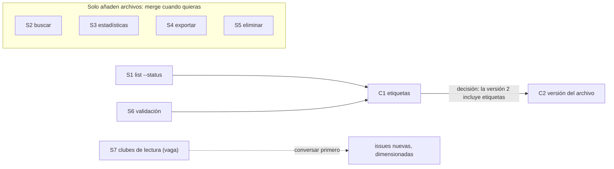

# 5. Divide el trabajo en pistas

> **En una frase:** los agentes en paralelo son tan buenos como la división que les das: convierte el plan en issues autosuficientes, agrúpalas por radio de impacto en pistas de trabajo (tracks) que no se pisen y ordena los merges, no el trabajo.

## Lo que serás capaz de hacer

- Convertir una conversación de planificación en issues autosuficientes que una sesión nueva pueda ejecutar sin ti.
- Dimensionar el trabajo por radio de impacto y agruparlo en pistas independientes, detectando los conflictos textuales y semánticos antes de que ocurran.
- Planificar un orden de merge distinto del orden de trabajo.
- Escribir un prompt de arranque que impida que un agente vuelva a deducir hechos, reabra decisiones o tome decisiones de diseño en silencio.
- Escribir un paquete de traspaso (handoff pack) que permita a una sesión nueva (o a ti, tras una semana fuera) retomar una pista.

## Por qué importa

Imagina un martes por la mañana. Tienes nueve issues y un hábito nuevo: una sesión por issue. Abres cinco terminales, escribes «implementa la #12» en cada una y te vas a por un café.

Cuarenta minutos después, dos sesiones han cambiado el formato de almacenamiento de dos maneras incompatibles. Otra ha reabierto una decisión que tomaste la semana pasada («creo que las etiquetas deberían ir en un archivo aparte»). Otra se ha parado a preguntarte algo que el código ya responde. La quinta ha hecho exactamente lo que decía su issue, pero la issue se escribió después de una conversación que esa sesión nunca vio, así que ha construido lo que no era.

Nada de eso es culpa de los agentes. El paralelismo no arregla una mala división: la multiplica. Con un agente en una tarea, detectas el malentendido mientras ocurre. Con cinco, detectas cinco a la vez, en la revisión.

Cuando los agentes escriben el código, los recursos escasos son tu atención para revisar y la coherencia del sistema. La descomposición decide cómo se gastan los dos. [Addy Osmani](https://addyosmani.com/blog/code-agent-orchestra/) sitúa la descomposición del trabajo, junto a las especificaciones claras y la verificación del resultado, entre las habilidades que sustituyen a escribir el código tú mismo. Este módulo trata de esa habilidad. El [módulo 06](../06-run-sessions-in-parallel/README.md) cubre la mecánica de ejecutar las sesiones.

## El backlog es del agente; tú lo diriges

En The Agile Monkeys ya casi no escribimos issues a mano. Planificamos conversando, dentro de una sesión que ya tiene el contexto del proyecto ([módulo 04](../04-context-is-infrastructure/README.md)). «Quiero hacer X, ¿cómo lo plantearías?» «No, prefiero esta otra forma.» «¿Qué pasa con los archivos en el formato antiguo?» Cuando el plan está claro, le pedimos al agente que lo deje escrito en el gestor de issues.

❌ **Prompt débil**

```text
Crea issues para esto.
```

✅ **Prompt mejor**

```text
Pasa a issues de GitHub el plan que acabamos de acordar. Una issue por cada
cambio que pueda hacer merge por sí solo. Cada cuerpo tiene que entenderse
solo: problema, evidencia con archivo:línea, esbozo de la solución, criterios
de aceptación, fuera de alcance, y con qué otras issues entra en conflicto o
después de cuáles debe hacer merge. Si el plan necesita más de cinco issues,
crea también una épica que las enlace. No crees nada todavía: primero
enséñame los títulos, un tamaño para cada una y los conflictos que ves.
```

La última frase importa. Crear issues le sale barato al agente y caro a tu atención más adelante. Revisa la *forma* (títulos, tamaños, conflictos) antes de que nada llegue al gestor. Tras unas cuantas rondas, las convenciones acaban en AGENTS.md o en una skill, y basta con «crea una issue para esto».

Dos hábitos lo mantienen honesto:

- **No leas todas las issues. Pide el plan antes de ejecutar.** Antes de que una sesión empiece una tarea, pregúntale: «Explica qué vas a hacer y qué vas a dejar fuera». Su respuesta se lee en un minuto. El cuerpo detallado de una issue, en diez.
- **Las issues envejecen; el código no.** El cuerpo de una issue tiene la fecha del día en que se escribió. El código tiene la fecha de hoy. Pide a las sesiones que contrasten lo que dice una issue con el código antes de construir sobre ello.

> [!NOTE]
> **En The Agile Monkeys** el backlog de nuestra plataforma interna de operaciones ha llegado a tener unas 500 issues abiertas a la vez, creadas y mantenidas casi por completo por agentes. Parte de lo que contiene está mal. Aun así, es el backlog mejor cuidado que hemos tenido: cada issue tiene detalle suficiente para dársela a una sesión nueva, y el agente lo vuelve a planificar cuando cambia la estrategia. Después de una reunión importante, actualizamos la base de conocimiento (knowledge base) y le pedimos al agente que cierre las issues que ya no hacen falta, actualice las que ya no encajan y cree las que faltan.

## Una issue es un prompt

Una sesión nueva no sabe nada salvo el repositorio y lo que tú le des. Muchas veces, la issue es todo lo que le das. Así que escribe las issues como prompts, no como recordatorios para alguien que estuvo en la reunión.

El cuerpo de una issue autosuficiente tiene seis partes:

| Parte | Para qué está |
|---|---|
| **Problema** | El resultado, en términos de quien lo usa. Permite al agente tomar las pequeñas decisiones que no anticipaste. |
| **Evidencia** | Referencias `archivo:línea`, comandos y su salida. La sesión no vuelve a deducir lo que ya sabes, y las afirmaciones caducadas son fáciles de comprobar. |
| **Esbozo de la solución** | El enfoque previsto, en pocas líneas. No es un diseño completo; solo lo justo para que el agente no elija otra arquitectura. |
| **Criterios de aceptación** | Observables y comprobables. Se convierten en el «terminado cuando» del prompt de arranque. |
| **Fuera de alcance** | Lo que *no* hay que hacer. Los agentes son entusiastas, y aquí es donde se frena el crecimiento del alcance. |
| **Coordinación** | Qué issues tocan los mismos archivos o contratos, y el orden de merge. |

El [catálogo de issues de práctica](../../../practice/issues/es.md) escribe las issues para quien empieza: problema, criterios de aceptación, archivos probables y fuera de alcance. Esta es su C1 después de que una sesión de planificación la convirtiera en un prompt autosuficiente para el [proyecto de práctica](../../../practice/shelf/), con evidencia, esbozo de la solución y coordinación:

```markdown
# C1: Etiquetar libros

## Problema
Un estado dice en qué punto de la lectura está un libro, no de qué trata.
La gente quiere agrupar libros por tema (sci-fi, work, book-club) y listar
un grupo.

## Evidencia
- shelf/models.py:16-23: `Book` tiene id, title, author, status, added_at y
  finished_at. No tiene etiquetas.
- shelf/models.py:34-35: `from_dict` pasa al constructor todas las claves
  guardadas, así que los archivos escritos antes de este cambio solo cargan
  si `tags` tiene un valor por defecto.
- shelf/models.py:37-38: `__str__` es la línea de libro que imprime `list`.
- shelf/commands/add.py:10-15 y shelf/commands/list_books.py:10-12: ninguno
  de los dos comandos acepta `--tag`.
- tests/test_store.py:29-37: fija el conjunto exacto de claves que se guardan
  por libro. Este test tiene que cambiar.

## Esbozo de la solución
- `Book.tags: list[str]`, con una lista vacía por defecto.
- `shelf add` recibe un `--tag` repetible; las etiquetas se guardan en
  minúsculas, sin espacios alrededor, sin duplicados y en el orden en que
  aparecen por primera vez.
- `shelf list --tag X` filtra sin distinguir mayúsculas. La línea del libro
  muestra las etiquetas entre paréntesis tras el autor; los libros sin
  etiquetas se imprimen como hoy.

## Criterios de aceptación
- [ ] `--tag Sci-Fi --tag " sci-fi "` guarda `["sci-fi"]`.
- [ ] `shelf list` imprime `#1 [to-read] Dune by Frank Herbert (sci-fi, classics)`.
- [ ] `shelf list --tag sci-fi` muestra solo los libros con esa etiqueta.
- [ ] Un archivo sin etiquetas sigue cargando, y sus libros no tienen etiquetas.
- [ ] El test de campos guardados de tests/test_store.py incluye `tags`.
- [ ] Cada criterio tiene un test que falla si se revierte el cambio, y
      `python -m unittest` pasa.

## Fuera de alcance
- Etiquetar libros existentes, renombrar o eliminar etiquetas.
- Etiquetas en `shelf export` (S4) y en `shelf search` (S2).

## Coordinación
- Conflicto semántico con C2 (versionado del archivo): las dos cambian cómo
  se guarda un libro. Decisión (2026-09-17): C1 hace merge primero y la
  versión 2 de C2 incluye `tags`. Una sola versión, menos código. Se adapta
  C2, no esta issue.
- Solapamientos textuales: S1 edita list_books.py y S6 edita add.py. Si
  siguen abiertas, las dos hacen merge antes que esta issue; cuando se te
  avise, haz merge de origin/main y conserva sus cambios.
```

Fíjate en dos cosas. Deja registrada una decisión, con su fecha y su motivo, para que ninguna sesión la reabra. Y la sección de **Coordinación** lleva el orden de merge *dentro de la issue*, donde lo verá cualquier sesión que la tome.

> [!TIP]
> Pon una palabra clave de cierre en la descripción de cada PR («Closes #14»). Un «#14» a secas solo menciona la issue; no la cierra al hacer merge ([documentación de GitHub sobre cómo enlazar PR e issues](https://docs.github.com/en/issues/tracking-your-work-with-issues/using-issues/linking-a-pull-request-to-an-issue)). Con decenas de PR a la semana, las issues que siguen abiertas cuando su trabajo ya está integrado son el primer paso para que el backlog mienta.

## Dimensiona por radio de impacto

[Peter Steinberger](https://steipete.me/posts/just-talk-to-it) piensa en el «radio de impacto» (blast radius) de cada cambio: antes de empezar, estima cuánto tardará y cuántos archivos tocará. Muchas bombas pequeñas pueden estallar en paralelo. Unas pocas grandes, no: se solapan, sus commits no se pueden aislar y, cuando una sale mal, cuesta desenredarla.

El radio de impacto tiene dos dimensiones, y casi siempre se mira solo la primera:

1. **Solapamiento textual.** Dos pistas editan las mismas líneas. Git te avisa al hacer merge. Molesto, visible y normalmente barato.
2. **Conflicto semántico.** Dos pistas editan líneas *distintas*, o archivos distintos, que comparten una suposición: un formato de datos, el contrato de una función, una convención de errores, una salida que otro programa interpreta. Git hace el merge sin problemas y el resultado está mal. Solo lo detectan los tests, o alguien que revise conociendo los dos cambios.

El proyecto de práctica tiene un ejemplo limpio. C1 (etiquetas) y C2 (versionado del archivo) cambian las dos cómo se guarda un libro. Cuando implementamos ambas en ramas separadas y las juntamos, git integró `models.py` y `store.py` sin quejarse y solo se detuvo en `tests/test_store.py`. Te quedes con el lado que te quedes de ese test, falla un test del formato guardado, hasta que alguien decide si la versión 2 del archivo incluye etiquetas. Git informó de un conflicto en un archivo de test. El conflicto real es una decisión de diseño.

S4 (exportar) es el caso silencioso. No comparte líneas con C1, pero en cuanto existen las etiquetas, una exportación escrita antes las deja fuera y nada falla. Eso no es motivo para acoplar las dos pistas. Es motivo para una issue de seguimiento de una línea («la exportación incluye las etiquetas») que espere a las dos.

Cuidado con los **archivos calientes** (hotspots): sitios que toca casi cualquier cambio. En una aplicación web suelen ser el router, el contenedor de dependencias, el índice de migraciones, el lockfile o el changelog. Generan conflictos textuales pequeños y frecuentes. Tienes dos opciones:

- **Aceptarlos.** Di a cada pista dónde añadir su entrada y cuenta con un merge trivial.
- **Eliminarlos primero.** Haz un cambio corto y secuencial que convierta el hotspot en archivos separados antes de lanzar las pistas en paralelo. [Kent Beck](https://newsletter.kentbeck.com/p/augmented-coding-beyond-the-vibes) separa los cambios estructurales de los de comportamiento por el mismo motivo.

El proyecto de práctica se construyó de la segunda forma. Sus comandos se descubren automáticamente en `shelf/commands/`, un módulo por comando, así que añadir `search`, `stats` o `export` es añadir un archivo, no editar una lista compartida. S2, S3 y S4 solo añaden archivos, así que no chocan con nada. Lo que queda son solapamientos menores: S1 y C1 cambian `shelf/commands/list_books.py`, y S6 y C1 cambian `shelf/commands/add.py`. Son solapamientos textuales sin contrato compartido, que se resuelven en un minuto al hacer merge.

Para cada pareja de issues tomamos esta decisión:

| | Radio de impacto pequeño | Radio de impacto grande |
|---|---|---|
| **Sin solapamiento** | En paralelo. Merge en cualquier orden. | En paralelo, pero escalona las revisiones: cada PR grande necesita toda tu atención. |
| **Con solapamiento** (mismos archivos o mismo contrato) | En paralelo, con un orden de merge planificado. La pista que va después hace merge de `main` y se adapta. | En secuencia, o como una sola pista con un solo responsable. |

Pide al agente la primera pasada. Lee código más rápido que tú:

```text
Para cada issue abierta, estima: los archivos que probablemente tocará, los
contratos compartidos que cambia (formatos de datos, funciones públicas,
salida de comandos) y su tamaño (S/M/L). Después lista cada pareja de issues
que se solapa textual o semánticamente, y los archivos que tocan más de dos
issues. No propongas pistas todavía.
```

> [!IMPORTANT]
> **«Independiente» significa archivos disjuntos y ningún contrato compartido.** Si no sabes decir qué archivos son de una pista, todavía no es una pista.

## Un PR, de principio a fin

Cuando un trabajo es grande, el reflejo de siempre es dividirlo en fases: el PR1 añade el modelo, el PR2 el almacenamiento, el PR3 el comando. Con agentes, ese reflejo suele costar más de lo que ahorra.

Con agentes implementando, escribir el código ya no es el paso caro. Lo caro es la revisión y la validación humanas. Cada PR de más suma una revisión, una ejecución de CI, una recarga de contexto para ti y un estado intermedio que tiene que ser válido por sí mismo. Las fases crean además deuda de coordinación: los PR tienen que integrarse en orden, cada descripción tiene que explicar las piezas que faltan y alguien tiene que seguirles la pista a todos.

Y las instrucciones por fases son frágiles. Las instrucciones de alcance no sobreviven. En The Agile Monkeys le pedimos una vez a un agente que implementara la fase 1 de una issue de cuatro fases, y entregó las cuatro. Una línea que dice «para antes» compite con todo lo demás del contexto, que describe la funcionalidad entera.

Por eso nuestra opción por defecto es **una issue, un PR, de principio a fin**: modelo, almacenamiento, comando, tests y documentación en el mismo cambio. Cuando el resultado es demasiado grande para revisarlo en un solo PR, la solución es una *issue* más pequeña, una rebanada más fina de comportamiento que siga funcionando de principio a fin. No una pila de capas horizontales de la misma issue.

Hacemos dos excepciones:

- **Un paso irreversible.** Por ejemplo, una migración de datos que tiene que ejecutarse y comprobarse en producción antes de desplegar el código que depende de ella.
- **Una mitad que hay que desplegar primero.** Por ejemplo, una API compatible hacia atrás que tiene que estar en producción antes de que sus clientes cambien a ella.

## El orden de merge no es el orden de trabajo

Una vez decidido que C1 hace merge antes que C2, la conclusión tentadora es «C2 espera a C1». No hace falta.

> [!IMPORTANT]
> **El orden de merge no es el orden de trabajo.** Arranca todas las pistas a la vez. Solo se ordenan los merges.

La sesión de C2 puede construir hoy el versionado del archivo, sobre el formato actual. Cuando C1 haga merge, C2 hace merge de `origin/main` en su rama y se adapta: su versión 2 pasa a incluir `tags`, y su migración desde el formato antiguo deja a los libros viejos con una lista de etiquetas vacía. El conflicto se conoce de antemano, está escrito en las dos issues y en los dos prompts de arranque, y es pequeño. Esperar convertiría dos pistas de 40 minutos en una cola de 80 minutos para ahorrarse diez minutos de adaptación.

¿Cómo eliges el orden? Dos reglas prácticas y un caso en el que ninguna regla ayuda:

- **Primero hace merge el cambio más difícil de adaptar.** Normalmente, el pequeño va antes que el grande: S1 y S6 hacen merge antes que C1, porque volver a aplicar unas pocas líneas dentro de la rama de C1 es fácil, y al revés no.
- **El proveedor va antes que sus consumidores.** Una pista que cambia un contrato (una API, un formato de archivo, una función compartida) va primero; las pistas que lo usan se adaptan.
- **Cuando dos pistas cambian el mismo contrato, el orden es una decisión de diseño.** C1 y C2 cambian las dos cómo se guarda un libro. Si va primero C1, la versión 2 incluye las etiquetas: una sola versión, menos código. Si va primero C2, C1 tiene que subir el archivo a la versión 3 y añadir una migración: más código, pero es lo que hace un proyecto real cuando la versión 2 ya está publicada. Ninguna opción es incorrecta. Decide antes de que arranque ninguna de las dos sesiones y escribe la decisión en las dos issues.

Hay una excepción más. Si el diseño de la primera pista todavía no está claro, la «pequeña adaptación» de la segunda puede acabar en reescritura. Si el modelo de etiquetas de C1 puede cambiar por completo, arranca C2 cuando esté aprobado el *plan* de C1, no cuando haga merge.

Este es el backlog de práctica como pistas. Todas las issues arrancan ya; una flecha significa «hace merge antes que»:



(S5 añade un método a `store.py`, pero en una parte del archivo que C1 y C2 no tocan, así que git lo integra sin problemas.)

S7 («hacer shelf más útil para clubes de lectura») no es una pista. Es una conversación que todavía no ha ocurrido. Cuando ocurra, puede que descubras que una parte ya es C1 (etiquetas) o S4 (exportar), y que casi todas las ideas para clubes de lectura también cambian el formato del archivo. Descompón después de decidir, no antes.

## Prioriza por valor, no por capacidad

Cuando una sola persona puede llevar cinco o diez pistas, «tenemos demasiadas historias» deja de ser el problema. El problema es tener arriba las historias equivocadas. Una sesión trabajará encantada en lo que le des. No te dirá que la issue más valiosa es la número 40 de la lista.

Así que ordena las pistas por valor, y protesta por una mala priorización, no por la carga. Cuando queremos un número, usamos una variante de [Weighted Shortest Job First (WSJF)](https://framework.scaledagile.com/wsjf):

```text
prioridad = (valor de negocio + urgencia + reducción de riesgo) / esfuerzo
```

Pide al agente que proponga las puntuaciones y justifique cada una en una frase. Tú corriges las dos o tres que estén mal. Es una decisión de dos minutos en lugar de una reunión.

## Avanza antes de discutir

Las peticiones vagas como S7 invitan al ping-pong: «¿Qué quieres decir con clubes de lectura?», «¿Qué funcionalidades?», «¿Puedes escribir los requisitos?». Cada ronda cuesta un día de calendario y produce un documento más largo, no un producto mejor.

Lo que hacemos en su lugar: una conversación centrada con el agente (propone dos o tres opciones y tú eliges una); después **registramos la decisión** en la base de conocimiento y **construimos la siguiente rebanada**. El feedback sobre algo que funciona vale más que otra ronda de requisitos. [DHH](https://lexfridman.com/dhh-2/) va en la misma línea: las personas somos mucho mejores eligiendo entre opciones que podemos ver que especificando de antemano lo que queremos.

Esto no es una excusa para no pensar. Las decisiones irreversibles o caras siguen mereciendo la conversación: una API pública, un modelo de datos en producción, cualquier cosa que implique dinero o datos personales. Se trata de dejar de discutir preguntas que una rebanada pequeña respondería antes.

> [!NOTE]
> **En The Agile Monkeys** tratamos una segunda ronda de preguntas sobre requisitos como una señal de alarma. Cuando la detectamos, escribimos la decisión que tomaríamos hoy y por qué, construimos la rebanada más pequeña que la pone a prueba y pedimos feedback sobre esa rebanada.

## El prompt de arranque

La issue dice *qué*. El prompt de arranque le dice a una sesión *cómo trabajar en ella ahora*: en qué checkout, con qué hechos ya establecidos, qué decisiones están cerradas y cuándo parar. Es la diferencia entre una sesión que termina y una que se para a preguntarte tres cosas que ya sabías.

Estas son las secciones que usamos, y el fallo que evita cada una:

| Sección | Evita |
|---|---|
| **Lo que ya he comprobado: empieza desde aquí** | Veinte minutos y un montón de tokens para volver a deducir hechos que ya tienes. |
| **Haz esto primero: demuestra la premisa** | Una implementación completa construida sobre una suposición falsa. |
| **Decisiones ya tomadas: no las reabras** | Sesiones que «mejoran» la decisión de la semana pasada. |
| **Alcance, e «informa, no arregles»** | El crecimiento del alcance. Lo que queda fuera va al informe, no al PR. |
| **Reglas del repositorio que romperán el build** | Un PR que falla en CI por una regla que el agente no podía adivinar. |
| **Notas del entorno que te costarán una hora** | Trampas conocidas: puertos, archivos de datos, tests lentos, variables que hay que definir. |
| **Coordinación** | Sorpresas de otras pistas: quién hace merge primero, qué archivos son de otra pista. |
| **Si te ves tomando decisiones de diseño, para e informa** | Arquitectura en silencio. |
| **Terminado cuando** | Un «terminado» que significa «he escrito algo de código». |
| **Informe final** | Un informe con el que no puedes hacer nada. Quieres la URL del PR y las decisiones que tomó. |

La plantilla completa:

```text
Vas a trabajar en la issue #<número>: <título> (<enlace>).
Trabaja solo en el worktree de <ruta>, en la rama <rama>, creado desde un
origin/main recién actualizado. No edites ningún otro checkout.

OBJETIVO
<Una o dos frases: el resultado, no los pasos.>

LO QUE YA HE COMPROBADO. EMPIEZA DESDE AQUÍ, NO LO VUELVAS A DEDUCIR
- <hecho, con archivo:línea, un comando o su salida>
- <hecho>

HAZ ESTO PRIMERO, ANTES DE IMPLEMENTAR NADA: DEMUESTRA LA PREMISA
<La comprobación más barata de la que depende el plan, p. ej. «escribe un
test que falle cargando un archivo en el formato antiguo».> Si la premisa
resulta ser falsa, para y cuéntame lo que has encontrado. No construyas
alrededor.

DECISIONES YA TOMADAS. IMPLEMÉNTALAS, NO LAS REABRAS
- <decisión>: <motivo en una línea>
- <decisión>: <motivo en una línea>

ALCANCE
Dentro: <...>
Fuera: <...>
Informa, no arregles: si encuentras errores o mejoras fuera de este alcance,
lístalos en tu informe final. No los cambies en este PR.

REGLAS DEL REPOSITORIO QUE ROMPERÁN EL BUILD
- <p. ej. cada cambio de comportamiento necesita un test que falle si se revierte>
- <p. ej. solo biblioteca estándar, ninguna dependencia nueva>
- <p. ej. nunca edites una migración ya aplicada>

NOTAS DEL ENTORNO QUE TE COSTARÁN UNA HORA
- <p. ej. SHELF_PATH apunta a un archivo de pruebas de esta pista; no la borres>
- <p. ej. el puerto 4467 es tuyo; no pares procesos que no hayas arrancado tú>
- <p. ej. variables que necesitas, solo por nombre: API_TOKEN>

COORDINACIÓN CON OTRAS PISTAS
- <p. ej. C1 cambia cómo se guarda un libro y hace merge antes que tú.
  Cuando te avise de que ha hecho merge, haz merge de origin/main y adáptate.>
- <p. ej. archivos que son de otras pistas: ... Si necesitas cambiar uno,
  para y pregunta.>

SI TE VES TOMANDO DECISIONES DE DISEÑO, PARA E INFORMA
Una decisión de diseño es cualquier cosa que ni este prompt ni la issue
resuelven y que otra ingeniera o ingeniero podría decidir razonablemente de
otra forma: formatos de datos, nombres públicos, comportamiento ante errores,
dependencias nuevas.

TERMINADO CUANDO
- [ ] Cada criterio de aceptación de la issue está cubierto por un test que
      falla si se revierte el cambio.
- [ ] La comprobación local completa pasa: <comando>.
- [ ] Hay un PR contra main con «Closes #<número>» en la descripción.
- [ ] La descripción del PR dice qué has ejecutado y qué no.

INFORME FINAL
La URL del PR. Los comandos que has ejecutado y sus resultados. Lo que no has
ejecutado, y por qué. Cualquier cosa que hayas tenido que decidir y que la
issue no resolvía. Lo que has encontrado fuera de alcance.
```

No todas las tareas necesitan todas las secciones. Un arreglo de una línea necesita un objetivo y un «terminado cuando». Pero una sección que te saltas debería quedar vacía porque no hay nada que decir, no porque no lo hayas pensado.

«Falla si se revierte el cambio» es una comprobación que puedes ejecutar, no una promesa que haya que creerse. El [módulo 03](../03-close-the-loop/README.md) tiene los comandos para el trabajo antes y después de hacer commit, incluidos los cambios que solo añaden archivos.

> [!TIP]
> Las reglas permanentes no van en los prompts de arranque. Si pegas «cada cambio necesita un test» en todos los prompts, muévelo a AGENTS.md o, mejor aún, a un hook ([módulo 03](../03-close-the-loop/README.md)). El prompt de arranque lleva lo específico de *esta* tarea y de *esta* semana. Las [buenas prácticas de Codex](https://learn.chatgpt.com/guides/best-practices) dan el mismo consejo y usan un esqueleto parecido para los prompts: objetivo, contexto, restricciones y terminado cuando.

## Paquetes de traspaso

Las pistas duran más que las sesiones. Se llena una ventana de contexto, te vas de vacaciones, una pista pasa a otra persona, una sesión se detiene porque hay una decisión pendiente. El peor traspaso es «estábamos cerca, los tests pasaban casi todos». Una semana después, nadie sabe qué significaban «cerca» ni «casi todos».

Un paquete de traspaso es un archivo corto que permite a una sesión nueva (o a ti) continuar sin la conversación original. Su regla central: **un número sobrevive a una semana fuera; un adjetivo, no.** «16 tests, 2 fallan: test_load_old_format y test_list_two_tags» es un traspaso. «Casi terminado» no lo es.

La estructura que nos funciona separa lo que se sabe de lo que se espera:

- **Verificado:** es cierto y sabes por qué (comando, salida, commit). Puedes construir encima.
- **Supuesto:** probablemente cierto, pero sin comprobar. La siguiente sesión lo verifica antes de apoyarse en ello.
- **Abierto:** sin decidir o sin terminar, con una recomendación cuando la tengas.
- **Trampas:** lo que costó tiempo y lo volverá a costar. Suele ser la sección más valiosa.
- **Continúa aquí:** pasos numerados. El primero tiene que poder hacerse hoy, con su comando.
- **Prompt de reanudación:** un prompt autosuficiente para pegar en una sesión nueva.

```markdown
# Traspaso: <pista> (<enlace a la issue>), <fecha>

Estado en una línea: <p. ej. «PR #41 abierto; 3 de 4 criterios de aceptación
cubiertos; esperando la decisión de si la versión 2 incluye etiquetas»>

## Verificado
- <hecho> (cómo: <comando y resultado, commit, fecha>)

## Supuesto (sin verificar: compruébalo antes de apoyarte en ello)
- <suposición> (por qué lo creemos: <motivo>)

## Abierto
- <pregunta o tarea sin terminar> (recomendación: <...>; quién decide: <...>)

## Trampas
- <qué salió mal, qué aspecto tenía, cómo evitarlo>

## Continúa aquí
1. <primer paso, que se pueda hacer hoy, con el comando exacto>
2. <siguiente paso>

## Entorno
- Worktree: <ruta>, rama <rama>
- Variables necesarias (solo nombres, nunca valores): <NOMBRES>
- Enlaces: <issue>, <PR>, <registro de decisión>

## Prompt de reanudación
Lee este paquete de traspaso y después la issue y el diff del PR. Contrasta
con el código cada punto de «Supuesto» antes de apoyarte en él. Empieza por el
paso 1 de «Continúa aquí». No reabras las decisiones registradas en la issue.
Para y pregúntame antes de decidir nada de lo que aparece en «Abierto».
```

Pide al agente que escriba el paquete: tiene el contexto. Después lee tú dos secciones. **Abierto**: ¿hay algo que puedas decidir ahora mismo, en una frase? **Trampas**: ¿está ahí lo que te hizo perder la tarde?

## Otras formas de verlo

**¿Especificaciones pesadas o conversación?** Herramientas como [GitHub Spec Kit](https://github.com/github/spec-kit) hacen explícitas las fases: especificar, planificar, dividir en tareas e implementar, con una comprobación humana entre fases. Steinberger rechaza las grandes especificaciones por adelantado: «Este es el modelo en cascada de construir software. Aprendimos hace mucho que esto no funciona.» ([The Pragmatic Engineer](https://newsletter.pragmaticengineer.com/p/the-creator-of-clawd-i-ship-code), traducción propia). [Birgitta Böckeler](https://martinfowler.com/articles/exploring-gen-ai/sdd-3-tools.html) advierte de que revisar montones de archivos de especificación puede dar una falsa sensación de control. Nosotros estamos en medio. Nuestras issues *son* especificaciones, pero cortas, generadas a partir de una conversación, y revisamos el plan que explica el agente en lugar del cuerpo de cada issue.

**¿Lotes pequeños o un PR de principio a fin?** La [investigación de DORA](https://dora.dev/dora-report-2025/) sigue concluyendo que trabajar en lotes pequeños importa, y «un PR, de principio a fin» puede sonar a lo contrario. No lo es, siempre que la *issue* sea pequeña. El tamaño del lote tiene que ver con cuánto comportamiento cambia a la vez, no con en cuántos PR se reparte un comportamiento. Donde los equipos discrepan de verdad es en el umbral. Algunos limitan los PR por número de líneas. Nosotros los limitamos por lo que una persona puede tener en la cabeza al revisar, y dividimos la issue cuando es demasiado.

**¿Dejar que el agente descomponga solo?** `/batch` de Claude Code reparte un cambio grande entre subagentes, cada uno en su propio worktree y cada uno abriendo un PR ([buenas prácticas](https://code.claude.com/docs/en/best-practices)). Los [equipos de agentes](https://code.claude.com/docs/en/agent-teams) permiten que una sesión principal divida y asigne el trabajo. Funcionan bien para cambios mecánicos y uniformes, como renombrar algo en 200 archivos. Para trabajo de producto seguimos descomponiendo conversando, porque la división codifica decisiones sobre lo que importa. Las herramientas también siguen la regla de esta lección: la documentación de los equipos de agentes pide repartir el trabajo para que los compañeros no editen los mismos archivos.

## Ojo con

- **Dividir por capas.** «PR1: modelo. PR2: almacenamiento. PR3: comando.» Tres revisiones y tres estados intermedios para un solo comportamiento. Divide por comportamiento.
- **Issues de «lo que hablamos».** Una issue que depende de una conversación que la sesión que la implementa nunca vio. Si el cuerpo no tendría sentido para una compañera nueva, tampoco lo tendrá para una sesión nueva.
- **Contratos compartidos ocultos.** Dos pistas que no comparten archivos pero sí un formato. Antes de empezar, pregunta: «¿Qué supone cada pista que otra podría cambiar?».
- **Más pistas que capacidad de revisión.** El trabajo que nadie revisa es una cola, no rendimiento. En palabras de Osmani: «No ejecutes más agentes de los que puedas revisar con sentido» (traducción propia).
- **Adjetivos en los traspasos.** «Casi funciona», «prácticamente terminado», «debería ir bien». Cambia cada uno por un número o un comando, o muévelo a **Supuesto**.
- **Prompts de arranque que no resuelven nada:**

❌ **Prompt débil**

```text
Implementa la #14 (etiquetas). Con cuidado, que lo del almacenamiento es delicado.
```

✅ **Prompt mejor**

```text
Implementa la #14 (C1: Etiquetar libros) en el worktree ../shelf-c1, rama
c1-tags. Ya comprobado: Book no tiene campo tags, y from_dict pasa al
constructor todas las claves guardadas, así que el campo nuevo necesita un
valor por defecto. Decisiones tomadas, no las reabras: las etiquetas van en
minúsculas, sin espacios alrededor y sin duplicados; list las muestra entre
paréntesis; C1 hace merge antes que C2, y se adapta C2, no tú. Primero,
escribe un test que falle cargando un archivo sin etiquetas. Si S1 y S6 siguen
abiertas, hacen merge antes que tú: cuando te avise, haz merge de origin/main y
conserva sus cambios. Si necesitas decidir algo que la issue no resuelve, para y pregunta.
Terminado cuando cada criterio de aceptación tenga un test y python -m
unittest pase. Informa de la URL del PR y de cualquier decisión que tomes.
```

## Comprueba lo que has aprendido

1. Dos issues editan archivos distintos y git las integrará sin conflicto. ¿Puedes ejecutarlas como pistas independientes sin pensarlo más?

   <details><summary>Respuesta</summary>

   Todavía no. Que no haya solapamiento textual no significa que no haya conflicto semántico. Comprueba si comparten un contrato: un formato de datos, el comportamiento de una función, una convención de errores, una salida que interpretan los tests u otros programas. Si lo comparten, planifica un orden de merge y escríbelo en las dos issues.

   </details>

2. Has decidido que C1 hace merge antes que C2. ¿Cuándo debería arrancar la sesión de C2?

   <details><summary>Respuesta</summary>

   Ahora, en paralelo con C1, con el orden de merge y la decisión («la versión 2 incluye etiquetas») escritos en su prompt de arranque. Solo se ordenan los merges. La excepción: si el diseño de C1 todavía no está claro, arranca C2 cuando esté aprobado el plan de C1, para que C2 no se adapte a un blanco en movimiento.

   </details>

3. Una funcionalidad grande no cabe en un PR revisable. Un compañero propone un PR1 para la base de datos, un PR2 para la API y un PR3 para la interfaz. ¿Qué propones tú, y cuándo aceptarías su división?

   <details><summary>Respuesta</summary>

   Dividir la *issue* en rebanadas más finas, cada una un comportamiento que funcione de principio a fin en un PR. Aceptaría una división secuencial cuando un paso es irreversible (una migración de datos en producción que hay que comprobar antes) o cuando una mitad tiene que estar desplegada para que la otra funcione (una API compatible hacia atrás antes que sus clientes).

   </details>

4. ¿Por qué un paquete de traspaso separa «Verificado» de «Supuesto»?

   <details><summary>Respuesta</summary>

   Porque la siguiente sesión trata como cierto todo lo que lee. La separación le dice sobre qué hechos puede construir y cuáles tiene que comprobar primero. Sin ella, la conjetura de la semana pasada se convierte en la premisa del trabajo de esta semana.

   </details>

5. Una sesión se pasó 20 minutos releyendo código de almacenamiento que tú ya habías analizado. ¿Qué sección del prompt de arranque lo habría evitado?

   <details><summary>Respuesta</summary>

   «Lo que ya he comprobado: empieza desde aquí, no lo vuelvas a deducir». Da los hechos con referencias `archivo:línea`, para que la sesión los confirme en segundos en lugar de redescubrirlos.

   </details>

## Ideas clave

- Las sesiones en paralelo multiplican la calidad de tu descomposición, sea buena o mala.
- Deja que el agente escriba y mantenga el backlog. Revisa el plan que explica, no cada issue.
- Escribe las issues como prompts: problema, evidencia con `archivo:línea`, esbozo de la solución, criterios de aceptación, fuera de alcance y coordinación.
- Dimensiona por radio de impacto y mira tanto el solapamiento textual como el conflicto semántico. Independiente significa archivos disjuntos y ningún contrato compartido.
- Una issue, un PR, de principio a fin. Haz issues más pequeñas en lugar de dividir los PR en fases.
- Arranca todas las pistas a la vez y ordena solo los merges. Cuando dos pistas cambian el mismo contrato, el orden de merge es una decisión de diseño: tómala antes de que arranquen.
- Los prompts de arranque cierran decisiones y definen «terminado». Los paquetes de traspaso separan Verificado, Supuesto y Abierto, con números en lugar de adjetivos.

## Para profundizar

- [Just Talk To It](https://steipete.me/posts/just-talk-to-it), de Peter Steinberger: radio de impacto, muchos agentes en una misma carpeta, prompts cortos.
- [The Code Agent Orchestra](https://addyosmani.com/blog/code-agent-orchestra/), de Addy Osmani: descomposición, propiedad de los archivos y la verificación como verdadero cuello de botella.
- [Buenas prácticas de Claude Code](https://code.claude.com/docs/en/best-practices): escribir una especificación con el agente, implementarla en una sesión nueva y `/batch`.
- [Buenas prácticas de Codex](https://learn.chatgpt.com/guides/best-practices): la estructura de prompt Objetivo / Contexto / Restricciones / Terminado cuando.
- [Weighted Shortest Job First](https://framework.scaledagile.com/wsjf): la fórmula de priorización detrás de nuestro orden por valor y esfuerzo.
- [Laboratorio 5](lab.md): convierte el backlog de práctica en issues, pistas y prompts de arranque.

Siguiente: [6. Sesiones en paralelo](../06-run-sessions-in-parallel/README.md)
