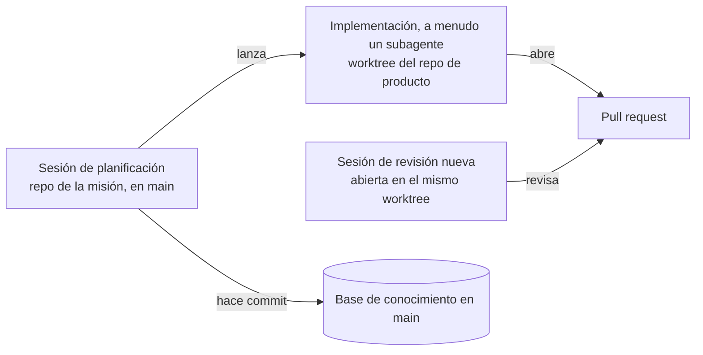

# 6. Sesiones en paralelo

> **En una frase:** llevar muchos agentes es un problema de atención antes que de herramientas: aísla cada pista de trabajo (track) para que las sesiones no se rompan entre sí, organiza las sesiones para que las decisiones te lleguen por orden de prioridad y añade sesiones solo al ritmo al que crece tu capacidad de revisión.

## Lo que serás capaz de hacer

- Elegir entre worktrees, una carpeta compartida y agentes en la nube para un proyecto, y explicar los compromisos de cada opción.
- Crear, usar y limpiar worktrees de git desde un `origin/main` recién actualizado sin caer en las trampas habituales.
- Aislar los recursos de ejecución (puertos, bases de datos, archivos de datos, memoria) para que las pistas en paralelo no rompan los tests de las demás.
- Organizar las sesiones por pista y prioridad, y atender sus notificaciones sin perder el hilo.
- Reconocer cuándo estás listo para más sesiones, y cuándo conviene dar un paso atrás.

## Por qué importa

Le das a un agente una issue bien especificada. Empieza a leer código. Dos minutos después miras: sigue leyendo. Abres el correo. Ocho minutos más tarde te hace una pregunta, respondes y pasa cuatro minutos ejecutando los tests. Cuando el PR está listo, llevas 40 minutos medio pendiente de una sola sesión, y te sientes menos productivo que cuando escribías el código tú.

[DHH describe exactamente esto en el Lex Fridman Podcast](https://lexfridman.com/dhh-2/): los agentes «son a la vez demasiado rápidos y demasiado lentos» (traducción propia). Demasiado lentos para mantenerte en flujo mientras esperas; demasiado rápidos para escribir el código a su lado. Esperar a uno, dice, «de hecho te hace sentir un poco inútil» (traducción propia).

La salida no es un agente más rápido. Es tener otra decisión preparada cuando una sesión se queda callada. Con varias sesiones en marcha, «puedes sentir que estás en estado de flujo porque estás haciendo trabajo de programación todo el rato, en el sentido de que estás tomando decisiones» (misma entrevista, traducción propia).

Pero en cuanto ejecutas dos sesiones en un mismo checkout, aparecen problemas nuevos. Una sesión reformatea un archivo que la otra está editando a medias. Los tests fallan porque el servidor de desarrollo de otra sesión ocupa el puerto. Un agente «limpia» una base de datos que el otro estaba usando. Esta lección trata de conseguir el beneficio de las sesiones en paralelo sin pagarlo en trabajo roto.

## Por qué funciona el paralelo, y dónde deja de funcionar

Las sesiones en paralelo no te hacen revisar más rápido. [Simon Willison](https://simonwillison.net/2025/Oct/5/parallel-coding-agents/) lo dice con precisión: «Solo puedo concentrarme en revisar e integrar un cambio importante a la vez» (traducción propia). Lo que él ejecuta en paralelo son tareas que no compiten por esa atención: investigación y pruebas de concepto, explicaciones de código existente, mantenimiento de poco riesgo y trabajo cuidadosamente especificado.

[Peter Steinberger](https://newsletter.pragmaticengineer.com/p/the-creator-of-clawd-i-ship-code) describe una forma parecida: un proyecto principal que tiene su atención, más proyectos satélite a los que dedica cinco minutos y en los que después el agente trabaja media hora.

Eso sugiere una forma práctica de combinar sesiones:

- **Una pista principal.** El cambio que vas a revisar con cuidado hoy. Se lleva tu atención primero.
- **Pistas satélite.** Bien especificadas, verificables, con poco radio de impacto ([módulo 05](../05-decompose-into-tracks/README.md)). Cada una necesita unos minutos de decisiones.
- **Trabajo de fondo.** Investigación, explicar partes del código, mantener la base de conocimiento (knowledge base), revisar otros PR ([módulo 07](../07-agents-review-agents/README.md)). No termina en un merge, así que no alimenta tu cola de revisión.

También marca el techo. Cuántas sesiones puedes llevar depende de cuántas decisiones por hora puedes tomar bien, no de tu máquina ni de tu suscripción. Por encima de ese número, las sesiones de más solo construyen una cola de PR esperándote. Eso no es rendimiento.

## Tres formas de aislar pistas

Cualquier montaje en paralelo tiene que responder a una pregunta: ¿qué impide que la sesión A rompa la sesión B? Hay tres respuestas habituales.

**1. Un worktree de git por pista.** Un [worktree](https://git-scm.com/docs/git-worktree) es un directorio de trabajo adicional conectado al mismo repositorio, con su propia rama y sus propios archivos. Cada sesión tiene uno. Las ediciones no pueden chocar, y los conflictos solo aparecen al integrar las ramas. Es lo que recomienda la [documentación de Claude Code](https://code.claude.com/docs/en/worktrees) para las sesiones en paralelo, y la [app de Codex crea worktrees](https://learn.chatgpt.com/docs/environments/git-worktrees) por el mismo motivo.

**2. Una carpeta, commits atómicos.** Todas las sesiones comparten un checkout. Cada agente hace commit solo de los archivos que ha cambiado, en cuanto termina una unidad de trabajo. [Steinberger trabaja así](https://steipete.me/posts/just-talk-to-it), con la mayoría de sus agentes «en la misma carpeta» (traducción propia). Sus motivos: un único servidor de desarrollo en el que probar varios cambios a la vez, no tener que manejar varios servidores y un proveedor de OAuth que solo acepta unos pocos dominios de callback. Él mismo añade la advertencia: «Normalmente trabajo solo; si trabajas en un equipo más grande, ese flujo obviamente no va a funcionar» ([Shipping at Inference-Speed](https://steipete.me/posts/2025/shipping-at-inference-speed), traducción propia).

**3. Agentes en la nube o en segundo plano.** Cada tarea se ejecuta en su propio entorno remoto, una máquina virtual o un contenedor que clona el repositorio y termina con un diff o un PR. Las [sesiones en la nube de Claude Code](https://code.claude.com/docs/en/claude-code-on-the-web) y [Codex cloud](https://learn.chatgpt.com/docs/cloud) funcionan así. El aislamiento es total y no se ejecuta nada en tu portátil.

Los compromisos, con honestidad:

| | Un worktree por pista | Una carpeta, commits atómicos | Agentes en la nube o en segundo plano |
|---|---|---|---|
| Aislamiento de archivos | Total: archivos separados por pista | Ninguno: los agentes ven las ediciones a medias de los demás | Total: una máquina distinta por tarea |
| Cuándo aparecen los conflictos | Al integrar, como conflictos de git | Todo el rato, como sorpresas en el árbol de trabajo | Al integrar, como conflictos de git |
| Servidores de desarrollo y puertos | Uno por worktree; necesitas un esquema de puertos | Un servidor para todos (sencillo) | Dentro de cada entorno, si lo configuras |
| Bases de datos y estado local | Hay que separarlos por rama | Compartidos: cómodo hasta que dos pistas necesitan migraciones distintas | Uno por entorno; necesita un script de preparación |
| Callbacks de OAuth y webhooks | Difícil: hay que registrar cada puerto o host | Fácil: una única URL registrada | Difícil: normalmente no hay callbacks entrantes |
| Probar varios cambios juntos | Primero hay que integrar o cambiar de rama | Natural: todo está en el mismo árbol | Solo después de integrar |
| Coste de preparación por pista | Segundos, más instalar dependencias | Ninguno | Configurar el entorno una vez, luego minutos por tarea |
| Disco y memoria | Multiplicados: dependencias, cachés de compilación y stacks en marcha por worktree | Una sola copia | No es tu máquina |
| Corregir el rumbo a mitad de tarea | Fácil: una terminal por sesión | Fácil | Posible, pero menos inmediato |
| Encaje en equipo | Bueno: una rama y un PR por pista | Malo más allá de una persona, según su propio autor | Bueno |
| Ideal para | Código que vas a revisar e integrar | Trabajo en solitario, cambios muy relacionados, documentos | Tareas bien especificadas con un entorno reproducible |

> [!NOTE]
> **En The Agile Monkeys** usamos las tres, para tipos de trabajo distintos: worktrees para el código, una carpeta compartida para el trabajo en la base de conocimiento (consulta [cada tipo de trabajo en su sitio](#cada-tipo-de-trabajo-en-su-sitio)) y agentes en la nube para tareas totalmente especificadas que no necesitan nuestro stack local.

## Una receta de worktrees que no muerde

Los comandos básicos son sencillos. Las trampas están en los detalles, así que aquí va la receta con los detalles incluidos.

**1. Parte de un `main` actualizado.** Un worktree creado desde un `main` local desactualizado empieza la pista con código viejo y garantiza conflictos después.

```bash
git fetch origin
```

**2. Crea el worktree en una rama nueva, desde `origin/main`.**

```bash
git worktree add --no-track -b c1-tags ../shelf-c1 origin/main
```

- `-b c1-tags` crea la rama, `../shelf-c1` es el directorio nuevo y `origin/main` es el punto de partida.
- `--no-track` importa. Sin él, una rama creada desde `origin/main` queda configurada para seguir a `origin/main`. Entonces `git status` compara tu rama con `origin/main` («Your branch is up to date with 'origin/main'»), lo que confunde a personas y agentes, y un `git push` a secas se niega porque los nombres no coinciden. Con `--no-track`, el primer push fija el upstream real: `git push -u origin HEAD`. Si ya tienes una rama con ese seguimiento, `git branch --unset-upstream` lo arregla.
- Un directorio hermano como `../shelf-c1` mantiene los worktrees fuera de tu checkout principal. Si los pones dentro del repositorio (`claude --worktree` usa `.claude/worktrees/`), añade esa ruta a `.gitignore`, o tu checkout principal la mostrará como no rastreada.
- Git se niega a hacer checkout de una rama que ya está en otro worktree, `main` incluida. Es una ventaja: es lo que impide que dos sesiones compartan una rama sin darse cuenta.

**3. Prepara el worktree.** Un worktree nuevo solo tiene los archivos rastreados. Faltan los no rastreados y los ignorados: `.env`, `node_modules`, entornos virtuales, cachés de compilación. Instala las dependencias en cada worktree y copia la configuración local a propósito. Claude Code puede copiar por ti algunos archivos ignorados con un [archivo `.worktreeinclude`](https://code.claude.com/docs/en/worktrees).

**4. Comprueba qué existe.**

```bash
git worktree list
```

Ejecútalo al empezar y al terminar cada sesión de trabajo. Es la forma más rápida de detectar pistas olvidadas.

**5. Limpia cuando el PR haga merge.**

```bash
gh pr view 42 --json state --jq .state   # debe decir MERGED
git worktree remove ../shelf-c1
git branch -D c1-tags
git worktree prune
```

- `git worktree remove` se niega si el worktree tiene archivos modificados o no rastreados. No recurras a `--force` por reflejo. Mira primero: esa negativa puede estar protegiendo la única copia de algún trabajo.
- `git branch -d` (en minúscula) suele negarse después de un squash merge, porque el squash crea un commit nuevo y los commits de la rama no están en `main`. Cuando `gh pr view` confirma que el PR está integrado, `-D` es seguro.
- `git worktree prune` elimina el registro de los worktrees cuyos directorios se borraron a mano. `git worktree list` los marca como `prunable`.

> [!WARNING]
> **Nuestra propia limpieza se descuida.** En The Agile Monkeys hemos llegado a encontrar decenas de worktrees abandonados en un solo repositorio, restos de sesiones que terminaron antes de que sus PR hicieran merge. Ocupan disco, mantienen vivas ramas viejas y confunden a la siguiente sesión que ejecuta `git worktree list`. Mete la limpieza en tu lista de cierre de sesión y haz un repaso una vez por semana.

Las herramientas pueden aplicar la receta por ti. `claude --worktree <nombre>` crea un worktree (a partir de tu rama por defecto en el remoto) y arranca una sesión dentro, y varios gestores de sesiones crean un worktree por tarea. Aprende la receta manual de todos modos. Es la que vas a necesitar cuando algo falle.

## Cada tipo de trabajo en su sitio

Juntando las piezas, esta es la organización que usamos:



- **La base de conocimiento vive en `main`, en el repositorio de la misión** ([módulo 04](../04-context-is-infrastructure/README.md)). Las sesiones de planificación la leen y la escriben. Sus tareas son lo bastante independientes como para no chocar, así que comparten un checkout, cada una hace commit solo de sus propios archivos y hacen push directamente a `main`. Es una excepción deliberada, para un repositorio de documentos protegido por validadores y hooks en lugar de por la revisión de pull requests; el módulo 04 la explica. El código de producto nunca funciona así.
- **El código va en worktrees del repositorio de producto.** Desde la sesión de planificación pedimos un worktree a partir de un `origin/main` actualizado y ejecutamos allí la implementación, a menudo como subagente, para que el contexto de la sesión de planificación siga siendo pequeño.
- **La revisión se hace en una sesión nueva abierta en el worktree.** Quien revisa no debe arrastrar el razonamiento de la sesión que implementó, o tenderá a darle la razón. El [módulo 07](../07-agents-review-agents/README.md) explica qué hace esa sesión.

## Aislar recursos, no solo archivos

Los worktrees aíslan archivos. Tus pistas siguen compartiendo una máquina: puertos, bases de datos, contenedores, cachés, memoria. La mayoría de los fallos «intermitentes» del trabajo en paralelo son dos pistas peleándose por uno de esos recursos.

**Puertos.** Dos servidores de desarrollo no pueden escuchar a la vez en el puerto 3000. Da a cada worktree un puerto derivado del nombre de su rama, para que la misma pista reciba siempre el mismo puerto:

```bash
BRANCH=$(git branch --show-current)
PORT=$((4000 + $(printf '%s' "$BRANCH" | cksum | cut -d' ' -f1) % 1000))
echo "$BRANCH -> $PORT"
```

Con 1.000 puertos posibles, dos ramas todavía pueden coincidir. Imprime el puerto y deja que el servidor falle de forma visible si está ocupado.

**Bases de datos y archivos de datos.** Dos ramas con migraciones distintas no pueden compartir base de datos. Usa una base de datos local, o un stack local completo, por rama, con el nombre de la rama, y deja que los tests creen la suya. Las bases de datos de test compartidas se contaminan entre worktrees: las filas que deja una pista hacen fallar el test de otra. En el proyecto de práctica, la «base de datos» es un archivo JSON, y `SHELF_PATH` permite que cada worktree use el suyo.

**Callbacks.** Los proveedores de OAuth y los webhooks necesitan URL registradas, y la mayoría de proveedores no te dejan registrar un puerto nuevo por rama. Tus opciones: un servidor de desarrollo compartido para los flujos que necesitan callbacks, un entorno de preview por PR o un túnel con un nombre estable por pista.

**Memoria.** Cada stack local completo (base de datos, servidor de la aplicación, workers, compilación en modo observación) consume memoria, y las máquinas llegan al techo antes de lo que esperas.

> [!NOTE]
> **En The Agile Monkeys** pasamos a stacks locales por rama después de que los worktrees en paralelo se pisaran una y otra vez las bases de datos. En nuestros portátiles, la memoria se acaba alrededor de cinco o seis stacks completos (*orientativo, y muy dependiente del stack*). A partir de ahí, las pistas comparten un stack a propósito o pasan a entornos de preview.

Hay una regla que vale sea cual sea tu stack:

> [!IMPORTANT]
> **No dejes nunca que una sesión pare recursos que no arrancó ella.** Un agente que «limpia» contenedores, o que mata lo que ocupa un puerto, puede tumbar la base de datos de otra pista a mitad de sus tests. Díselo a cada sesión: para solo lo que tú arrancaste. Y cuando un test sensible a la carga falla con cinco stacks en marcha, vuelve a ejecutarlo solo antes de darlo por fallido.

## Gestionar muchas sesiones

Las herramientas cambian cada pocos meses. Estos principios se han mantenido:

1. **Una sesión, una pista; una pista de código, un worktree.** Nunca dos pistas en una sesión, y nunca dos sesiones escribiendo código en un mismo worktree. Las sesiones de planificación de la base de conocimiento son la excepción que se describe [más arriba](#cada-tipo-de-trabajo-en-su-sitio): comparten un checkout porque escriben documentos distintos.
2. **Pon a cada sesión el nombre de su pista.** «c1-tags», no «claude (3)». La mayoría de herramientas admite nombres; en Claude Code es `claude -n <nombre>` o `/rename` ([documentación de sesiones](https://code.claude.com/docs/en/sessions)).
3. **Agrupa las sesiones por pista y ordénalas por prioridad.** Pon arriba la pista principal. Los grupos ordenan tu cabeza tanto como tu pantalla.
4. **Atiende las notificaciones por turnos (round-robin), empezando por arriba.** Cuando una sesión termina o necesita una decisión, te avisa. Acaba la decisión que estás tomando y ve a la sesión en espera con más prioridad, no a la última que ha sonado.
5. **Ten una terminal normal junto a cada agente.** La usarás para ejecutar tú los tests, mirar `git status` y ver un diff. También te evita escribir en la ventana equivocada: Steinberger escribió una vez un prompt en el proyecto que no era, y el agente pasó unos 20 minutos confundido intentando entender qué quería decir ([Lex Fridman Podcast #491](https://lexfridman.com/peter-steinberger-transcript/)).
6. **Guarda los ID de sesión.** Claude Code y Codex guardan las sesiones en local y pueden reanudarlas (`/resume`; consulta los [comandos de Codex](https://learn.chatgpt.com/docs/developer-commands)). Apunta cada ID junto a su pista. Tras un reinicio, los ID son la forma de recuperar qué sesión hacía qué, y permiten que una sesión lea las transcripciones de otras, por ejemplo para escribir una actualización de estado de todas las pistas.

**¿Notificaciones activadas o desactivadas?** Quienes lo practican no se ponen de acuerdo. DHH pasó de tmux a secas a [Herdr](https://herdr.dev/), «básicamente tmux más notificaciones de agentes» (traducción propia), con una campanita cuando un agente está listo para una decisión. [Mitchell Hashimoto](https://mitchellh.com/writing/my-ai-adoption-journey) aconseja lo contrario: «desactiva las notificaciones de escritorio de los agentes. Cambiar de contexto es muy caro» (traducción propia). (Él tampoco lleva varios agentes a la vez, y de momento no quiere.) Con uno o dos agentes, las notificaciones sobre todo interrumpen el trabajo profundo. Con cinco o más y sin notificaciones, acabas mirando ventana por ventana, que es peor. Lo que hacemos: notificaciones activadas, tratadas como una *cola*, no como una interrupción. Cuando necesitamos concentración profunda, como leer un modelo de datos línea a línea, las silenciamos y dejamos que la cola espere.

Herramientas, solo como ejemplos (la [referencia de herramientas](../reference/tools.md) mantiene la lista al día): multiplexores de terminal como [tmux](https://github.com/tmux/tmux/wiki) y [Herdr](https://herdr.dev/), que entiende de agentes; terminales y apps que entienden de agentes como [Warp](https://www.warp.dev/), [Superset](https://github.com/superset-sh/superset) y [Conductor](https://www.conductor.build/) (las dos últimas crean un worktree por tarea); [claude-squad](https://github.com/smtg-ai/claude-squad), que combina tmux y worktrees; y lo que traen los propios agentes, como la [vista de agentes](https://code.claude.com/docs/en/agent-view) de Claude Code (`claude agents`), que muestra todas las sesiones en segundo plano y cuáles necesitan tu intervención.

> [!NOTE]
> **En The Agile Monkeys** quienes llevan más sesiones las tienen en una terminal que entiende de agentes, agrupadas por pista, ordenadas por importancia y atendidas por turnos. Hemos cambiado de herramienta más de una vez: una mostraba el PR de cada sesión justo al lado, pero a veces se colgaba cuando la usábamos. Elige herramientas que puedas abandonar sin perder tu práctica.

## ¿Subagentes o ventanas separadas?

Parte del trabajo en paralelo no necesita una ventana propia. Un **subagente** es un trabajador que la sesión actual lanza para una tarea lateral. Trabaja en su propia ventana de contexto y devuelve un resumen ([subagentes de Claude Code](https://code.claude.com/docs/en/sub-agents), [subagentes de Codex](https://learn.chatgpt.com/docs/agent-configuration/subagents)).

| | Subagente | Sesión separada en su propia ventana |
|---|---|---|
| Tu contexto principal | Sigue siendo pequeño: solo vuelve el resumen | Intacto, pero las conexiones entre sesiones las llevas tú en la cabeza |
| Visibilidad mientras trabaja | Baja: ves el resultado | Total: ves cada paso |
| Corregir el rumbo a mitad de tarea | Difícil | Fácil |
| Notificaciones y cola | Las gestiona la sesión que lo lanzó | Las gestionas tú |
| Ideal para | Trabajo acotado y verificable: implementar un plan aprobado, buscar, una revisión especializada | Trabajo que quizá tengas que reconducir, y revisiones que quieres seguir |

Steinberger prefiere ventanas: «Lo que otros hacen con subagentes, yo normalmente lo hago con ventanas separadas» ([Just Talk To It](https://steipete.me/posts/just-talk-to-it), traducción propia). La [documentación de Claude Code](https://code.claude.com/docs/en/agents) recomienda subagentes para las tareas laterales que, si no, inundarían tu conversación. Nosotros usamos las dos cosas a propósito: la sesión de planificación lanza la implementación como subagente en un worktree, y la revisión se hace en una ventana separada y nueva, porque esa es la que queremos seguir.

## Un camino realista para escalar

No saltes de un agente a veinte. Las habilidades se apoyan unas en otras: cada etapa depende de que la anterior se haya vuelto rutina.

| Etapa | Cómo es | Listo para la siguiente cuando… | Da un paso atrás cuando… |
|---|---|---|---|
| **2 sesiones** | Una pista principal más una satélite (investigación o un arreglo pequeño) en un worktree. | Rara vez estás parado esperando; la satélite termina sin que tengas que rescatarla; sus tests son su ciclo de verificación ([módulo 03](../03-close-the-loop/README.md)). | Te quedas mirando la salida de una sesión en lugar de cambiar a otra. |
| **5 sesiones** | Pistas salidas de una descomposición planificada. Prompts de arranque que funcionan en frío. Worktrees, puertos y aislamiento de datos automatizados con scripts. | Los conflictos son raros y previstos; la cola de revisión no crece de un día para otro; `ACTIVE.md` te dice en diez segundos qué hace cada sesión. | Los PR te esperan más de un día; escribes en la ventana equivocada. |
| **10 sesiones** | Agentes que revisan a agentes ([módulo 07](../07-agents-review-agents/README.md)). Notificaciones por turnos. Stacks por rama. La limpieza es un hábito. | Tus minutos por PR integrado bajan mientras el retrabajo se mantiene; llegas a los límites de memoria o de tu plan antes que a los de atención. | Apruebas planes sin leerlos; sube el retrabajo. |
| **20+ sesiones** | Muchas sesiones no escriben código: revisiones, triaje, mantenimiento de la base de conocimiento, investigación. Los agentes en la nube se llevan el trabajo especificado. Los límites de uso pasan a ser una cuestión de presupuesto ([módulo 08](../08-token-economics/README.md)). | No hay siguiente etapa. La mayoría no necesita esta. | Cualquiera de las anteriores, o si tu sueño se resiente. |

Como referencia: DHH dice que puede llevar «unos 16 hilos», y que «cuanto más rápido van los agentes, claro, menos hilos puedo llevar» (traducción propia). Steinberger ha descrito entre tres y diez agentes en distintos momentos. [Boris Cherny](https://x.com/bcherny/status/2007179832300581177), creador de Claude Code, describió cinco sesiones locales, cada una en su propio checkout, más otras en la web. Los números difieren porque el techo no es la herramienta. Es la atención, y cuánta necesita cada pista.

## Higiene de sesión

Con varias sesiones trabajando sobre un mismo repositorio, la higiene es una cuestión de corrección, no de orden. La siguiente sesión lee una línea desactualizada de la base de conocimiento como si fuera la verdad actual. Un checkout compartido sucio hace que el diff de la siguiente sesión mienta.

**Al empezar una sesión:**

```text
[ ] git fetch origin && git status       ¿limpio? ¿en la rama que esperas?
[ ] git worktree list                    ¿hay algo abandonado que resolver antes?
[ ] lee ACTIVE.md (o tu lista de pistas) ¿para qué pista es esta sesión?
[ ] ¿trabajo de código? crea o entra en el worktree de esa pista; nunca programes en un checkout compartido
[ ] pon a la sesión el nombre de la pista y apunta su ID junto a la pista
```

**Al terminar una sesión:**

```text
[ ] los tests y la comprobación local pasan, o el traspaso dice exactamente qué no pasa
[ ] commit y push, incluidos los cambios de la base de conocimiento
[ ] PR abierto con "Closes #n", o paquete de traspaso escrito
[ ] fila de ACTIVE.md actualizada: estado y siguiente puerta, reescrita, no añadida al final
[ ] para los servidores y contenedores que arrancó esta sesión, y solo esos
[ ] ¿PR integrado? elimina el worktree y borra la rama que creaste
[ ] git status está limpio
```

Pide al agente que recorra la lista de cierre: sabe qué arrancó. Mejor todavía, haz deterministas las comprobaciones importantes: un hook que no deja terminar una sesión con cambios de la base de conocimiento sin commit es mejor que un recordatorio ([módulo 03](../03-close-the-loop/README.md)).

## Sostenibilidad

Llevar muchos agentes cansa más que escribir código, no menos. Steinberger: «No tengo un empleado al que gestionar. Tengo como cinco o 10 trabajando en cosas» (traducción propia). A Willison le parece que llevar varios agentes es «sorprendentemente eficaz, aunque agotador mentalmente» ([Vibe engineering](https://simonwillison.net/2025/Oct/7/vibe-engineering/), traducción propia). Cuando le preguntaron si podía mantener su ritmo, DHH respondió: «Esto no es sostenible en absoluto» (traducción propia).

Hay además un tirón que no tiene nada que ver con el cansancio. Cada prompt es una pequeña apuesta con un premio rápido e impredecible, y siempre hay una sesión más que podrías lanzar. Steinberger escribió abiertamente sobre su «adicción a la tragaperras» (traducción propia) y sobre acabar despierto de madrugada en [Just One More Prompt](https://steipete.me/posts/just-one-more-prompt). La dinámica viene con el trabajo, así que planifica para ella.

Lo que ayuda:

- **Una hora de parar, y silencio después.** Decide cuándo acaba el día antes de empezarlo. Deja preparado el trabajo de mañana como issues y prompts de arranque en lugar de lanzar sesiones a medianoche, y desactiva fuera del horario de trabajo las notificaciones del teléfono de agentes y bots de revisión.
- **No lances ejecuciones largas solo para «aprovechar la noche».** Una ejecución nocturna que luego revisas agotado es un mal trato. El trabajo desatendido debería ser trabajo que no te necesite al terminar: investigación, revisiones, tareas especificadas de poco riesgo.
- **Protege tu sueño.** Tu criterio es el recurso escaso de todo este sistema, y la revisión cansada es como se integra código malo.
- **Vigila tus horas, no solo tus PR.** Si tus sesiones y tus horas crecen a la vez, no has escalado. Solo has trabajado más.

> [!NOTE]
> **En The Agile Monkeys** tratamos un ritmo sostenible como parte de la práctica. Cuando un montaje en paralelo solo funciona a base de noches largas, arreglamos el montaje: demasiadas pistas, revisiones que deberían estar automatizadas o decisiones que deberían haberse tomado una vez y haberse dejado por escrito.

## Otras formas de verlo

**¿Worktrees o una sola carpeta?** En [consejos compartidos desde el equipo de Claude Code](https://x.com/bcherny/status/2017742741636321619), ejecutar de tres a cinco worktrees a la vez aparece como su mayor mejora de productividad. Steinberger opina que, para sus refactorizaciones grandes, los worktrees «solo causarían un montón de conflictos de merge y refactorizaciones mediocres» (traducción propia). Cada uno describe su contexto: un equipo que revisa PR y un desarrollador en solitario que prueba muchos cambios en una misma aplicación en marcha. Nosotros trabajamos en equipo y revisamos cada PR, así que el código va en worktrees.

**¿Cuántos agentes, para empezar?** Hashimoto lleva uno a propósito. Willison lleva varios, pero integra un cambio importante cada vez. Otros llevan decenas. El paralelismo multiplica tu descomposición, tu verificación y tu revisión; si esas flojean, el número correcto es un agente.

**¿Construir tu propia orquestación?** Steinberger no ve la necesidad de sistemas de orquestación multiagente: «de momento no veo mucha necesidad de esto; normalmente el cuello de botella soy yo» (traducción propia). DHH espera que lo absorban los fabricantes: «No vamos a tener que construirnos cada uno nuestros propios arneses de coordinación» (traducción propia). De momento estamos de acuerdo. Usa lo que traen tus herramientas, automatiza con scripts las partes aburridas (worktrees, puertos, limpieza) y dedica tu esfuerzo a la descomposición y a la revisión.

## Ojo con

- **Programar en el checkout compartido «solo esta vez».** La siguiente sesión hereda tu desorden. El código va en un worktree, siempre.
- **Tomar un fallo por carga como una regresión.** Un timeout con seis stacks en marcha no es una prueba. Vuelve a ejecutar el test solo antes de que alguien lo «arregle» subiendo el timeout.
- **Más sesiones que revisiones.** Si cada día los PR te esperan más tiempo, tienes más sesiones que atención. Quita sesiones antes de añadir herramientas.
- **Perder el hilo tras un reinicio.** Sin nombres de sesión, sin ID y sin fila en `ACTIVE.md`, pasarás la mañana reconstruyendo qué se ejecutaba y dónde.
- **Un agente que limpia recursos que no son suyos:**

❌ **Prompt débil**

```text
Los tests fallan porque el puerto 5432 está ocupado. Arréglalo.
```

✅ **Prompt mejor**

```text
Los tests fallan porque el puerto 5432 está ocupado. No pares ni mates nada:
otras pistas tienen sus propias bases de datos en esta máquina. Averigua qué
proceso ocupa el puerto y si lo arrancó este worktree. Si no, configura el
stack de este worktree para que use su propio puerto y su propio nombre de
base de datos, y vuelve a ejecutar los tests.
```

## Comprueba lo que has aprendido

1. Tu aplicación web tiene un login con OAuth y una única URL de callback registrada, y quieres tres pistas en paralelo. ¿Qué opción de aislamiento facilita más el flujo de login, y qué te cuesta?

   <details><summary>Respuesta</summary>

   Una carpeta con un servidor de desarrollo compartido hace trivial el callback, pero pierdes el aislamiento de archivos y tienes sorpresas en el árbol de trabajo todo el día. En un equipo que revisa PR, rara vez compensa. El término medio habitual: worktrees para las pistas, más un servidor de desarrollo compartido (o entornos de preview con URL registradas) para probar el propio flujo de login.

   </details>

2. Has ejecutado `git worktree add -b s4-export ../shelf-s4 origin/main`, y `git status` en el worktree nuevo dice «Your branch is up to date with 'origin/main'». ¿Qué ha pasado y cómo lo evitas?

   <details><summary>Respuesta</summary>

   Como el punto de partida era una rama remota, git configuró la rama nueva para seguir a `origin/main`. Crea los worktrees con `--no-track` y fija el upstream en el primer push con `git push -u origin HEAD`. Para arreglar una rama existente, ejecuta `git branch --unset-upstream`.

   </details>

3. Un test da timeout en una pista mientras hay otros cinco stacks en marcha. El agente propone subir el timeout. ¿Qué haces primero?

   <details><summary>Respuesta</summary>

   Volver a ejecutar el test solo. Si pasa en solitario, el fallo venía de la competencia por recursos: no es una regresión ni un motivo para relajar la comprobación. Si falla en solitario, es un fallo real; investígalo.

   </details>

4. ¿Cuándo usarías un subagente en lugar de una ventana separada?

   <details><summary>Respuesta</summary>

   Cuando el trabajo es acotado y verificable y no esperas tener que reconducirlo: implementar un plan aprobado, una búsqueda o una revisión especializada. Mantiene pequeño el contexto de la sesión que lo lanza. Usa una ventana separada cuando quizá tengas que reconducir el trabajo, o cuando quieres seguirlo, como una revisión con contexto limpio.

   </details>

5. La semana pasada pasaste de tres a ocho sesiones. Nombra dos señales de que te has pasado.

   <details><summary>Respuesta</summary>

   Dos cualesquiera de estas: cada día los PR esperan más tu revisión; apruebas planes sin leerlos; suben el retrabajo o las reversiones; escribes prompts en la ventana equivocada; tus horas de trabajo han crecido al mismo ritmo que las sesiones.

   </details>

## Ideas clave

- El límite de sesiones en paralelo lo marcan tu atención y tu capacidad de revisión, no tu máquina ni tus herramientas.
- Aísla cada pista: worktrees para el código, una carpeta compartida solo donde las tareas de verdad no chocan, agentes en la nube para el trabajo bien especificado.
- Crea los worktrees desde un `origin/main` recién actualizado con `--no-track`, prepáralos de forma explícita y elimínalos cuando el PR haga merge.
- Los archivos no son el único recurso compartido. Da a cada pista sus propios puertos y su base de datos o archivo de datos, y no pares nunca lo que no arrancaste.
- Pon nombre a las sesiones, agrúpalas por pista, ordénalas por prioridad, guarda sus ID y trata las notificaciones como una cola.
- Escala por etapas (2, luego 5, luego 10) y sube solo cuando las señales lo indiquen.
- Protege tu sueño. La revisión cansada es como se integra código malo.

## Para profundizar

- [Run parallel sessions with worktrees](https://code.claude.com/docs/en/worktrees) (documentación de Claude Code): `--worktree`, `.worktreeinclude`, aislamiento de subagentes y limpieza.
- [git-worktree](https://git-scm.com/docs/git-worktree) (referencia de git): todas las opciones, incluidas `lock`, `move` y `prune`.
- [Run agents in parallel](https://code.claude.com/docs/en/agents) (documentación de Claude Code): subagentes, vista de agentes, equipos de agentes y workflows, comparados.
- [Embracing the parallel coding agent lifestyle](https://simonwillison.net/2025/Oct/5/parallel-coding-agents/), de Simon Willison: qué tareas se paralelizan bien.
- [My AI Adoption Journey](https://mitchellh.com/writing/my-ai-adoption-journey), de Mitchell Hashimoto: un contrapeso sólido, de alguien que lleva un solo agente a propósito.
- [DHH en el Lex Fridman Podcast #501](https://lexfridman.com/dhh-2/): programar con agentes en paralelo, hacia el minuto 1:32 de la transcripción.
- [Just One More Prompt](https://steipete.me/posts/just-one-more-prompt), de Peter Steinberger: un relato honesto del lado tragaperras de este trabajo.
- [Laboratorio 6](lab.md): ejecuta tres pistas a la vez e intégralas en orden.

Siguiente: [7. Agentes que revisan a agentes](../07-agents-review-agents/README.md)
