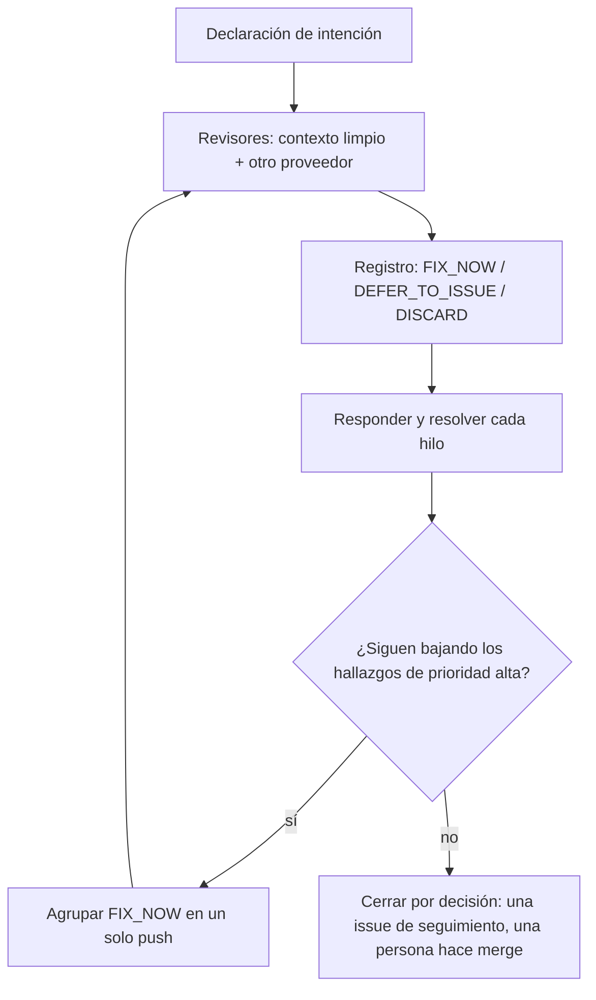

# 7. Agentes que revisan a agentes

> **En una frase:** deja que agentes con contexto limpio, a ser posible de otro proveedor, encuentren los problemas; juzga cada hallazgo contra la intención declarada del PR; y cierra el bucle con una decisión, no por agotamiento.

## Lo que serás capaz de hacer

- Montar revisores que no compartan los puntos ciegos de quien escribió el código: un contexto limpio y un segundo proveedor.
- Escribir la declaración de intención de un PR y usarla para decidir sobre cada hallazgo.
- Hacer el triaje de los hallazgos con un registro (FIX_NOW / DEFER_TO_ISSUE / DISCARD) y después responder y resolver cada hilo.
- Detectar cuándo las rondas de revisión dejan de converger y cerrar el bucle con una decisión registrada.
- Devolver tus veredictos a las instrucciones del revisor para que deje de repetir falsos positivos.
- Decidir cuánto de un PR tiene que leer una persona según el riesgo.

## Por qué importa

Después del [módulo 6](../06-run-sessions-in-parallel/README.md) tienes cinco sesiones en marcha y, a media tarde, cinco pull requests. Cada agente dice que ha terminado. No puedes leer miles de líneas una a una, y tampoco deberías hacer merge sin leerlas.

La revisión automática ayuda, pero falla de dos maneras opuestas:

1. **Nadie independiente mira.** El agente que escribió el código también lo evalúa, así que no cuestiona sus propias decisiones.
2. **La revisión no acaba nunca.** Un revisor al que se le pide encontrar problemas siempre encuentra alguno. Un agente al que le dices "atiende los comentarios" los acepta todos. Cada corrección añade código, el código nuevo se revisa y el PR crece en cada ronda.

Nosotros sufrimos el segundo fallo a lo grande: uno de nuestros PR pasó de unas 5.000 líneas cambiadas a algo entre 20.000 y 40.000. Esta lección describe el sistema que montamos para evitar ambos fallos: revisores independientes, una regla para medir el alcance, un registro para las decisiones y un punto claro en el que una persona para el bucle.

## Por qué el autor no debería ser el único revisor

Un revisor puede ser independiente del autor de dos maneras. Cada una detecta problemas distintos, así que usa las dos.

**Contexto limpio.** Abre una sesión nueva, sin memoria de la implementación. Solo ve el diff, el código que lo rodea y tus criterios. Lo explican las [buenas prácticas de Claude Code](https://code.claude.com/docs/en/best-practices): «Un contexto limpio mejora la revisión de código (code review), porque Claude no tendrá sesgo a favor del código que acaba de escribir» (traducción propia).

**Otro modelo, a ser posible de otro proveedor.** Los modelos entrenados de forma distinta tienen puntos ciegos distintos. [DHH](https://lexfridman.com/dhh-2/) pone a trabajar el modelo de un proveedor, a revisar el de un segundo proveedor y a un bot a revisar el PR en GitHub:

> «Copilot no para de encontrar cosas que están rotas de verdad» — DHH en [Lex Fridman Podcast #501](https://lexfridman.com/dhh-2/) (traducción propia)

Su razonamiento es el mismo que justifica la revisión entre personas:

> «si terminas un trabajo y le pides a un compañero también muy bueno que lo revise, vas a acabar con mejor código.» — DHH en [Lex Fridman Podcast #501](https://lexfridman.com/dhh-2/) (traducción propia)

[Addy Osmani](https://addyosmani.com/blog/agentic-code-review/) dice lo mismo: dos revisores que trabajan de forma distinta detectan tipos de fallos distintos, y esa variedad importa más que elegir "el mejor".

| Revisor | Qué aporta | Límites |
| --- | --- | --- |
| La misma sesión del autor | Erratas, huecos evidentes | Comparte cada suposición que produjo el fallo |
| Sesión nueva, mismo modelo | Errores que venían del razonamiento del autor | Algunos puntos ciegos compartidos por el entrenamiento |
| Sesión nueva, otro proveedor | Tipos de fallos distintos | Una segunda suscripción o clave de API |
| Bot de revisión en cada push | Detecta regresiones mientras el PR cambia | Tokens en cada push; ruidoso sin reglas |
| Subagentes especialistas | Profundidad en una zona de riesgo | Más hallazgos que clasificar |
| Persona | Intención, encaje de producto, complejidad, responsabilidad | El recurso más escaso: gástalo en decisiones |

> [!NOTE]
> **En The Agile Monkeys** abrimos el revisor como una *sesión nueva dentro del worktree del PR*, para que no herede el contexto de la sesión que implementó. La mayor parte de la revisión automática en nuestros repositorios la hace el modelo de un proveedor distinto al que escribió el código. Con los modelos actuales, uno tiende a hablar más y nos ayuda a pensar; el otro toma una tarea y la ejecuta sin más, y eso encaja bien con la revisión.

Los revisores también pueden comprobar la *dirección*. Cuando pedimos al modelo de otro proveedor que cuestionara las decisiones de producto de un PR, concluyó que el trabajo era "técnicamente cuidadoso, pero resuelve el problema de interacción equivocado". Ninguna batería de tests lo habría dicho. En las revisiones de dirección forzamos exactamente un veredicto (CONTINUE / CONTINUE_WITH_FIXES / PIVOT / STOP / ESCALATE) y un nivel de confianza.

## Empieza con la declaración de intención del PR

Cada hallazgo plantea una pregunta de alcance: ¿esto pertenece a *este* PR? Si nada escrito la responde, gana el revisor más seguro de sí mismo, y los agentes están hechos para darle la razón.

La **declaración de intención** es la regla para cada decisión de alcance. Escríbela antes de la primera revisión, ponla al principio de la descripción del PR y pásasela a cada revisor:

```markdown
## Intención
**Objetivo:** <una frase: el comportamiento que entrega este PR>
**Issue:** <enlace>
**Dentro del alcance:** <qué cambia este PR>
**Fuera del alcance (a propósito):** <qué no cambia, y dónde vive eso>
**Contexto que fija el listón:** <¿herramienta interna o expuesta a internet? ¿quién la usa? ¿qué datos? ¿es reversible?>
**Decisiones ya tomadas (no reabrir):** <elecciones que un revisor podría cuestionar>
**Verificado con:** <comandos ejecutados y resultados>
**Dónde mirar con más cuidado:** <archivos o funciones con riesgo>
```

Así queda para la issue S5 del [proyecto de práctica](../../../practice/shelf/), "Eliminar un libro, con confirmación":

```markdown
## Intención
**Objetivo:** `shelf remove ID --yes` elimina exactamente un libro; sin `--yes` no se elimina nada.
**Issue:** S5
**Dentro del alcance:** el nuevo `shelf/commands/remove.py`, un método `Store.remove`, mensajes y códigos de salida, tests.
**Fuera del alcance (a propósito):** confirmaciones interactivas, deshacer, eliminar varios libros, reutilizar
el id tras eliminar el libro más reciente (arreglarlo exige guardar un contador, y eso cambia el formato del archivo).
**Contexto que fija el listón:** CLI local de un solo usuario; el archivo de datos es de quien lo ejecuta; sin red.
**Decisiones ya tomadas (no reabrir):** sin pregunta `Are you sure?`; sin `--yes` muestra lo que
eliminaría y sale con código 1.
**Verificado con:** `python -m unittest` (todo pasa); ejecución manual contra un SHELF_PATH temporal.
**Dónde mirar con más cuidado:** `Store.remove` en `shelf/store.py` y el camino del id desconocido.
```

La gente se salta la línea "Contexto que fija el listón". Para nosotros, fue la línea que frenó el crecimiento descontrolado del alcance (scope creep).

## Triaje: un veredicto por hallazgo

Este es nuestro bucle de revisión. Lo convertimos en una skill cuando nos dimos cuenta de que pasábamos horas al día escribiendo "continue" en sesiones de revisión (ver el [módulo 4](../04-context-is-infrastructure/README.md)).

1. **Recoge** en cada ronda todos los hilos sin resolver, de bots y de personas, en todas las páginas.
2. **Lee** cada hilo entero antes de decidir.
3. **Registra un veredicto por hallazgo:**
   - **FIX_NOW**: rompe el objetivo declarado o pertenece a una categoría que siempre se corrige.
   - **DEFER_TO_ISSUE**: es real, pero queda fuera de la intención de este PR. Va a una issue de seguimiento que se entienda por sí sola.
   - **DISCARD**: un detalle menor (nitpick), una preferencia o algo incorrecto. No conviertas los detalles menores en issues que nadie va a tomar.
4. **Agrupa** los cambios FIX_NOW en un solo push por ronda.
5. **Responde y resuelve cada hilo**, también los descartados, con el veredicto y el motivo.
6. **Vigila** la nueva revisión (nosotros miramos a los 1, 2, 4, 7, 15 y 30 minutos). Un push no basta para dar un PR por terminado.

Cuando el agente no sabe qué veredicto aplicar, marca el hallazgo como **ASK** y espera. ASK no es un cuarto veredicto. Significa que decide una persona.



El registro del PR de S5 tras la primera ronda:

| ID | Origen | Hallazgo | Veredicto | Motivo (frente a la intención) | Hilo |
| --- | --- | --- | --- | --- | --- |
| F1 | Revisor de otro proveedor | `remove 42 --yes` con un id desconocido sale con 0 y no imprime nada | FIX_NOW | Rompe el objetivo: el usuario cree que se eliminó un libro | Corregido, test añadido, resuelto |
| F2 | Revisor con contexto limpio | Ningún test falla si se borra la comprobación de `--yes` | FIX_NOW | Siempre se corrige: falta cobertura de comportamiento | Test añadido, resuelto |
| F3 | Bot del PR | `Store.remove` copia el bucle de búsqueda por id en vez de usar `find` | FIX_NOW | Siempre se corrige: este PR introduce la duplicación | Usa `find`, resuelto |
| F4 | Revisor de otro proveedor | Tras eliminar el libro más reciente, el siguiente `shelf add` reutiliza su id | DEFER_TO_ISSUE | Es real, pero la issue lo deja fuera del alcance: arreglarlo cambia el formato del archivo | Issue enlazada, resuelto |
| F5 | Revisor con contexto limpio | Un título con secuencias de escape de terminal podría falsear la salida de `list` | DEFER_TO_ISSUE (tras ASK) | La seguridad nunca se descarta; en una herramienta local de un solo usuario, el atacante ya controla el archivo | Decidió una persona, misma issue, resuelto |
| F6 | Bot del PR | Renombrar `--yes` a `--force` | DISCARD | Decisión ya tomada en la issue | Respondido, resuelto |

Seis hilos, seis respuestas, una issue de seguimiento, y cada veredicto remite a la intención.

**Categorías que siempre se corrigen.** Se arreglan en el PR diga lo que diga la intención, porque ahora cuestan poco y más adelante mucho:

- **Seguridad o exposición de datos.** Nunca se descartan: corrígelas, aplázalas con un motivo por escrito o escálalas.
- **Regresiones de rendimiento serias.**
- **Duplicación introducida por este PR.** Los agentes copian código con facilidad, y cada copia es una incoherencia futura.
- **Falta de cobertura de comportamiento.** La batería de tests tiene que poder fallar si se revierte el comportamiento de este PR.
- **Desviaciones de la arquitectura documentada**, como las reglas de `AGENTS.md` o los documentos de arquitectura.

Lee también con cuidado los tests reescritos. Osmani advierte de que a veces los agentes cambian las aserciones para que encajen con un comportamiento que acaba de romperse.

## Nuestro fallo: revisores sin regla

La primera versión de nuestro agente de triaje de revisiones era optimista. Para cada comentario de un bot de revisión elegía entre aplicarlo, llevarlo a una issue o descartarlo, y en la práctica lo aplicaba casi todo. Trabajó toda la noche, y los teléfonos vibraron con notificaciones de GitHub hasta el amanecer.

Un PR de unas 5.000 líneas cambiadas creció hasta algo entre 20.000 y 40.000. El revisor no dejaba de plantear cosas como "si un usuario escribe algún carácter raro, podría haber una inyección SQL". No tenía nada que ver con el objetivo del PR, y el producto era una herramienta interna a la que solo se podía acceder desde dentro de la empresa. Cada corrección añadía código, el código nuevo atraía nuevas amenazas hipotéticas y el bucle se alimentaba solo. Cada comentario, por separado, parecía razonable. Lo que faltaba era una regla.

La solución tuvo dos partes:

1. **Los revisores y el agente de triaje reciben siempre el objetivo del PR y el contexto del proyecto**: interno o expuesto a internet, quién lo usa, qué datos toca.
2. **Cuando no está seguro de si implementar algo, el agente pregunta a una persona** en lugar de decir "sí" por defecto.

El contexto rebaja el listón para algunas amenazas, no para todas. Las herramientas internas también filtran datos y también tienen fallos de autorización. "Interno" forma parte del contexto; no es una exención.

> [!IMPORTANT]
> Trata los hallazgos como afirmaciones sobre las que decidir, no como instrucciones. «Un revisor al que se le pide encontrar huecos normalmente encontrará alguno, incluso cuando el trabajo es sólido, porque es lo que se le pidió.» ([buenas prácticas de Claude Code](https://code.claude.com/docs/en/best-practices), traducción propia)

## Un prompt de revisión que no pierde de vista el objetivo

❌ **Prompt débil**

```text
Revisa este PR y arregla todo lo que encuentres.
```

No tiene objetivo, ni contexto, ni listón, y deja al revisor editar el código. Así es como un PR de 5.000 líneas acaba teniendo 30.000.

✅ **Prompt mejor**

```text
Estás revisando el PR #<n> en una sesión nueva. Tú no escribiste este código.

1. Lee la declaración de intención al principio de la descripción del PR
   (gh pr view <n>). Es la regla: juzga cada hallazgo contra su objetivo, su
   alcance y su contexto.
2. Lee el diff (gh pr diff <n>) y el código que lo rodea. Lee más código para
   responder tus propias dudas antes de informar.
3. Contexto del proyecto: <herramienta interna que solo se usa dentro de la
   empresa | producto expuesto a internet | librería de la que dependen otros
   equipos>. Datos: <ninguno | personales | dinero>. Ajusta las amenazas a este
   contexto.

Informa solo de: fallos de corrección y huecos frente al objetivo; seguridad o
exposición de datos; regresiones de rendimiento serias; duplicación que introduce
este PR; comportamiento que ningún test detectaría si se revierte; desviaciones de
la arquitectura documentada (AGENTS.md, docs/).
No informes de formato, de nada que ya compruebe la CI, de renombrados ni de
preferencias. Marca como PRE-EXISTING los problemas anteriores a este PR.

Para cada hallazgo: prioridad (P0 bloquea el merge, P1 se arregla en este PR,
P2 seguimiento), archivo:línea, un escenario concreto que falla y una idea de
arreglo en una línea.
Si no estás seguro de si un hallazgo es real o está dentro del alcance, no
decidas: ponlo en "Preguntas para la persona". Como mucho cinco hallazgos P2.
No edites archivos. Si nada llega a P0 o P1, dilo. Una revisión vacía es un
resultado válido.
```

Puedes guardar estas reglas en el repositorio para que se apliquen a cada PR. El revisor de Codex en GitHub solo marca problemas P0 y P1 por defecto y lee una sección `## Code Review Rules` en `AGENTS.md` ([documentación](https://learn.chatgpt.com/docs/third-party/github)). La revisión gestionada de Claude Code lee un `REVIEW.md` donde defines la gravedad, un tope de detalles menores y reglas para las revisiones posteriores ([documentación](https://code.claude.com/docs/en/code-review)). Consulta la [referencia de herramientas](../reference/tools.md).

## Cierra los bucles por decisión

Las rondas de revisión deberían converger. Vigila un número: **los hallazgos de prioridad alta por ronda**. Cuando deja de bajar, más rondas no te van a ayudar.

> [!NOTE]
> **En The Agile Monkeys** lo aprendimos por las malas. Un PR grande pasó por unas 20 rondas de revisión automática y más de 200 hilos: unos 155 corregidos, unos pocos mitigados y unos 44 aplazados. Son números indicativos, no un benchmark.

Hallazgos de prioridad alta por ronda en ese PR:

| Ronda | 1 | 2 | 3 | 4 | 5 | 6 |
| --- | --- | --- | --- | --- | --- | --- |
| Hallazgos de prioridad alta | 8 | 5 | 3 | 0 | 3 | 4 |

A partir de la ronda 4, el propio bucle generaba sus hallazgos. Cada ciclo de CI más revisión tardaba unos 40 minutos, así que veinte rondas costaron más de una jornada de tiempo de reloj, además de nuestra atención cada vez que terminaba una ronda.

**Cómo son los hallazgos derivados.** Cuando la mayoría de los hallazgos de una ronda encajan aquí, deja de hacer push de correcciones:

- **Consecuencias de las correcciones de la ronda anterior.** "La función auxiliar que extrajiste también debería manejar X." Si tu corrección rompió algo, arréglalo. Si el revisor quiere ampliar el código nuevo, eso es crecimiento del alcance.
- **Temas aparcados que vuelven con otras palabras.** "Los ids se reutilizan tras eliminar" vuelve como "los ids no son estables entre remove y add". Responde con el enlace a la issue que ya existe.
- **Preguntas de producto disfrazadas de fallos.** "¿Debería `remove` permitir deshacer?" es una decisión de producto.
- **Hipótesis que van más allá del contexto declarado.** Si tienen sabor a seguridad, aplázalas con un motivo. Nunca las dejes caer en silencio.
- **Revisores que se contradicen.** Una ronda pide excepciones y la siguiente, códigos de retorno. Decide una vez y añade la elección a "Decisiones ya tomadas".

**Cómo cerrar:** para el bucle de correcciones; pide una evaluación exigente de sí o no en lugar de otro registro; clasifica todos los hilos abiertos en un registro final; responde con la decisión y resuelve; mete todo lo aplazado en **una sola** issue de seguimiento; confirma que no se descartó ningún hallazgo de seguridad. El merge lo decide una persona.

```text
Para el bucle de correcciones. Los hallazgos de prioridad alta por ronda fueron
3 → 1 → 2, y los últimos son consecuencias de nuestras propias correcciones o temas
que ya aplazamos.
Dame una evaluación exigente, sí o no, del PR #<n> frente a su declaración de
intención: ¿qué se le rompería a un usuario si hiciéramos merge ahora? Después
clasifica todos los hilos abiertos en un registro final, redacta una respuesta con
el motivo de cada uno, lista lo que va a UNA issue de seguimiento y confirma que no
se descartó ningún hallazgo de seguridad.
No hagas push de código. El merge lo decido yo.
```

Una regla práctica para empezar: si los hallazgos de prioridad alta no bajaron en las dos últimas rondas, para y decide. Ajusta el umbral a tu riesgo.

## ¿Cuánto debería leer una persona?

Aquí los practicantes no están de acuerdo, así que conviene ver las posturas:

- **[Peter Steinberger](https://newsletter.pragmaticengineer.com/p/the-creator-of-clawd-i-ship-code)**: «¿Leí todo el código? No. Porque mucho código es simplemente fontanería aburrida» (traducción propia). Pero lee el código que toca la base de datos y las contribuciones externas, su confianza sale de los ciclos de verificación y trabaja casi siempre solo.
- **DHH** revisa la *forma* de todo y lee línea a línea el código crítico de la capa de modelo. Su mejor movimiento de revisión es frenar la complejidad. Describe agentes que dicen haber terminado y superan la revisión de otro agente, y luego recortan el código a la mitad cuando él dice que se ve demasiado complicado: «lo que sí tienes que decirles es: "Hazlo más simple"» ([Lex Fridman Podcast #501](https://lexfridman.com/dhh-2/), traducción propia).
- **Anthropic** registra cada aprobación automática y hace que personas revisen «una muestra ponderada por riesgo» (traducción propia). Los revisores de IA nuevos funcionan primero en modo sombra ([Cómo protege Anthropic su ciclo de desarrollo nativo de IA](https://claude.com/blog/how-anthropic-secures-its-ai-native-software-development-lifecycle)).
- **Osmani** gradúa la revisión por riesgo, no por quién escribió el código: «A un modelo no se le puede llamar de guardia ni hacer responsable de lo que desplegó, así que quien pulsa merge es el responsable» ([Agentic Code Review](https://addyosmani.com/blog/agentic-code-review/), traducción propia).

Lo que hacemos nosotros es una lectura por niveles:

| Nivel | Qué | Cómo lo lee una persona |
| --- | --- | --- |
| Todos los PR | Declaración de intención, registro, forma del PR (archivos, tamaño, dependencias nuevas, tests borrados o reescritos) | Siempre; unos minutos |
| Crítico | Modelo de datos y migraciones, autenticación y permisos, dinero, eliminación y otras operaciones irreversibles, contribuciones externas | Línea a línea |
| Lógica normal | Reglas de negocio con tests de comportamiento | Los tests y las funciones con riesgo; muestreo del resto |
| Fontanería | Parseo, transformaciones, cableado, código generado | Puede quedarse sin leer, pero solo porque existen tests, tipos, guardas en CI y entornos de previsualización ([módulo 3](../03-close-the-loop/README.md)) |

Leer la forma incluye preguntarse si el cambio es proporcional al problema:

```text
Esto parece demasiado complicado para lo que hace. Hazlo más simple: mismo
comportamiento, los mismos tests pasan, menos piezas móviles. Enséñame qué has
quitado y por qué era seguro quitarlo.
```

## Revisores especialistas como subagentes

Un revisor generalista reparte su atención. Donde los errores salen caros, añade especialistas estrechos. En uno de nuestros montajes, un revisor principal de calidad de funcionalidades delega en cuatro: seguridad (reglas de acceso a datos por fila), privacidad de la telemetría, coherencia de la interfaz y exposición en la búsqueda (qué acaba indexado y quién puede encontrarlo). Anthropic también describe agentes de revisión «acotados a un foco específico y estrecho» ([fuente](https://claude.com/blog/how-anthropic-secures-its-ai-native-software-development-lifecycle), traducción propia).

Un especialista funciona cuando tiene **una sola pregunta** ("¿puede algún usuario leer o cambiar datos que no debería?"), **un disparador** (se ejecuta solo cuando el diff toca su zona), **el formato de salida del registro** y **su propio contexto**. Como subagente, lee lo que necesita sin llenar la ventana de contexto del orquestador ([subagentes en Claude Code](https://code.claude.com/docs/en/sub-agents)).

## Enseña al revisor con tus veredictos

Cada DISCARD del registro lleva un motivo, y sin un bucle de retroalimentación el mismo falso positivo vuelve en el siguiente PR, y en el de después. Eso cuesta tokens, rondas de revisión y atención. La solución es el [camino de promoción](../04-context-is-infrastructure/README.md#la-memoria-y-el-camino-de-promoción) aplicado al revisor: convierte los veredictos que se repiten en instrucciones de revisión.

Los revisores automáticos pueden leer esas instrucciones desde el repositorio. [Code Review de Claude Code](https://code.claude.com/docs/en/code-review-customize) lee un `REVIEW.md` en la raíz del repositorio, con secciones como qué comprobar siempre y qué no señalar. [Las revisiones de Codex en GitHub](https://learn.chatgpt.com/docs/third-party/github) siguen una sección `## Code Review Rules` en `AGENTS.md`. Un revisor que hayas construido tú puede leer cualquier archivo que le indiques.

> [!NOTE]
> **En The Agile Monkeys** algunos de nuestros repositorios usan un agente propio como revisor de pull requests. Respondemos a cada uno de sus comentarios: «esto no aplica aquí», «aplicado», «deja de revisar estas dependencias». Una vez a la semana, un proceso recoge esas respuestas de todos los pull requests en un archivo del repositorio, y el revisor lee ese archivo antes de cada revisión.

```text
Lee los hilos de revisión de los pull requests mergeados desde <fecha>, con
nuestras respuestas y veredictos. Agrupa los hallazgos que descartamos por el
mismo motivo y las categorías que seguimos teniendo que corregir. Propón cambios
a REVIEW.md: qué dejar de señalar, con el motivo, y qué comprobar siempre.
Propón solo reglas respaldadas por al menos dos pull requests, y enlázalos. Abre
un pull request con el cambio.
```

Tres precauciones:

- **«Fuera del alcance de este PR» no es «no lo señales nunca».** Los veredictos DEFER_TO_ISSUE no se convierten en reglas de «no señalar», y los hallazgos de seguridad tampoco.
- **Las instrucciones son una regla de equipo.** Cambian mediante un pull request revisado ([módulo 9](../09-teams-and-organizations/README.md)). Code Review de Claude Code lee `REVIEW.md` desde la rama base o la rama por defecto, nunca desde los cambios del propio pull request, así que el cambio surte efecto cuando se mergea.
- **Pódalas.** Quita una regla cuando el revisor ya no comete ese error, igual que harías con `AGENTS.md`.

## Trampas de las herramientas

Nuestro bucle se rompió más veces por la fontanería que por el criterio:

- **Paginación.** El `reviewThreads` de la API GraphQL de GitHub devuelve como mucho 100 hilos por petición. Uno de nuestros PR tenía más de 100, y un agente que solo leyó la primera página dijo que todo estaba resuelto. Repite hasta que no queden páginas.
- **Lee antes de resolver.** Resolver en bloque esconde lo que no leíste. Encontramos un hallazgo de prioridad alta escondido solo porque el agente leyó antes todos los hilos.
- **Fallos silenciosos.** Un comando de CLI para editar la descripción de un PR falló una vez sin dar ningún error. Cuando un agente escribe en GitHub, vuelve a consultar y comprueba.
- **Coste por push.** Revisar en cada push multiplica el coste de la revisión por el número de pushes. Agrupa las correcciones por ronda (ver el [módulo 8](../08-token-economics/README.md)).

## Pull requests como «prompt requests»

En las contribuciones externas, cómo llegó la persona al diff puede importar más que el propio diff:

> «Ahora los veo más bien como prompt requests.» — Peter Steinberger en [The Pragmatic Engineer](https://newsletter.pragmaticengineer.com/p/the-creator-of-clawd-i-ship-code) (traducción propia)

Pide a quienes contribuyen que incluyan sus prompts y dice que lee «los prompts más que el código» ([mismo episodio](https://newsletter.pragmaticengineer.com/p/the-creator-of-clawd-i-ship-code), traducción propia), porque muestran qué se pidió y cuánto hubo que dirigir al agente. Después, su propio agente reconstruye la funcionalidad para que encaje en la arquitectura.

Si mantienes un proyecto, pide a quienes contribuyen una declaración de intención, los prompts que usaron (y dónde tuvieron que corregir al agente) y la verificación que hicieron. Dos cautelas. Los prompts son una entrada no confiable y pueden colar una inyección de prompt en tu agente. Y las contribuciones externas se quedan en el nivel de lectura línea a línea: Steinberger las lee porque «siempre podría haber algo malicioso dentro» ([Lex Fridman Podcast #491](https://lexfridman.com/peter-steinberger-transcript/), traducción propia). Ver el [módulo 9](../09-teams-and-organizations/README.md).

## Otras formas de verlo

- **Agentes que revisan a agentes o personas que leen diffs.** El experimento de [harness engineering](https://openai.com/index/harness-engineering/) de OpenAI se apoya en agentes que revisan a agentes. [HumanLayer](https://github.com/humanlayer/advanced-context-engineering-for-coding-agents/blob/main/ace-fca.md) pone el esfuerzo de revisión humana en la investigación y los planes, no en el código. [Kent Beck](https://newsletter.kentbeck.com/p/augmented-coding-beyond-the-vibes) y Osmani mantienen a las personas leyendo diffs y siendo responsables del merge. Nosotros usamos niveles, y la intención, la forma, el código crítico y el merge siempre son cosa de personas.
- **Un proveedor con verificación o varios proveedores.** La revisión gestionada de Claude Code ejecuta varios agentes más un paso de verificación que filtra falsos positivos. DHH y Osmani insisten en la variedad entre modelos. Nosotros usamos ambas cosas cuando podemos.
- **Evidencia.** [Anthropic informa](https://claude.com/blog/how-anthropic-secures-its-ai-native-software-development-lifecycle) de que la proporción de sus PR con comentarios de revisión sustanciales subió del 16 % al 54 % a medida que exigió a sus agentes de revisión demostrar que cada hallazgo es válido. Es un proveedor hablando de sí mismo. DHH describe un estudio en otra empresa en el que los PR revisados por agentes causaron menos problemas en producción. No pudimos verificarlo. Trata ambas cosas como señales, no como pruebas.

## Ojo con

- **Un triaje que lo acepta todo.** El diff crece en cada ronda.
  - ❌ `Atiende todos los comentarios de la revisión.`
  - ✅ `Recoge todos los hilos sin resolver (todas las páginas), construye el registro frente a la declaración de intención, marca como ASK lo que no tengas claro y enséñamelo antes de arreglar nada.`
- **Revisar en la sesión del autor.** Parece una revisión, pero el revisor comparte las suposiciones que causaron el fallo.
- **Resolver sin responder.** Meses después nadie sabe por qué se descartó un hallazgo.
- **Descartar hallazgos de seguridad** porque "es interno". Aplázalos con un motivo.
- **Abrir PR más rápido de lo que puedes revisarlos.** [Faros AI](https://www.faros.ai/blog/ai-software-engineering) vio que los equipos con uso intensivo de IA mergeaban un 98 % más de PR mientras el tiempo de revisión subía un 91 %. Por encima de tu capacidad de revisión, el trabajo en paralelo se convierte en una cola.

## Comprueba lo que has aprendido

1. Tu revisor con contexto limpio y tu revisor de otro proveedor encuentran hallazgos completamente distintos en el mismo PR. ¿Algo va mal?

   <details><summary>Respuesta</summary>

   No necesariamente. Precisamente por eso ejecutas los dos. Junta ambos conjuntos en un mismo registro y decide sobre cada hallazgo frente a la declaración de intención.

   </details>

2. En una herramienta interna de administración, un revisor señala: "un nombre de usuario Unicode manipulado podría saltarse la comprobación de unicidad". El PR solo cambia el formato de exportación. ¿Qué veredicto le das?

   <details><summary>Respuesta</summary>

   Está fuera del alcance, pero tiene sabor a seguridad, así que nunca es DISCARD. Márcalo como ASK. Si una persona confirma que no tiene relación, registra DEFER_TO_ISSUE con el motivo. Si este PR introduce de verdad la exposición, es FIX_NOW.

   </details>

3. Los hallazgos de prioridad alta por ronda son 6 → 4 → 4 → 5, y los últimos tratan de una función auxiliar añadida en la ronda 2. ¿Qué haces?

   <details><summary>Respuesta</summary>

   Cerrar por decisión. El número dejó de bajar y los hallazgos son derivados, porque tratan de código que añadió el propio bucle. Corrige cualquier regresión real que causara tu propia corrección. Después pide una evaluación de sí o no, responde y resuelve cada hilo, abre una única issue de seguimiento y decide tú el merge.

   </details>

4. ¿Qué partes de un PR de 1.500 líneas con una migración de base de datos y una página de informe nueva tiene que leer una persona línea a línea?

   <details><summary>Respuesta</summary>

   La migración, todo lo que cambie permisos o acceso a datos, y los tests reescritos. La intención, el registro y la forma se leen siempre. El código de presentación y de transformación se puede muestrear si hay tests y entornos de previsualización que lo cubran.

   </details>

5. ¿Por qué decirle a un revisor que "una revisión vacía es un resultado válido"?

   <details><summary>Respuesta</summary>

   Un revisor al que se le pide encontrar problemas encontrará alguno incluso en un trabajo sólido. Permitir "nada en P0 ni P1" quita la presión de inventar hallazgos, que es donde empiezan el crecimiento del alcance y la sobreingeniería.

   </details>

## Ideas clave

- El autor no debería ser su único revisor: usa un contexto limpio y, cuando puedas, el modelo de otro proveedor.
- Escribe primero la declaración de intención. Su línea de contexto fija el listón de las amenazas.
- Un veredicto por hallazgo, correcciones agrupadas por ronda, responde y resuelve cada hilo, y nunca descartes la seguridad.
- Vigila los hallazgos de prioridad alta por ronda. Cuando dejan de bajar y pasan a ser derivados, cierra por decisión.
- Convierte los veredictos que se repiten en instrucciones de revisión, mediante un pull request revisado, para que el mismo falso positivo no vuelva.
- Lee según el riesgo: la forma siempre, el código crítico línea a línea, y deja la fontanería sin leer solo donde existe verificación.
- Los agentes encuentran problemas. Las personas deciden qué importa, frenan la complejidad y son responsables del merge.

## Para profundizar

- [Buenas prácticas de Claude Code](https://code.claude.com/docs/en/best-practices): el patrón autor/revisor y el aviso sobre perseguir cada hallazgo.
- [Agentic Code Review](https://addyosmani.com/blog/agentic-code-review/), de Addy Osmani: niveles de riesgo, evidencia antes de revisar, tests reescritos.
- [Cómo protege Anthropic su ciclo de desarrollo nativo de IA](https://claude.com/blog/how-anthropic-secures-its-ai-native-software-development-lifecycle): agentes de revisión estrechos, muestreo humano ponderado por riesgo, modo sombra.
- [Code Review de Claude Code](https://code.claude.com/docs/en/code-review) y [revisión de código de Codex en GitHub](https://learn.chatgpt.com/docs/third-party/github): cómo fijar la gravedad y las reglas de revisión en el repositorio.
- [The creator of Clawd: "I ship code I don't read"](https://newsletter.pragmaticengineer.com/p/the-creator-of-clawd-i-ship-code): prompt requests y lo que Steinberger sí lee.
- [Patrones de prompts](../reference/prompt-patterns.md): los prompts de revisión, triaje y cierre por decisión, con notas.

Siguiente: [8. Economía de tokens](../08-token-economics/README.md)
