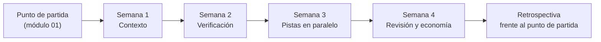

# 10. Tu plan de 30 días

> **En una frase:** la práctica solo se asienta cuando la aplicas a tu propio código durante cuatro semanas, una capa cada vez, y mides el resultado frente al punto de partida que tomaste en el módulo 01.

## Lo que serás capaz de hacer

- Convertir esta guía en un plan de cuatro semanas sobre tu propio código, una capa por semana.
- Fijar objetivos semanales con entregables que otra persona, o un agente, pueda verificar.
- Comparar tu práctica con tu punto de partida del módulo 01 usando las mismas métricas y el mismo método.
- Hacer un check-in semanal de 15 minutos y una retrospectiva final que decidan qué mantener, qué cambiar y qué abandonar.
- Compartir una práctica para que otras personas aprendan de ella.

## Por qué importa

Un workshop termina en lo más alto. El segundo día llevaste cuatro sesiones en paralelo sobre un pequeño proyecto de prácticas con tests rápidos, issues limpias y nada en juego. El lunes abres tu repositorio real. La suite de tests tarda 25 minutos y dos tests fallan de forma intermitente. No hay `AGENTS.md`. El backlog es una mezcla de tickets escritos para personas que ya conocían el contexto. El miércoles vuelves a una ventana y un prompt.

No es un problema de motivación. La práctica tiene capas, y una capa que falta deshace las que se construyen encima:

- **Sesiones en paralelo sin verificación** te dan slop (código de baja calidad generado sin criterio) en paralelo, y lo revisas todo tú.
- **Verificación sin contexto** significa que cada sesión vuelve a aprender el proyecto, y tú vuelves a explicarlo cada vez.
- **Bucles de revisión sin una forma de medir su coste** pueden llegar a veinte rondas en un PR antes de que alguien pregunte cuánto cuesta (módulo 07).

Por eso el plan construye las capas en orden, sobre tu código real, y mide el efecto. Medir importa porque aquí tus sensaciones no son fiables. En el [estudio de METR de 2025](https://metr.org/blog/2025-07-10-early-2025-ai-experienced-os-dev-study/), desarrolladores experimentados de open source fueron un 19 % más lentos con IA en sus propios repositorios, y después seguían creyendo que habían ido alrededor de un 20 % más rápido. Necesitas números, tomados de la misma forma antes y después.

## La forma de las cuatro semanas



| Semana | Capa | Módulos | Objetivo | Meta |
| --- | --- | --- | --- | --- |
| 1 | Contexto | 04 | Una sesión nueva sabe qué estás haciendo y por qué | Las sesiones nuevas empiezan a trabajar sin que vuelvas a explicar nada |
| 2 | Verificación | 02, 03 | El agente no puede dar el trabajo por terminado si fallan las comprobaciones | Un comando de verificación más una guarda determinista |
| 3 | Pistas en paralelo | 05, 06 | Varias pistas reales a la vez, en worktrees | 5 o más sesiones en paralelo al menos dos días, si las señales del módulo 06 se mantienen con 2–3 |
| 4 | Revisión y economía | 07, 08 | Agentes que revisan a agentes; sabes cuánto cuesta un PR mergeado | Coste por PR mergeado calculado y un sumidero de tokens eliminado |

El módulo 00 enseña el ciclo interno, verificación incluida, antes que el ciclo de contexto. Aun así, en tu propio código el plan empieza por el contexto, porque los dos se encuentran en un mismo archivo: `AGENTS.md` es donde escribes cómo verifica el agente su trabajo, con los comandos que compilan el proyecto, pasan el linter y ejecutan los tests. La semana 1 hace que la verificación se pueda descubrir, para que cada sesión sepa cómo comprobarse. La semana 2 hace que sea obligatoria, con un comando de verificación y una guarda que el agente no puede saltarse.

El módulo 09 no tiene semana propia. Aplica su base de seguridad antes de la semana 3, cuando tus agentes empiecen a trabajar con más autonomía.

## Antes del día 1: prepara el terreno

1. **Recupera tu punto de partida.** Abre las notas del [laboratorio 1](../01-from-chatbot-to-system/lab.md): sesiones en paralelo, PR mergeados, tiempo de ciclo, minutos humanos por PR, coste por PR mergeado, retrabajo, tiempo esperando al agente y uso del plan. Si te lo saltaste, dedica ahora los primeros tres a cinco días laborables a tomarlo. Sin punto de partida, la semana 4 es una opinión.
2. **Elige un repositorio** en el que vayas a trabajar todos los días durante el mes. Para las primeras semanas, elige uno en el que un PR malo sea una molestia, no un incidente. Si trabaja más gente en él, cuéntales lo que vas a hacer: vas a añadir archivos que van a ver.
3. **Protege tiempo.** Unos 30 minutos al día de práctica deliberada además del trabajo normal, y 15 minutos para un check-in semanal. Si puedes, busca a alguien que siga el mismo plan y haz los check-ins en compañía.
4. **Crea un archivo de plan** donde tu agente pueda leerlo, por ejemplo `kb/30-day-plan.md` en una base de conocimiento (knowledge base) personal o en el propio repositorio. El [laboratorio 10](lab.md) te da la plantilla.

> [!NOTE]
> **En The Agile Monkeys** hemos construido el seguimiento de cuatro semanas de nuestro workshop sobre este mismo plan: cada participante lo aplica a su código real y compara sus números de antes y después. Esos números son orientativos, no benchmarks. Su valor está en enseñar a cada persona qué ha cambiado para ella.

## Semana 1 — Contexto

**Objetivo:** una sesión nueva responde bien a "¿en qué estamos trabajando y por qué?" sin que tengas que explicarlo.

**Haz:**

- Pide al agente que redacte `AGENTS.md` a partir del código y del README (y un `CLAUDE.md` que lo importe, si usas Claude Code). Asegúrate de que nombra los comandos que compilan el proyecto, pasan el linter y ejecutan los tests. Corrígelo con frases cortas. Que sea breve: un mapa, no un manual.
- Crea `kb/` con un índice `ACTIVE.md` de tus pistas de trabajo (tracks) actuales (menos de 100 líneas) y un registro de decisión por cada decisión real que tomes esta semana.
- Termina cada sesión con "actualiza la base de conocimiento y haz commit". Un cambio en la base de conocimiento sin commit no ha ocurrido.
- Cada vez que corrijas dos veces al agente por lo mismo, dile "recuerda esto" y comprueba dónde lo ha escrito.

**Entregables:** `AGENTS.md`, `kb/ACTIVE.md`, al menos tres registros de decisión y una nota que compare la respuesta de una sesión nueva antes y después.

**Mide:** cuántas veces al día vuelves a explicar contexto a un agente (basta con ir apuntando rayitas).

**Vigila:** un `AGENTS.md` de 500 líneas escrito de una sentada. El contexto que se carga siempre cuesta tokens en cada sesión. Mueve el detalle a archivos que el agente lea cuando los necesite.

> [!NOTE]
> **En The Agile Monkeys** toda sesión termina con "haz commit y push de la base de conocimiento". Lo aprendimos por las malas: semanas después de empezar con esta práctica encontramos miles de cambios sin commit en la base de conocimiento que ninguna otra sesión ni nadie del equipo podía ver.

## Semana 2 — Verificación y guardas

**Objetivo:** el agente comprueba su propio trabajo sobre tu código real y no puede terminar mientras fallen las comprobaciones.

**Haz:**

- Acuerda con el agente **un comando de verificación** que ejecute el lint, la comprobación de tipos y los tests relevantes, y escríbelo en `AGENTS.md`.
- Si la suite es lenta o inestable, arregla el ciclo antes que nada: un subconjunto rápido para el trabajo del día a día, y los tests inestables se vuelven a ejecutar solos antes de darlos por fallidos.
- Añade **una guarda determinista**, como un [hook](https://code.claude.com/docs/en/hooks) que impida terminar la sesión mientras falle la verificación. Mírala atrapar un error real.
- Configura niveles de permisos: permitir tests y comandos de solo lectura, preguntar antes de hacer push o crear un PR, denegar la lectura de secretos y el force-push (módulo 03).
- Cada vez que una regla se incumpla dos veces, conviértela en una comprobación.

**Entregables:** el comando de verificación, una guarda que hayas visto bloquear, una configuración de permisos y un fixture de test que varíe como varían los datos de producción.

**Mide:** qué proporción de PR de agentes pasa la CI a la primera y cuántas correcciones haces por tarea (lleva un registro de correcciones como el del laboratorio 2).

**Vigila:** que el agente debilite un test para ponerlo en verde. La regla es "arregla el cambio, no la comprobación".

## Semana 3 — Pistas en paralelo

**Objetivo:** llevar varias pistas reales a la vez sin perder el hilo ni la calidad. Meta: 5 o más sesiones en paralelo al menos dos días, si las señales del módulo 06 se mantienen con 2–3 sesiones.

**Haz:**

- Sube poco a poco: dos sesiones los días 1 y 2, tres o cuatro el día 3, cinco o más los días 4 y 5. Sube solo mientras se mantengan las señales del [módulo 06](../06-run-sessions-in-parallel/README.md): las pistas satélite terminan sin rescate, tu cola de revisión no crece de un día para otro y `ACTIVE.md` te dice qué hace cada sesión. Si no se mantienen, quédate en el nivel al que llegaste, arregla lo que muestran las señales y apunta ese nivel como hallazgo.
- Divide primero (módulo 05). Usa issues escritas como prompts, agrupadas en pistas que toquen archivos distintos, con un prompt de arranque por pista.
- Aísla cada pista de código en un worktree creado desde un `origin/main` recién actualizado, y da a cada rama sus propios puertos y su propia base de datos si tu stack lo necesita (módulo 06).
- Mantén una fila por pista en `ACTIVE.md` y atiende las notificaciones por turnos, empezando por el grupo más importante.
- Termina cada día limpio: commit, push y elimina los worktrees terminados (`git worktree list` solo debería mostrar pistas vivas).

**Entregables:** una receta de worktrees en `AGENTS.md`, una plantilla de prompt de arranque, los IDs de sesión de tus dos días con más carga y un `git worktree list` limpio.

**Mide:** máximo de sesiones en paralelo, PR mergeados esta semana y tiempo esperando a un agente.

**Vigila:** lanzar más de lo que puedes revisar. Si los PR que esperan tu revisión superan a las sesiones en marcha, deja de lanzar y revisa.

## Semana 4 — Agentes que revisan a agentes, y la factura

**Objetivo:** cada PR recibe una revisión independiente por agentes que cierras por decisión, y sabes cuánto te cuesta un PR mergeado.

**Haz:**

- Empieza cada PR con una breve declaración de intención. Es la regla de medir para cada decisión de alcance.
- Revisa cada PR en una **sesión nueva**, y con un **segundo modelo o proveedor** cuando tengas acceso a uno.
- Clasifica cada hallazgo como `FIX_NOW`, `DEFER_TO_ISSUE` o `DISCARD`, responde a cada hilo y resuélvelo. Cuando los hallazgos se vuelvan derivados, deja de empujar y cierra por decisión (módulo 07).
- Calcula el **coste por PR mergeado** de la semana (módulo 08) y encuentra tus tres mayores sumideros de tokens.

**Entregables:** registros de triaje en al menos tres PR, tu coste por PR mergeado y un cambio aplicado a cada uno de tus tres mayores sumideros.

**Mide:** coste por PR mergeado, rondas de revisión por PR y minutos humanos por PR.

**Vigila:** un revisor que convierte un PR pequeño en uno enorme persiguiendo amenazas improbables. Dale a quien revisa el objetivo del PR y el contexto del proyecto.

## Mide frente a tu punto de partida

Al final de la semana 4, toma las mismas medidas que en tu punto de partida: **mismas métricas, mismo método, misma duración de la ventana** (una semana laborable). Igual que en el punto de partida, vuelve a comprobar el retrabajo una semana después, cuando cada PR haya tenido sus 7 días. Rellena una tabla como esta:

| Métrica | Punto de partida | Semana 4 | Cambio | Fuente | Factores de confusión |
| --- | --- | --- | --- | --- | --- |
| Máximo de sesiones en paralelo | | | | | |
| PR mergeados en la semana | | | | | |
| Tiempo de ciclo, apertura del PR → merge (mediana) | | | | | |
| Tiempo esperando a un agente (por día) | | | | | |
| Uso del plan o tokens | | | | | |
| Coste por PR mergeado | | | | | |
| Minutos humanos por PR | | | | | |
| Retrabajo (PR mergeados que necesitaron un arreglo posterior o una reversión en 7 días) | | | | | |

Reglas para leer tus propios números con honestidad:

- **Son orientativos, no benchmarks.** Tu trabajo de la semana 4 no es el de tu punto de partida. Vacaciones, guardias y el tipo de tareas mueven los números. Apunta los factores de confusión.
- **Cuidado con la sustitución de tareas.** [METR encontró](https://metr.org/blog/2026-05-08-task-substitution-and-uplift/) que la gente se desplaza hacia las tareas que la IA ha abaratado, así que la aceleración por tarea exagera el valor. Pregúntate si los PR que mergeaste eran los que importaban.
- **El número de PR no es valor.** Junto a la tabla, escribe una frase por cada PR importante sobre qué cambió para los usuarios o para el equipo.
- **Un número peor es un hallazgo, no un fracaso.** El coste por PR suele subir antes de bajar, mientras aprendes adónde van los tokens.

## El check-in semanal

Quince minutos, el mismo día cada semana, a solas o con tu compañero de plan. Copia esto en `kb/checkins/week-N.md`:

```markdown
# Check-in de la semana N — AAAA-MM-DD

**Objetivo de esta semana:**

**Entregables** (enlaza cada uno a un archivo, commit o PR):
- [ ]
- [ ]

**Números** (mismo método que el punto de partida):
- Máximo de sesiones en paralelo:
- PR mergeados:
- Tiempo esperando a agentes (aproximado, por día):
- Uso del plan / tokens:
- Métrica propia de la semana:

**Ha funcionado — seguir haciéndolo:**

**Ha dolido — una frase cada cosa:**

**Promovido esta semana** (corrección → memoria, regla, skill o guarda):

**Un cambio para la semana que viene:**

**Bloqueado por** (qué necesito, por qué ahora, qué haré mientras tanto):
```

Deja que el agente rellene los números a partir de las fuentes a las que llegue, como `gh pr list --state merged --author "@me"` para los PR mergeados. Las líneas de "ha funcionado", "ha dolido" y "un cambio" escríbelas tú. Esa es la parte que construye criterio.

## Cuando el plan se tuerce

Se va a torcer. Algunos desvíos son el plan funcionando:

- **El repositorio no tiene tests aprovechables.** La semana 2 se convierte en las semanas 2 y 3. No saltes al trabajo en paralelo: sesiones en paralelo sobre código que no se puede verificar multiplican el retrabajo.
- **Las herramientas o las políticas de tu empresa te bloquean.** Apunta qué está bloqueado y haz esa semana con el proyecto de prácticas para que la habilidad siga creciendo.
- **Estás agotado.** Llevar muchos agentes cansa más que escribir código, y puede parecerse a una máquina tragaperras. Steinberger escribió sobre ello en ["Just One More Prompt"](https://steipete.me/posts/just-one-more-prompt), y DHH dice de su propio ritmo: «Esto no es sostenible en absoluto.» ([Lex Fridman Podcast #501](https://lexfridman.com/dhh-2-transcript), traducción propia). Elige una hora a partir de la cual no lanzas sesiones nuevas, y protege tu sueño.

## Comparte una práctica

Al final del mes, comparte algo que hayas aprendido: un prompt, un hook, una skill, un fracaso, un número de antes y después. Usa el formulario de issue "Share your practice" descrito en [CONTRIBUTING](../../../CONTRIBUTING.es.md). Una buena aportación incluye:

- **Contexto:** tipo de repositorio, tamaño del equipo, qué agentes.
- **Qué hiciste:** el prompt, la regla o la guarda, literal y sin datos sensibles.
- **Evidencia:** números de antes y después, marcados como orientativos.
- **Qué no funcionó,** o dónde deja de aplicarse.

Quita nombres de clientes, secretos, URLs internas y cualquier cosa que tu empresa no publicaría.

## Otras formas de verlo

- **No todo el mundo debería aspirar a 5 o más sesiones.** [El camino de adopción de Mitchell Hashimoto](https://mitchellh.com/writing/my-ai-adoption-journey) construye hábitos profundos con un solo agente, y él escribe que no lleva varios agentes a la vez ni quiere hacerlo todavía. [Simon Willison](https://simonwillison.net/2025/Oct/5/parallel-coding-agents/) señala un límite claro: «Solo puedo concentrarme en revisar e integrar un cambio importante a la vez.» (traducción propia). La meta de la semana 3 es práctica, no una cuota. Si tu capacidad de revisión llega hasta tres sesiones, tres pistas bien revisadas valen más que seis sin revisar. Apúntalo como hallazgo.
- **¿Por qué no todo a la vez?** Hay quien aprende mejor saltando directamente al trabajo en paralelo, como en nuestro workshop de dos días. Para un proyecto de prácticas está bien. En código real construimos las capas en orden porque una capa que te saltas suele volver como retrabajo: slop en paralelo, contexto que explicas cada día, bucles de revisión que nadie mide.
- **Cuatro semanas es una cifra arbitraria.** Es lo bastante largo para toparte con problemas reales y lo bastante corto para terminarlo. Repite la medición un mes después: el [estudio del despliegue en Microsoft](https://arxiv.org/abs/2607.01418) comprobó si las mejoras se mantenían durante cuatro meses, y tú deberías hacer lo mismo.

## Ojo con

- ❌ Saltarte la semana 2 para llegar antes a las sesiones en paralelo. ✅ Primero verificación; el trabajo en paralelo sobre código sin verificar multiplica la revisión.
- ❌ Medir al final algo distinto de lo que mediste al principio. ✅ Mismas métricas, mismo método, misma ventana.
- ❌ Tratar "5 o más sesiones" como una puntuación. ✅ Es una meta de práctica; lo que cuentas son resultados.
- ❌ Usar modos que se saltan los permisos en tu portátil de trabajo "para ir más rápido" en la semana 3. ✅ Aplica antes la base de seguridad del módulo 09.
- ❌ Hacer el plan a solas y en silencio. ✅ Haz check-ins con alguien y comparte una práctica.

Pedirle al agente tu retrospectiva, de dos maneras:

❌ **Prompt débil**

```text
¿Qué tal me ha ido el mes?
```

✅ **Prompt mejor**

```text
Lee kb/30-day-plan.md, mis notas del punto de partida y los cuatro archivos de kb/checkins/.
Rellena la tabla de antes y después del plan. Saca cada número de una fuente que
me puedas enseñar (un archivo, o la salida de un comando como
gh pr list --state merged --author "@me"). Deja la celda vacía si no hay fuente.
No estimes. Después enumera los tres factores de confusión más grandes que veas.
No escribas conclusiones: esas las escribo yo.
```

## Comprueba lo que has aprendido

1. ¿Por qué la verificación (semana 2) va antes que las pistas en paralelo (semana 3)?

   <details><summary>Respuesta</summary>

   Las sesiones en paralelo multiplican lo que produce cada sesión. Sin un comando de verificación y una guarda, multiplicas trabajo sin verificar, y tu tiempo de revisión se convierte enseguida en el cuello de botella. Con la verificación en marcha, las sesiones atrapan la mayoría de sus propios errores antes de que te lleguen.

   </details>

2. Tus PR mergeados pasaron de 6 a 14 por semana, y tu coste por PR mergeado subió un 50 %. ¿Es bueno o malo? ¿Qué más necesitas saber?

   <details><summary>Respuesta</summary>

   Con esos dos números no se puede saber. Revisa el retrabajo (¿necesitaron los PR mergeados un arreglo posterior o una reversión en 7 días?), los minutos humanos por PR, qué cambiaron los PR (¿sustitución hacia tareas baratas y de poco valor?) y los factores de confusión. Que el coste por PR suba mientras aprendes adónde van los tokens es habitual y puede estar bien.

   </details>

3. El día 4 de la semana 3 tienes seis sesiones en marcha y nueve PR esperando tu revisión. ¿Qué haces?

   <details><summary>Respuesta</summary>

   Dejar de lanzar sesiones y revisar. Los PR que esperan revisión superan a las sesiones en marcha, así que estás produciendo cola, no rendimiento. Usa revisores automáticos y triaje para reducir tu tiempo por PR, y apunta tu capacidad real de revisión como hallazgo.

   </details>

4. ¿Por qué la medición de la semana 4 tiene que usar el mismo método y la misma ventana que el punto de partida?

   <details><summary>Respuesta</summary>

   Porque si no, cualquier cambio podría venir de la medición y no de la práctica. Una ventana de otra duración, otra forma de contar el tiempo de espera u otra fuente para el uso del plan dejan la comparación sin sentido. Además, la gente se equivoca al juzgar su propia velocidad con IA, así que un método constante es la única protección que tienes.

   </details>

## Ideas clave

- Construye las capas en orden sobre tu código real: contexto, verificación, pistas en paralelo, revisión y economía.
- Cada semana tiene un objetivo, entregables que alguien puede verificar y una métrica.
- Mide frente a tu punto de partida del módulo 01 con las mismas métricas, el mismo método y la misma ventana. Los números son orientativos, y un número peor es un hallazgo.
- Un check-in semanal de 15 minutos mantiene el plan honesto. Las líneas de criterio escríbelas tú.
- Tu techo real lo marca tu capacidad de revisión, no el número de sesiones.
- Termina compartiendo una práctica.

## Para profundizar

- [Mitchell Hashimoto, "My AI Adoption Journey"](https://mitchellh.com/writing/my-ai-adoption-journey): un camino de adopción paso a paso, deliberadamente distinto del nuestro.
- [El análisis de METR sobre sustitución de tareas](https://metr.org/blog/2026-05-08-task-substitution-and-uplift/): por qué la aceleración por tarea exagera el valor.
- [La actualización de METR de 2026](https://metr.org/blog/2026-02-24-uplift-update/): por qué medir la productividad con IA es difícil, incluso para investigadores.
- [Buenas prácticas de Claude Code](https://code.claude.com/docs/en/best-practices) y [buenas prácticas de Codex](https://learn.chatgpt.com/guides/best-practices): la guía oficial con la que contrastar tus hábitos.
- [Laboratorio 10](lab.md): la lista de comprobación final y la plantilla de retrospectiva.

Siguiente: [Apéndice — Hacia dónde vamos](../appendix/where-we-are-heading.md) (opcional: los límites de esta práctica basada en portátiles y hacia dónde la llevamos; no lo necesitas para aplicar esta guía)
