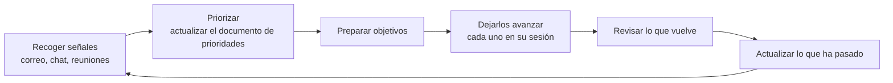

# Tu propio ciclo de trabajo

Esta guía trata del trabajo de ingeniería: un repositorio, pistas de trabajo, pull requests. Tu día tiene más cosas: correo, chat, reuniones, peticiones de otras personas, revisiones que no son de código, decisiones que esperan por ti. El mismo agente que lleva tus pistas puede ayudarte a decidir qué pistas abrir.

En The Agile Monkeys, algunas de las personas que más agentes usan dicen que aquí es donde más ha cambiado su trabajo. Optimizar un proyecto hace que el proyecto vaya más rápido. Optimizar cómo eliges y repartes el trabajo te permite abarcar más. Nada de esta página es necesario para seguir el resto de la guía. Se apoya en las fuentes conectadas ([módulo 4](../04-context-is-infrastructure/README.md#conecta-las-fuentes-y-señala-no-resumas)), en las sesiones orquestadoras ([módulo 6](../06-run-sessions-in-parallel/README.md#una-sesión-orquestadora-para-cada-plan)) y en el coste del trabajo sin supervisión ([módulo 8](../08-token-economics/README.md)).

## El ciclo



## Recoge señales

Una tarea programada lee tu correo y tus menciones en el chat, y saca a la luz lo poco que necesita tu atención, cada cosa con una línea que explica por qué. Durante la primera o las dos primeras semanas, compara su lista con tu bandeja de entrada. Cuando se le escape algo, dile por qué importaba ese mensaje y añade el motivo a sus instrucciones: es la misma [ruta de promoción](../04-context-is-infrastructure/README.md#la-memoria-y-el-camino-de-promoción) que usas con el código. Cuando deje de escapársele nada, puedes dejar de leerlo todo tú.

```text
Lee el correo y las menciones del chat que he recibido desde la última
ejecución. Lista como mucho diez cosas que necesitan mi atención, de la más
urgente a la menos, cada una con una línea que explique por qué y un enlace a
la fuente. Señala todo lo que caduque, se rompa o bloquee a alguien. No
respondas a nada y no marques nada como leído.
```

Claude Code puede ejecutar un prompt así de forma programada de tres maneras: en la nube con [routines](https://code.claude.com/docs/en/routines), en tu propia máquina con las [tareas programadas de Desktop](https://code.claude.com/docs/en/desktop-scheduled-tasks), o dentro de una sesión abierta con `/loop` ([Run prompts on a schedule](https://code.claude.com/docs/en/scheduled-tasks) las compara).

> [!NOTE]
> **En The Agile Monkeys** esto detectó algo que nadie estaba buscando. La lista diaria destacó un aviso de una lista de correo que siempre habíamos ignorado: un certificado del que dependen varios de nuestros servicios caducaba en 30 días.

## Mantén un documento de prioridades

Ten un único documento con tus prioridades, en algún sitio donde el agente pueda leer y escribir: un archivo de tu base de conocimiento o una página de tu herramienta de documentos. El agente lo mantiene cruzando peticiones, reuniones y plazos de todas tus fuentes. Por la mañana, pídele que priorice tu día: que lea las señales nuevas, actualice el documento y proponga en qué centrarte. Tú decides.

## De las prioridades a los objetivos

Ten una sesión de prioridades de larga duración. Conoce el documento y tus fuentes, y reparte el trabajo en sesiones centradas: un pull request, una propuesta, la preparación de una reunión, una charla. Cada una recibe un objetivo completo («explora, planifica, construye y verifica, y avísame cuando me necesites») y una sesión propia, igual que un [orquestador](../06-run-sessions-in-parallel/README.md#una-sesión-orquestadora-para-cada-plan) reparte hilos. No todo es código, y se aplican los mismos principios.

## Actualiza lo que ya ha pasado

Al final del día, o cada vez que vuelvas a la sesión de prioridades, pídele que repase las sesiones y las fuentes y actualice el documento: qué está terminado, qué está pendiente y qué espera a otra persona. El documento sigue siendo cierto sin que tengas que mantenerlo tú.

## Organiza tus sesiones para poder volver

Pon la sesión de prioridades arriba, el trabajo en curso agrupado debajo y tus proyectos clave en un grupo aparte. Sin esa estructura, la lista crece hasta que una sesión que espera tu revisión se pierde, y el trabajo se para por una revisión que nunca viste. El [módulo 6](../06-run-sessions-in-parallel/README.md#gestionar-muchas-sesiones) tiene los principios, y herramientas como la [vista de agentes](https://code.claude.com/docs/en/agent-view) de Claude Code muestran todas las sesiones en segundo plano y cuáles te necesitan.

## Ojo con

- **El correo es información privada y texto no confiable.** Cualquiera puede enviarte un mensaje con instrucciones dentro. Un agente de triaje que además puede responder reúne las tres patas de la [trifecta letal](../09-teams-and-organizations/README.md#entradas-no-confiables-y-la-trifecta-letal). Mantenlo en solo lectura, y conecta tu correo y tu chat solo a través de las cuentas y los conectores que apruebe tu empresa.
- **Los prompts sin supervisión cuestan tokens.** Mantén pequeños los prompts programados, y no los programes sobre sesiones grandes ([módulo 8](../08-token-economics/README.md)).
- **Una sesión de larga duración reenvía todo su historial en cada petición.** Compáctala en las pausas naturales, y lleva cada asunto sin relación a su propia sesión.
- **No delegues la decisión.** El agente propone prioridades; las fijas tú. Si el ciclo te lleva a trabajar más horas en lugar de mejores horas, arregla el ciclo ([módulo 6](../06-run-sessions-in-parallel/README.md#sostenibilidad)).
- **Los resúmenes de tu correo contienen información de otras personas.** Mantenlos fuera de los repositorios compartidos.
